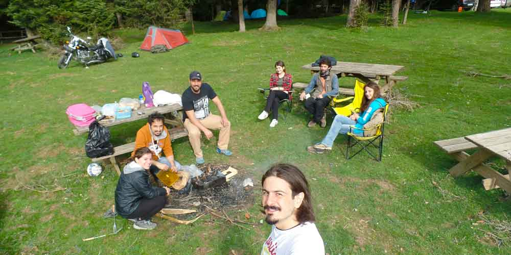
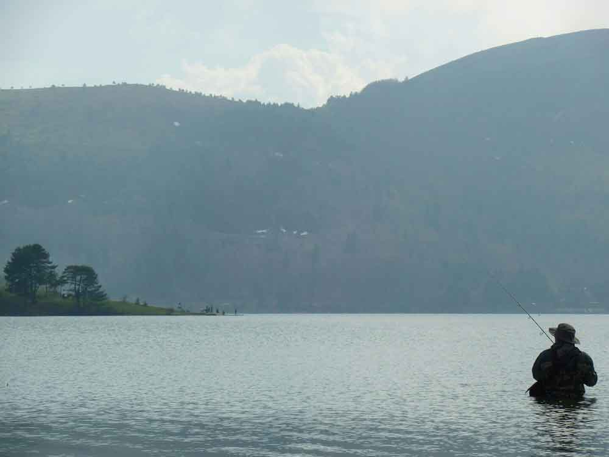

I hadn’t even started writing and I was right back in the mood I’d been in that day. Expect a fair bit of grumbling, anger and frustration.

Abant; we’ll hear about it from our friends, see it in the photos they share, and say, “How wonderful it would be to go there someday, if we could.”

Should we really go to Abant? Should we camp at Abant?

If you’ve been to Abant, your rebellion against national parks is ten times stronger than mine. Sure, you’re protecting nature. But if Abant weren’t a national park, people would have trashed it. We know that. So why are you turning this into a robbery? Let me answer these questions by telling you what happened to me.

Date: 1 May 2015, a Friday (oh, what a lovely three-day holiday!) On a beautiful sunny day, I set off for Abant. As I approached Abant, just about to arrive, a queue of vehicles started forming. There was a comfortable 500 metres to go. Luckily, I was going by motorcycle, so I didn’t have to join the queue. The official at the gate didn’t charge me because I was on a motorcycle, and I passed through. I stepped inside and what do you know? It was a family day here. It was so crowded that traffic was gridlocked on the road around Abant Lake, and you were left having to wait. Should you pay an entrance fee? I think you should; after all, a service is being provided here, and it’s normal to charge a fee for the preservation of nature (I think it was 15TL for a car). The nature is very beautiful. It’s so beautiful that you’re left in awe. But there’s a crowd – people and cars are bursting out from everywhere. One bus doesn’t even leave before another one arrives, and 50 people burst in with a “hurrah!” For a moment, I felt like I was in *The Walking Dead* (those who’ve seen it will understand). What can people do? They’ve come to see and explore, just like me. Coming here on a weekend is a bad choice. Come during the week and enjoy it in peace. I can’t describe its natural beauties; I can’t even form the right sentences. I don’t have that kind of vocabulary. Anyway, that’s the general situation. Go and see. It’s a natural beauty worth seeing. Even stay overnight and take a walk around the lake in the evening.

Abant Gölü Camping Area

As for the campsite, it was all too crowded for me. I can’t help feeling overwhelmed. I’d come looking for peace and quiet, and look what I found. Pretty as it was, I told myself it wasn’t worth the ordeal. I was about to drive straight past the campsite when I thought I’d have a look. The devil must have put me up to it. It’s a broad fenced area a little higher than the lake. Apart from 1 or 2 tents there was nobody there, none of the racket from the lakeside and no barbecue smoke. “All right, İbrahim, you’re staying here tonight,” I told myself and settled in straight away. The campsite is nice enough and has benches. There are toilets, showers, a kitchen and electricity. But the building with the toilets, showers and kitchen was so filthy that even a dog wouldn’t stay in it. The excuse was that the season had just opened, maintenance was still to come and so on. Then the attendant wanted 27 TL for my tent! It’s barely the size of a coffin, and there’s only me. What do you mean, 27 lira? You can see the state of the toilet building, and there’s not even clean water. I had to go all the way down to the fountain. The attendant kept making excuses and said he wouldn’t charge me next time. I said I wasn’t against a fee, but why 27 lira for 1 person with a tiny tent? He said it had been 15 last year, they’d put it up to 27 this year and he had to charge it. What a jump, almost a hundred percent. My pay hadn’t gone up that much that year. It hadn’t even kept up with inflation. Nice business you’ve got there. After I asked whether it cost 27 for a person on their own in 1 tent and still 27 for 6 people in a tent, he said yes. It’s daylight robbery. Pay to get in. Pay to pitch. What will they charge for next? I’d had it with the national parks. I’m not coming back and I’ll tell people everywhere. They use the national park label to charge as much as they can. Oh, and fires are banned, too. What sort of campsite is this? No fire, no water, nothing.

Where should you set up camp at Abant Lake?

Take the TEM motorway and continue straight after entering Abant. Pass the Abant Palace hotel on your right. Before the main road bends left around the lake, take the right fork and continue straight through the forest. Ahead are three highlands: Örencik, Sarıyer and Pelitözü. A vast meadow will greet you. Go and pitch your tent there. Provided you protect nature and don’t litter, don’t go overboard with the money. Or, go with six people and pitch just one tent :)