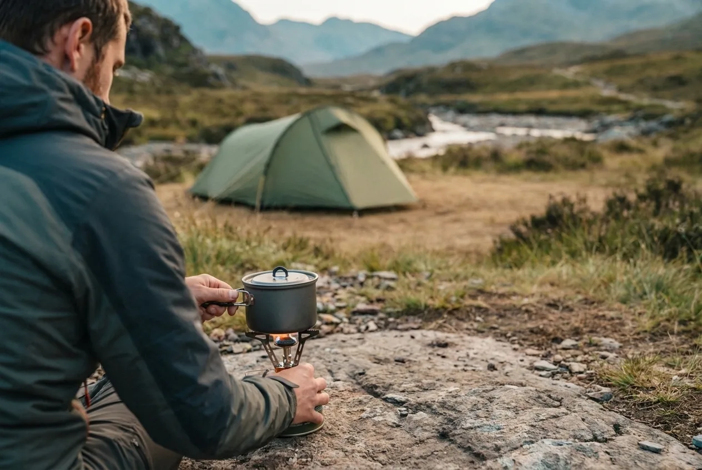

Is camping in nature safe? If you need to answer in one sentence, safety depends on where you are camping and the conditions on that particular day. An area that is dry and calm one week might be safe, but it may not be a good choice on a day with strong winds, heavy rain, or a risk of fire.

Do not only associate safety with interactions with strangers or wild animals. Incorrect camping locations, bad weather, dehydration, getting lost, fire, and equipment malfunctions are just as important as other risks. For beginners, the goal is not to create fear, but to establish a simple system of checks to facilitate decision-making.

Going camping alone, as a couple, or with a family changes the assessment. The experience, health condition, and ability to withstand the weather of those with you are all part of the plan. Before going camping, leave a trusted person with your location, your return time, and how you will notify them if the plan changes.

## How do you determine if a campsite is safe?

When choosing a camping spot, first find out whether camping is permitted there. Rules differ in national parks, nature parks, forests, and private properties. In some areas, only designated camping areas may be available, and access to the forest, setting up a tent, or building a fire may be restricted at certain times. Do not assume that an old camping review found online is still valid.

Then, pay attention to the following details:

A beautiful view alone is not enough; be sure to check transportation, ground conditions, and, if needed, exit options.

- Is there a way out if the weather turns bad?
- Is the ground dry, level and clear of flood risk?
- Could a branch, a rock or anything else fall on the tent?
- Where can I find water, use a toilet or get a phone signal?
- Is there a business, a main road, a health centre or somewhere else you can ask for help nearby?

Starting with a designated, managed area or a location that’s easily accessible, with clear rules, is often a better initial choice. Distance alone isn’t a measure of safety.

## Is there a difference between a settlement, a picnic area, and a highland?

One advantage of being in a location close to a settlement is the ease of access to transportation and assistance. However, a disadvantage can be overcrowding, noise, nighttime use, or the behavior of the people sharing the area with you. It is not correct to collectively consider people as dangerous; however, if you feel uncomfortable or threatened, you don’t need a specific reason to move your camping spot.

Camping in the highlands isn’t necessarily safe or unsafe on its own. Consider the habits of the local population, changes in the weather, water conditions, and the vehicle’s ability to leave. It’s important to secure the tent if the highlands are open and windy, to monitor nighttime temperatures, and to learn about road conditions after rainfall.

## Is camping in a remote location inherently safer?

Solitude can mean peace for some people; however, it is not an automatic advantage from a safety perspective. The remoteness of assistance, the lack of cell phone signal, a road becoming impassable, or the inability to return if the weather changes can all increase the risk. If you’re looking for solitude on your first camping trip, choose a location that maintains complete communication and accessibility, without isolating you.

Observe the animals in the camping area from a distance; do not approach them, do not feed them, and do not leave food within their reach.

Do not leave food exposed at the campsite, do not feed the animals, and do not let food smells build up inside the tent. If you see animals, do not approach them, do not chase them for photos, and follow all official warnings for the area you are in. Saying “Nothing will happen to me” or “every animal attacks” is not a good safety plan.

## How do you check the weather and the ground?

Before heading to the campsite, be sure to check the hourly and five-day weather forecast. Wind, heavy rain, thunder, and nighttime temperatures are particularly important. The city center’s forecast may not accurately describe the campsite; altitude and open terrain conditions can make a difference.

Before setting up the tent, carefully check the flow of the water, loose rocks, wind, and any natural risks in the surrounding area.

Keep your tent out of streambeds and runoff channels, away from loose rock overhead and from trees with dead branches over your pitch. Ground that’s level and dry now can still be in the path of rainwater. Aim to arrive in daylight so you can see where you’re pitching.

## What should you check before using a campfire or stove?

Check whether fires are allowed at that spot on the day you visit. Wildfire risk and local restrictions change. If there’s a ban, don’t light a fire. Where fires are allowed, use the designated hearths or fire areas. Leave forest wood where it is, stay with the fire, and make sure the embers are completely out before you leave.

*Keep your stove away from the tent and anything flammable. Set it down on level ground where it won’t tip.*

Never use a fuel-burning stove inside the tent, in the doorway or in an enclosed porch. Set it up on level ground away from anything flammable and follow the manufacturer’s instructions. If the wind picks up, it’s smarter to change the menu than pick a fight with the flames. For more on fires, see my [campfire safety tips](/guvenli-kamp-atesi-icin-en-iyi-10-ipucu/).

## What is the first thing you should consider in an emergency?

Before you go running off in a panic, check where you are, what the weather’s doing and how everyone is. If you have a signal, share your location. If you don’t, follow the route and return plan you worked out beforehand. Resist the urge to head for high or open ground at random.

*Don't just rely on your phone for the route, location sharing, and return plan before the hike.*

If any of the following are present, you do not need to continue the camp:

- If the weather deteriorates faster and more severely than expected
- If your tent or heating system is not suitable for the conditions
- If a person is injured, feels cold, or has lost their way,
- If your water, food, or medication plan is inadequate,
- If there is a risk of fire, flood, or landslide…

Turning back is sometimes the best decision you can make outdoors.

## How can outdoor camping safety be summarized?

For your first camping trip, choose a location that’s easy to reach, with clear rules, where you can monitor the weather, and where you can leave if needed. Share your location with someone you know. Check the rules for fires and stoves, store food properly, do not approach animals, and be prepared to change your plans if the weather gets worse.

Take the risks seriously without letting them frighten you out of going. Things may be different next time, even if you’ve always been fine here before. A little preparation leaves a lot less to chance.

What factor most influences your safety when camping: the weather, the campsite itself, transportation, crowd size, or solitude? If you share your experiences and camping conditions in the comments, you can provide a valuable reference for beginners.
