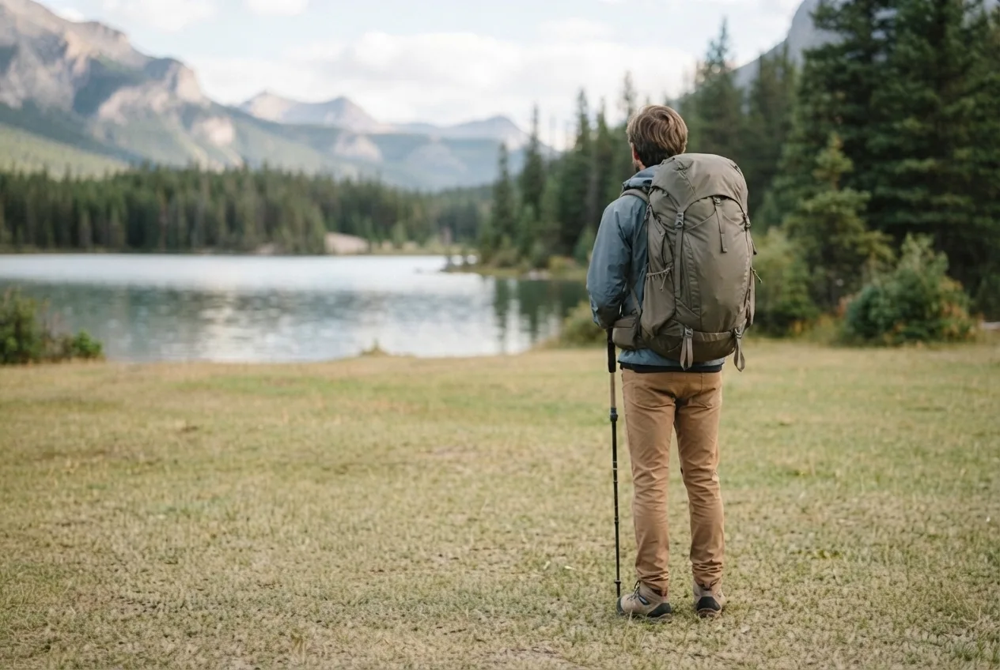
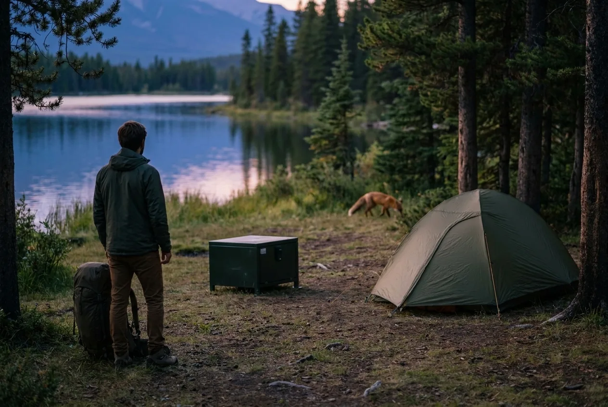
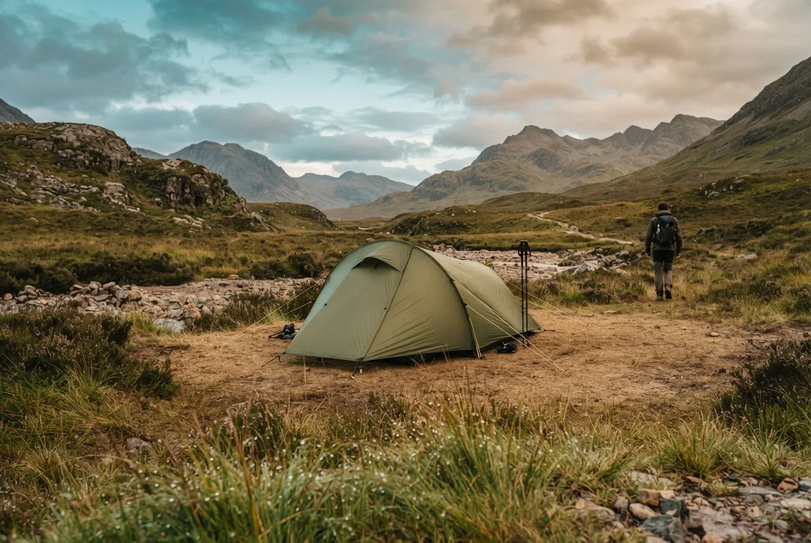
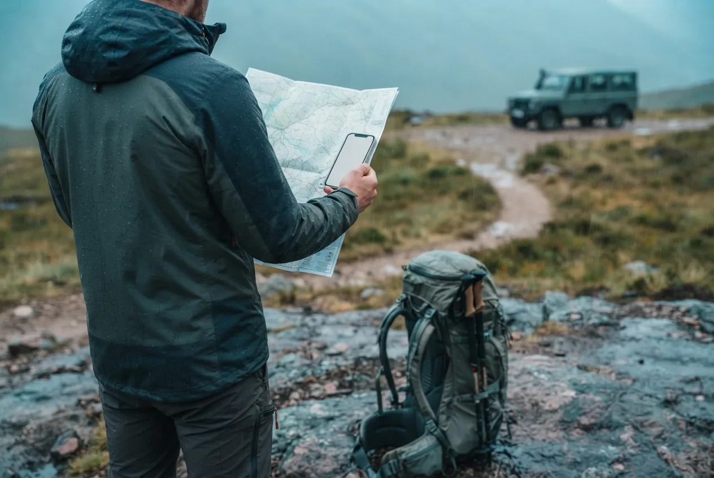

Is camping in nature safe? If you need to answer in one sentence, safety depends on where you are camping and the conditions on that particular day. An area that is dry and calm one week might be safe, but it may not be a good choice on a day with strong winds, heavy rain, or a risk of fire.

Do not only associate safety with interactions with strangers or wild animals. Incorrect camping locations, bad weather, dehydration, getting lost, fire, and equipment malfunctions are just as important as other risks. For beginners, the goal is not to create fear, but to establish a simple system of checks to facilitate decision-making.

Going camping alone, with one or more people, or with a family changes the experience. The experience of the people accompanying you, their health condition, and their ability to withstand the weather are all part of the plan. Before going camping, tell a trusted person where you will be, when you will return, and how you will let them know if the plan changes.

## How do you determine if a campsite is safe?

When choosing a camping spot, first find out whether camping is permitted there. Rules differ in national parks, nature parks, forests, and private properties. In some areas, only designated camping areas may be available, and access to the forest, setting up a tent, or building a fire may be restricted at certain times. Do not assume that an old camping review found online is still valid.

Then, pay attention to the following details:

A beautiful view alone is not enough; be sure to check transportation, ground conditions, and, if needed, exit options.

- Is there a way to evacuate if the weather is bad?
- The subgrade is free from flat and over-flow risk?
- Could a tent, a rock, or another object fall onto the tent?
- Where is water, a toilet, and communication facilities?
- Is there a business, roadside location, healthcare facility, or place where you can request assistance nearby?

Starting with a designated, managed area or a location that’s easily accessible, with clear rules, is often a better initial choice. Distance alone isn’t a measure of safety.

## Is there a difference between a settlement, a picnic area, and a highland?

One advantage of being in a location close to a settlement is the ease of access to transportation and assistance. However, a disadvantage can be overcrowding, noise, nighttime use, or the behavior of the people sharing the area with you. It is not correct to collectively consider people as dangerous; however, if you feel uncomfortable or threatened, you don’t need a specific reason to move your camping spot.

Camping in the highlands isn’t necessarily safe or unsafe on its own. Consider the habits of the local population, changes in the weather, water conditions, and the vehicle’s ability to leave. It’s important to secure the tent if the highlands are open and windy, to monitor nighttime temperatures, and to learn about road conditions after rainfall.

## Is camping in a remote location inherently safer?

Solitude can mean peace for some people; however, it is not an automatic advantage from a safety perspective. The remoteness of assistance, the lack of cell phone signal, a road becoming impassable, or the inability to return if the weather changes can all increase the risk. If you’re looking for solitude on your first camping trip, choose a location that maintains complete communication and accessibility, without isolating you.

Observe the animals in the camping area from a distance; do not approach them, do not feed them, and do not leave food within their reach.

Do not leave food exposed at the campsite, do not feed the animals, and do not accumulate food smells inside the tent. If you see animals, do not approach them, do not follow them for photos, and follow all official warnings for the area you are in. Saying “Nothing will happen to me” or “every animal attacks” is not a good safety plan.

## How do you check the air and ground safety?

Before heading to the campsite, be sure to check the hourly and five-day weather forecast. Wind, heavy rain, thunder, and nighttime temperatures are particularly important. The city center’s forecast may not accurately describe the campsite; altitude and open terrain conditions can make a difference.

Before setting up the tent, carefully check the flow of the water, loose rocks, wind, and any natural risks in the surrounding area.

Do not set up your tent near streams, along the flow of water, beneath loose rocks, or under dry branches. It’s also important to consider where water will flow after rain, just as much as it is to set up on dry, level ground. If possible, set up your camp in daylight to avoid having to set up in the dark.

## What should you do when using fire and stove?

First, check whether a fire was permitted on that day and in that area. The risk of forest fires and local restrictions can change periodically. If a fire is not permitted, do not build a fire; if it is permitted, use only designated fireplaces or areas. Gathering wood from the forest, leaving a fire unattended, and departing without completely extinguishing the embers is not good camping.

Keep it away from your hearth/fire and home, on a level surface that won’t roll, and keep it separate from flammable materials.

Do not use the fuel stove inside the tent, at the entrance, or in the enclosed luggage compartment. Operate it on a flat surface where it won’t tip over, away from flammable materials, and in accordance with the manufacturer’s instructions. If the wind strengthens, it’s wiser to change your meal plan than to argue with the fire. For more detailed information about campfires, you can see [safe campfire tips](/guvenli-kamp-atesi-icin-en-iyi-10-ipucu/).

## What is the first thing you should consider in an emergency?

Before starting to panic, check your surroundings, the weather conditions, and the people around you. If your phone is working, share your location. Instead of randomly going to a higher or open area, use the route and return plan you’ve already determined, if your phone isn’t working.

*Don't just rely on your phone for the route, location sharing, and return plan before the hike.*

If any of the following are present, you do not need to continue the camp:

- If the weather deteriorates faster and more severely than expected
- If your tent or heating system is not suitable for the conditions
- If a person is injured, feels cold, or has lost their way,
- If your water, food, or medication plan is inadequate,
- If there is a risk of fire, flood, or landslide…

Returning from a trip isn't failure. Sometimes, the best decision is to end the plan early, in nature.

## How can outdoor camping safety be summarized?

For your first camping trip, choose a location that’s easy to reach, with clear rules, where you can monitor the weather, and where you can leave if needed. Share your location with someone you know. Check the rules for fires and stoves, store food properly, do not approach animals, and be prepared to change your plans if the weather gets worse.

Natural camping safety involves preparation without fear, but without disregarding it. The fact that you haven’t experienced problems in the past doesn’t guarantee that the next situation will be the same; however, proper preparation significantly reduces uncertainty.

What factor most influences your safety when camping: the weather, the campsite itself, transportation, crowd size, or solitude? If you share your experiences and camping conditions in the comments, you can provide a valuable reference for beginners.
