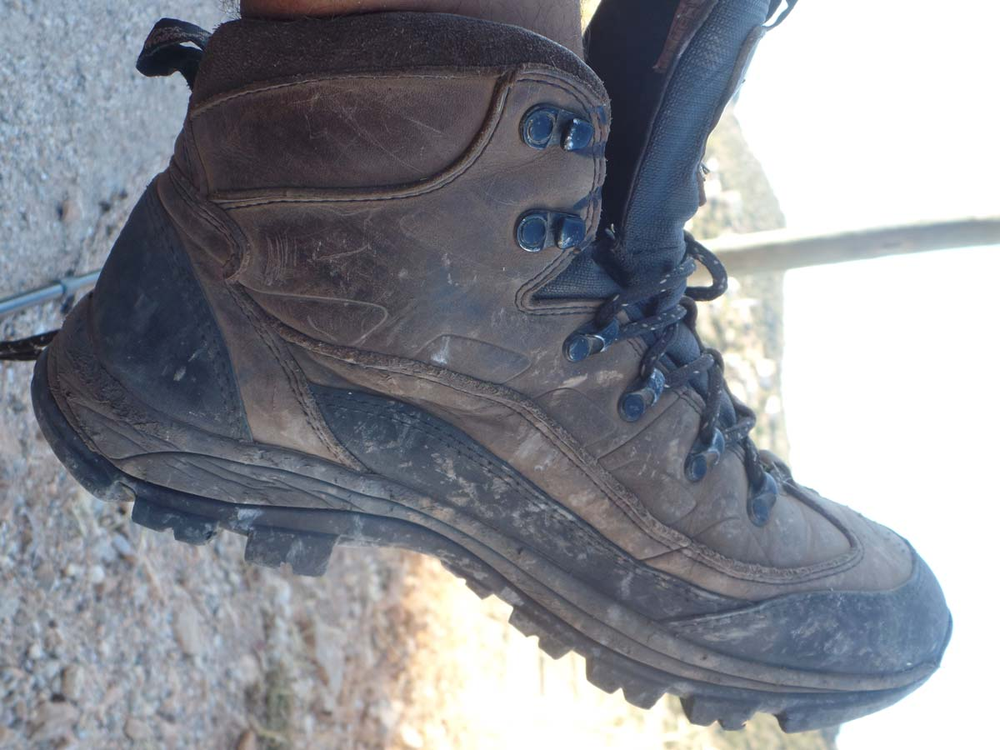

In 2014, I bought these boots from Hepsiburada for 75 TL, and I’m still using them. The 75 TL bit is a bit of a story, though. There’s a whole tale about how I got them at that price: in short, I happened to stumble across a promotion, and I didn’t miss the chance to buy them when I did. In fact, I keep telling myself I wish I’d bought two pairs today.

My first trekking boots, and my first love. I still wear them, but they’re in a pretty rough state. I must have walked about 400 km in them. They’re a bit worn out, and that’s my fault. Boots shouldn’t give up at that distance. Call it ignorance: a few times when they got dirty, I put them in the washing machine on the hand-wash setting. I wondered what harm hand-washing could do. The boots no longer keep water out. The sole has come apart a little, and water gets in through the gap. We glued it back together, but it still lets water through now and then. The tread has worn down a lot. There’s a big difference from when they were new, though they look as if they might do another 300 km. They still feel just as comfortable. They only let me down in rain and at stream crossings. I used to splash straight through with no trouble. Now I avoid the water.

I love these boots and I’d happily recommend them. When I put them on I feel like nothing can happen to my feet, like my ankles could take anything. If I haven’t worn them in a while, that first step is always, “Ohhh, I’ve missed you.” I’m buying a new pair this year, but I haven’t made up my mind yet. I’d buy these again, although I’m looking at other brands just to try something different. There’s the budget too. Dropping 500–600 TL on boots in one go is a bit of a stretch. If I find them for 75 TL again, that’s another story. I’ll take five pairs :)

You can also read [How to Choose Trekking Shoes](/trekking-ayakkabisi-nasil-olmali/).

