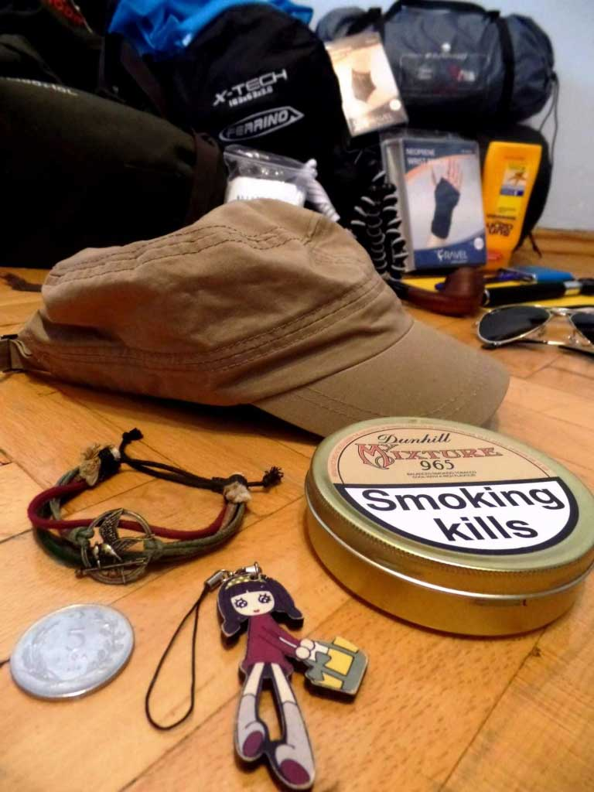

This note, prepared one day before my 2014 Lycia Trail hike, with a target of 509 km and a duration of 21 days, records why I chose this particular route and my expectations before setting off.

## The day before setting off

29 August 2014

Everyone has a story to tell. Mine, however, begins on September 20th.

\*Everyone has a story to tell. Mine begins on September 20.

### Why the Lycian Road?

I first heard of it in October 2013. Once I’d looked into the trail and seen some of the scenery, it started to draw me in. For someone who loves nature and trekking as much as I do, it looked perfect. I thought you might get to do something that changes your life like this once or 2 times. So I decided. 1 man, 21 days, 509 km. That would be my story.

### Who went to the Lycian Road?

Who hasn't missed it, right? :). You can find a lot of information and resources online. I’ll be sharing my research on **Yola Çıkmalı** soon. There are many people who complete this route in segments, but I haven’t yet seen anyone who completes it in one go, but there certainly must be someone.

Likya Trail Preparations

In February, I started exercising to improve my physical strength. I have been doing cardio and strength training regularly for 7 months. Because I planned to walk approximately 30km a day – 4 days of walking and 1 day of rest – I needed to increase my physical strength. Currently, I can comfortably walk 30km a day, but I am curious to see how this process will unfold over the next 21 days. Today is August 18th, and I have approximately one month left to set off. The route is clear, but I don’t yet know where I will be staying. During the remaining month, I will determine where to set up my tents and gain extensive knowledge about the route itself.

When I hear your name, I get really excited, and my eyes sparkle. Even though it’s only been about one month, I feel like I don’t have much time left for preparations. I guess it’s just because of the excitement :)

I’m continuing with the preparations. I will share more detailed information once they are completed.

\*Never give up on your dreams!
