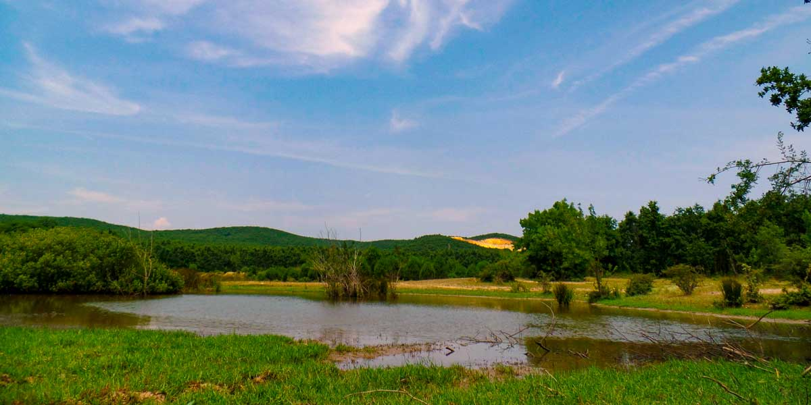
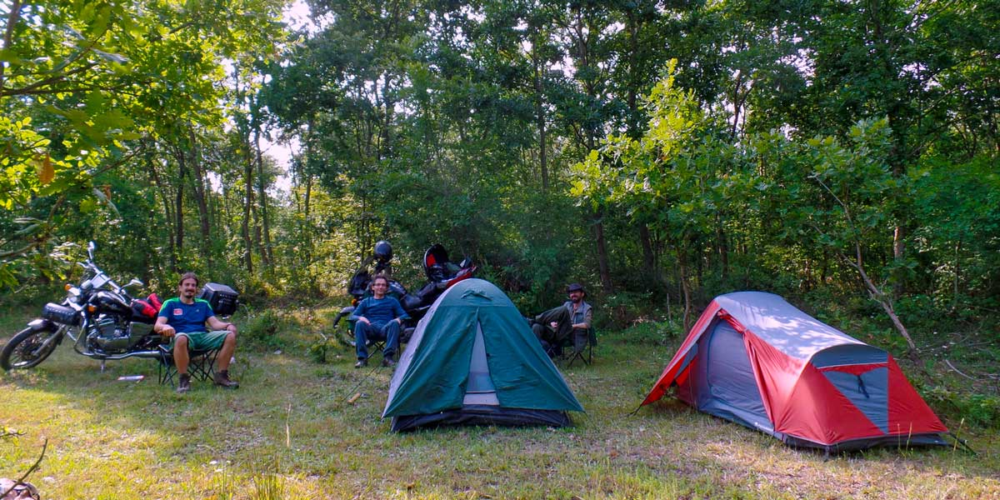

You can find directions to Karacaköy Göleti, information on camping facilities, and nearby hiking routes in this guide. The information on the site is based on my observations from 2015.

## Quick summary

- **Region:** İstanbul, Çatalca–Karacaköy area
- **Camp:** Natural area not in use; suitable flat areas around a pond and stream.
- Routes: four options ranging from 1.6 km to 13.3 km
- Field observation: July 2015

> Update note: Vehicle crossings, stream levels, camping permits, fire restrictions, and facility status may vary. Check the weather and local announcements before you go; do not attempt stream crossings when water levels are high.

## Karacaköy Göleti: Where is it and how do you get there?

You will follow the route starting from İstanbul, passing through Çatalca, and then to Danamandıra. After passing the Danamandıra crossroads immediately, you will turn onto the road leading to Karamandere on the right. You will travel on a beautiful, paved road up to this point. From here on, the road is paved but slightly rough. After passing the Karamandere crossroads (you will not enter Karamandere), you will continue towards Karacaköy. When you get close to the Karacaköy lake, you will cross a bridge. Then, immediately turn right and follow the road into the forest to reach the stream’s edge. To reach the lake, you will need to cross the stream. If your vehicle has high ground clearance, you can easily pass here.

<iframe
  class='mappingFrame'
  src='https://www.google.com/maps/embed?pb=!1m22!1m8!1m3!1d168751.54515777374!2d28.4370009!3d41.2500756!3m2!1i1024!2i768!4f13.1!4m11!3e6!4m5!1s0x14b5453ec13a5ca5%3A0xbf8d4d9384d2cd81!2zw4dhdGFsY2EsIFTDvHJraXll!3m2!1d41.142258999999996!2d28.457469!4m3!3m2!1d41.3922969!2d28.3356119!5e1!3m2!1str!2s!4v1437142320620'
  width='300'
  height='150'
></iframe>

 

## Karacaköy Göleti camping area information

### Available facilities

- Camping Area (You can set up your tent in the flat areas you find. There are no private businesses.)
- On the map below, I have indicated our camping spot and a suitable camping area.
- You can descend from the dirt road and set up a tent by the lake shore. However, because so many day-trippers come here, you may not find much peace.
- Clean Water (There are fountains along the main road of Karamandere)

### Facilities that are unavailable

- Grocery shop
- Restaurant
- Café

Note: This information dates back to July 2015.

## Karacaköy Göleti hiking routes

### Karacaköy Göleti and the corn fields (1.6 km)

<iframe
  frameBorder='0'
  scrolling='no'
  src='https://tr.wikiloc.com/wikiloc/spatialArtifacts.do?event=view&id=10226418&measures=on&title=on&near=off&images=on&maptype=H'
  width='100%'
  height='600'
  style={{ borderRadius: '10px 10px' }}
></iframe>

- I started my camping trip from the place I began. Following a dirt path, I entered the forest. After reaching the cornfields, I tried to reach Karacaköy pond, moving from side to side. However, when I couldn't cross the stream, I turned back.
- The parkrun is short, and there’s no drinking water available along the route.
- The sound of many jackals came during the night, but they didn’t approach closely.

### From Karamandere Village to Mandıra Creek and return (12.5 km)

<iframe
  frameBorder='0'
  scrolling='no'
  src='https://tr.wikiloc.com/wikiloc/spatialArtifacts.do?event=view&id=7037680&measures=on&title=on&near=off&images=on&maptype=H'
  width='100%'
  height='600'
  style={{ borderRadius: '10px 10px' }}
></iframe>

- The route begins after passing through Karamandere village. The trail continues on an unpaved path through the forest, following alongside the Mandıra stream before circling back to its starting point.
- It’s an easy course.
- In the park, there’s no water source. You should collect your water in the village before starting the route.

### From Karamandere Village, to Mandıra Stream and Gümüşpınar (12.6 km)

<iframe
  frameBorder='0'
  scrolling='no'
  src='https://tr.wikiloc.com/wikiloc/spatialArtifacts.do?event=view&id=1373421&measures=on&title=on&near=off&images=on&maptype=H'
  width='100%'
  height='600'
  style={{ borderRadius: '10px 10px' }}
></iframe>

- The route begins after passing through Karamandere village. The trail continues on an unpaved path through the forest, following alongside the Mandıra stream, and eventually ends in Gümüşpınar village.
- It’s an easy course.
- In the park, there’s no water source. You should collect your water in the village before starting the route.

### Belgrad Köyü area (13.3 km)

<iframe
  frameBorder='0'
  scrolling='no'
  src='https://tr.wikiloc.com/wikiloc/spatialArtifacts.do?event=view&id=10000613&measures=on&title=on&near=off&images=on&maptype=H'
  width='100%'
  height='600'
  style={{ borderRadius: '10px 10px' }}
></iframe>

- The trail begins in Belgrat village. It follows a dirt path within the forest, tracing a circular route and returning to the village.
- It’s an easy course.
- In the park, there’s no water source. You should collect your water in the village before starting the route.

## Nearby camping and preparation guides

- For the trails around the lake in Kocaeli, refer to the guide for [Gebze Denizli Göleti](/gebze-denizli-goleti/).
- Examine the guide for [Acelle Valley](/acelle-yaylasi/) for camping in the countryside and longer hikes.
- Transition to the article: “[What Is a Buff and How Do You Use It?](/buff-nedir-ne-ise-yarar/)” – a versatile accessory for dealing with changes in weather.
