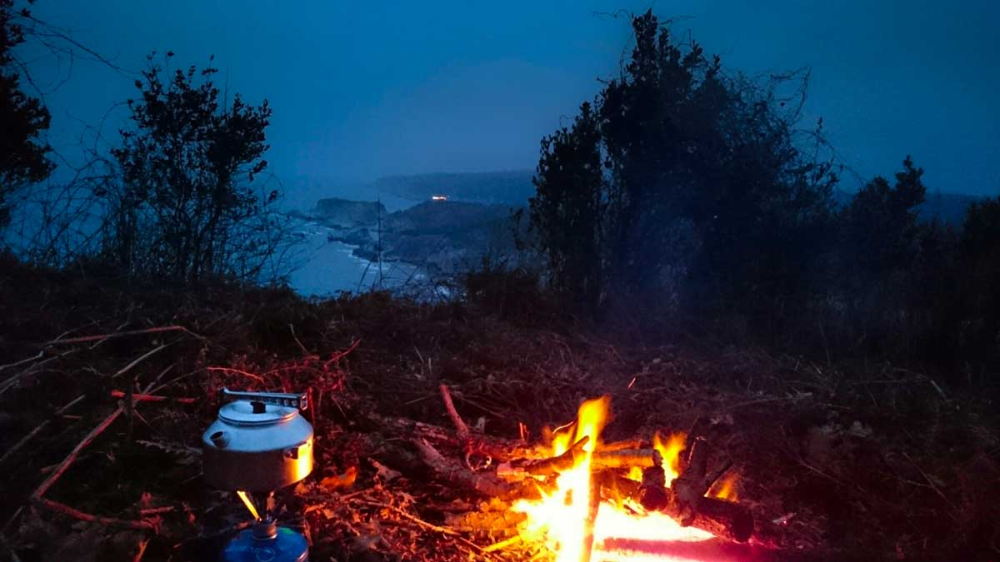

### Where is Kilimli Bay, and how do you get there?

Once you reach Ağva from İstanbul or Kocaeli, it’s easy to get to Kilimli Bay. Follow the coastal Dikbucak road from Ağva towards Kerpe and look for the signs for Kilimli Bay. It’s a beautiful spot just outside Ağva and doesn’t take long to reach.

<iframe
  class='mappingFrame'
  src='https://www.google.com/maps/embed?pb=!1m22!1m12!1m3!1d11618.123949528164!2d29.86686961981396!3d41.13786220898904!2m3!1f0!2f0!3f0!3m2!1i1024!2i768!4f13.1!4m7!1i0!3e6!4m3!3m2!1d41.140783!2d29.8713052!4m0!5e1!3m2!1str!2s!4v1425898013348'
  width='300'
  height='150'
></iframe>

 

### Camping at Kilimli Bay

##### Available facilities

- There is no camping area in Kilimli Cove. You can set up your tent and stay within the forest.
- Restaurant (Kilimli Restaurant)
- WC (Kilimli Restaurant)

##### Facilities that are unavailable

- Guesthouse
- Clean Water (Please bring with you)
- Groceries (stock up in Ağva).
- Guesthouse

Note: This information dates back to March 2015.

### Hiking Routes at Kilimli Bay

#### From Ağva to Kilimli Cove (11 km)

<iframe
  frameBorder='0'
  scrolling='no'
  src='https://tr.wikiloc.com/wikiloc/spatialArtifacts.do?event=view&id=8966397&measures=on&title=on&near=off&images=on&maptype=H'
  width='100%'
  height='600'
  style={{ borderRadius: '10px 10px' }}
></iframe>

- The route begins within Ağva, proceeding along the roadside. After crossing the bridge, the path continues on a dirt road, leading to Kilimli bay. Then, the route continues through the forest, eventually reaching the point where Ağva is visible. Following a walking trail along the coast, the path returns to Kilimli bay. Finally, the route leads back to Ağva via the road.
- If you go after heavy rain or immediately after a rain shower, you will get very muddy, soaking through.
- As you are moving along the coast, there is a dangerous area you need to pass through, going past the rocks. Be especially careful, as the rocks become slippery after rain.
- There are no water sources on the trail.
- The route is marked with red and white paint and signs.
- You can find food and drinks at the restaurant located in Kilimli bay.
- It’s a pleasant, beautiful, and easy course.
