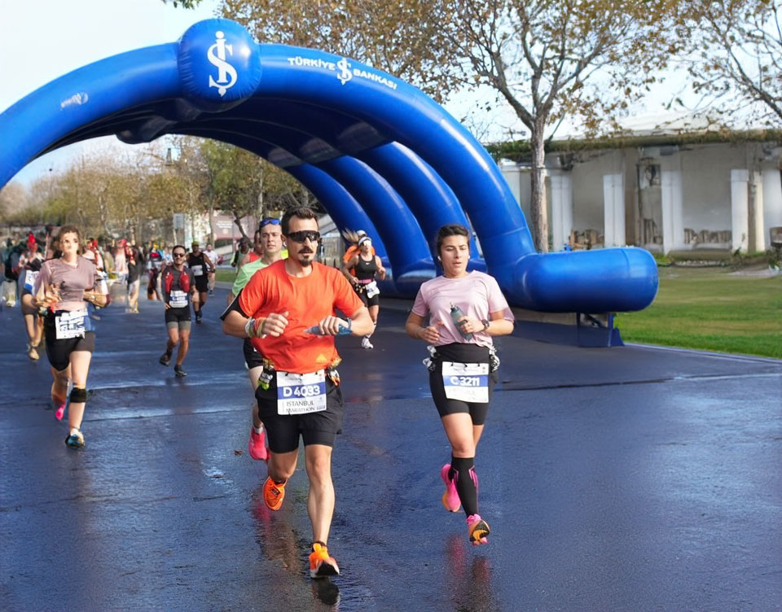

I’m at 32 kilometers, and I’m trying to keep moving, but it’s not working. I tell myself to walk and then jog, and I manage to go another 1-2 km, but it just doesn’t continue. I keep trying, I keep saying, “maybe this time it will work,” and I’m pushing myself, but I can’t take a step. It feels like I’m banging against a wall; my legs are rigid, and I don’t know what to do – I’m hitting a new low, I’m aware, I’m desperate, and I’m just looking for a way out…

The idea of running my first marathon (42km) in the 100th anniversary of the Republic of Türkiye with Aydan excited me greatly. I immediately said, "I can do it," because it would be a special race for me. I began marathon preparations ten weeks before the race. Yes, a short period, but I was in good condition. I was comfortably covering 40–50km per week. I told myself that if I made those ten weeks count, I would be ready, but that did not happen. Two weeks were lost to illness. Eight weeks was far too short a period. However, I was stubborn and determined to enter this race. I kept telling myself that if necessary, I would finish the last 10km on foot. And, the weeks flew by, and the day of the race arrived. I had flown from London to İstanbul the day before the race and managed to sleep only three hours. The reason I slept only three hours was the three-hour time difference between London and İstanbul, and I had overslept by a little. I could not sleep. Aydan reis had run another marathon two weeks earlier. She was undecided about running a second marathon in such a short time, but we said, "We will do it," and she went for it. She was the sharp knife, and I was the potato.

The runners took their places and the starting signal sounded. We set off pounding along at a 5-minute pace per kilometre, or 12 km an hour. For the first 10 km we laughed, had fun and waved back at people. It was brilliant and flew by. We kept up the pace, but at kilometre 29 I noticed myself slowing down and told Aydan to save himself. “I won’t hold you back. You’re going well. I’ll come along a bit more slowly.” He reminded me to take a gel every 6 km, then hit the turbo and was gone. It was just me against myself. I went another 3 km. At kilometre 32 it all hit me at once: the mental slump, cramps, heat, fatigue, helplessness and rock bottom. Isn’t that how every difficult period in life feels? Everything piles up all at once. You hit a wall or feel like a fish out of water. You have no idea what to do.

For years, my legs had carried me everywhere, and they wouldn't let me stop for even a moment. They would say, "Yeter artık be adam" – "That's enough, man." But as my brain urged, "Beyin yaparsın" – "Just let the brain do it" – my body resisted. My eyes were searching for a taxi to trick my brain. I had once hit the bottom, I was aware of it, and I told myself I would finish by walking, but it wasn't happening. My feet wouldn't lift from the ground. Getting into a taxi to escape wasn't an option for me, but a kind invitation from the side was. After struggling with myself for 3km, I stopped at the first water station. Sometimes, when you are helpless and don't know what to do, all you need to do is stop. That's what I did. I washed myself from head to toe, performed stretching movements after massaging my legs, and, taking my first step, tried running again. Seeing that my body, which was resisting my brain, was listening to me, running had begun anew for me. While I was passing 200 metres, I saw a group aiming to finish in 4 hours. "Yavrum Ibrahim, takıl peşlerine yoksa bu 7km bitmez," I said, and I did not leave the group. An interesting coincidence was that Mahmut Yavuz, whom we had been friends with for years through social media, was leading the 4-hour group. Our first meeting had also been while running. Although the last 2km were tough, the finish line was right in front of me. That's where I was, at the end of a start. It was the end of a 42km, containing everything. Time had slowed down. As I watched my steps change into the finish line, all the things I had experienced flowed before my eyes, accompanied by tears. I had finished in exactly 4 hours.

Will I run the marathon again? I don't know, is there really a need for it :)

Will I sink again? Absolutely yes, always, every time.

I hope every time you hit rock bottom, the rebound is this fast.

