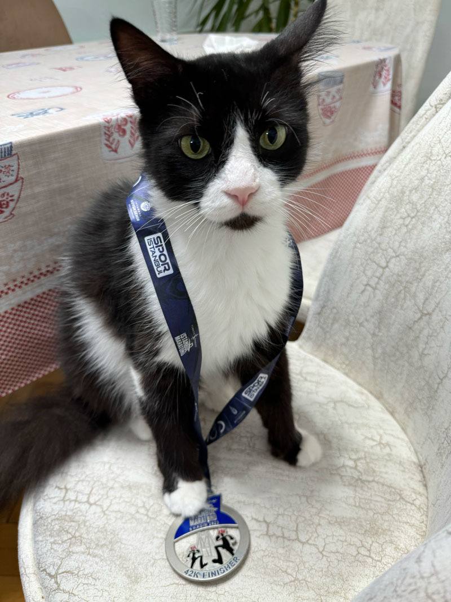

I’m at kilometre 32, trying to force my steps forward, but it’s not working. I tell myself, “Walk a bit, run a bit, maybe you’ll pull yourself together,” and I manage to go another 1–2 km, but then nothing happens. It’s not working. I try, I try again, I tell myself, “Maybe now it will work,” I push myself, but I can’t take a step. It’s like I’ve hit a wall; my legs are frozen stiff, I don’t know what to do, I’m experiencing a new bottoming out, I’m aware of it, I’m helpless, and I’m just looking for a way out…

The idea of running my first marathon (42km) in the 100th anniversary of the Republic of Türkiye with Aydan excited me greatly. I immediately said, "I can do it," because it would be a special race for me. I began marathon preparations ten weeks before the race. Yes, a short period, but I was in good condition. I was comfortably covering 40–50km per week. I told myself that if I made those ten weeks count, I would be ready, but that did not happen. Two weeks were lost to illness. Eight weeks was far too short a period. However, I was stubborn and determined to enter this race. I kept telling myself that if necessary, I would finish the last 10km on foot. And, the weeks flew by, and the day of the race arrived. I had flown from London to İstanbul the day before the race and managed to sleep only three hours. The reason I slept only three hours was the three-hour time difference between London and İstanbul, and I had overslept by a little. I could not sleep. Aydan reis had run another marathon two weeks earlier. She was undecided about running a second marathon in such a short time, but we said, "We will do it," and she went for it. She was the sharp knife, and I was the potato.

The runners took their places and the starting signal sounded. We set off pounding along at a 5-minute pace per kilometre, or 12 km an hour. For the first 10 km we laughed, had fun and waved back at people. It was brilliant and flew by. We kept up the pace, but at kilometre 29 I noticed myself slowing down and told Aydan to save himself. “I won’t hold you back. You’re going well. I’ll come along a bit more slowly.” He reminded me to take a gel every 6 km, then hit the turbo and was gone. It was just me against myself. I went another 3 km. At kilometre 32 it all hit me at once: the mental slump, cramps, heat, fatigue, helplessness and rock bottom. Isn’t that how every difficult period in life feels? Everything piles up all at once. You hit a wall or feel like a fish out of water. You have no idea what to do.

For years, my legs had carried me everywhere, running me to every corner, never once saying "no" to me, yet now they were frozen stiff. They wouldn't let me go. "That's enough, man," they seemed to say. "You can do it, brain," I'd think, but my body resisted. My eyes were searching for a taxi to trick my brain. I had hit rock bottom, I knew it; I told myself I'd finish by walking, but it wasn't happening. My feet wouldn't lift from the ground. Getting into a taxi to escape wasn't my style, but a nice offer from the side was. After 3km of struggling with myself, I stopped at the first water station. Sometimes, when you're helpless and don't know what to do, you just have to stop. That's what I did. I washed myself from head to toe, massaged my legs, did some stretches, and tried running again with my first step. Seeing my body, which had been resisting my brain, finally listen, running had begun anew for me. "Vay be, I can run again!" I thought, but before 200 metres had passed, I looked up and saw a group aiming to finish in 4 hours passing me. "Yavrum Ibrahim, hang on, chase them, otherwise this 7km will never end," I said, and I didn't leave the group. An interesting coincidence: Mahmut Yavuz, a long-distance runner I'd been friends with for years via social media, was leading that 4-hour group. Our first meeting had also been while running. The last 2km were tough, but the finish line was right in front of me. There I was, at the end of a beginning. The end of a 42km containing everything. Time had slowed down. As I watched my steps approach the finish line, all I'd experienced rushed before my eyes, flowing away with tears. I had finished in exactly 4 hours.

Will I run another marathon? Don’t know. Do I really need to? :)

Will I sink again? Absolutely yes, always, every time.

I hope every time you hit rock bottom, the rebound is this fast.

