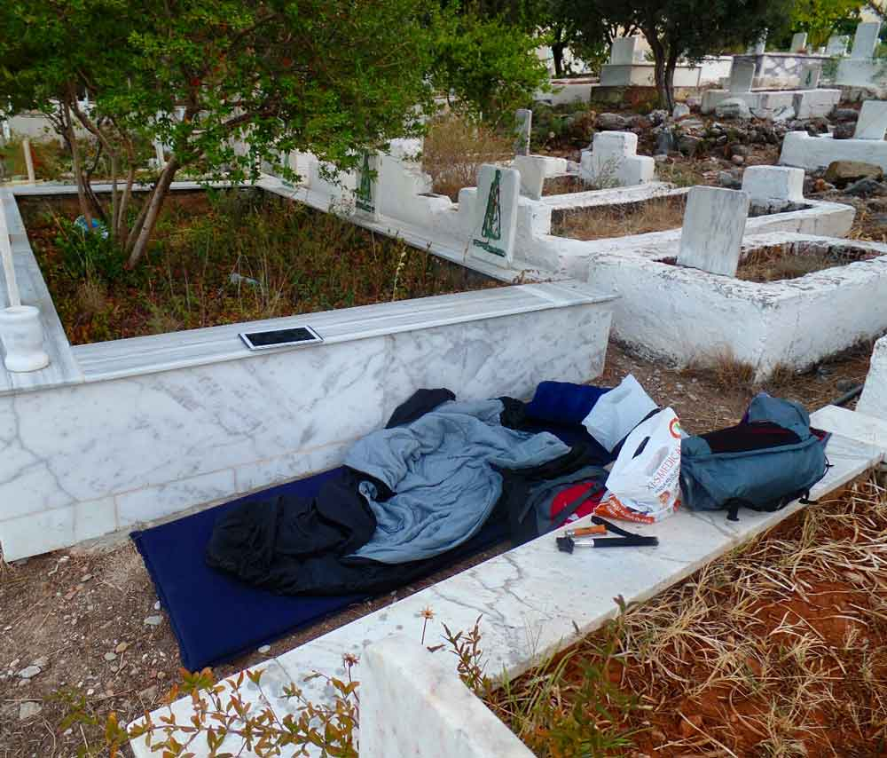

This journal entry, dated September 20, 2014, records my experiences during the first 25 km stage of my Lycian Way hike, from Ölüdeniz to Kabak Koyu.

## 2014 Hiking Log: Quick Notes

> Editorial context: These daily notes were written during a hike in 2014, and the following information summarizes the trip’s itinerary.

- Day: 1
- Date: September 20, 2014
- Etap: Ölüdeniz – Kabak Bay
- Distance: 25 km

### Lycia Trail daily navigation

- [11-Day Hiking Index: Ölüdeniz – Kaleüçağız route](/likya-yolu-11-gunde-yurudugum-parkur/)
- [Main route: 11-stage guide for the Lycian Way](/likya-yolu-rotasi/)
- [Lycian Way Stage 1: Ölüdeniz to Kabak Bay (25 km)](/likya-yolu-rotasi-oludenizden-kabak-koyuna/)
- [Next day: 2nd day – Kabak Bay – Sidyma Ancient City diary](/likya-yolu-2.-gun/)

### LYKIA PATH – DAY 1 (September 20, 2014)

Ölüdeniz → Faralya → Butterfly Valley → Kabak Bay (25 km)

### Adventure starting with “MAZERLIKTA”

The previous night I slept very little, and my arrival in Dalaman was around 23:15. The bus to Fethiye was full, and I was the only one left outside. While waiting for the next bus, I arrived in Fethiye at 12 with a 30-minute delay. When looking for transport to Ölüdeniz, I learned there were no cars at that time. Because I was very tired, I did not bother with a taxi and decided to walk out of Fethiye and set up a tent. I walked for about 45 minutes, but as I was so tired I could not sleep standing up, I imagined falling asleep as soon as possible. On my right I saw a green area, which turned out to be a cemetery. Looking behind me, I saw large open spaces. Deciding to camp in the cemetery, I thought, "If there is going to be an adventure, let it be like this." I entered the cemetery and turned towards the rear. I tried to set up my tent as soon as possible, but the ground was very hard and the stakes were bending. If I could not drive the stakes in, the tent would not stand, and I was at a level where I could not sleep standing up. So, I decided to curl up between two graves, with my sleeping mat and sleeping bag. It was not a very comfortable sleep, but at least I was in a safe place. The temperature was also at a level that would not cause me to shiver. When I fell asleep, it was 2:00 AM. While waiting for a cat or dog, I heard a sound, and when I lifted my head, there were only two graves between us. I made a series of frightened "ssssssss" and the animal ran away. It was a small thing anyway. Then, I fell asleep, hoping for an early morning.

Last year, at this time, my high blood pressure, which I had been tolerating, reappeared three days ago. For three days, I have been experiencing mild dizziness and a sense of discomfort. However, today passed better than the other days. I wouldn't have continued if things had been otherwise. After recovering in the morning, I reached Ölüdeniz by minibus, then set myself at the starting point of the Lycian Trail. I began my walk climbing Babadağ. The elevation gain wasn't excessive, so I hadn't become too fatigued; however, when the thought of the remaining 500 km came to me, I began to wonder what it would be like to do this in 21 days. Without dwelling too deeply on these thoughts, I watched the scenery, telling myself, "Just enjoy the view." The first people I encountered were a family. In fact, I had not met them directly; I had spotted them from a distance. They were carrying a pram on their backs, holding a small bag, and walking together as a family. They were most likely not Turkish. The first people I spoke to were children. I was heading to Antalya, while they were heading to Züheyla to play. Talking to children has done me good. I love them – they are innocent, pure, and clean. There is joy behind their smiles. Afterwards, I met a group of tourists and managed to converse with them using my English. At least, we managed to understand each other :).

When I decided to descend into the Valley of Butterflies, my blood pressure spiked again. My head was pounding. I descended a bit, went a short distance, but then decided to turn back. Because it would have been a waste of time to go down and back up, and also because I was having some sleep problems. I went to the mosque in Faralya and slept for about an hour. I also charged my phone. There was also a cold water tap, which was a nice bonus. This sleep was really good, and after that, I arrived at Kabak koyuna around 5. I had achieved my goal for the first day. First, I went swimming in the sea to wash off, and then I walked a bit into the forest to set up my tent. The weather was warmer than I had anticipated for this time of year. That’s why swimming was really good.

## Guard Dismissal in Kabak Village 

I set up my tent in a secluded spot, and I’m writing down my notes, just to make sure. Two people are coming towards me, apparently having seen the light from my lantern. The guard, along with his young companion, told me that setting up a tent is prohibited, haven’t you seen the signs? I’m walking along the Lycian road, as you can see – I haven’t built a fire, and there’s no preparation for that either. I responded to them, asking, “What’s the reason for this prohibition? What law are you referring to?” The guard seemed surprised, as he didn’t expect such a reaction from me. He seemed to soften a bit, saying, “Well, it seems that there’s a ban on forest operations,” and then he added, “You can set up your tent here and sleep on the beach.” He said that setting up a tent is prohibited, but sleeping is allowed. So, I told him, “Then I’ll take down my tent and sleep in my sleeping bag.” The guard was clearly surprised. He then said, “Sleep on the beach,” and then he started to complain about it. To avoid any further hassle and preserve my enjoyment, I replied, “Let’s just leave it.” I moved to Kabak beach, and said, “It doesn’t matter to me.” “But there’s a man sleeping in the cemetery,” I added. “However, the attitude of the manager is not pleasant.” Furthermore, there’s no legal repercussions. It’s a practice implemented by the local operators. Anyway, it didn’t really matter. Because I was going to sleep while watching the clear blue sky.

Okay, then good night.

Time: 20:03

Additional information: These notes were written during the journey.

---

## Continue walking.

**[Next day: 2nd day – Kabak Cove–Sidyma Ancient City log →](/likya-yolu-2.-gun/)**

[11-day hiking route](/likya-yolu-11-gunde-yurudugum-parkur/)
