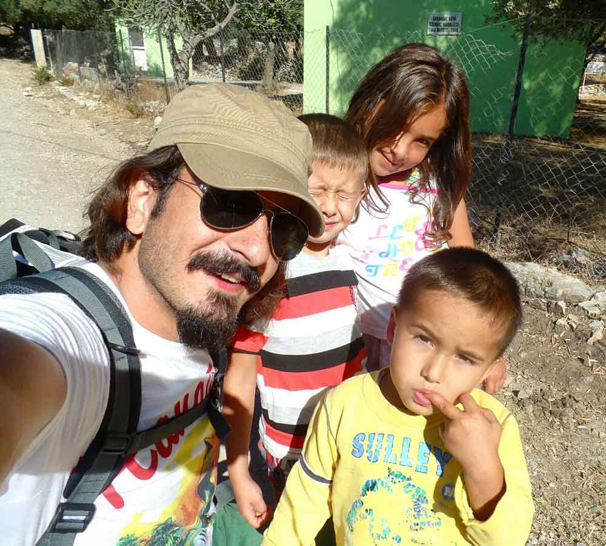

This journal entry, dated September 20, 2014, records my experiences during the first 25 km stage of my Lycian Way hike, from Ölüdeniz to Kabak Bay.

## 2014 Hiking Log: Quick Notes

> Editorial context: These daily notes were written during a hike in 2014, and the following information summarizes the trip’s itinerary.

- Day: 1
- Date: September 20, 2014
- Stage: Ölüdeniz – Kabak Bay
- Distance: 25 km

### Lycian Way journal navigation

- [All 11 days · Ölüdeniz to Kaleüçağız](/likya-yolu-11-gunde-yurudugum-parkur/)
- [Lycian Way route guide · all 11 stages](/likya-yolu-rotasi/)
- [Lycian Way Stage 1: Ölüdeniz to Kabak Bay (25 km)](/likya-yolu-rotasi-oludenizden-kabak-koyuna/)
- [Next · day 2 · Kabak Bay to Sidyma](/likya-yolu-2.-gun/)

### Lycian Way, Day 1 (20 September 2014)

Ölüdeniz → Faralya → Butterfly Valley → Kabak Bay (25 km)

### Adventure Starting at the Cemetery

The previous night I slept very little, and my arrival in Dalaman was around 23:15. The bus to Fethiye was full, and I was the only one left outside. While waiting for the next bus, I arrived in Fethiye at 12 with a 30-minute delay. When looking for transport to Ölüdeniz, I learned there were no cars at that time. Because I was very tired, I did not bother with a taxi and decided to walk out of Fethiye and set up a tent. I walked for about 45 minutes, but as I was so tired I could not sleep standing up, I imagined falling asleep as soon as possible. On my right I saw a green area, which turned out to be a cemetery. Looking behind me, I saw large open spaces. Deciding to camp in the cemetery, I thought, "If there is going to be an adventure, let it be like this." I entered the cemetery and turned towards the rear. I tried to set up my tent as soon as possible, but the ground was very hard and the stakes were bending. If I could not drive the stakes in, the tent would not stand, and I was at a level where I could not sleep standing up. So, I decided to curl up between two graves, with my sleeping mat and sleeping bag. It was not a very comfortable sleep, but at least I was in a safe place. The temperature was also at a level that would not cause me to shiver. When I fell asleep, it was 2:00 AM. While waiting for a cat or dog, I heard a sound, and when I lifted my head, there were only two graves between us. I made a series of frightened "ssssssss" and the animal ran away. It was a small thing anyway. Then, I fell asleep, hoping for an early morning.

Last year, at this time, my high blood pressure, which I had been tolerating, reappeared three days ago. For three days, I have been experiencing mild dizziness and a sense of discomfort. However, today passed better than the other days. I wouldn't have continued if things had been otherwise. After recovering in the morning, I reached Ölüdeniz by minibus, then set myself at the starting point of the Lycian Trail. I began my walk climbing Babadağ. The elevation gain wasn't excessive, so I hadn't become too fatigued; however, when the thought of the remaining 500 km came to me, I began to wonder what it would be like to do this in 21 days. Without dwelling too deeply on these thoughts, I watched the scenery, telling myself, "Just enjoy the view." The first people I encountered were a family. In fact, I had not met them directly; I had spotted them from a distance. They were carrying a pram on their backs, holding a small bag, and walking together as a family. They were most likely not Turkish. The first people I spoke to were children. I was heading to Antalya, while they were heading to Züheyla to play. Talking to children has done me good. I love them – they are innocent, pure, and clean. There is joy behind their smiles. Afterwards, I met a group of tourists and managed to converse with them using my English. At least, we managed to understand each other :).

When I decided to descend into the Valley of Butterflies, my blood pressure was acting up again. My head was pounding. I went down a bit and walked a short distance, but then decided to turn back. Because going down and back up would have been a waste of time, and I was also having some sleep problems. I went to the mosque in Faralya and slept for about an hour. I also charged my phone. They’d even put out a cold water tap, which was a nice bonus. This sleep really helped, and after that, I arrived at Kabak Bay around 5. I’d hit my target for the first day. First, I went for a swim to wash off, then walked a bit into the forest to set up my tent. The weather was warmer than I’d expected for this time of year. That’s why swimming was really good.

## The so-called watchman at Kabak Bay 

I set up my tent in a secluded spot and wrote down my notes, just to see. Two people were coming towards me; they must have seen the light from my lantern from afar. The guard, along with the young man beside him, said setting up a tent is prohibited, haven't you seen the signs? I replied, "I'm walking the Lycian Way, as you can see; I haven't lit a fire, nor do I have any intention to. I'm writing my notes, then I'll sleep and continue my walk early tomorrow. On what grounds is this prohibited? By which law? Could you explain?" The guard was surprised. He hadn't expected such a reaction from me. He softened a bit and said, "Well, the Forestry Administration has imposed a ban. If you like, I can call them to come and talk to you. They're the ones giving you the lecture. You can pack up your tent and come sleep on the beach; there are others sleeping on the beach too." So setting up a tent is prohibited, but sleeping is allowed. "Then I'll take down my tent and sleep in my sleeping bag right here," I said. The man was thoroughly surprised. "Come sleep on the beach," he said, then started complaining that people would get angry at me and so on. To avoid further trouble and not ruin my mood, I said, "Okay." I packed up and moved to Kabak beach. "It doesn't matter to me," I thought. "I'm a man who's slept in a cemetery, but the guard's attitude wasn't pleasant. Besides, there's no legal penalty anyway. It's just a practice by the local operators." Anyway, it wasn't that bad. Why? Because I was going to sleep while watching the Milky Way. Yes, the night sky over Kabak Bay is simply magnificent.

Okay, then good night.

Time: 20:03

Additional information: These notes were written during the journey.

---

## Keep walking

**[Next · day 2 · Kabak Bay to Sidyma →](/likya-yolu-2.-gun/)**

[All 11 days · Ölüdeniz to Kaleüçağız](/likya-yolu-11-gunde-yurudugum-parkur/)
