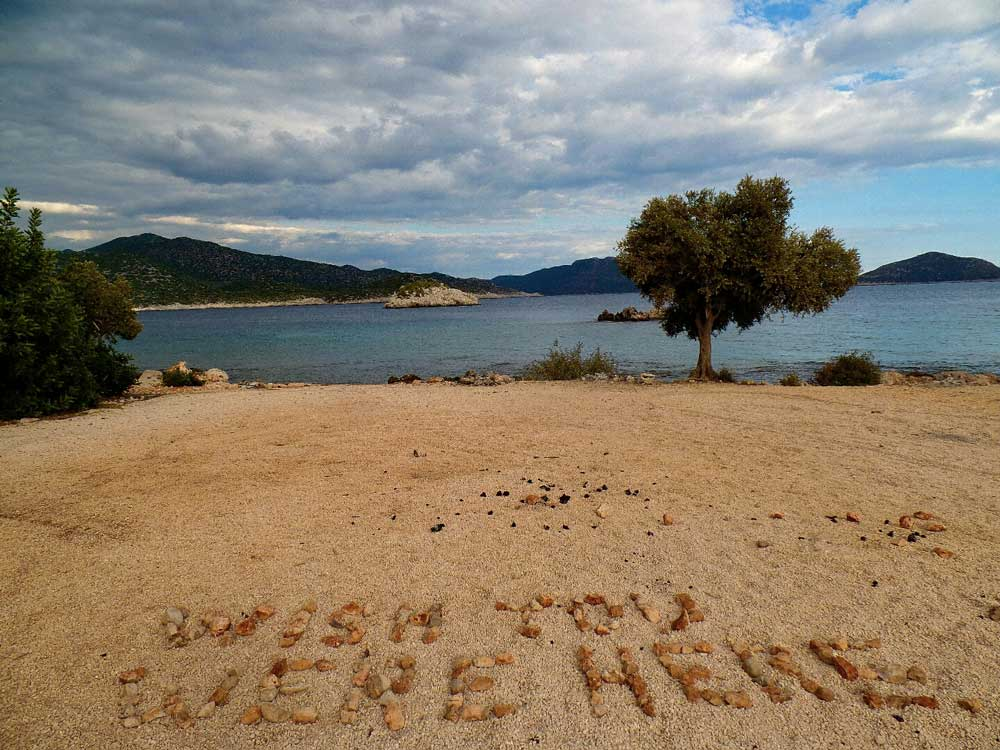

My journal for 29 September 2014 records the 13 km tenth stage of the Lycian Way, from Kaş via Limanağzı to the shore opposite Körmen Island.

## 2014 Hiking Log: Quick Notes

> Editorial context: These daily notes were written during a hike in 2014, and the following information summarizes the trip’s itinerary.

- Day: 10
- Date: 29 September 2014
- Etap: Kaş – Körmen Island
- Distance: 13 km

### Lycia Trail daily navigation

- [Previous day: 9th day Gökçeören – Kaş log](/likya-yolu-9.-gun/)
- [11-Day Hiking Index: Ölüdeniz – Kaleüçağız route](/likya-yolu-11-gunde-yurudugum-parkur/)
- [Main route: 11-stage guide for the Lycian Way](/likya-yolu-rotasi/)
- [Lycian Way Stage 10: Kaş to Körmen Island (13 km)](/likya-yolu-rotasi-kasdan-kormen-adasina/)
- [Next day: Day 11 journal, Körmen Island to Kaleüçağız](/likya-yolu-11.-gun/)

### Kaş → Limanağzı → Körmen Island (13 km), 29 September 2014

I woke early again. By early, I mean around 7, as if I’d got up at 5. I told everyone I was going without a phone. Luckily they didn’t say much. They knew it wouldn’t change anything anyway, because I’d do what I wanted. After Ayşegül’s lovely breakfast, I decided to set off around midday. Muammer wasn’t home so we couldn’t say goodbye. I’ll thank him personally. He’s a lovely, hospitable man. Spending a night here really brought me back to life. I’d washed, cleaned up and eaten my fill. What else could I ask for? :) Now it was time to get back into nature.

Today I had planned to go as far as Üçağız, but when I finally set off, I decided to stay around Körmen Island. On the way, I encountered 3 elderly German men. Despite their age, they looked remarkably well. In fact, when I began setting up my tent for camping, they were still on their way. I finished setting up the tent around 5 that afternoon. I have covered approximately 12–13 km, but I must be exhausted – probably due to the fatigue of the journey. I do not think I will make it all the way to Finike; most likely, I’ll end the walk at Demre. By the way, I am glad I listened to Olaf and brought 3 litres of water, because there is no water or villages on the way. I came across a place called Ufakdere, where I paid 4 TL for a 1.5-litre bottle. Wow. Luckily, the man was a good fellow and did not take the money for the tea I drank :).

I set up my tent in a flat area facing Körmen Island. I’m incredibly tired; I’ll take a short nap and then get up.

Additional information: These notes were written during the journey.

---

## Continue walking.

**[Next day: 11th day – Körmen Island – Kaleüçağız journal →](/likya-yolu-11.-gun/)**

[11-day hiking route](/likya-yolu-11-gunde-yurudugum-parkur/)
