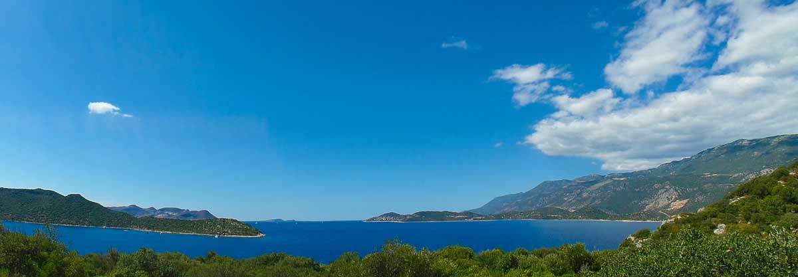

My journal for 29 September 2014 records the 13 km tenth stage of the Lycian Way, from Kaş via Limanağzı to the shore opposite Körmen Island.

## 2014 Hiking Log: Quick Notes

> Editorial context: These daily notes were written during a hike in 2014, and the following information summarizes the trip’s itinerary.

- Day: 10
- Date: 29 September 2014
- Stage: Kaş – Körmen Island
- Distance: 13 km

### Lycian Way journal navigation

- [Previous · day 9 · Gökçeören to Kaş](/likya-yolu-9.-gun/)
- [All 11 days · Ölüdeniz to Kaleüçağız](/likya-yolu-11-gunde-yurudugum-parkur/)
- [Lycian Way route guide · all 11 stages](/likya-yolu-rotasi/)
- [Lycian Way Stage 10: Kaş to Körmen Island (13 km)](/likya-yolu-rotasi-kasdan-kormen-adasina/)
- [Next · day 11 · Körmen Island to Kaleüçağız](/likya-yolu-11.-gun/)

### Kaş → Limanağzı → Körmen Island (13 km), 29 September 2014

I woke early again. By early, I mean around 7, as if I’d got up at 5. I told everyone I was going without a phone. Luckily they didn’t say much. They knew it wouldn’t change anything anyway, because I’d do what I wanted. After Ayşegül’s lovely breakfast, I decided to set off around midday. Muammer wasn’t home so we couldn’t say goodbye. I’ll thank him personally. He’s a lovely, hospitable man. Spending a night here really brought me back to life. I’d washed, cleaned up and eaten my fill. What else could I ask for? :) Now it was time to get back into nature.

Today I thought I’d go all the way to Üçağız, but because I set off late, I decided to stop around Körmen Island. On the way, I met three German grandpas. Despite their age, they looked remarkably fit. In fact, when I started setting up my tent for the night, they were still on the trail. I finished pitching the tent around 5 p.m. I’ve covered about 12–13 km, but I must be exhausted – probably due to the cumulative fatigue of the days. I don’t think I’ll make it to Finike; most likely, I’ll stop in Demre. By the way, glad I listened to Olaf and brought 3 litres of water, because there’s no water and no villages on the way. There’s only a place called Ufakdere, where I paid 4 TL for 1.5 litres of water. Wow. Luckily, the guy was a decent sort and didn’t charge me for the tea I drank :).

I set up my tent in a flat area facing Körmen Island. I’m incredibly tired; I’ll take a short nap and then get up.

Additional information: These notes were written during the journey.

---

## Keep walking

**[Next · day 11 · Körmen Island to Kaleüçağız →](/likya-yolu-11.-gun/)**

[All 11 days · Ölüdeniz to Kaleüçağız](/likya-yolu-11-gunde-yurudugum-parkur/)
