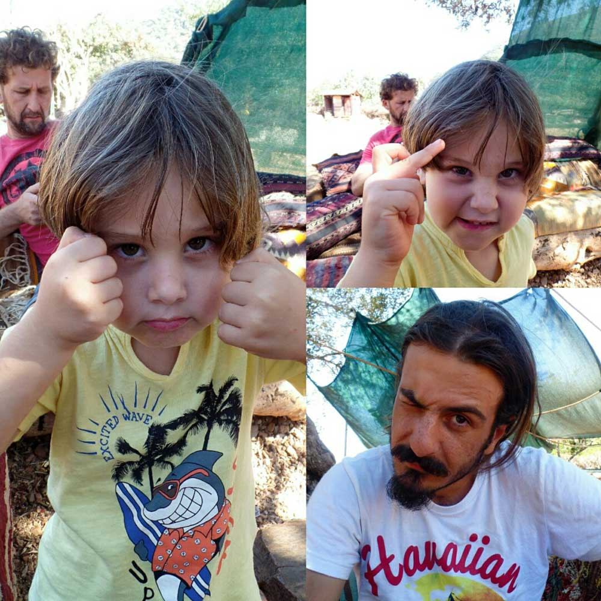
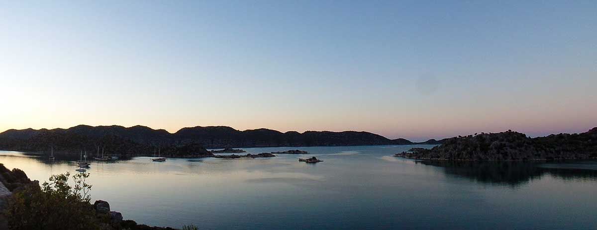
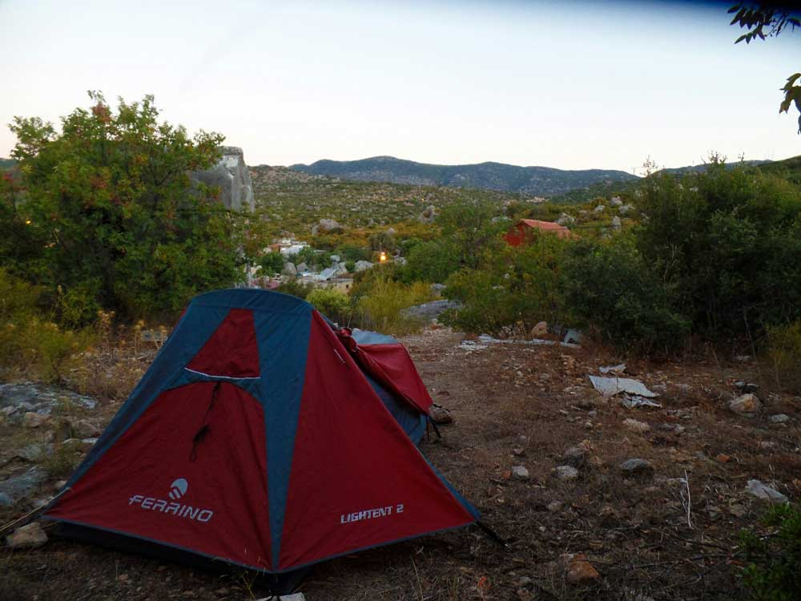

This log entry, dated September 30, 2014, recounts my 23 km final Lycian Way walk, from Körmen Island, through Boğazcık and Aperlai, to Kaleüçağız.

## 2014 Hiking Log: Quick Notes

> Editorial context: These daily notes were written during a hike in 2014, and the following information summarizes the trip’s itinerary.

- Day: 11
- Date: 30 September 2014
- **Stage:** Körmen Island to Kaleüçağız
- Distance: 23 km

### Lycian Way journal navigation

- [Previous day: Day 10 journal, Kaş to Körmen Island](/likya-yolu-10.-gun/)
- [11-Day Hiking Index: Ölüdeniz – Kaleüçağız route](/likya-yolu-11-gunde-yurudugum-parkur/)
- [Main route: 11-stage guide for the Lycian Way](/likya-yolu-rotasi/)
- [Lycian Way Stage 11: Körmen Island to Kaleüçağız (23 km)](/likya-yolu-rotasi-kormen-adasindan-kaleucagiza/)

### Körmen Island → Boğazcık → Aperlai → Kaleüçağız (23 km), 30 September 2014

I will never forget this place, which is located across from Körmen Island. Swarms of black flies bit me everywhere. I got up early and set off, to the point that I decided to have breakfast on the way. Meanwhile, Ayşegül was so kind to have made me a bag – I told her, “Thank you so much, otherwise I would have starved.”

While driving, I ran into a German couple in Ufakdere, and I met them again. After greeting them, I continued on my way. When I arrived at a certain point, I realized I had strayed from the route. Then, I saw three people a bit higher up, and assuming they were on the correct path, I quickly approached them and said “Hi.” When they responded with “Hello,” I was stunned. They were three Turkish men. “Oh my God, is this really happening?!” They had mentioned walking the route between Kaş and Finike. But at the moment, they were lost. While we were looking for signs, we ran into some hunters, and we learned the correct path and found the route, and then continued on. We parted ways after a break in Boğaziçi village, as I was traveling at a faster pace. Meanwhile, the German couple had caught up with us, and we greeted each other again. When I first met them, I hadn’t seen any Turkish men walking. I told them, “Look, I found three Turkish men walking.” Ahah, what a shame, I had mostly seen Germans on the roads.

Then, I decided to continue from the beginning in order not to disrupt my rhythm. The artist had said that he needed to avoid disrupting his rhythm. (I ate a good meal.) Because, I lost the course for the second time, and I reached the nearest village to get back on track. I asked someone for the route, and I reached the ancient city of Aperlai. Oh, and what do you see? There was an old man, three Germans, here, and a German couple, eating and getting ready to set off. We said hello again, and said goodbye. I said that it would continue like this, so I’ll see you again :)

Here, I both rested and ate something. Then, I set off. Meanwhile, the Germans had arranged a boat to go to Kaleüçağız together. After crossing by boat, they planned to continue from there on foot. Also, a French couple arrived about half an hour before me. Somehow, I ran into them again. How? Like this: Me again, amazing, I can see the route with my heart’s eye, what a silly man – how can someone get lost for the third time in a single day? And, in my last time getting lost, I ended up in a ridiculous place, there was also the effect of a misleading sign. While looking for the path, I was jumping from one rocky area to another, with my big backpack, and suddenly my foot hit a huge rock, and I fell. When I fell, I thought my elbow had come out or broken. When I got up, there was no damage. There was pain, of course, but my arm wasn't broken – that’s a huge luck. At this point, I received the divine message and decided to finish the hike. Physical fatigue will pass with rest, but psychological fatigue can be much worse. Well, I finished the hike. Not exactly, first I need to get out of this ridiculous place. There are no signs nearby. I decided to turn back. Halfway through the route, I ran into the French couple again. “Are there any signs?” – “No,” they replied. They had made the same mistake as me. “Do you have a GPS?” – “No,” they replied again. “How come neither of us have one?” – “Seriously, why don’t you?” – “You’re much worse than me!” – Then, they had a Lycian path map with them. I looked at it, and I saw that the path led to a much further, higher place. Then, we turned back and found the route, and we said hello and parted ways.

I’m dying from exhaustion, and I’m incredibly lucky that I haven’t hurt myself. I’ve also become very exhausted psychologically. I was planning to go to Demre, but after what happened today, I’m telling you, “you need to receive the divine message that’s being given,” and I’m turning back. If I continue, I’ll probably be doing blind bungee jumping next time. Imagine, 30 years from now, when people read this, they’ll be saying “there won’t be any blind bungee jumping,” :)

Today, I decided that I won’t be traveling. Because I’m extremely tired. My feet want to, but my brain doesn’t. Today, we’ve reached the end of a dream. An unfulfilled dream. I honestly don’t think I could have lasted another 21 days with this performance. I need to be able to perform better.

Right now, I’ve set up my tent near the ancient city in Kaleüçağız, and I’m writing my final sentences. This adventure, which began in the cemetery, ended in the cemetery :)

20:00

Additional information: These notes were written during the journey.

---

## Complete the walk.

[An 11-Day Lycian Way Hike: Ölüdeniz to Kaleüçağız](/likya-yolu-11-gunde-yurudugum-parkur/)

[Main route guide for the Lycian Way](/likya-yolu-rotasi/)
