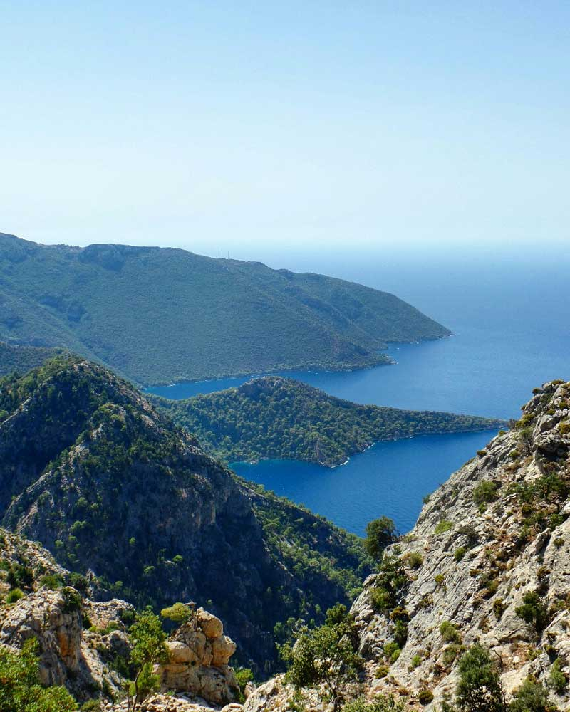
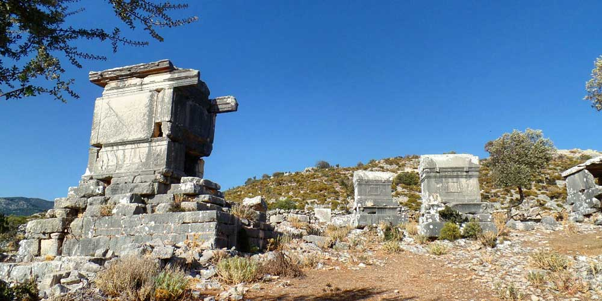

This journal entry recounts the second stage of the Lycian Way, a 23 km walk from Kabak Cove via Alınca to the ancient city of the ancient city of Sidyma, on September 21, 2014.

## 2014 Hiking Log: Quick Notes

> Editorial context: These daily notes were written during a hike in 2014, and the following information summarizes the trip’s itinerary.

- Day: 2
- Date: September 21, 2014
- Stage: Kabak Bay – the ancient city of Sidyma
- Distance: 23 km

### Lycian Way journal navigation

- [Yesterday: 1st day of Ölüdeniz – Kabak Cove journal](/likya-yolu-1.-gun/)
- [11-Day Hiking Index: Ölüdeniz – Kaleüçağız route](/likya-yolu-11-gunde-yurudugum-parkur/)
- [Main route: 11-stage guide for the Lycian Way](/likya-yolu-rotasi/)
- [Stage guide: Hiking from Kabak Bay to the ancient city of Sidyma](/likya-yolu-rotasi-kabak-koyundan-sidyma-antik-kentine/)
- [Next day: 3rd day – Sidyma – Karadere log](/likya-yolu-3.-gun/)

### Kabak Bay -> Alınca -> Sidyma Ancient City (23km) - **September 21, 2014**

Last night, while watching the stars at Kabak koy, I fell asleep. At one point, some stars had also disappeared. After a peaceful sleep, I set out again at 8 in the morning. I used to wake up at 6 in the morning, but it turned out that waking up at 6 would be ridiculous, because the weather starts to brighten at 7. From Kabak koy to Alınca, there’s a steep 8km climb, and it was taking a toll on me. As I climbed uphill, I began to miss my home and loved ones, and I felt a sense of melancholy. When the road leveled out, I started to return to my old wood collection. I was completely exhausted on this steep slope, honestly. While climbing the slope, I encountered a Swedish couple in their 50s. They had set out from Antalya and had been walking for a month. They had two days left until they finished, while I was just starting my first day. Perhaps I’ll have the chance to experience those days. They are smart, they’ve taken a small bag and are staying in guesthouses while walking the route. Of course, there’s also a financial aspect to it. Many guesthouses on the Lycian route have quite high prices. It’s as if you’re staying in a 5-star hotel, but there’s nothing you can do about it. Either a tent or money. The slope felt like it would never end, but it took 3.5 hours, and I was starting to get tired, when I reached the top and enjoyed a burst of happiness seeing the view. After going a little further, I had my breakfast at the first house I encountered. Even the locals here have turned it into a business. Anyway, I had a wonderful village breakfast and set off again. I’d eaten so much that I couldn’t eat anything else. Just one meal and 1-2 packs of biscuits are enough for me. I’ve been walking alone for two days, and I was starting to get really tired. I turned on some music and, after going a little further, I started dancing when I saw the beautiful view of Yediburunlar. When the road started to descend, I felt like I was finishing the route.

## SİDYMA ANTİK KENT

On our way towards Sidyma, we met a couple from Romania (apparently this is where couples come). They had descended to the beach and then checked into a pension. The elevation at the place I mentioned is equivalent to the height where I left Kabak Bay. I must admit, I complimented them – I'd give them 100 points. After arriving in Boğaziçi Köyü and chatting with the children, I followed the signs towards Sidyma. The signs here were a bit faint, or perhaps I am colour-blind, so I struggled a little (red and green blend together for me). Consequently, I checked the map 2 times. Eventually, I reached the ancient city of Sidyma. Here, I met someone taking photos of the ruins, and I called out "Hi". When I received a response, I was surprised. The man turned out to be Turkish – the first Turkish person I encountered on my journey. Ilhan abi, who lives in Fethiye and loves ancient cities, joined me. We explored Sidyma together, and he explained the ruins to me. Lycian, Roman, and Byzantine periods have left their mark. The Lycians were particularly interesting. It's amazing to think how they carved those massive stone blocks. If they saw the code we write (programmers would understand), they would be astonished :)

I spoke with an aunt in a village right next to the ancient city. She told me I could set up a tent in her backyard. Initially, I refused, wanting to avoid any trouble, but then I agreed. He kept insisting, “What can I do?” Nevertheless, I set up the tent a little away from the houses. Once I had settled, I immediately ran to the mosque for water and electricity. “Go to prayer, go to prayer.” You’re always looking for water and electricity, my friend. The Imam, my neighbor, came out. I chatted with Haşim a bit. After having tea and refreshments in his garden, I moved to my tent. I met a nice person along the way. Perhaps we’ll meet Haşim again someday.

If you have someone you love, they keep popping into your thoughts constantly. Then, emotions make you vulnerable. And emotions leave you weak in nature. Understand this well, my friend. There’s no room for emotion in nature. You need to be strong to survive. :)

Well, good night again.

Time: 22:30

Additional information: These notes were written during the journey.

---

## Continue walking.

**[Next day: 3rd day Sidyma–Karadere log →](/likya-yolu-3.-gun/)**

[11-day hiking route](/likya-yolu-11-gunde-yurudugum-parkur/)
