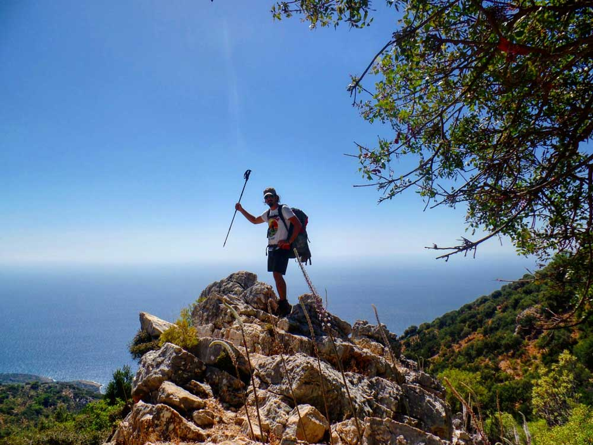
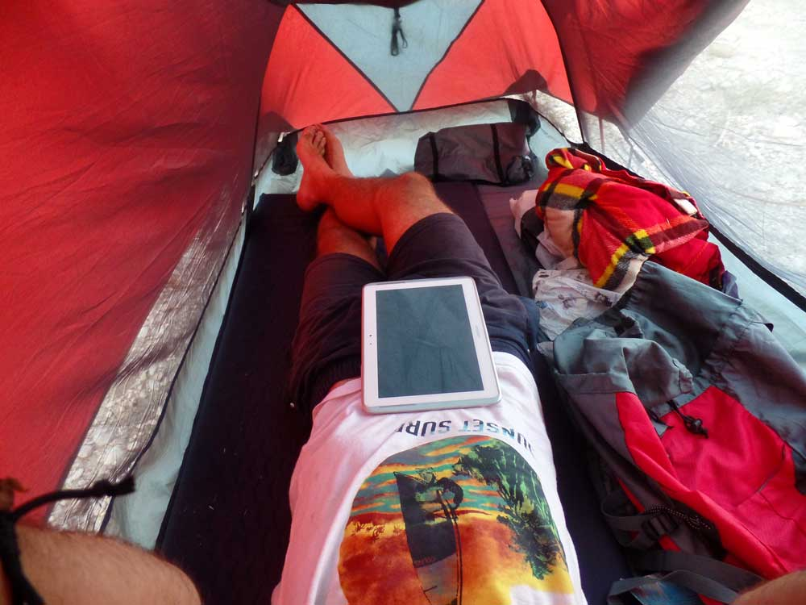

This 22 September 2014 log is a field record of my third day on the Lycian Way, from Sidyma to Karadere via the descent at Gavurağalı – a 17 km stretch.

## 2014 Hiking Log: Quick Notes

> Editorial context: These daily notes were written during a hike in 2014, and the following information summarizes the trip’s itinerary.

- Day: 3
- Date: 22 September 2014
- Stage: Sidyma – Karadere
- Distance: 17 km

### Lycian Way journal navigation

- [Previous · day 2 · Kabak Bay to Sidyma](/likya-yolu-2.-gun/)
- [All 11 days · Ölüdeniz to Kaleüçağız](/likya-yolu-11-gunde-yurudugum-parkur/)
- [Lycian Way route guide · all 11 stages](/likya-yolu-rotasi/)
- [Lycian Way Stage 3: Sidyma to Karadere (17 km)](/likya-yolu-rotasi-sidymadan-karadereye/)
- [Next · day 4 · Karadere to Kınık](/likya-yolu-4.-gun/)

### Sidyma → Gavurağalı → Karadere (17 km), **22 September 2014**

Actually, today is the 4th day. I decided to start writing today because I was very tired yesterday.

## Farewell to Sidyma

Around 8 am I got back on the road. Just as I was about to leave Sidyma, I met Haşim abi. Our encounter was good because after the long chat and refreshments we shared last evening I was able to thank him again and we even took a photo together. I then continued on the Lycian Way heading towards Bel – Yediburunlar. The signs on the route are painted in red and white. Because I am colour blind I am struggling to distinguish the signs. It is proving difficult for me to spot the red amongst all this green. There are also numerous white smudges on the rocks. This is making it very difficult for me. While I was making progress along the trail I lost the signs again for a while. Then I spotted the red and yellow signs. These are a separate route marked by the Germans. I decided to follow them as they seemed easier to spot. However, while thinking I would reach the same destination I lost the signs again. Damn it. All right, no problem. I consulted the map to see where the route continued. I had gone quite far off course. I did not feel like turning back at all. Continuing on, without realising how big a mistake I was making, I said I would proceed from this slope within the forest. I continued without knowing how great an error I was making. The initial section was fine because the forest was not too dense. However, finding a path within the thickening forest was not possible. On top of that, every side was full of thorny bushes. I managed to get through this section in about 2 hours. My whole body is covered in scratches. I’m bleeding in one or two places. I managed to wriggle free from the bushes and emerge onto flat ground, but in the process I found myself amongst beehives. The beekeepers saw me and immediately moved away, telling me to get away from there. At that moment a bee landed on the right side of my forehead. Damn it, as if I had done something to them. I forced myself to the side. I took the allergy medication they provided. The bee's stinger remained in my skin which I removed. I then continued on my way with a slight pain and swelling on the right side of my forehead. I went off route and unnecessarily hurt myself. I could have injured myself while trying to leave that spot. I broke one of the most important rules. Damn it.

## The descent to Gavurağalı

As I started down towards Gavurağalı, I came to a very steep stretch. Descending the steep, rocky slope was exhausting. I’d had enough of it again. If I’d let myself get a little more worked up, I might have quit the Lycian Way halfway through. I slid down 2 times and barely managed to stop myself. I was practically flying down the slope. It was the most serious danger I got through. I realised I was exhausted and being stubborn with myself. So I stopped for 1 hour and smoked my pipe in a ridiculous spot high in the mountains. I later found out that the path down to Gavurağalı is one of the hardest sections of the route. Anyway, I got through safely. When I reached level ground I saw a man lying there.

## Tourist Hunter

The person lying on the ground, Ali abi, and himself are “tourist hunters.” He’s lying in wait, expecting to catch them. He says that he lies here every day and directs those who come here to his business – a restaurant and guesthouse – in Karadere. You can find Özlen’s restaurant in Karadere and set up a tent there. He says he will come here in a little while. It’s 4km to Özlen’s restaurant.

When he told me there was a place to pitch a tent, I pictured soft ground. I just about manage to pitch mine on the stones. At least my inflatable mat will let me sleep comfortably. I was planning to leave my phone charging in the restaurant and pick it up in the morning, but Ali said no. Oh, come on. He went on about something happening to the phone, the plug and so on. I decided against staying another 1 day somewhere I didn’t feel secure. I’d planned to rest on day 4, but it wouldn’t be here. I was exhausted and had gone well off plan. This was the hardest of the 3 days. If I survived today, I’m never going to die :).

Additional information: These notes were written during the journey.

---

## Keep walking

**[Next · day 4 · Karadere to Kınık →](/likya-yolu-4.-gun/)**

[All 11 days · Ölüdeniz to Kaleüçağız](/likya-yolu-11-gunde-yurudugum-parkur/)
