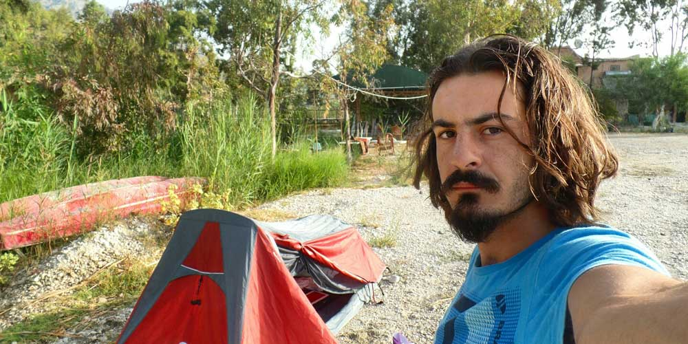
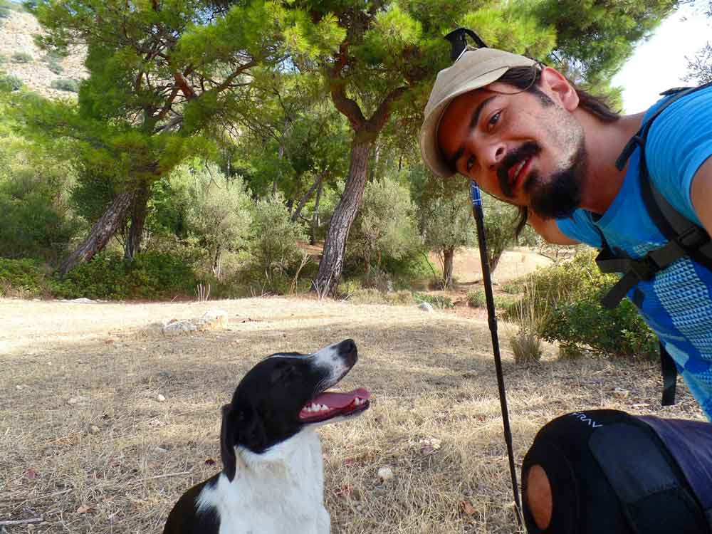
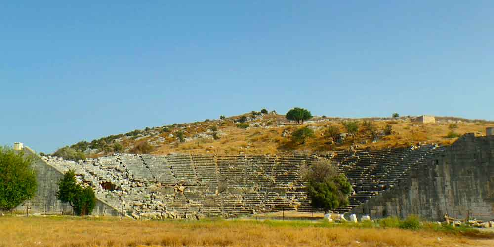

This log entry, dated September 23, 2014, records the 15 km fourth stage of the fourth Lycian Way, from Karadere to Kınık, via Pydnee.

## 2014 Hiking Log: Quick Notes

> Editorial context: These daily notes were written during a hike in 2014, and the following information summarizes the trip’s itinerary.

- Day: 4
- Date: 23 September 2014
- Stage: Karadere – Kınık
- Distance: 15 km

### Lycia Trail daily navigation

- [Yesterday: 3rd day of Sidyma – Karadere log](/likya-yolu-3.-gun/)
- [11-Day Hiking Index: Ölüdeniz – Kaleüçağız route](/likya-yolu-11-gunde-yurudugum-parkur/)
- [Main route: 11-stage guide for the Lycian Way](/likya-yolu-rotasi/)
- [Lycian Way Stage 4: Karadere to Kınık (15 km)](/likya-yolu-rotasi-karadereden-kinika/)
- [Next day: Day 5 journal, Kınık to Üzümlü](/likya-yolu-5.-gun/)

### Karadere → Ancient City of Pydnee → Kınık (15 km), 23 September 2014

10:15

Today, I woke up later. I set off around 9 am. I really need to rest today, but I’m not there. My left leg started to hurt. I decided to walk a bit with a crutch, starting at the Patara beach, and have breakfast where I encountered this place. And I ate olives for breakfast, you know. Luckily, I can manage to eat them with some effort. I also have a pain in my back. I won’t be walking today. Since I found the beach, I’ll go for a swim and relax a bit. Then, I’ll set up a tent somewhere around here. Maybe I could stay in the Letoon ancient city as well. But first, I need to wash.

00:30

My morning breakfast and then going into the sea felt really good. I felt much better. Then, Özlem Akovalıgil (the person who explained the Lycian route to me the most) called and said that she was in Kaş, and that I shouldn’t stay in a ridiculous place like Kınık, but should instead relax in Patara and then continue my journey from where I left off. It made a lot of sense to me, and I started walking towards Kınık. To get to Patara, I first needed to reach Kınık. As I got to Kınık, I realized that I couldn’t set up a tent anywhere – it was all greenhouses. There weren’t any. The route was already continuing on an asphalt road, so I decided to go to Patara. Even though my foot hurt, it was a comfortable walk on the flat road. After approximately 15km, I reached Kınık, and I took a minibus to Patara, where I met with Özlem. After a little stroll on Patara beach, we found a spot on the sand dunes to watch the sunset, but the hazy weather prevented us from seeing it.

Today was a relaxed walk. I at least slowed down a bit and had a chat with some people. It was good to socialize a little. We went to Medusa camping in Patara and set up our tents. After dinner and a chat about the Lycian Way, I moved on to doing laundry. I try to wash myself whenever I have the chance, and I also need to wash the clothes. Otherwise, they’ll start to smell. By the way, Kate Clow, who designed the Lycian trail, said this route can be walked in 21 days. I chose 21 days because of my schedule. It’s a coincidence, isn’t it?

Today is the 4th day. It feels like I’m getting used to the road. It wasn’t like yesterday and today’s first two days at all. I don’t know, maybe because there weren’t too many steep inclines today. Tomorrow, I’ll sleep until noon, then take the minibuses back to Kınık and continue from where I left off. Tomorrow should be pretty calm, because there aren’t any difficult trails. Actually, the descent to Gavurağalı was one of the most difficult places. It really took it out of me. The road feeling better helped me too. I just can’t seem to get used to this tobacco. I smoked it just now, and then went into the tent and collapsed. Head spinning. I thought I was going to faint. Do you think it’s my blood pressure? I don’t understand. I guess the tobacco isn’t good for me :). Yesterday and today, I was doing well in terms of blood pressure. Nothing mischievous. Now I’ll lie down. I can’t really think of anything to say. Good night.

Additional information: These notes were written during the journey.

---

## Continue walking.

**[Next day: 5th day Kınık–Üzümlü log →](/likya-yolu-5.-gun/)**

[11-day hiking route](/likya-yolu-11-gunde-yurudugum-parkur/)
