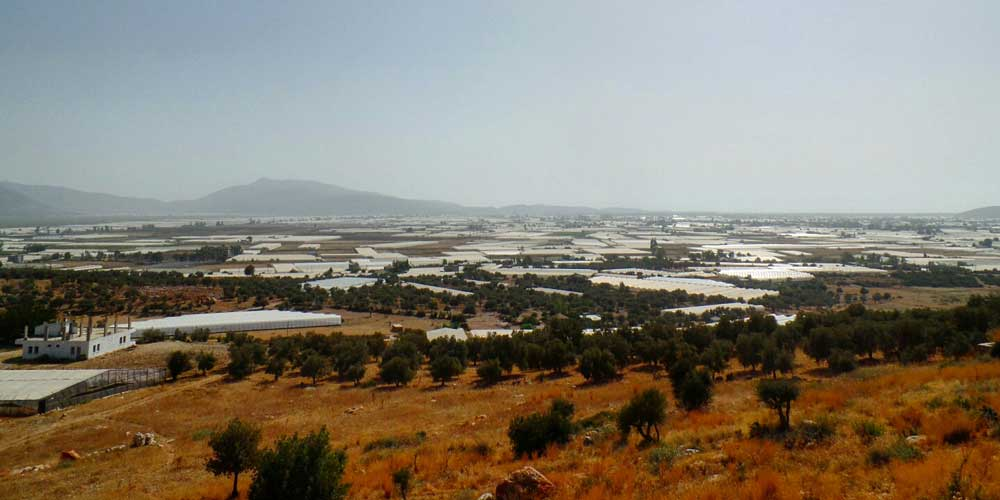
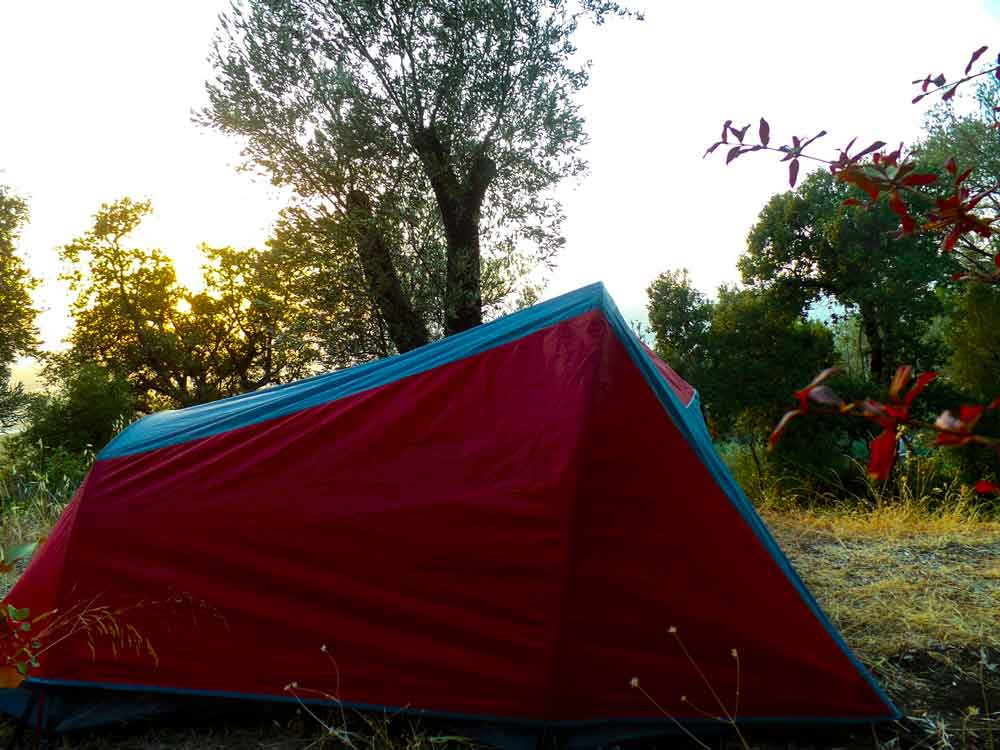

This journal entry, dated September 24, 2014, recounts the events of the fifth Lycian Way route – a 22 km stretch from Kınık to Üzümlü, passing through Çavdır.

## 2014 Hiking Log: Quick Notes

> Editorial context: These daily notes were written during a hike in 2014, and the following information summarizes the trip’s itinerary.

- Day: 5
- Date: 24 September 2014
- Etap: Kınık – Üzümlü
- Distance: 22 km

### Lycia Trail daily navigation

- [Previous day: 4th day Karadere – Kınık log](/likya-yolu-4.-gun/)
- [11-Day Hiking Index: Ölüdeniz – Kaleüçağız route](/likya-yolu-11-gunde-yurudugum-parkur/)
- [Main route: 11-stage guide for the Lycian Way](/likya-yolu-rotasi/)
- [Lycian Way Stage 5: Kınık to Üzümlü (22 km)](/likya-yolu-rotasi-kinikdan-uzumluye/)
- [Next day: Day 6 journal, Üzümlü to Bezirgan](/likya-yolu-6.-gun/)

### Kınık -> Çavdır -> Üzümlü (22km) - 24 September 2014

Oh my God, what kind of writing is this. Honestly, I’ve always written such awful things. Anyway, today I’ll try to write something better. So, I’ll try :)

I woke up around 8, and since Özlem hadn't woken up yet, I started making bracelets with the cords I brought with me. The process of tying the cords will take a long time, and I’ve done about 1cm so far. That’s enough for today. After Özlem woke up, we had breakfast and a bit of chatting, and then I got ready to go to Kınık. Normally, today is my rest day, but because my plans have thrown me off schedule, I’ll be walking today, having rested about half of yesterday. I arrived in Kınık at 1, and started my walk. This section of the route is also on asphalt.

While I needed to enter a forest trail, I couldn't discern the colours and, having missed the path, continued along the road. It turned out to be a good thing I didn't step onto it, just to avoid straining my left foot. I reached Üzümlü village with a relaxed walk. While taking a break, I met a trekking couple, Arash and Andrea. Arash is an Iranian in his 30s, and Andrea is a German also in her 30s. I didn't ask how they met or how they knew each other, but they seemed quite familiar with one another. They mentioned they were both heading to Antalya, just like me. As they had no tents, they were staying in guesthouses. I suspect I'll encounter this couple more often. They told me they would spend the night in Üzümlü village, whereas I was heading to Akbel. As I passed through Üzümlü village, I saw grapevines everywhere. Honestly, does anyone ever feel like picking this many grapes? I continued on, sighing, wishing someone would offer me a bunch of grapes. Near the village exit, an uncle was busy placing grapes into crates, called out to me, and gave me 2 bunches. Normally, I would have politely declined, saying I didn't want them, but this time I simply took them, thanked him, and quickly continued towards Akbel.

On the way towards Akbel I suddenly realised it was 18:25, and Akbel was still 4 km away. I’d started breaking one of the rules I’d set myself before leaving: “No walking after 18:00. Stay wherever you are.” First I looked for a place to pitch. The ground at the first spot was so hard that I couldn’t get the pegs in. Then I went a little way into the woods to find somewhere flat. It was the softest ground I’d found in 5 days. If I hadn’t found it, I’d have gone on to Patara.

I settled down quickly and immediately started writing my notes. Walking comfortably on a pleasant route for the past two days had been incredibly relaxing for me. I had come to accept the path, in a way.

Good night.

21:00

Additional information: These notes were written during the journey.

---

## Continue walking.

**[Next day: 6th day Üzümlü–Bezirgan diary →](/likya-yolu-6.-gun/)**

[11-day hiking route](/likya-yolu-11-gunde-yurudugum-parkur/)
