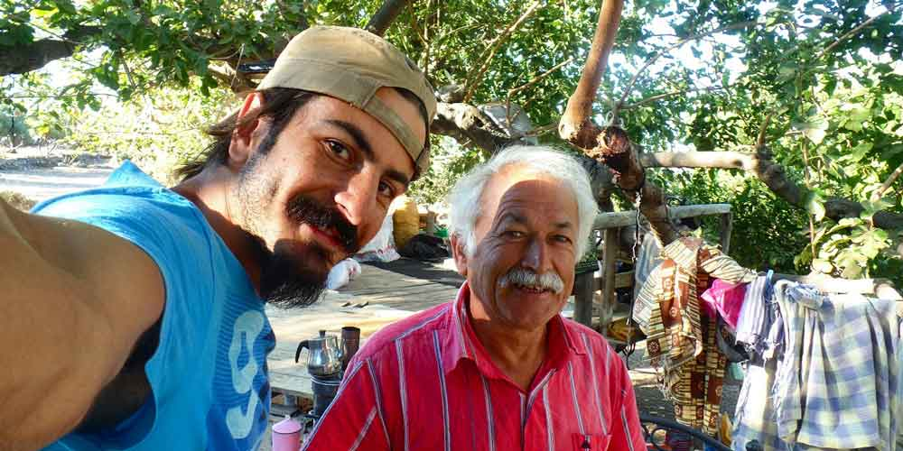
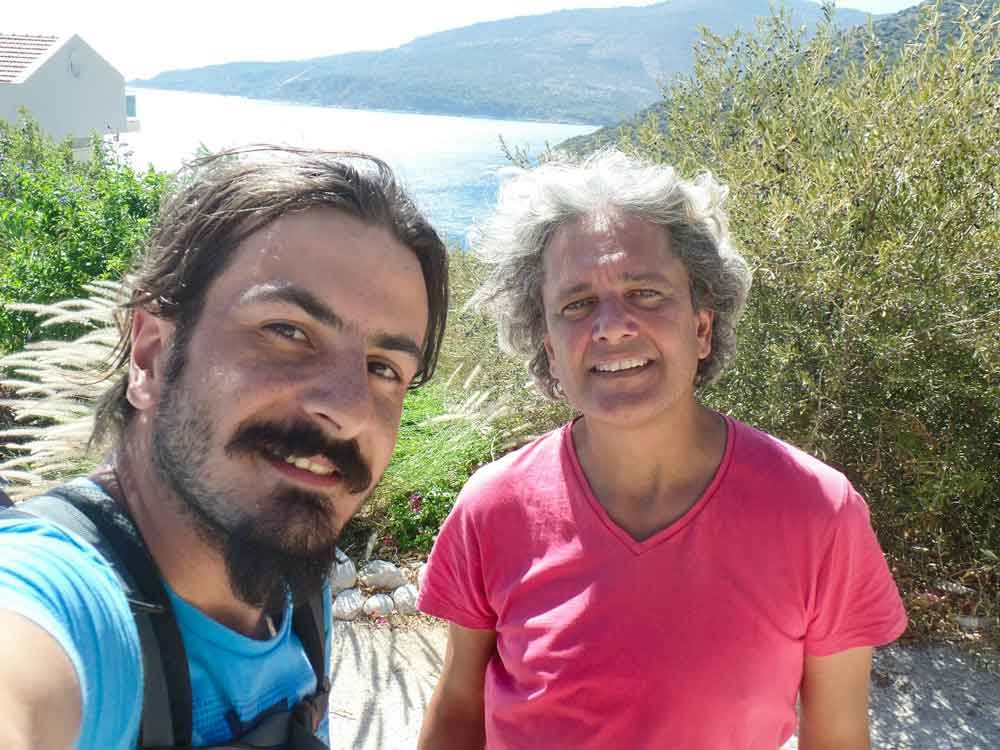
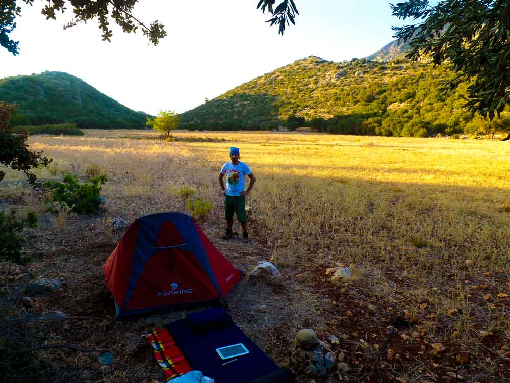

This 25 September 2014 log records the sixth Lycian Route stage, which stretches 22 km from Üzümlü to Bezirgan via Delik Kemer and Kalkan.

## 2014 Hiking Log: Quick Notes

> Editorial context: These daily notes were written during a hike in 2014, and the following information summarizes the trip’s itinerary.

- Day: 6
- Date: 25 September 2014
- Stage: Üzümlü – Bezirgan
- Distance: 22 km

### Lycian Way journal navigation

- [Previous · day 5 · Kınık to Üzümlü](/likya-yolu-5.-gun/)
- [All 11 days · Ölüdeniz to Kaleüçağız](/likya-yolu-11-gunde-yurudugum-parkur/)
- [Lycian Way route guide · all 11 stages](/likya-yolu-rotasi/)
- [Lycian Way Stage 6: Üzümlü to Bezirgan (22 km)](/likya-yolu-rotasi-uzumluden-bezirgan-koyune/)
- [Next · day 7 · Bezirgan to Sarıbelen](/likya-yolu-7.-gun/)

### Üzümlü -> Akbel -> Delik Kemer -> Kalkan -> Bezirgan (22km) - 25 September 2014

I’ve really missed days like these. Which days, exactly? I’ve missed the days when I forgot the date, the time, or when I mixed things up. Just now, while I was writing the date, I copied from the previous page. Tomorrow is Friday. Wow, I’m almost finishing a week. I had thought that on my sixth day, I’d be complaining, making trouble, and generally being difficult, but it didn’t happen. Simge said you’d be like that on day eight. Let’s see, there are still two more days, and I’m feeling good right now.

I woke up a little late this morning, around 07:30. I packed quickly and managed to be on the trail at about 08:13. I’m glad I kept my promise to myself yesterday and stopped walking after 18:00. The route now follows a footpath. I might not have found room for a tent on it and might have had to walk in the dark, when it would have been hard to find the way. Yes, sometimes I do use my head :).

Walking along, I realised I’d lost the trail markers. The path forked and I spotted a house, so I went over to ask which way to go. Next thing I knew, I was sitting there chatting over tea. You’ve got a nerve these days, İbrahim. You used to say, “No thanks, I’d better be on my way.” Now look at you asking for another glass. My host, also called İbrahim, lives here with his family. Such warm people. I suspect he’s put his wife through a thing or two. At one point she said, “God forgive me, but every İbrahim I’ve met is a step behind his own thoughts.” A dig at her İbrahim, with a little something for me too. The old fox didn’t miss a beat. “That’ll be because our minds are a step ahead,” he said. Ahead or behind, mine seems to have gone off without me lately. I left them to their sparring and went on my way.

The trail must have missed me. “Two days of easy walking on the road,” I could almost hear it saying. “Come and spend some time with me.” The rest of the route was on footpaths. I got to Akbel first and then Delikkemer. The weeds on the way to Delikkemer had gone absolutely mad. Come on, did you really have to grow quite so tall and swallow the whole path? I pushed through, getting scratched on both sides. Just past Delikkemer the weeds thinned out. Oh, what a relief. Then I realised I had less than half a litre of water left. No water source in sight, and the going was getting ugly. What did you expect, mate? You could always have stayed at home. I got across the rocks and carried on along the path. That crossing really was nasty. One slip, lose your balance for a second, and you’d be off to meet your maker. I found out afterwards that people have died there. Anyway, I got out alive. Why am I telling you that? How else would I be writing this? There I go again, a step behind my own thoughts :)

Now, the water ran out. I had only one sip left, and I was drinking it little by little. There was no path or anything; the trail just continued through some ridiculous places. After about 1.5 hours of a dry journey, I reached Kalkan. By the edge of the first well I encountered, there was a hose. I found the tap and was about to quench my thirst, when I realized the water was flowing hot. Oh my, mate. I opened it a bit, but it didn’t change. So, we were still without water, good for us. We were close to the settlement, and I asked the first person I saw for water. Actually, I couldn’t bring myself to ask. The man saw my condition and, before I could even say “water,” he ran into the kitchen and brought a big glass. I drank one, then another, and only then did I start to feel like myself and begin talking. His name was Mark or Mike. I forgot, honestly. He was half English, half Indian, a good man living here. He gave me water, which was good; what else… don’t tire me with nonsense. Anyway, he was just a friendly man.

After receiving logistical support in Kalkan, I headed towards Bezirgan village. Before I even reached Bezirgan, I realised it was approaching 18:00, a critical hour, and immediately started looking for a place to pitch my tent. There aren’t many flat spots here – is everything made of rock? Seriously, where did you find all this rock and dump it here? Amazing. I cleared a spot and settled in. Before entering the tent, I lit a pipe. This tobacco doesn’t agree with me. I love smoking a pipe, but it makes me feel absolutely awful. For a moment, I felt like I was about to fall and faint while standing, so I forced myself into the tent. I think the tobacco is triggering my blood pressure. And I’d also eaten Dardanel ton. May God curse me. It’s greasy, I’m eating it, and then I’m smoking tobacco. It’s supposed to be good, I think you deserve it.

Once I’d got my breath back I spent half an hour making bracelets. The nail on my right big toe started coming loose today. It hurts a bit. Just what I was afraid of, and my toenails had only just recovered. Fingers crossed it simply falls off without getting infected. In Kalkan one of the shoulder straps on my pack broke, too. I’ve tied it up with a bit of cord for now. Has anything not gone wrong today? I’m starting to feel the strain in my head as well as my legs. Twenty-one days suddenly seems a tall order, and I’m already behind schedule. Let’s see how much further I get.

Good night.

22:30

Additional information: These notes were written during the journey.

---

## Keep walking

**[Next · day 7 · Bezirgan to Sarıbelen →](/likya-yolu-7.-gun/)**

[All 11 days · Ölüdeniz to Kaleüçağız](/likya-yolu-11-gunde-yurudugum-parkur/)
