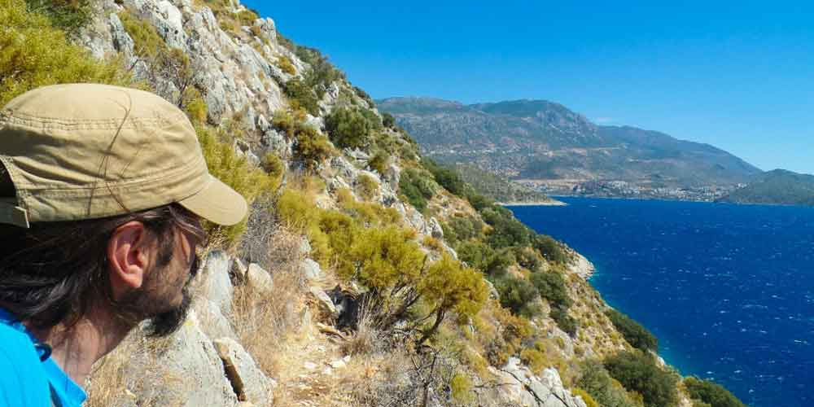
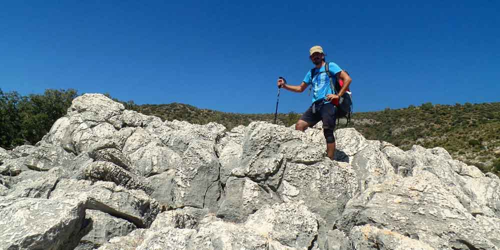

This 25 September 2014 log records the sixth Lycian Route stage, which stretches 22 km from Üzümlü to Bezirgan via Delik Kemer and Kalkan.

## 2014 Hiking Log: Quick Notes

> Editorial context: These daily notes were written during a hike in 2014, and the following information summarizes the trip’s itinerary.

- Day: 6
- Date: 25 September 2014
- Stage: Üzümlü – Bezirgan
- Distance: 22 km

### Lycian Way journal navigation

- [Previous day: 5th day Kınık – Üzümlü log](/likya-yolu-5.-gun/)
- [11-Day Hiking Index: Ölüdeniz – Kaleüçağız route](/likya-yolu-11-gunde-yurudugum-parkur/)
- [Main route: 11-stage guide for the Lycian Way](/likya-yolu-rotasi/)
- [Lycian Way Stage 6: Üzümlü to Bezirgan (22 km)](/likya-yolu-rotasi-uzumluden-bezirgan-koyune/)
- [Next day: 7th day Bezirgan – Sarıbelen diary](/likya-yolu-7.-gun/)

### Üzümlü -> Akbel -> Delik Kemer -> Kalkan -> Bezirgan (22km) - 25 September 2014

I’ve really missed days like these. Which days, exactly? I’ve missed the days when I forgot the date, the time, or when I mixed things up. Just now, while I was writing the date, I copied from the previous page. Tomorrow is Friday. Wow, I’m almost finishing a week. I had thought that on my sixth day, I would be complaining, making trouble, and generally being difficult, but it didn’t happen. Simge had said that you’re on day eight. Let’s see, there are still two more days, and I’m feeling good right now.

I woke up a little late this morning, around 07:30. I packed quickly and managed to be on the trail at about 08:13. I’m glad I kept my promise to myself yesterday and stopped walking after 18:00. The route now follows a footpath. I might not have found room for a tent on it and might have had to walk in the dark, when it would have been hard to find the way. Yes, sometimes I do use my head :).

While walking on the path, I realized I was losing my bearings. The path split into two, and I saw a house. I walked towards the house to ask where the course was, and then I found myself sitting down, chatting and drinking tea. “You’ve become a really shameless man, Ibrahim,” I said. “Back when someone would offer something, we used to say ‘No, I don’t want it, thank you, let’s go,’ but now you’re asking for another cup of tea.” Ibrahim amca (Uncle Ibrahim) is living here with his family. They are very warm and kind people. It seems Ibrahim amca has given his wife a lot of gifts. While chatting, he said, “May God guide their heads, but Ibrahim’s heads always come from the front.” He then steered the conversation back to Ibrahim amca. I left them to argue, and continued on my way.

The trail misses me. For two days, you’ve been freely moving away from the path, and someone said, “Come back and connect with the trail.” The remaining section of the course continues on the trail. I first reached Akbel, and then Delik Kemer. The trail leading to Delik Kemer was completely overgrown and deteriorated. “Why are you closing the trail? There’s no need for it to grow so much.” I continued, with scrapes on my right and left. I reached Delik Kemer – I realized I only had less than half a liter of water. I couldn’t find any water sources around, and the course was really starting to look rough. Seriously? You should have just stayed home. After a difficult, rocky passage, I continued on the trail. But the rocks were truly awful. If you were to slip or lose your balance, it could be fatal. (I learned this later). Luckily, I was okay. I’m saying this because… well, it’s just our mindset. :)

Now, the water ran out. I had only one sip left, and I was drinking it, little by little. There wasn’t really a path or anything. It was just walking through silly places. After about 1.5 hours of a dry journey, I reached Kalkan. There was a hose by the edge of the first well I encountered. I found the tap and was about to fill myself with water, when I realized the water was flowing hot. Oh my. I turned it off a bit, but it didn’t change. So, we were still without water. We were close to the settlement, and I asked the first person I saw for water. Actually, I couldn’t bring myself to ask. He saw my condition and, before I could even say “water,” he ran into the kitchen and brought a big glass. I drank one, and then I finally started to feel and began to talk. His name was Mark or Mike. He was a good man living here, half English, half Indian. He gave me water, which was good. What else… don’t tire me with nonsense. He was just a friendly man.

I traveled to Bezirgan village after receiving logistical support in Kalkan. Before I even reached Bezirgan, I noticed that it was approaching 18:00, a critical time, and I immediately started looking for a place to set up a tent. Apparently, there aren’t many flat spots here – everything seems to be covered in rocks? Seriously, where did you find all this rock and dump it here? Amazing. I cleared a spot and set it up. Before entering the tent, I lit a cigarette. This tobacco isn’t doing well for me. I really love smoking cigarettes, but it makes me feel extremely unwell. Just a moment ago, I felt like I was about to fall and lose consciousness while standing. I struggled to get into the tent. I think the tobacco is affecting my blood pressure. And I had also eaten Dardanel fish. May God punish me. It’s greasy and I’m eating it, and then I’m smoking tobacco. It’s supposed to be good, I think you deserve it.

When it comes to myself, I’ve spent barely half an hour making a bracelet. Meanwhile, today my right little toe nail started to wiggle. There’s also a slight pain. Exactly what I was afraid of is happening. My nails had just been fixed, actually. I hope it doesn’t become inflamed, just that it falls off. Today, while I was in Kalkan, the part of the bag where it rested on my shoulder broke. I’ve temporarily fixed it by tying it with a string. It seems like nothing bad has happened to me today. I’m starting to feel psychologically exhausted, and it feels like 21 days will be really difficult. According to my plans, I’m already behind. Let’s see how much longer I can keep going.

Good night.

22:30

Additional information: These notes were written during the journey.

---

## Continue walking.

**[Next day: 7th Bezirgan–Sarıbelen log →](/likya-yolu-7.-gun/)**

[11-day hiking route](/likya-yolu-11-gunde-yurudugum-parkur/)
