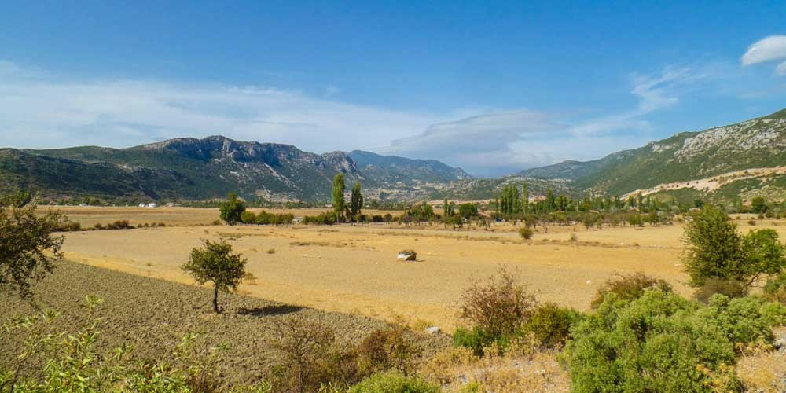
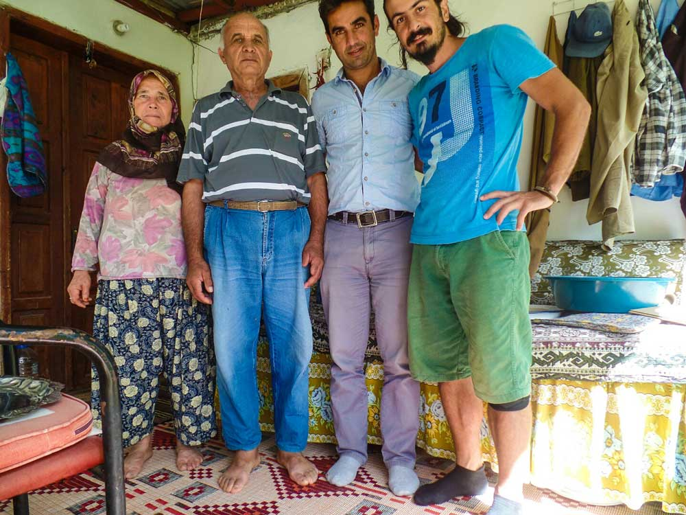
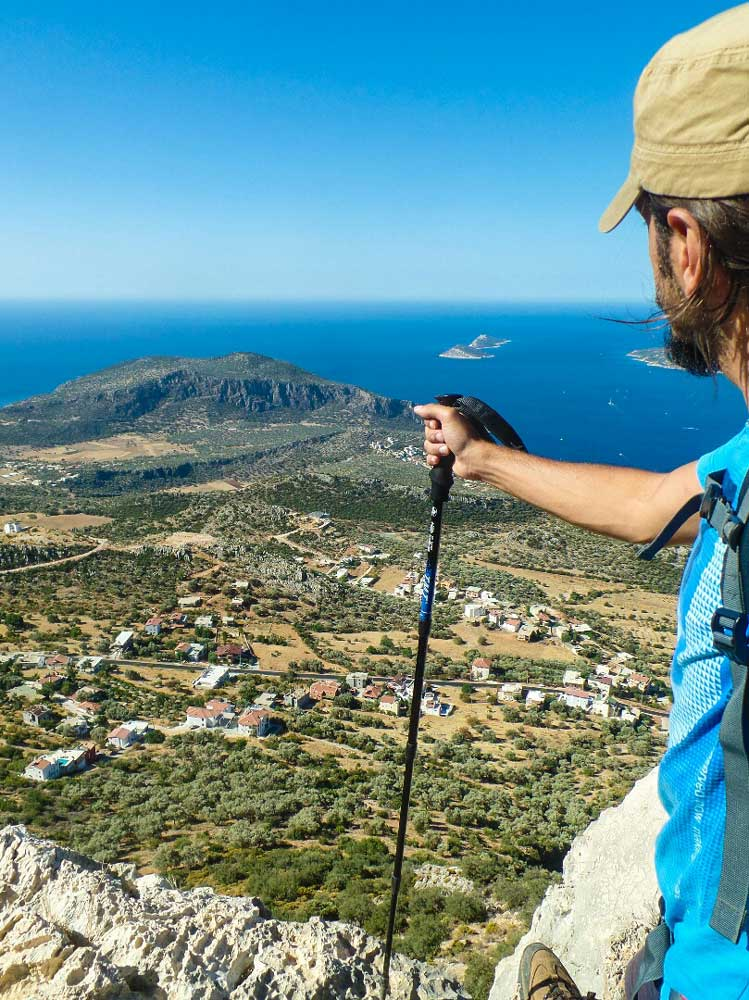

This journal entry from 26 September 2014 describes my seventh Lycian Way day, walking from Bezirgan to Sarıbelen, which was 12 km, and my experiences along the route.

## 2014 Hiking Log: Quick Notes

> Editorial context: These daily notes were written during a hike in 2014, and the following information summarizes the trip’s itinerary.

- Day: 7
- Date: 26 September 2014
- Stage: Bezirgan – Sarıbelen
- Distance: 12 km

### Lycian Way journal navigation

- [Previous day: 6th day Üzümlü – Bezirgan log](/likya-yolu-6.-gun/)
- [11-Day Hiking Index: Ölüdeniz – Kaleüçağız route](/likya-yolu-11-gunde-yurudugum-parkur/)
- [Main route: 11-stage guide for the Lycian Way](/likya-yolu-rotasi/)
- [Lycian Way Stage 7: Bezirgan to Sarıbelen (12 km)](/likya-yolu-rotasi-bezirgandan-saribelene/)
- [Next day: Day 8 journal, Sarıbelen to Gökçeören](/likya-yolu-8.-gun/)

### Bezirgan – Sarıbelen (12km) – 26 September 2014

Last night was quiet; no one came or went. I set out again at 8 o'clock. After walking on a very dirty trail, I reached Bezirgan village. Along the way, there were 3–4 water wells. I had lost my resolve; I intended to strip at the head of the mountain and bathe with the view of Kalkan. But the wells were dry. Near the entrance to Bezirgan village I saw a spring. I thought, at least I could wash my hair. It really helped. Yes, I smell, but my head is clear :). As I was finishing off the washing, Muhittin abi arrived. Namely Moşe. Yes, the nickname is Moşe. He said he had chosen the name himself and that everyone in the village knows him as Moşe. He seemed a little eccentric. He came to join me because he was out herding goats. We chatted a bit, and I said I was going to Sarıbelen. Of course, I had to pass through the village first. When I reached the centre of the village, I thought it was Friday and that prayer would be in one hour, so I decided to stay here for Friday. Because if I said I was going to Sarıbelen, I wouldn't make it. I was tucking into the snacks I had bought from the village shop when Hamza came. He works as a veterinarian in this area. We chatted a bit, and he said after Friday prayers we would go to have dinner with Necati amca. I said I didn't want to cause any inconvenience, as I had much further to go, but he would not be convinced. After Friday prayers we went to Necati amca's and ate the meal his wife had prepared. Oh, what a lovely stuffed pepper it was! It was super for me, having not eaten anything like a man for days. No, no, my aunt made it well. There were 2 elderly men in their nineties. They look very well for their age. After the meal we said goodbye and I set off for Sarıbelen. Of course I thanked him, couldn't I :)

While heading to Sarıbelen, the path turned back towards the coast. As we got closer to the coast, the view from the top was truly stunning. I was completely amazed. Approximately 25-30km of the vast Kalkan and Patara coast stretched beneath my feet. The sea, in turn, shimmered like gold thanks to the reflection of the sun. I could have sat there for hours, just watching this view. After the path, it began to descend back onto that awful asphalt road, in order to complete the route. I put up a hitch, specifically to cover this 2-3km section. Yes, I wasn’t planning to, but I did. Because if I’ve done this, I want to continue, as one of the rules was to complete the entire route.

Then, I set up my tent in a spot near the village. Lord, this place is so disgusting. It’s all rocky. I’m starting to feel sick as I begin to clean the ground and then hammer in the tent stakes. Since I can’t finish it, I’ve left the rest for tomorrow.

Good night.

22:10

Additional information: These notes were written during the journey.

---

## Continue walking.

**[Next day: 8th day Sarıbelen–Gökçeören log →](/likya-yolu-8.-gun/)**

[11-day hiking route](/likya-yolu-11-gunde-yurudugum-parkur/)
