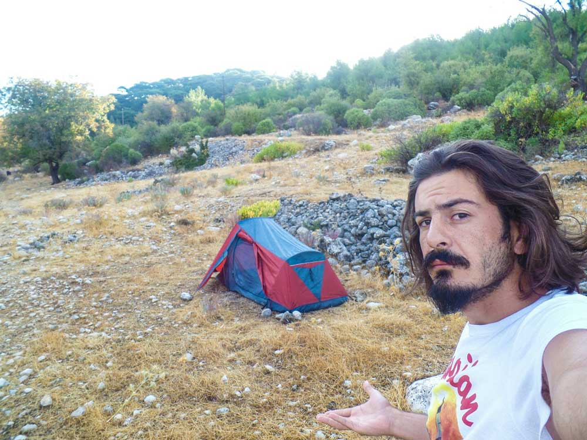
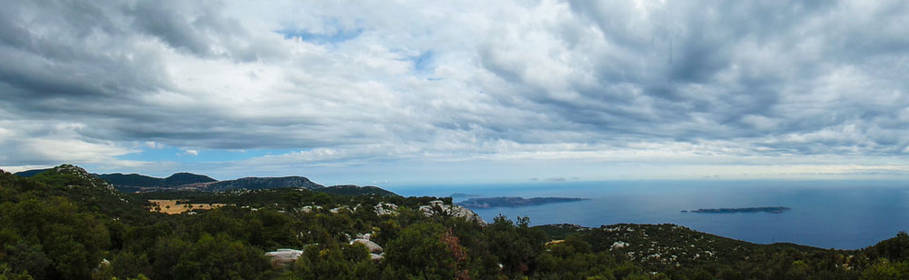
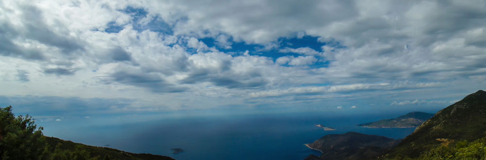
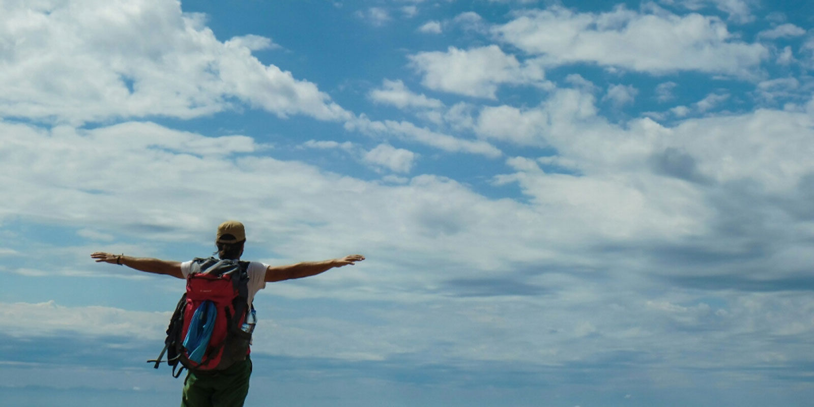
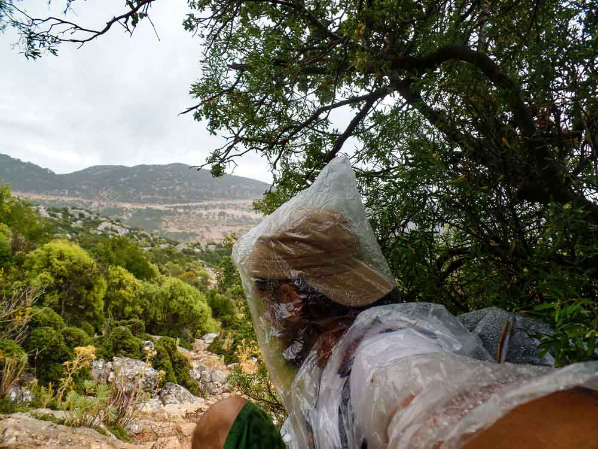

This log entry, dated September 27, 2014, records the eighth stage of the Lycian Way, stretching from Sarıbelen to Gökçeören, which is 12 km long, with notes from a rainy day.

## 2014 Hiking Log: Quick Notes

> Editorial context: These daily notes were written during a hike in 2014, and the following information summarizes the trip’s itinerary.

- Day: 8
- Date: 27 September 2014
- Stage: Sarıbelen – Gökçeören
- Distance: 12 km

### Lycian Way journal navigation

- [Previous day: 7th Bezirgan – Sarıbelen log](/likya-yolu-7.-gun/)
- [11-Day Hiking Index: Ölüdeniz – Kaleüçağız route](/likya-yolu-11-gunde-yurudugum-parkur/)
- [Main route: 11-stage guide for the Lycian Way](/likya-yolu-rotasi/)
- [Lycian Way Stage 8: Sarıbelen to Gökçeören (12 km)](/likya-yolu-rotasi-saribelenden-gokceorene/)
- [Next day: 9th day Gökçeören – Kaş diary](/likya-yolu-9.-gun/)

### Sarıbelen → Gökçeören (12 km), 27 September 2014

I woke last night at about 3. The wind had picked up and it was drizzling. I went out for the clothes I’d left on the ground to dry and got back inside the tent. Then the wind got stronger and the rain came down harder. The ground was too hard for me to pitch properly. I hadn’t been able to drive in the pegs. And then 2 pegs came loose. Oh no, the tent was going to take off. I threw myself outside again in the rain and wind and secured it with rocks. There are enough rocks here to build a wall. I went back to sleep hoping it wouldn’t rain in the morning.

Today, I started my hike a bit later than planned. I waited for the tent to dry, and also did a bit of laundry at the well. The rain had stopped, but the weather was cloudy. I wasn’t sure what to do. After a breakfast consisting of two packs of büskivi, I set off on the 12-14km route to Gökçeören. This section, entirely on a trail and quite tiring, had incredible views. With the clouds added to the scenery, it was truly wonderful. Would such a beautiful view be used for something bad? Well, I can’t really think about that now.

I’m hoping to have a nice meal in Gökçeören. In fact, there seems to be a guesthouse there, and I might stay there and have a nice shower. But I’m continuing on my way, but physically, I can easily feel the weakness in my legs. Then, I came across a house at the top of the mountain.

Hüseyin amca, Fatma teyze, and their son Adem were living there. There wasn’t a soul around. The nearest village was Gökçeören, about a 2-hour walk away. I had a meal, drank tea, and had a lengthy conversation here for a small fee. Hüseyin amca has been living here for a long time and has become quite well-known on the Lycian trail. :). They have a large number of sheep and generate their electricity using solar energy. Then, I said goodbye and continued on to Gökçeören.

These clouds, however, don’t seem very appealing. The rain started before it looked like it would be a proper, solid rain. I put on a nylon raincoat and waited under the base of a tree for about 10-15 minutes for the rain to lessen. This nylon raincoat at least saved the day. When the rain stopped, I quickly reached Gökçeören, where the stones were very slippery because they had gotten wet. The phone isn’t working either. If I were to fall, I’d be stuck. Luckily, I arrived at the village without anything. Hüseyin abi, who runs the pension, greeted me at the entrance. He runs the pension and, following the principle of “a welcomed guest is a blessing,” immediately came to greet anyone who arrived.

I decided to stay here. I started setting up a tent in the pension’s garden, but the rain started again. It was difficult to set up the tent; the ground was incredibly hard. The stakes were all bent. As for the rain, it never stops. I hope it doesn't rain tomorrow. Taking a shower and wearing clean clothes here was really good. Then, a German man named Olaf arrived. He had been traveling for 14 days, starting in Antalya. He said he had a flight to Germany scheduled for next Friday, and he wanted to go as far as possible until then. When I asked him where he learned about the Lycian road, he replied that it’s a very famous place in Germany. He then asked me why Turks don’t walk it. “We prefer to sleep,” I replied with a smile. “Of course, we are a people who prefer to sleep.” However, this is a self-deprecating remark. Olaf told me about the remaining section of the path, mentioning that it was very tiring. I told him a few things to be careful about, and I retreated to my tent.

The sound of rain and wind is coming from outside. Tomorrow’s journey will be long. I aim to walk 28km to reach Kaş. Let’s see what happens.

Additional information: These notes were written during the journey.

---

## Continue walking.

**[Next day: 9th day Gökçeören–Kaş log →](/likya-yolu-9.-gun/)**

[11-day hiking route](/likya-yolu-11-gunde-yurudugum-parkur/)
