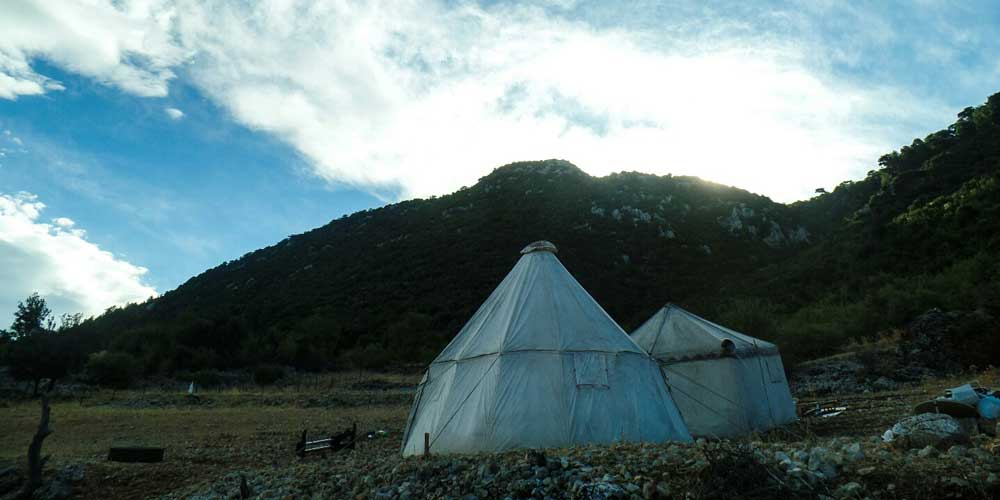
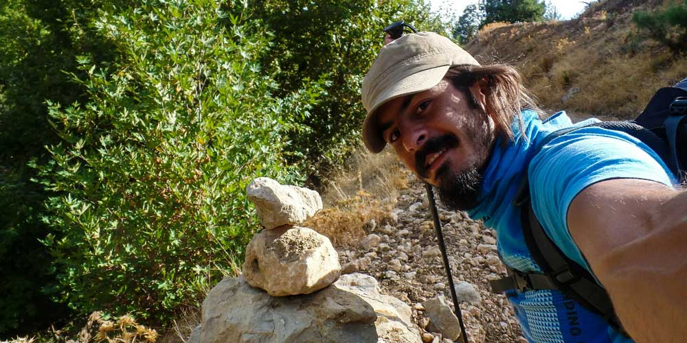
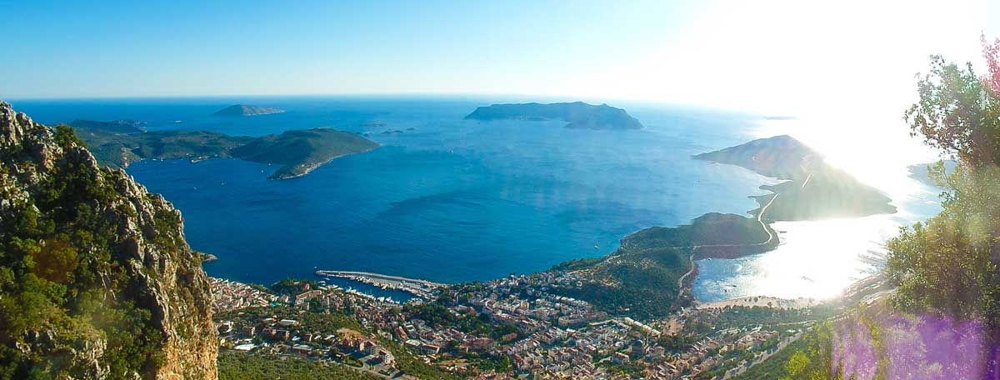

This log entry, dated September 28, 2014, describes the 28 km ninth Lycian Way hike from Gökçeören to Kaş, passing through Phellos and Çukurbağ.

## 2014 Hiking Log: Quick Notes

> Editorial context: These daily notes were written during a hike in 2014, and the following information summarizes the trip’s itinerary.

- Day: 9
- Date: 28 September 2014
- Stage: Gökçeören – Kaş
- Distance: 28 km

### Lycian Way journal navigation

- [Previous · day 8 · Sarıbelen to Gökçeören](/likya-yolu-8.-gun/)
- [All 11 days · Ölüdeniz to Kaleüçağız](/likya-yolu-11-gunde-yurudugum-parkur/)
- [Lycian Way route guide · all 11 stages](/likya-yolu-rotasi/)
- [Lycian Way Stage 9: Gökçeören to Kaş (28 km)](/likya-yolu-rotasi-gokceorenden-kasa/)
- [Next · day 10 · Kaş to Körmen Island](/likya-yolu-10.-gun/)

### Gökçeören -> Phellos -> Çukurbağ -> Kaş (28km) - 28 September 2014

The rain didn’t last long last night. But the blessed wind never stopped. I’d set up the tent well afterwards, so there were no problems. Waking up to a clear blue sky was wonderful. It’s a bit cold, and I’m shivering, but the absence of clouds and rain is more than welcome. Olaf got up earlier than me. I woke at 8, and he was already ready to set off. We said goodbye, maybe we’ll meet again someday. Who knows, the world is small.

The weather was a bit chilly tonight, but I didn’t feel too unwell. After a nice breakfast, I set off around 9. I thought I’d check my phone – but it was dead. After that, nothing worked. Today, I’m aiming to get to Kaş without a phone or GPS. From Gökçeören to Kaş, it’s approximately 30km, and 75% of the road is a dirt path. I set off without a phone or GPS. The signs really threw me off. I lost and returned the signs 4-5 times, wandering around and searching before finally finding them. Sometimes, I didn’t see any signs at all. Because there wasn’t much to do, I just followed the road. Then, when I spotted a sign, I realized I was on the right path. Listening to music really helped me out. I spent a large part of the route listening to music, which helped keep my pace steady. When I was about 5-6km from the ancient city of Phellos, I suddenly found myself in the middle of a herd of horses. They ran away when they saw me. If I hadn’t been listening to music, I would have heard them and approached more cautiously. “Ugh.” But I followed them. I tried to take pictures, but they kept running away. They were running, and I was chasing after them. I managed to get a few pictures :). They were clean and well-maintained horses, but they seemed to be feral. It was really interesting.

Then I realized that I had covered 22km in 5.5 hours. And this is really good. Moreover, I walked on a rough path, and it took me about 4 hours. In addition, I had posted a message on my Facebook page in the evening the previous day, which was published in the morning. Aside from that, I couldn’t contact anyone because my phone was broken. Because our group said they would panic if I stayed in Çukurbağ for one day, I decided to go as far as Kaş. I was very tired when I was only 2-3km away from Kaş. I even looked for a place to set up a camp. However, it was very windy there. I thought I wouldn’t be able to sleep well at night. So, I rested a bit and continued. I arrived in Kaş around 18:00. Of course, it was difficult to find the way just using signs without GPS. My first thing was to go to an internet cafe. Unfortunately, I can’t get on Facebook. It says to enter the code produced by Kodmatik. I got my Facebook account from there and logged in. Then I saw that no one was even wondering about me :). Ayşegül was in Kaş. She said we should let her know when she arrives. My first thing was to call her. She said she would welcome me. I initially said no, to avoid feeling uncomfortable, but she didn’t give up. Becoming civilized made me very happy. I showered, cleaned myself, and ate a meal. I received a really serious logistical support. After 9 days, this was really good for me. Then I started dealing with my phone, but it didn’t work. I also met with Muammer abi. He’s actually the owner. He does diving lessons in Kaş. Ayşegül told me that Ayşegül had visited him. They are very kind and friendly people. They told me to feel at home like I was at their own house. I got everything at their house. Just tell this to the wrong person, my friend :). Now, I’m leaving the house, haha.

It would be really difficult to continue without a phone and without a map. Constantly getting lost is becoming exhausting. It’s taking a toll on you psychologically. So I might stop the walk in Demre or Finike. By the way, I haven’t told our people that I’ll be continuing without a phone. I’ll tell them tomorrow morning and carry on. Right now, I really don’t want to deal with them – they’ll be talking a lot :)

Good night.

23:30

Additional information: These notes were written during the journey.

---

## Keep walking

**[Next · day 10 · Kaş to Körmen Island →](/likya-yolu-10.-gun/)**

[All 11 days · Ölüdeniz to Kaleüçağız](/likya-yolu-11-gunde-yurudugum-parkur/)
