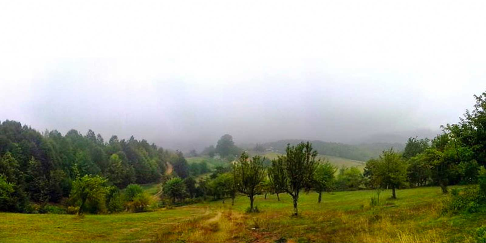

### Where is Menekşe Subatımı valley, and how do I get there?

There are two ways to reach Menekşe Subatımı Highland. From Kocaeli, go through Yuvacık to Aytepe on the first route, then follow the signs for Menekşe Highland. On the second route, go from Kocaeli through Gölcük and Nüzhetiye and follow the same signs. The first road turns to dirt after Aytepe. In places you have to go slowly to avoid scraping the underside of the car. Route 2 is in better shape. It turns to dirt after Nüzhetiye, but the going is easier.

<iframe
  class='mappingFrame'
  src='https://www.google.com/maps?q=40.586044,29.89676&amp;num=1&amp;t=h&amp;hl=tr&amp;ie=UTF8&amp;ll=40.586924,29.903476&amp;spn=0.012238,0.022724&amp;z=14&amp;output=embed'
  width='300'
  height='150'
></iframe>

 

### Menekşe Subatımı’nın yaylası camp area information

##### Available facilities

- Camping Area (You can set up your tent in the flat areas you find. There are no private businesses.)
- Clean water

##### Facilities that are unavailable

- Grocery shop
- Restaurant
- Café

Note: This information dates back to 2013.

### Menekşe Subatımı’nın Hiking Routes

#### From Aytepe and Soğukpınar, crossing Papaz çayırını, then to the Menekşe subatımı plateau, and finally to the Servetiye Karşı village (22 km).

<iframe
  frameBorder='0'
  scrolling='no'
  src='https://tr.wikiloc.com/wikiloc/spatialArtifacts.do?event=view&id=4037382&measures=on&title=on&near=off&images=on&maptype=H'
  width='100%'
  height='600'
  style={{ borderRadius: '10px 10px' }}
></iframe>

- Starting on the route from Aytepe, you first descend to Soğukpınar. From there, you then follow a steep, forest trail to Papaz Çayır and then on to Menekşe Valley. Finally, you descend via a forest path to Servetiye Karşı village.
- There is water in Soğukpınar, Papaz Çayırı, and Menekşe yaylası.
- Soğukpınar – Kayaklıklar arasındaki orman içi patika (trail) might be a bit tiring, as it’s a medium-level route and quite long.

#### From the village of Kırıntı, Menekşe Subatımı traveled to the Subatımı Valley (18 km).

<iframe
  frameBorder='0'
  scrolling='no'
  src='https://tr.wikiloc.com/wikiloc/spatialArtifacts.do?event=view&id=7162797&measures=on&title=on&near=off&images=on&maptype=H'
  width='100%'
  height='600'
  style={{ borderRadius: '10px 10px' }}
></iframe>

- The route begins in Kırıntı village, and proceeds along a dirt road to the Menekşe-Subatımı plateau, passing by the Menekşe plateau, reaching the summit and then returning along the same path.
- The viewpoint offers a beautiful panorama.
- There is water in Kırıntı köyü and in the Menekşe yaylası.
- Overall, it’s a relatively easy course.

#### From Aytepe to Menekşe Subatımı Highland (18 km)

<iframe
  frameBorder='0'
  scrolling='no'
  src='https://tr.wikiloc.com/wikiloc/spatialArtifacts.do?event=view&id=557748&measures=on&title=on&near=off&images=on&maptype=H'
  width='100%'
  height='600'
  style={{ borderRadius: '10px 10px' }}
></iframe>

- There are water points along the parkour route.
- The journey begins in Aytepe and extends to Soğukpınar, and then to Papaz Çayırı. From Soğukpınar, you take a steep, forest trail, which can be tiring. Afterwards, you will proceed through a forest dirt path, passing by the Menekşe Subatımı plateau, and then descend into the forest towards Nüzhetiye.
- A moderately difficult course. It could challenge beginners.
