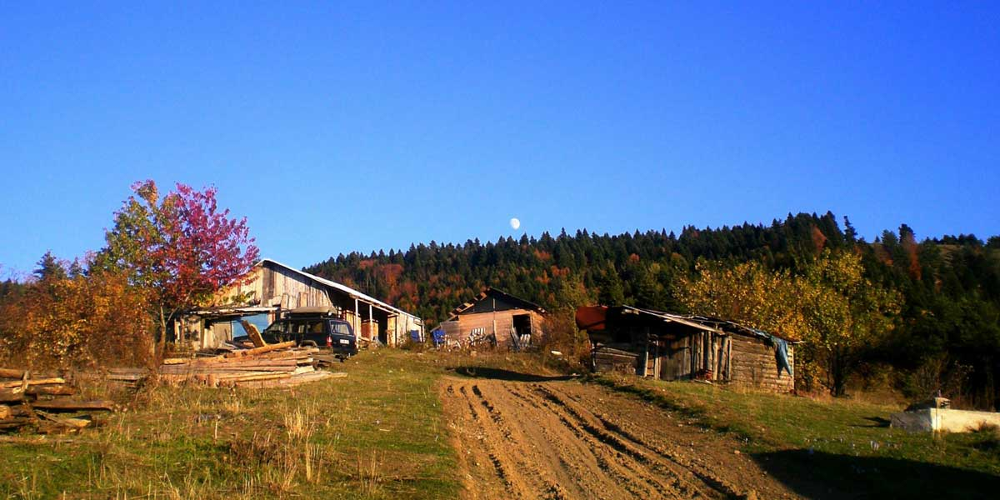
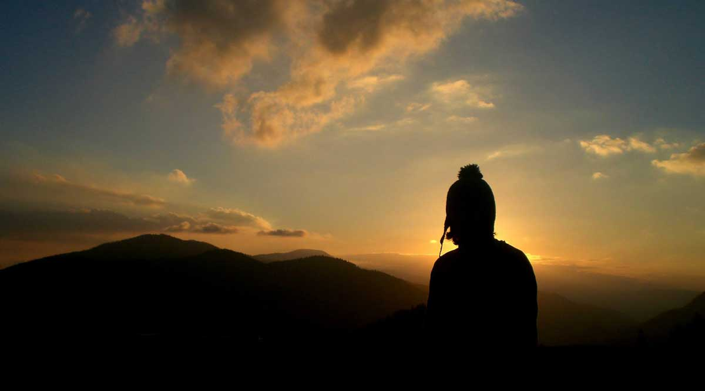
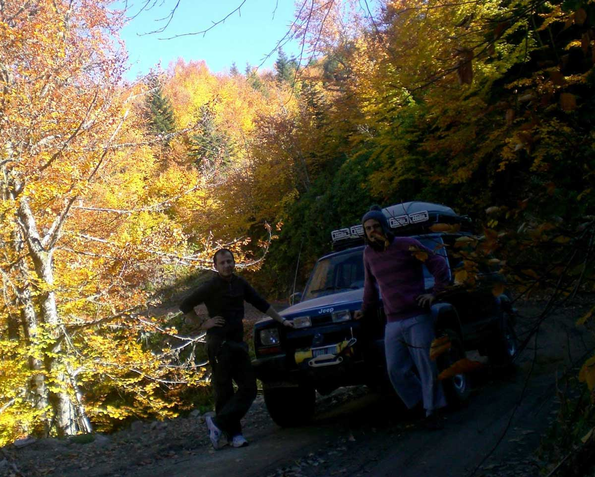
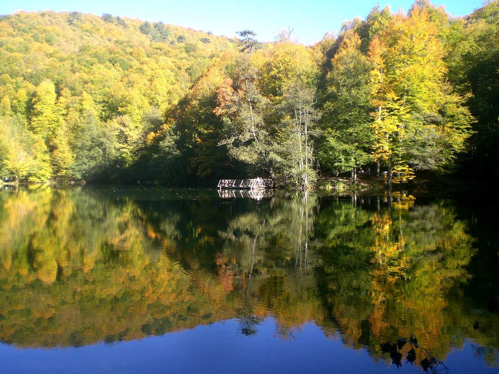

This time, the vacation is long. I’ve decided to go to Yedigöller in Bolu, alone, for a 9-day Kurban Bayramı holiday. Actually, my goal isn’t just to go alone, but when I said I would walk 80km and stay for 7-8 days, no one wants to join me. So, I’ve decided for the first time to set off on my own. I’ve thoroughly researched Yedigöller, made my plans, and determined my route. These travel notes will be written during the journey itself. From now on, I will try to write like this, because I find I can better convey my feelings and what I’m experiencing at the moment.

Day 1, 12/10/2013, Saturday

I was very hesitant about planning a solo trekking of approximately 80km to Yedigöller for the Bayram holiday – there were a lot of risks, and it’s generally not advisable to travel alone. :) But, a foolhardy decision! I made the decision and completed all my preparations. It was also exciting and a strange feeling to be hiking in the mountains and camping alone for the first time. You could also say “yusuf yusuf” about this. We were going to travel with my colleague Neşe and her husband, who works at a company in Bolu, departing on Saturday towards Mersin.

While waiting for the days to pass, I realized that on Saturday morning, I had completed all my preparations and was walking the streets of İstanbul with my belongings. I met with Neşe and Gürkan and set off. It was the beginning of a very uncertain adventure for me, and for them, it was putting up with my rambling conversations :). Then, they dropped me off near Yeniköy, on the edge of TEM, in Bolu. Actually, their initial intention was to rob me and leave me by the roadside, but when they saw that it was Rafık, Ömer's niece, and saw my knife, they gave up :). I want to express my deepest gratitude to them for the transportation and conversation support that helped me begin this adventure. May their heads be in peace.

I carried 26 kilos of weight and all my belongings that would keep me alive, and set off. The road was very long. On the first day, I planned a 14km hike to reach a place on the map where I would set up camp. Of course, I had identified these locations beforehand and had worked quite a bit on the route. But, of course, it wouldn't have made sense to delve into forests without using a saw. I would follow the route I could see on Google Maps – the path to the Yedigöller (Seven Lakes).

While passing from Bakırlı to Yeniköy, the unruly dogs in the houses were terrifying. Those guys would have eaten me if they weren’t on chains. I managed to get past the dogs, but this time, I saw three eagles above me. They were huge, patterned, predatory birds. I think they’re eagles. They looked like they would attack me if my foot hit the ground. “Oh my god,” I said, “if the eagles do this, I’m starting to think about what will happen if…” I’m Nuri’s nephew, Ayıboğan Nuri’s, but I told myself not to hurt the animals, not to break their hearts, and continued on my way.

I had conversations with many people along the way to where I was planning to camp, in villages, in meadows, and while driving on the road. I even spoke with the village headman :). After a roughly 11km uphill, I started to imagine my campsite. My whole body ached, and the remaining 3km didn’t seem to end. There was nothing to do – no place to set up a tent, and no one around. I was forced to walk. After a 5-hour hike, I finally reached the meadow. “I thought a few people might greet me,” I said, “but there was no one.” I couldn’t even find anyone for 2 minutes of chat. While I was trying to set up my tent, a jeep arrived. “We live in these meadows,” they said, “and we came here to explore today.” Then, they insisted that I stay in one of the houses. “I’m a mountaineer,” I said, “but…” the man cut me off and arranged for a house with a stove. “According to local traditions,” they explained, “these meadow houses aren’t locked, and sometimes there’s food available for use.” They said this was done deliberately by the people. So, I went into the house, lit the stove, and ate. The atmosphere was an easy 10. Now, while sipping my tea, I decided to write down my travel notes. My whole body ached, and I was incredibly tired. But I didn’t want to sleep. I thought I could stay in this place, with its amazing view and such a warm atmosphere, for 10 days straight. I wouldn’t regret not going to Yedigöller. But I will go, of course. I’ve written a lot, and I don’t even have paper with me. I hope I can find something. I’ll drink a bit more tea and then sleep. I need to be rested tomorrow. New adventures await me.

Note: Don’t get bogged down in grammar rules; just translate. You already know who you are :)

**Day 2: Sunday, 13/10/2013**

To avoid poisoning myself, I’m waiting for the wood in the fireplace to burn completely. While staying inside the house, I’m really longing to watch the outdoors through the window, hoping to see a wild animal. After half an hour, I see a shadow move. When I direct the light towards it, a pair of shining eyes immediately move behind the other house. Assuming it’s a fox or a wild dog, my dreams are shattered. I fall asleep with the warmth from the fireplace.

I wake up at 7:30. The air is cold, and it feels as though rain is about to fall. Naturally, this won't put me off. I'm heading towards the Yedigöller. I light the stove, then have a proper breakfast. Having spent a very comfortable night, I don't want to leave. The road is long, and the bag is heavy. I say, "Pöff, friend," because there's another incline again. Just as I'm about to set off, I feel a strain in the left rear of my body, and the pain originating from my back strikes my right leg. But it won't put me off. I have plenty of energy and excitement. "Go, go, go, keep going!" I say. The incline never seems to end. Along the way, I saw signs stating that the road to Yedigöller is closed. "Eh, cars are closed, I'll pass," I thought. Naturally, that didn't happen. The right side of the known road is rocky, the left is a cliff. It looks like a landslide. A bulldozer is at work. I thought I'd pass through the forest, but there is no forest. So I got stuck there. Then, I asked the people on the other side for permission to pass. The bulldozer stops, and I carefully cross, bearing the risk of rolling down, and pass without incident. One foot is crushed, I think, İbrahim. On the second day, I'm heading to the plateau I've targeted for camping. When I arrive at that plateau, I see that all the doors are locked. "Come on, İbrahim, you're a mountaineer, aren't you?" I say. Naturally, I had raised expectations for a fireplace the previous day, didn't I? Anyway, I see that it says 15km to Yedigöller. I have already walked 10km. Fatigue is increasing. I give up on camping and steer towards Yedigöller. My goal is to arrive before nightfall. Since it's downhill, I increase my pace. After walking approximately 3km further, the injuries start again. And now, I'm thinking, "What if a car passes and picks me up?" Because I'm struggling to walk. I'm almost as if I can hear a car, so I stop and look back – "Bam, the sound cuts off, and there's no car." "Pöff, this happened five times," I say. I think I'm really losing my mind. Then, I see a car coming. I jump to the middle of the road, and of course, I don't say "What can I give to my brother!" Then, three more cars arrive, and my eyes sparkle. Naturally, one will pick me up, right?

Of course, someone will take me. If not, I’m aiming to travel a bit at night and reach the lakes. My friend, who’s in the back jeep (Yasin), has said he can pick me up. And I’m learning that he’s also set off on the road alone, just like me. I’ve trusted my feet, while he’s trusted the jeep. That’s the only difference :)

Yesterday, I stayed at home with the stove on, but today, Yasin taking me all the way to the lakes was the most meaningful moment. My happiness reached its peak again. I fell on my fourth foot. After dinner with Yasin, I went to my tent. There is no trouble with my right leg, but my left ankle is very sore. I am now in pain even when walking barefoot. It seems that even a young man experiences things like this :). I have been here for two days; I will rest and explore around the lakes. Today, I looked around to set up my tent near the large lake. I think, simply saying that this is a truly remarkable natural place is enough. You are naturally curious about the day-trippers. I said, "Let them go," and they left. They have not been on a bicycle; they have not come this far. One should not come here without staying. Yasin says it takes him about two hours to get here by car. And with everyone gone, the atmosphere is quiet, and I am once again thinking of you. Will it be cold tonight? I am very curious.

**Day 3: Monday, 14/10/2013**

Oh, my goodness, another day is gone. I didn’t sleep early today. Because there’s a reason for it. I was thinking of you. Yes, you. I still don’t know what I feel, but I’m thinking about it. Thinking is free :).

It was a crazy night, though. Why? Because there was a fight between foxes and dogs. Our brave dogs chased after the foxes all night long. They kept coming back and back. One fox even came so close to my tent that I could hear its breathing. “Pişt!” I exclaimed, and it ran off immediately. I was so tired, and my sleeping bag was warm, so I didn’t want to go outside. I could hear all the sounds. The foxes were really driving me crazy. They didn’t let up at all, you know. Then, there were owl sounds. That was nice though ;). But in the morning, there were rustling leaves. We think that’s what the squirrels and mice were making. Because when we woke up early in the morning, we saw them. So, it was a crazy night, right? Despite all of that, I slept for 12 hours :) (I could hear it saying “oha”).

After a lovely morning, we enjoyed a good breakfast before heading towards Gülen Kayalar (the Smiling Rocks), the Dilek Fountain and the waterfall, then continuing towards Seringöl and Deringöl. We walked approximately 5 km. It surprises me that this place has remained so natural despite having so many people. I do not know the words to describe the beauty I am seeing. If I did, I would already be involved with literature :). Let's get back to it, let's not ruin the seriousness of the writing. Anyway, we lit the campfire after dinner. Tonight, we won't be sleeping early; we'll be waiting for the jackals. Meanwhile, the first group arrives around 8:30 pm. We wait for them to approach closely enough to light our lights, then we light our own. Sobeee :). There are four or five jackals in front of us. Their shining eyes stare at us for a while before they run off. I blow my whistle behind them, and they disappear even further. Yes, these were the culprits who’d kicked up such a fuss there yesterday. Waiting, waiting… What is coming, what is going? It is 12 o'clock, and we say we should go to sleep. But, they have come back again. I chase them again. While I am writing these notes in the tent, I hear the dog chasing a jackal. Because all the action takes place in front of my tent. I suppose we are in for another eventful night. And I will be thinking of you again. It would be good to find out who you are :). Goodnight.

**Day 4: Tuesday, 15/10/2013**

Last night, we didn't hear them anymore after chasing a squirrel, and when I woke up in the morning, the squirrels were still roaming around – they are very mischievous, but also incredibly cute animals. After breakfast by the edge of the large lake, we explored the other four lakes we had planned to visit. My plan to visit the Yedigöller (Seven Lakes) was now complete. We could now set a course for our return journey.

After we sorted and loaded the belongings into the car, we planned to spend one more night camping at Yasin’s house in the valley. But before that, we were going to hike to the top of Mount Ayı. When we reached the top of Mount Ayı, we were above the mountains, and we could see everything around us. It was a very beautiful view. But there was no bear :). We collected thyme, ate aloç (a type of plant), and even gathered rowan berries to make tea. And if we had known how to hunt, we would have hunted a deer, which would have been fantastic. Right now, we are receiving a proper fine :).

Afterward, we arrived at the house in the valley, ate, and built our campfire. It was a very interesting day. Although it was supposed to be a quiet day, we didn’t stay in one place. I think the excitement from being on the return journey has faded a bit. We don’t really want to return, but we’ve completed our plans. However, tomorrow will be an exciting day for me. I’ll walk the 14km return journey, and then I’ll try to hitch a ride. Let’s see if anyone picks me up? :) Of course, they will.

It could probably be extended by a few more days, but I’ve started to feel like I’m running out of energy and getting really tired. That’s why I’m thinking about turning back. Actually, I’m turning back because I’m thinking about you. Oh, you. I’m stuck, I’m really stuck. When I camp alone, you just appear, you know? :) Good night.

**Day 5: Wednesday, 16/10/2013**

I think I’ve completely messed up today’s date. :) I really haven’t had any information about the date or the time. What does it matter what date I put – you know? :)

We said there was activity out in the meadow at night – people coming and going – but we didn’t hear a single sound. Or, I slept soundly, without a disturbance. :) After a lovely breakfast, we collected pine cones from the top of the mountain and drank them. They were delicious. Then, it was time to gather. I left all of our excess food, the kind that wouldn’t spoil, at the house in the meadow. Now, the bags needed to get lighter :). And now, it was time to say goodbye to Yasin. Afterwards, I was back on the road.

I had anticipated that today would be a very sad day. Because I was leaving nature, and also leaving you. But you appeared again. Luckily, you stayed there; you didn't come over :). My expectations were completely wrong, and it turned out to be a day where I was incredibly happy and joyful. Why? Because I was starting to go crazy :-o. And, you know, I was already like that :). Today, many people were trying to reach Yedigöller. And as I traveled, I waved to all the cars I encountered. And, of course, many of them waved back to me. I could tell that they were very happy to see me. And that, in turn, greatly increased my own happiness. It’s wonderful to share your happiness with people you don’t even know. In fact, some cars stopped, and we chatted. Yes, the journey went like this – I encountered approximately 40 cars, and I chatted with at least 10 of them. I had pains in my left shoulder and left foot, making it difficult to walk. But I didn’t even care. I didn’t want to spoil my happiness, and I wanted to enjoy the beauty of nature even more.

Then I found myself next to the TEM. Of course, those telephone wires again. I’m so tired and weak that I’m giving up on trying to flag down rides and instead, I’m just walking along the bus station. As I walked towards Bolu, everyone looking at me. People passing by would turn around and look. It must be a strange sight :). Then, after a 18km walk, I arrived at the bus terminal and bought my ticket. And in about 4-5 hours, I was home. Now, a feeling of sadness has come over me, of course. But the most important thing was that I arrived home safely. If you managed to do that, you have a really good reason to be happy :). Best regards.

