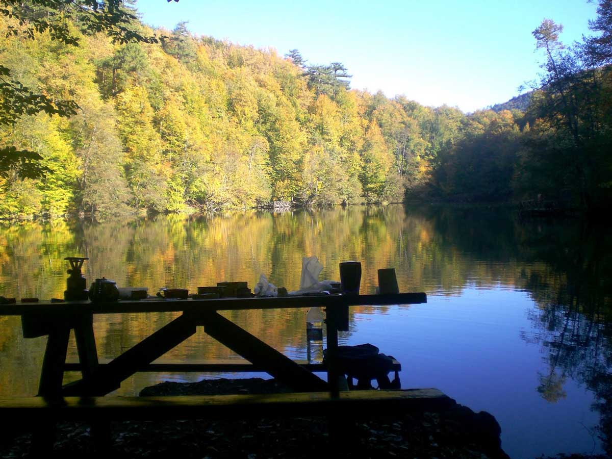
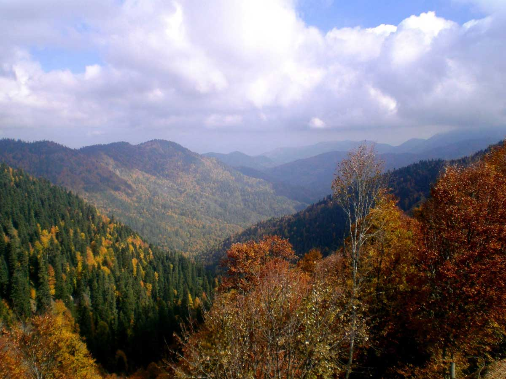
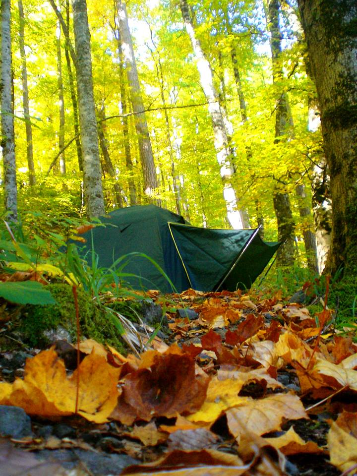
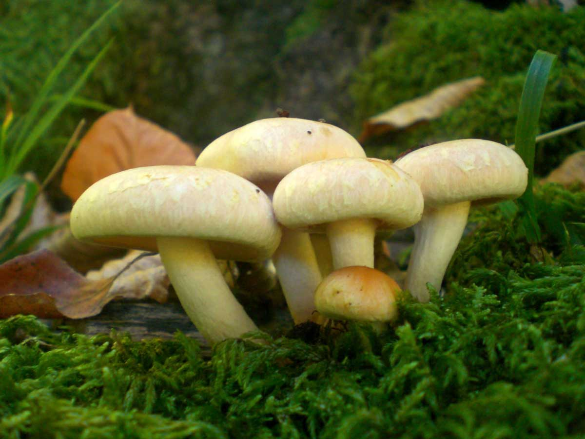
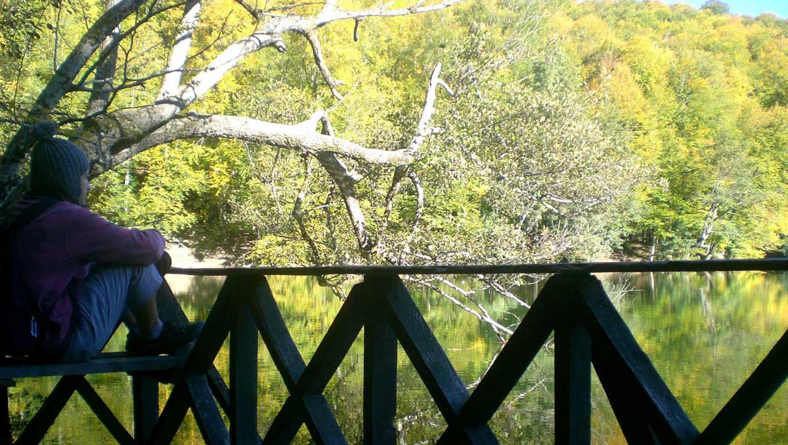

This time, the holiday is long. During the 9-day Kurban Bayramı holiday, I’ve decided to go to Yedigöller in Bolu on my own. Actually, my aim wasn’t just to go alone, but when I said I’d walk 80km and stay for 7 or 8 days, no one wanted to join me. So, I decided for the first time to set off on my own. I thoroughly researched Yedigöller, made my plans, and fixed my route. These travel notes were written during the journey itself. From now on, I’ll try to write like this, because I can better convey my feelings and what I’m feeling at the moment.

Day 1, 12/10/2013, Saturday

I was very hesitant about planning a solo trekking of approximately 80km to Yedigöller for the Bayram holiday – there were a lot of risks, and it’s generally not advisable to travel alone. :) But, a foolhardy decision! I made the decision and completed all my preparations. It was also exciting and a strange feeling to be hiking in the mountains and camping alone for the first time. You could also say “yusuf yusuf” about this. We were going to travel with my colleague Neşe and her husband, who works at a company in Bolu, departing on Saturday towards Mersin.

While waiting for the days to pass, I realized that on Saturday morning I had finished all my preparations and was walking the streets of Istanbul with my gear. I met up with Neşe and Gürkan and set off. For me, it was the start of a very uncertain adventure; for them, it was putting up with my nonsense chatter :). Then they dropped me off near Yeniköy, by the side of the TEM highway in Bolu. Actually, their initial plan was to rob me and dump me by the roadside, but when they realized I was Rafık, Ömer's nephew, and saw my knife, they gave up :). I owe them a huge thank you for the transport and chat support that helped me start this adventure. May your heads be at peace, Oymak.

I shouldered my 26kg pack, laden with the gear needed to keep me alive, and set off. The road was long. On the first day, I planned a 14km uphill hike to reach a spot on the map where I'd set up camp. Of course, I'd already identified these points and put in quite a bit of work on the route. A bit more planning would have been silly, of course :). Speaking of routes, I didn't plunge into virgin forests; I'd be following the Yedigöller path you can see on Google Maps.

While passing between Bakırlı and Yeniköy, the stray dogs in the houses nearly scared the life out of me. Without their chains, those madmen would have eaten me :) I managed to get past the dogs, but this time, three eagles appeared above me. They were huge predatory birds with patterned wings. I think they were eagles. They looked as if they would attack me if I slipped and fell. "Oh my god," I said, "there's a jackal up there, a boar, a bear. If the eagles do this, what else might happen to me?" I thought about that. I'm Ayıboğan Nuri's nephew, but I told myself there's no need to hurt the animals or break their hearts, and continued on my way.

I chatted with many people in cars as we passed through villages, on the highland pasture, and along the road, all the way to where I planned to camp. I even spoke with the muhtar :). After a roughly 11km uphill, I started imagining my campsite. My whole body ached, and the remaining 3km wouldn't end. There was nothing to be done: no place to pitch a tent, and no one around. I had to keep walking. After a 5-hour hike, I finally reached the yayla. I thought, "Even if a few people don't pop some confetti, they'd at least greet me," but there wasn't a soul. We couldn't even manage two riv-riv chats. Just as I was setting up my tent, a jeep arrived. "We have houses in the highland settlement," they said, "and we came to explore today." Then they insisted I stay in one of the houses. "I'm a mountaineer," I said, "and I'm a bit stubborn..." but the man cut me off and arranged for a house with a sobalı stove. According to local traditions, yayla houses aren't locked, and some even have food available for use. People do this deliberately. "So don't be shy," he said, and I went inside, lit the stove, and filled my stomach. The atmosphere was 10 out of 10. Now, while sipping my tea, I decided to write down my travel notes. My whole body ached, and I was incredibly tired. But I didn't want to sleep. In a place with such a stunning view and such a warm atmosphere, I could stay for 10 days. I wouldn't regret not going to Yedigöller, but I will go, of course. I've written so much, and I don't even have spare paper with me. I hope I can find some somewhere. I'll sip a bit more tea and then sleep. I need to be fresh tomorrow. New adventures await me.

P.S. Don’t drive me mad picking apart my spelling. You know who you are :)

**Day 2: Sunday, 13/10/2013**

To avoid getting poisoned, I wait for the wood in the stove to burn completely. Meanwhile, buoyed by the safety of staying indoors, I watch the outside through the window, desperately longing to spot a wild animal. Half an hour later, I see a shadow move. When I shine the light on it, a pair of glowing eyes quickly retreat behind the other house. My dreams are shattered when I realise this animal, which I thought was a jackal or a fox, is actually a stupid dog. I fall asleep, warmed by the stove.

I wake up at 7:30. The house is cold, and the air feels like it's about to rain. Of course, that won't put me off. I'm heading to Yedigöller. I light the stove and then have a proper breakfast. Having slept very comfortably, I don't want to leave. The road is long, and the bag is heavy. "Pöff, friend," I say, because there's another incline again. Just as I'm about to set off, I feel a strain in my left rear ankle, and the pain originating from my back strikes my right leg. But it won't put me off. I have plenty of energy and excitement. "Go, go, go, keep going!" I say. The incline never seems to end. Along the way, I saw signs stating that the road to Yedigöller is closed due to work. "Eh, cars are closed, I'll pass," I thought. Naturally, that didn't happen. It's the known road: rocky on the right, a cliff on the left. It looks like a landslide. A bulldozer is at work. I thought I'd pass through the forest, but there is no forest. So we got stuck there. Then, I asked the people on the other side for permission to pass. The bulldozer stops, and I gather all my courage, taking the risk of rolling down, and pass without incident. One foot slips, and İbrahim is done for. On the second day, I'm heading to the highland pasture I've targeted for camping. When I arrive at that yayla, I see that all the doors are locked. "Come on, İbrahim, you're a mountaineer, aren't you? Pitch the tent." Naturally, the fireplace-equipped house from the previous day raised expectations, didn't it? Anyway, I see that it says 15km to Yedigöller. I have already walked 10km. Fatigue is increasing. I give up on camping and steer towards Yedigöller. My goal is to arrive before nightfall. Since it's downhill, I increase my pace. After walking approximately 3km further, the injuries start again. And now, I'm thinking, "What if a car passes and picks me up?" Because I'm struggling to walk. I almost hear a car, so I stop and look back – "Bam, the sound cuts off, and there's no car." "Pöff, this happened five times." I think I'm really losing my mind. Then, I see a car coming. I jump to the middle of the road, and of course, I don't say "What can I give to my brother!" Then, three more cars arrive, and my eyes sparkle. Naturally, one will pick me up, right?

Of course, someone will take me. If not, I’m aiming to reach the lakes by travelling a bit at night. My friend in the back jeep (Yasin) says he can pick me up. And I find out that he’s also set off on the road alone, just like me. I’ve trusted my feet, while he’s trusted his jeep. That’s the only difference :)

A night in a house with a wood-burning stove, and today Yasin brought me all the way to the lakes. Those were the things that meant the most to me. I was over the moon. Landed on my feet again, didn’t I? After dinner with Yasin I retired to my tent. My right foot’s fine, but the muscle in my left leg is shot. It hurts even without my pack. So it happens to strapping young lads too :) I’ve got two days here to rest and wander around the lakes. Today I only had a quick look around Büyük Lake for a place to pitch. Let’s just say it’s a wonder of nature. And the day-trippers, you ask? I said, “Clear off, the lot of you!” and off they went. Quite a crowd had taken the trouble to come all that way. It took Yasin two hours even by car. If you’re coming this far, stay the night. Now everyone’s gone, it’s quiet and I’m thinking of you again. I wonder if it’ll be cold tonight too.

**Day 3: Monday, 14/10/2013**

Oh, mate, another day has gone. I didn’t go to bed early today. There’s a reason for it. I was thinking of you again. Yes, you. I don’t know who you are to me yet, but I’m thinking about you. Thinking is free :).

It was a night, though. Why? Because there was a fight between jackals and dogs. Our brave dogs chased the jackals until dawn. They kept coming back and forth. One jackal passed so close to my tent that I could even hear its breathing. I said "Pişt!" and it ran off immediately. I was so tired, and the sleeping bag was warm, that I didn't want to go outside. I heard all the sounds. The jackals really wore us out. They didn't give us a moment's peace, friends. Then came the owl sounds. That was nice, though ;). Towards morning, there were rustling leaf sounds. We think these are made by squirrels and mice. Because when we got up early in the morning, we saw them. So, what a night, wasn't it? Despite all that, I slept for 12 hours :) (I can almost hear you saying "oha").

After a lovely morning breakfast, we walked towards the Smiling Rocks, the Dilek Fountain and the waterfall, then onwards to Seringöl and Deringöl. We walked approximately 5 km. It surprises me that this place has remained so natural despite so many people. I don't know the words to describe the beauty I'm seeing. If I did, I'd already be into literature :). Stop chattering, don't ruin the seriousness of the writing. Anyway, after dinner we lit the camping stove. Tonight we won't be sleeping early; we'll be waiting for the jackals. Then the first group arrives around 8:30 pm. We wait for them to get close enough to light our lights, then we light ours. Sobeee :). There are four or five jackals in front of us. Their shining eyes stare at us for a while before they run off. I blow a whistle behind them, and they disappear even further. Yes, these were the culprits who'd kicked up such a fuss there yesterday. Wait, wait… What's coming, what's going? It's 12 o'clock, and we say we should go to sleep. But, they've come back again. I chase them again. While I'm writing these notes in the tent, I hear a dog chasing a jackal. Because all the action is happening right in front of my tent. I suppose we're in for another eventful night. And I'll be thinking of you again. It would be good to find out who you are :). Goodnight.

**Day 4: Tuesday, 15/10/2013**

Last night, we didn't hear them anymore after chasing a squirrel, and when I woke up in the morning, the squirrels were still roaming around – they are very mischievous, but also incredibly cute animals. After breakfast by the edge of the large lake, we explored the other four lakes we had planned to visit. My plan to visit the Yedigöller (Seven Lakes) was now complete. We could now set a course for our return journey.

After we packed and loaded our gear into the car, we planned to spend one more night camping at the house on the highland pasture with Yasin. But before that, we were going to hike to Ayı Tepesi. When we reached Ayı Tepesi, we were above the mountains, and everything around us was visible. The view was stunning. But there was no bear :). We collected thyme, ate aloç, or rather aluç, and even gathered rose hips to boil and make tea. If only we had known how to hunt, we would have bagged a deer – that would have been perfect. Now we’d be paying a hefty fine :).

Later, we reached the house on the highland pasture, ate our fill, and lit our kamp ocağı. It was a very interesting day. Although it was a quiet day, we didn’t stay put for long. I think the excitement has faded a bit now that we’re on the return journey. We don’t really want to go back, but we’ve completed our plans. However, tomorrow will be an exciting day for me. I’ll walk the 14km return route, then hitch a ride. Let’s see if anyone picks me up? :) Of course they will.

I could have stayed a few more days, but I was starting to lose my strength and getting really tired. So I’m thinking about turning back. Actually, I’m turning back because I’m thinking about you. Oh, you. Who are you, anyway? I got stuck, I’m really stuck. When I camp alone, you just get all over me, that’s how it is :) Good night.

**Day 5: Wednesday, 16/10/2013**

I think today’s the only date I’ve actually got right :) I’ve pretty much lost track of the days and the time. What do I need the date for out here anyway? :)

There was supposed to be some activity in the highland settlement at night – people coming and going – but we didn’t hear a single sound. Or, my sleep was heavy again; I slept soundly without a disturbance. :) After a lovely breakfast, we boiled and drank the rosehips we’d collected from Ayı Tepesi. They were delicious. Then, it was time to pack up. I left all our excess food – the kind that wouldn’t spoil – at the house in the highland settlement. Now, the bags needed to get lighter. :) And now, it was time to say goodbye to Yasin. Afterwards, I was back on the road.

I thought today would be very sad. Because I was leaving nature, and also leaving you. But you appeared again. Luckily, you stayed there and didn't come :). My expectations were completely wrong, and it turned out to be a day where I was incredibly happy and joyful. Why? Because I was going a bit crazy :-o. And, you know, I was already like that :). Today, many people were trying to reach Yedigöller. And as I traveled, I waved to all the cars I encountered. And, of course, many of them waved back to me. I could tell they were very happy to see me. And that, in turn, greatly increased my own happiness. It's wonderful to share your happiness with people you don't even know. In fact, some cars stopped, and we chatted. Yes, the journey went like this – I encountered approximately 40 cars, and I chatted with at least 10 of them. I had pains in my left shoulder and left big toe, making it difficult to walk. But I didn't even care. I didn't want to spoil my happiness, and I wanted to enjoy the beauty of nature even more.

Then I found myself by the TEM. Of course, those fences again. I was so exhausted and drained that I gave up on jumping the fences and haggling for lifts, and instead set off for the bus station. Walking towards Bolu like this, everyone stared at me. Those passing by turned around to look. It must be an unusual sight :). Then, after an 18km walk, I reached the bus terminal and bought my ticket. And 4-5 hours later, I was home. Now, a melancholy has settled over me, I suppose. Of course, the most important thing was getting home safely. If you’ve managed that, you have a very good reason to be happy :). Best regards.

