Zorlu Mountain, Kaçkar Mountains

August is the most beautiful time to go to the Kaçkar mountains. This is because it’s the month with the best weather conditions. During this month, rainfall decreases, and temperatures increase further. If you’re considering going in other months, be prepared for rain at all times, as it’s in the Eastern Black Sea region.

Plan

We are starting our trekking (nature hike) tour to the Kaçkar mountains on 16 August. Our route will take us via Erzurum to Yusufeli, then through Altıparmak (Barhal) village to Olgunlar (Hevek) yayla. We will park our vehicle here and use the Naletleme pass to cross the Kaçkar mountains, descending via Kavrun Highland to Ayder Highland. We will return the same way. Our group consists of three people, and we will stay for two nights and three days. We will take our tent, sleeping bags, and enough food to last us along the way. We don’t want to be without food at the top of the Kaçkars :). Since there are many natural water sources along our route, we won’t worry about water.

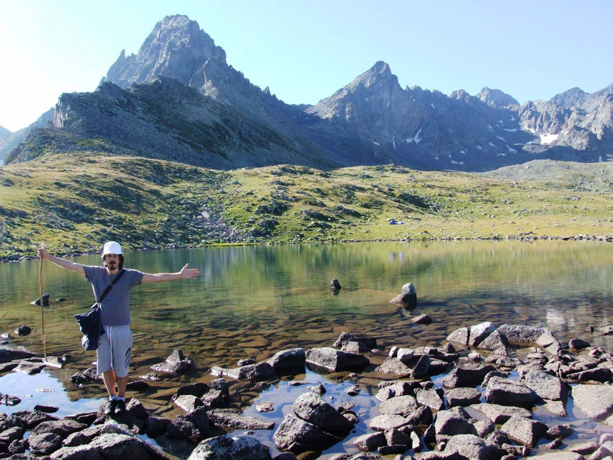

**DAY ONE** At 6:00 on the morning of 16 August we set off from Erzurum. The whole group is excited. A new adventure and the Kaçkar Mountains are waiting for us. The road from Erzurum to Yusufeli is paved and very easy. However, after Yusufeli, as we get closer to Altıparmak village, the road gets rougher and the bends increase. Between Altıparmak and Olgunlar, the road is now very rough. We cover the roughly 25 km in 1 hour. However, the road is enjoyable, nature is very beautiful, so we don't get bored.

Six and a half hours later we’re up on Olgunlar Highland and can barely find anywhere to park. Why all the cars? It turns out people come up here to celebrate Eid at the end of Ramadan. There’s dancing to the sound of the tulum, the local bagpipes, and lamb roasting on spits. We’re short on time, so we can’t stay for the festivities.

If you continue straight up from Olgunlar Highland, you will first reach Deniz Gölü, and then the summit of the Kaçkarlar. From there, you can reach Kavrun Highland after a very steep and challenging rocky descent. We don’t want to tackle this route with our backpacks, weighing approximately 20 kg each. [To reach the relevant route, click here.](http://tr.wikiloc.com/wikiloc/view.do?id=2137109) As an added note, there are guesthouses available for staying at Olgunlar Highland.

Time to get started.

It’s 12:30 and we’re heading for Naletleme Pass, entering the valley that branches off to the right of Olgunlar Highland. Actually, we’re starting this journey later than we should have. However, on the first day we plan to cross Dibe yayla, reach Naletleme Pass, cover 14 km and camp beside Karadeniz Lake. We take the stream on our left, which starts at the entrance to Naletleme Pass and joins other waters further down, and follow the path uphill. This path takes you straight to Naletleme Pass.

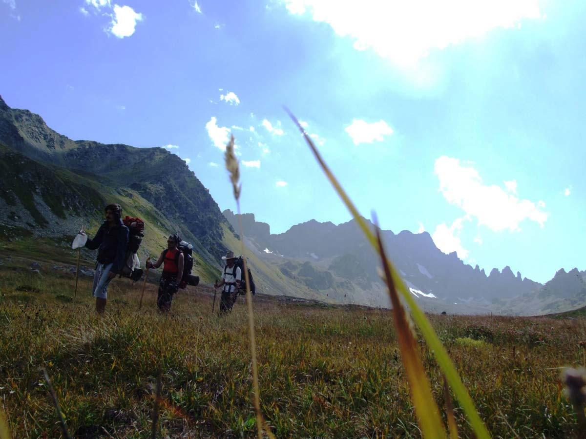

After walking a bit further, the valley turns to the left. And what do we see? The summit is right in front of us. Our excitement grows even more. The distance is greater, but the view is magnificent. As we followed the trail, we realised we were climbing higher and higher. At a point where we were very close to the pass, suddenly a huge swarm of butterflies started flying around us. They were all different colours, and dozens of them were fluttering all around us. We had seen butterflies along the way, but we had never found ourselves in the midst of so many. After all, Yusufeli is one of the places in the world with the greatest butterfly diversity.

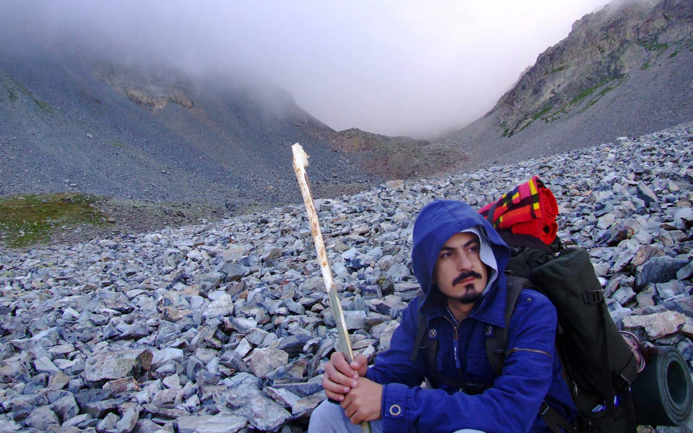

Naletleme Geçidi and the Spot Where the Water First Emerges

And finally, we reached the pass. As long as you follow the path, you won’t lose your way here. We’re greeted by an extraordinary view: clouds drifting through the pass. It’s mysterious and intriguing, because you don’t know what lies beyond. The deeper we go into the pass, the visibility drops to just 10 metres. While 10 metres might seem like enough, all you can see are rocks. Everything is rocky, and the air has turned quite cold. We’ve put on thicker layers. To avoid losing the path, people have stacked stones on top of each other. This makes things much easier for us. Otherwise, we’d have certainly lost our way. Even in August, you can still find snow in this pass.

There was about an hour left before the sky darkened. We had covered most of the pass, but this time there was fog. Because of the fog, we started using our lanterns. We were now very tired and wanted to set up our tents by the Black Sea as soon as possible. The trail simply wouldn't take us to the lake. Due to the fog, we couldn't quite tell where we were going. There was no flat ground to set up a tent. We checked the GPS and saw we were near the lake, but since everywhere was rocky and stony, we didn't know how to get there. And now the sky had darkened and our energy was fading. This was the last thing we wanted. The phones weren't working anyway. We had to move forward somehow. The fog intensified further and we seemed to be losing the trail. The worst possible scenario for us was beginning to unfold. In fact, it was our fault. We had stayed awake the night before and had started the hike late. You, for your part, don't take such risks in places where few people pass. Then we found a small clearing and immediately set up our tent there, spending the night. We were very tired, our morale and motivation had dropped. We were near the lakes but couldn't guess exactly where we were. After eating, we went straight to sleep.

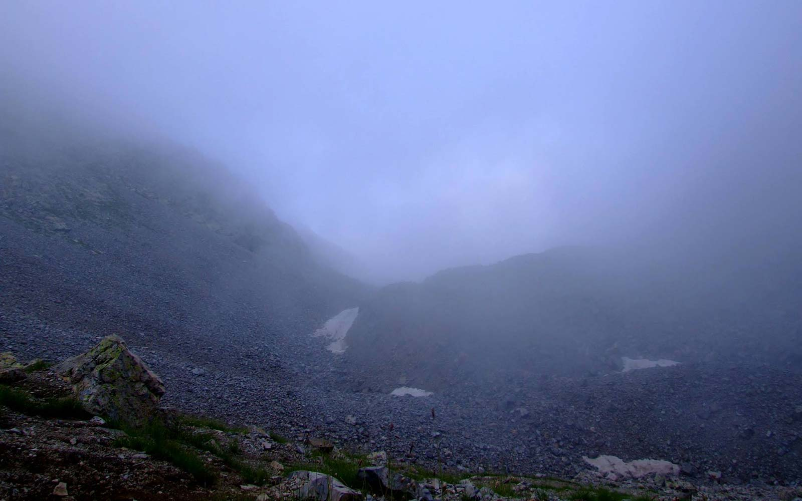

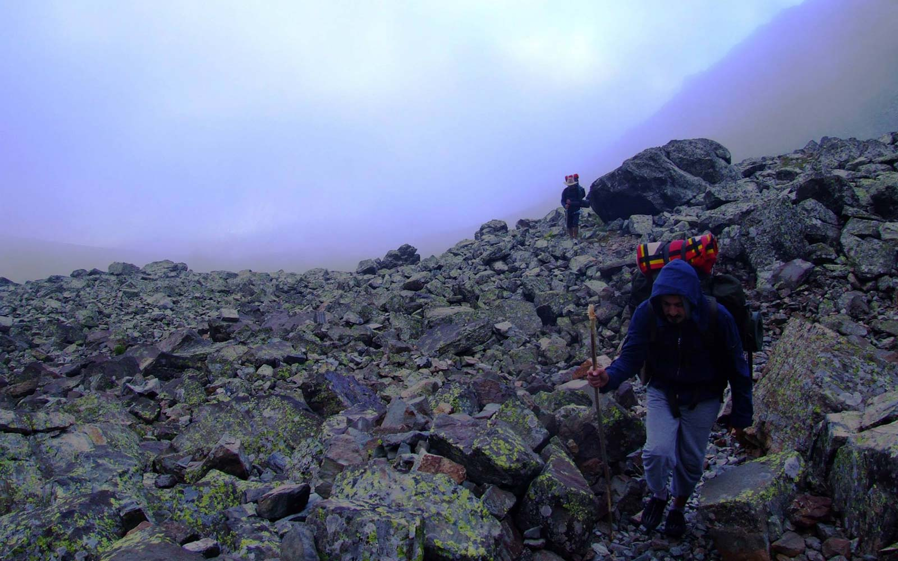

Second Day

Black Sea (Lake)

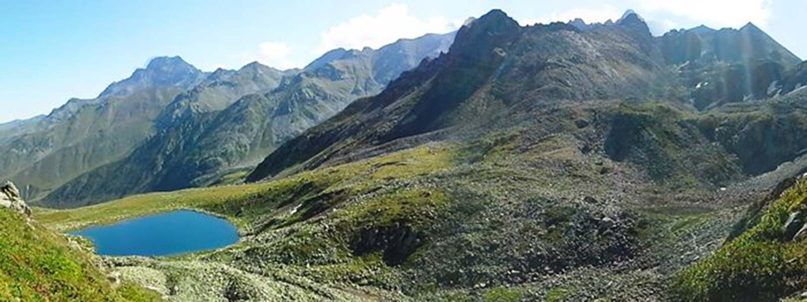

And then came that moment. I stepped out of the tent and there was the lake, right there. We’d got that close without seeing a thing in the fog. The sun was out, we’d had our sleep and at last we knew where we were. All our energy and excitement came rushing back. We’d crossed the pass. Here we were at the lakes, with about 5 km to go to Kavrun Highland, where we could catch a minibus down to Ayder. We decided to leave the tent and the rest of our gear here. If we made it back before dark, we’d spend another night in the same spot.

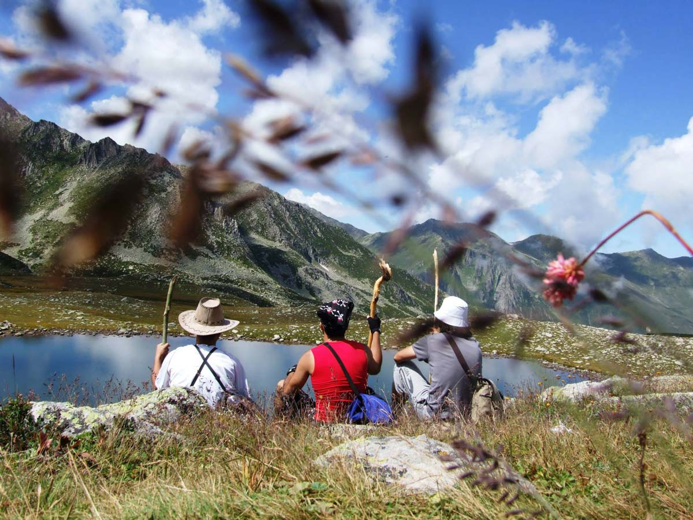

The view was very beautiful while driving to Yukarı Kavrun Highland.

As I was descending into the Yukarı Kavrun Highland, near the lakes, I encountered many people – separate groups of hikers walking towards the lakes. I arrived at Ayder Highland for the first time, starting from Yukarı Kavrun.

Ayder has become increasingly popular with tourists. Despite this, it continues to preserve its natural beauty. Due to Bayram (a major holiday), it had become extremely crowded. We realized we wouldn't be able to find a tent before nightfall. After nightfall, we decided to stay in a guesthouse because walking would be very risky. Moreover, we wanted to spend the night well, as we would be crossing the pass again the next day. However, the guesthouses in Ayder were fully booked, and they were asking very high prices for the few remaining places. Later, a minibus driver who offered to help us arranged accommodation for us in Yukarı Kavrun Highland, and we spent the night there.

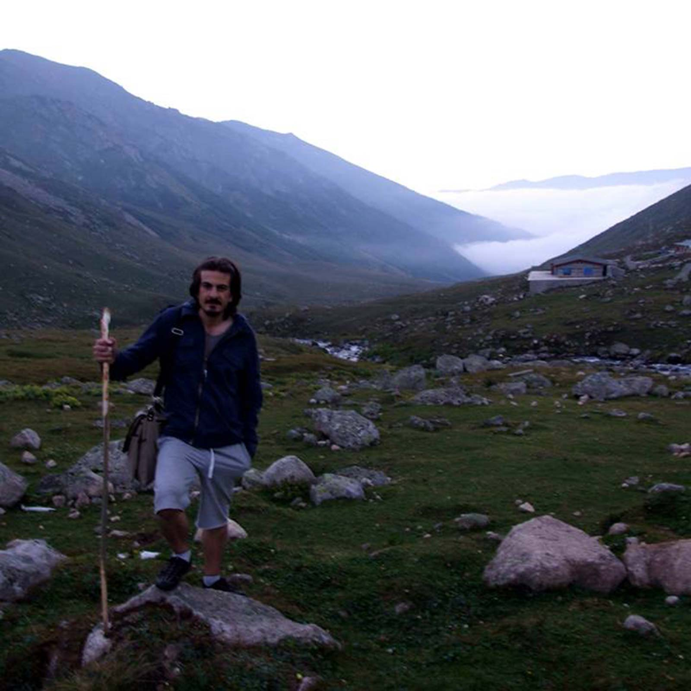

LAST DAY

The next morning, we set off early. First, we reached the spot where we had left the tent. We started walking towards the path, gathering our belongings. After a pleasant and energetic hike in sunny weather, we arrived at the place where we had left the car in Olgunlar Highland. When we arrived, the valley was completely empty, with no one there. After approximately 6 hours of travel, we safely returned to Erzurum.

Don’t forget; the most beautiful part of any adventure is to complete it safely and return home.

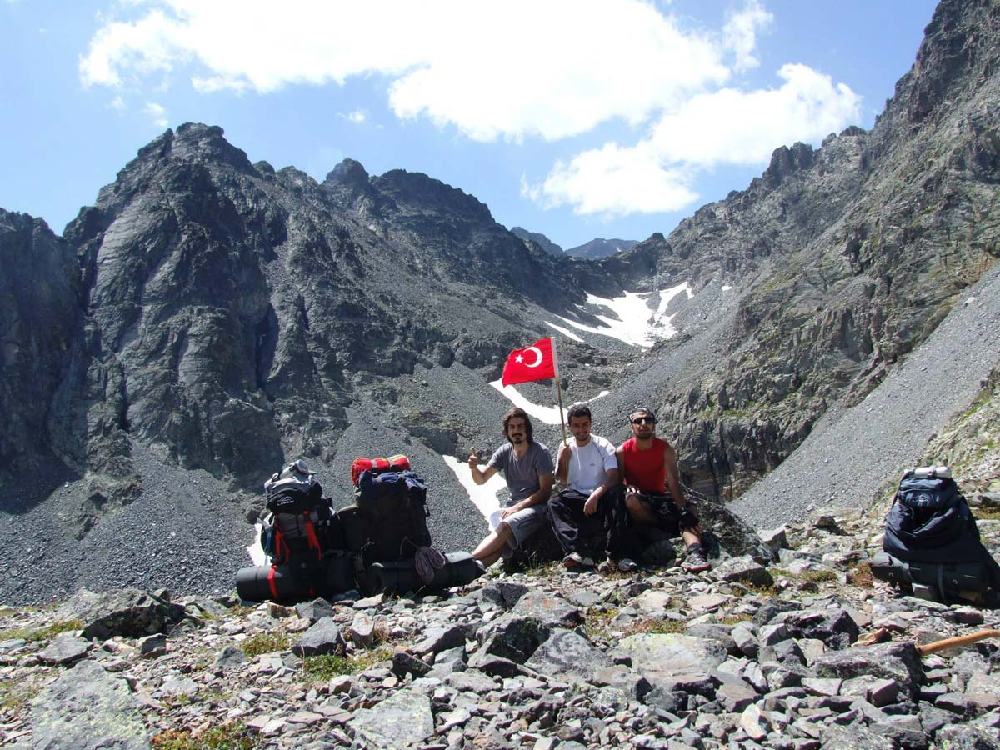

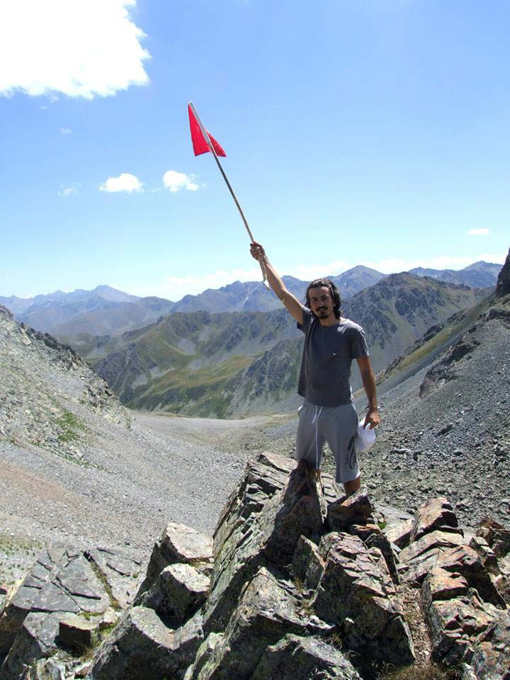

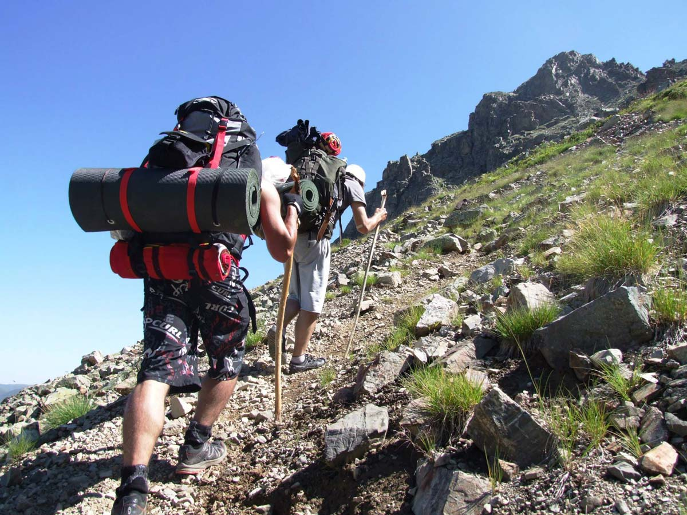

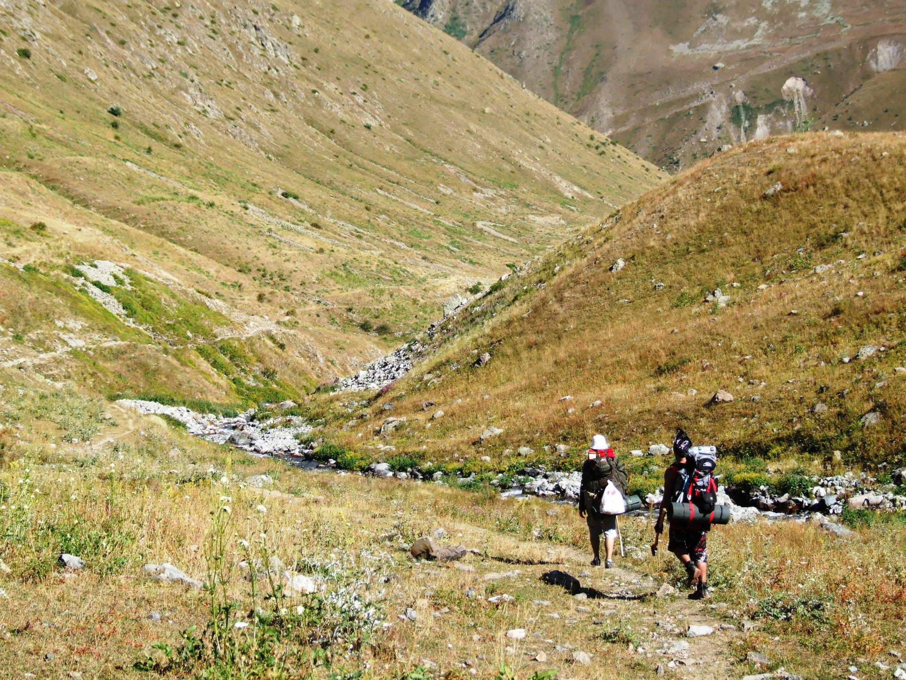