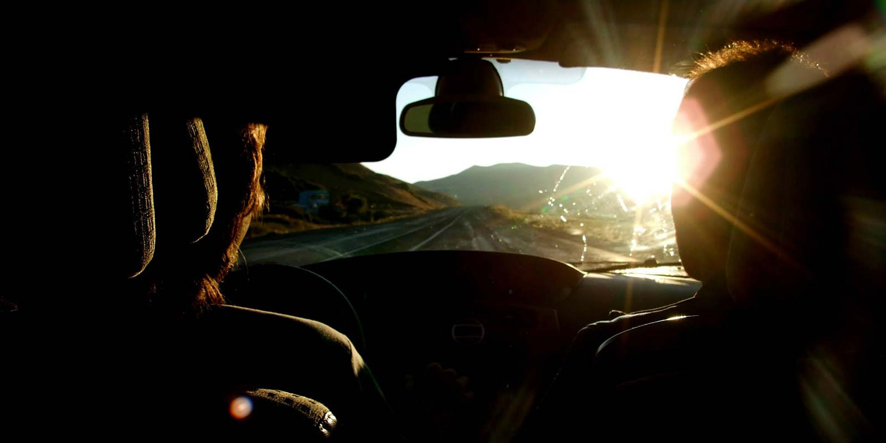
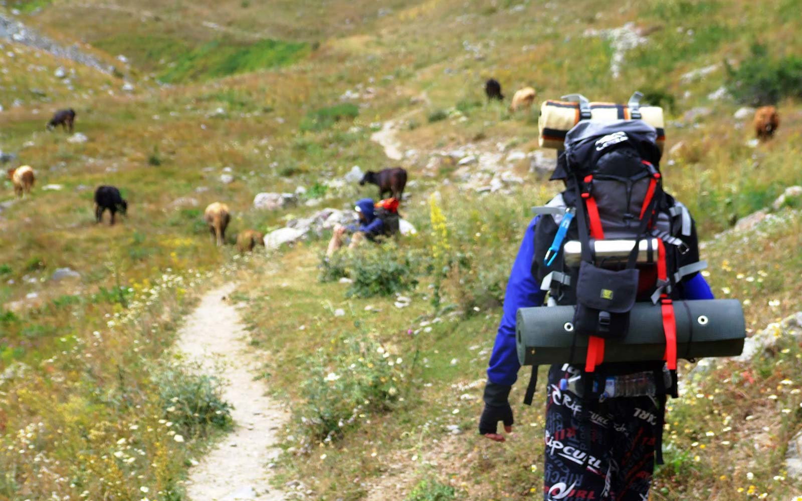
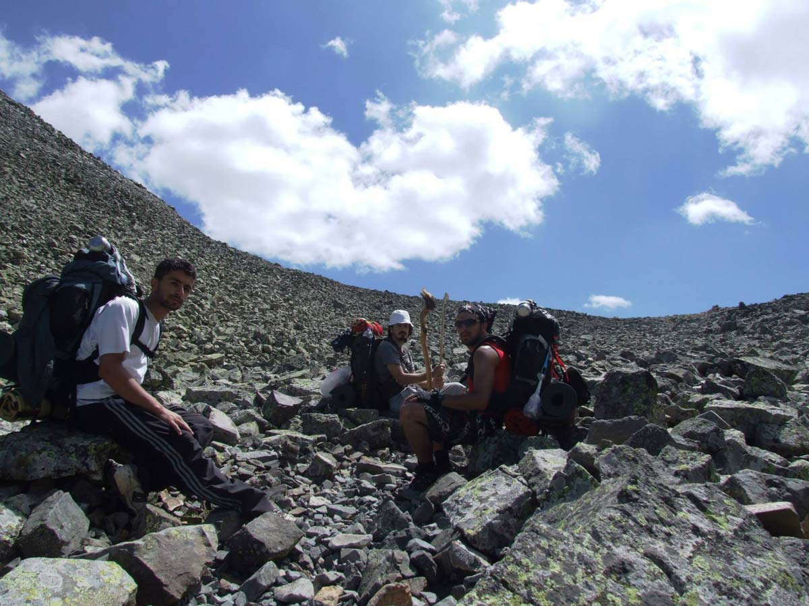
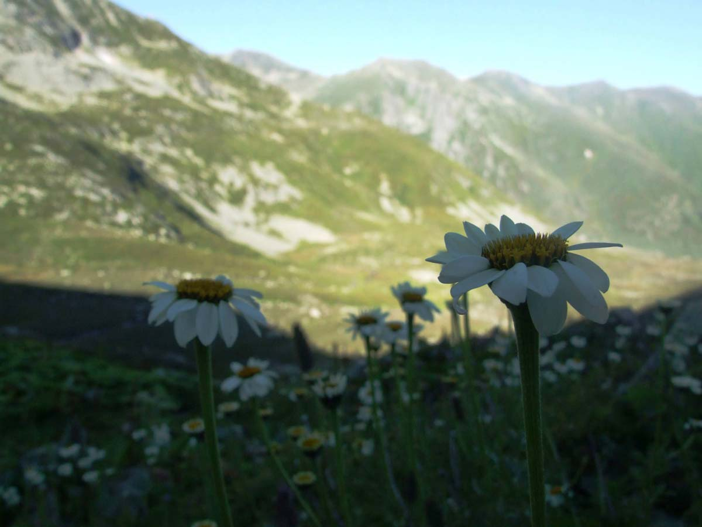

Zorlu Mountain, Kaçkar Mountains

August is the most beautiful time to go to the Kaçkar mountains. This is because it’s the month with the best weather conditions. During this month, rainfall decreases, and temperatures increase further. If you’re considering going in other months, be prepared for rain at all times, as it’s in the Eastern Black Sea region.

Plan

We are starting our trekking (nature hike) tour to the Kaçkar mountains on August 16th. Our route will be via Erzurum, to Yusufeli. Then, we will reach the Olgunlar (Hevek) valley via the Altıparmak (Barhal) village. We will park our vehicle here and use the Naletleme pass to cross the Kaçkar mountains, and descend via the Kavrun valley to Ayder valley. We will follow the same route back. We are a group of 3 people, and we will be staying for 2 nights and 3 days. We will bring our tent, sleeping bags, and enough food to get us through the journey. We don’t want to be without food at the top of the Kaçkars :). Since there are many natural water sources along our route, we won’t worry about water.

**DAY ONE** At 6:00 on the morning of 16 August we set off from Erzurum. The whole group is excited. A new adventure and the Kaçkar Mountains are waiting for us. The road from Erzurum to Yusufeli is paved and easy. After Yusufeli, as you get closer to Altıparmak village, the road gets rougher and the bends more frequent. From Altıparmak to Olgunlar it’s very rough. It takes us 1 hour to cover the roughly 25 km. It’s an enjoyable drive with lovely scenery, so we don’t get bored.

After a 6 hour and 30 minute journey, we are now in Olgunlar yaylası, and we’re having trouble finding a place to park the car. Why? We’ve learned that people here celebrate Ramadan Bayram with festivities in the valley – we’re seeing people making tulum (traditional felt hats) and preparing kuzu çevirme (lamb skewers). Because our time is limited, we can’t stay and enjoy the festivities.

If you continue upwards from Olgunlar yaylası, you will first reach Deniz Gölü, and then the summit of the Kaçkarlar. From there, you can reach Kavrun yaylası after a very steep and challenging rocky descent. We don’t want to undertake this route with our backpacks, which weigh approximately 20 kg. [To reach the relevant route, click here.](http://tr.wikiloc.com/wikiloc/view.do?id=2137109) There are also guesthouses available to stay in Olgunlar yaylası.

Time to get started.

It’s 12:30. We enter the valley that branches off to the right of Olgunlar Highland and head for Naletleme Pass. We’ve started later than we should have. On the first day we plan to cross Dibe Highland, reach Naletleme Pass, cover 14 km and camp beside Karadeniz Lake. We keep the stream on our left. It starts at the entrance to Naletleme Pass and joins other streams farther down. We follow the path uphill and it takes us straight to the pass.

We walked a bit further, and then turned towards the valley to the left. And then, what do we see? The summit is right in front of us. Our excitement is growing. The distance is longer, but the view is incredible. As we followed the path, we noticed that we were steadily climbing. We reached a point where we were very close to the gorge, and suddenly, a huge number of butterflies started flying around us. They were all different colors, and dozens of them were flying all around us. We had seen butterflies along the way, but we had never encountered so many butterflies in one place. Yusufeli is already one of the places in the world where butterfly diversity is at its highest.

Naletleme Geçidi and the Spot Where the Water First Emerges

And finally, we arrived at the narrow passage. Following the path will ensure you don’t get lost here. We are confronted with a unique and mysterious sight, one that evokes curiosity because you don’t know what lies ahead. As you enter the passage, the visible distance decreases to approximately 10 meters. While 10 meters might seem like a good distance, you can only see rocks. The area is rocky, and the air is becoming noticeably colder. We put on thicker layers. People have built up a series of rocks to ensure they don’t lose their way. This makes the task incredibly easy. Otherwise, we would certainly have lost our direction. This passage can even see snow, even in August.

The sky is darkening, about an hour remains. We’ve covered a large portion of the route, but there’s fog. Because of the fog, we’ve started using our lanterns. We’re now very tired and we want to set up our tents on the edge of the Black Sea. The trail isn’t letting us reach the lake. Because of the fog, we can’t really determine where we are. After eating, we immediately went to sleep. We were very tired and our morale and motivation had decreased. We were close to the lakes, but we couldn’t accurately determine where we were. We actually made a small clearing and set up our tents there, but we were very tired. We couldn’t accurately determine where we were. It’s really something we didn’t want to do. The phones aren’t working at all. We have to find a way to move forward. The fog is becoming increasingly intense, and we’re starting to lose our way. What we really didn’t want to happen is starting to happen. In fact, we were wrong, because the previous night we hadn’t slept well and we had started our hike late. You shouldn’t take such risks in places where few people pass through.

Second Day

Black Sea (Lake)

And then, that’s when it happened. When I stepped out of the tent, I realized we had arrived right by the lake. We hadn’t noticed anything because of the sunny weather, our tiredness, and the fact that we knew exactly where we were. We had already passed the barrier – we were at the lake, and we would be at Kavrun meadow approximately 5 km from here. Then, we would use the local minibuses to get to Ayder. We decided to leave our tent and other belongings here. If we could return before the weather turned dark, we would spend the night here again.

The view was very beautiful while driving to Yukarı Kavrun Plateau.

As I was descending into the Yukarı Kavrun valley, near the lakes, I encountered many people – separate groups of hikers walking towards the lakes. I arrived at Ayder valley for the first time, starting from Yukarı Kavrun.

Ayder has become increasingly popular with tourists. Despite this, it continues to preserve its natural beauty. Due to Bayram (a major holiday), it had become extremely crowded. We realized we wouldn't be able to find a tent before nightfall. After nightfall, we decided to stay in a guesthouse because walking would be very risky. Moreover, we wanted to spend the night well, as we would be crossing the pass again the next day. However, the guesthouses in Ayder were fully booked, and they were asking very high prices for the few remaining places. Later, a minibus driver who offered to help us arranged accommodation for us in Yukarı Kavrun plateau, and we spent the night there.

LAST DAY

The next morning, we set off early. First, we reached the spot where we had left the tent. We started walking towards the path, gathering our belongings. After a pleasant and energetic hike in sunny weather, we arrived at the place where we had left the car in Olgunlar Valley. When we arrived, the valley was completely empty, with no one there. After approximately 6 hours of travel, we safely returned to Erzurum.

Don’t forget; the most beautiful part of any adventure is to complete it safely and return home.

 to Olgunlar Valley, via the Kaçkar Mountains, 2013")