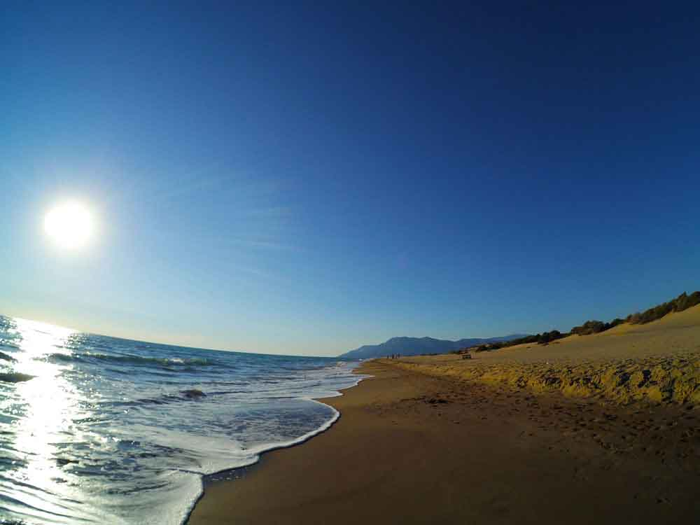

Patara beach is 18km long and is the longest beach in the Mediterranean. Half of the beach is located in Antalya, and the other half is on the border of Muğla. The Patara side is more beautiful. Although the sea is constantly wavy, the beach has a very beautiful sand. You can’t finish walking on the 18km stretch of sand. When I leaned against the sea and walked on the sand dunes, I felt like I was in the desert. In winter, there’s a beautiful view with the redness of the sun during sunset. It’s also the beach where Caretta Caretta turtles lay their eggs. It’s open to people during the day and to them at night. I don’t know if we step on the sand when they lay their eggs. I have information that they lay their eggs in May. Those who are curious can read the news “[Patara’s Young ‘Caretta’ Turtles Meet the Sea](http://www.haberler.com/patara-nin-yavru-caretta-lari-denizle-bulusuyor-4994792-haberi/)”.

Patara is a city that was once the capital of the Lycian civilization. The ancient city of Patara is located immediately next to the beach. When you come to Patara, you can explore the ancient city for hours. It’s a vast city, and exploring it will take several hours. Excavation and restoration work are still ongoing. It’s a place that ancient city enthusiasts should visit.

### Where is Patara Beach and how do you get there?

Driving from Antalya towards Fethiye, look for the sign for Patara on the left after passing Kalkan. Take that turn. In about 5–6 minutes you’ll pass through Gelemiş village and reach the ancient city of Patara. There’s an entrance fee for both the ruins and the beach. You can get in without paying if you have a museum pass.

<iframe
  class='mappingFrame'
  src='https://www.google.com/maps/embed?pb=!1m26!1m12!1m3!1d41475.49134071756!2d29.326969579978517!3d36.27501370364359!2m3!1f0!2f0!3f0!3m2!1i1024!2i768!4f13.1!4m11!3e0!4m3!3m2!1d36.269559699999995!2d29.400693999999998!4m5!1s0x14c02ead63170a3f%3A0x35a9c0a15ea8e437!2zUGF0YXJhIFBsYWrEsSwgMDc5NzUgS2HFny9BbnRhbHlh!3m2!1d36.254314!2d29.313651999999998!5e0!3m2!1str!2str!4v1475766241613'
  width='300'
  height='150'
  allowfullscreen='allowfullscreen'
></iframe>

 

### Patara Beach Shuttle Schedules

The bus schedules for buses traveling from Patara beach to Kalkan, Kaputaş, Kaş, Fethiye and Patara (Gelemiş) village are as follows. You can get information regarding your questions at the number 0242-843-51-17.

| Kalkan-Kaputaş-Kaş                        | Fethiye                       | Patara (Gelemiş) Village                                        |
| ----------------------------------------- | ----------------------------- | ----------------------------------------------------------- |
| 12:40 14:00 15:05 16:05 17:05 17:35 18:45 | 12:40 14:00 16:00 17:00 18:45 | 12:40 14:00 15:00 16:00 17:00 17:30 18:00 18:30 19:00 19:30 |

### Patara Beach camping area information

##### Available facilities

- In the village of Patara (Gelemiş), there are campsites. I can recommend Medusa campsite.
- If you happen to find a place – a property that isn’t owned by anyone, meaning it’s not private property – at the entrance to the village, you could set up a tent.
- If you’re wondering if you can set up a tent on the beach, there are areas with trees here and there. Because it’s a protected area, the night watchman is likely to keep you from entering.
- There are many markets, guesthouses, hotels, and restaurants in the village.
- There is a parking area at the beach.
- There’s a cafe on the beach.
- The property has a shower/toilet on the beach. The cost is 1 TL.
- There is a sunbed on the beach.

Note: This information dates back to September 2016.

### Patara Beach Hiking Routes

There are Lycian trails in the surrounding area. If you’d like to go for a walk, you can take a look at the links below to find them. Or, you can follow one of the routes listed below.

- [Kalkan Bezirgan Hiking Route](/likya-yolu-rotasi-uzumluden-bezirgan-koyune/)

#### From Gelemiş village to one end of Patara Beach, then on to the Eşen River (9.1 km)

<iframe
  frameBorder='0'
  scrolling='no'
  src='https://tr.wikiloc.com/wikiloc/spatialArtifacts.do?event=view&id=15002635&measures=on&title=on&near=off&images=on&maptype=H'
  width='100%'
  height='600'
  style={{ borderRadius: '10px 10px' }}
></iframe>

- It’s an easy course.
- Starting from Gelemiş village, the route heads gently downhill and reaches the magnificent sands of Patara after 2.5 km.
- Afterwards, you reach the Eşen stream by walking approximately 7km along the coastline, either from the beach or from sand dunes.
- When you set out, be sure to take water with you. Walking on sand can be a bit difficult. If you want to walk more comfortably, you should follow the coastline.
- Due to the excessive water levels in the Eşen stream, you are unable to proceed to the Patara beach. You can walk to the 18km Patara beach by swimming or by crossing the stream.
- Upon your first entry into Kumsala, you will find a cafeteria. Similarly, there are toilet and shower facilities available.

#### From Gelemiş Köy, to Delikkemer (6.3 km)

<iframe
  frameBorder='0'
  scrolling='no'
  src='https://tr.wikiloc.com/wikiloc/spatialArtifacts.do?event=view&id=8830975&measures=on&title=on&near=off&images=on&maptype=H'
  width='100%'
  height='600'
  style={{ borderRadius: '10px 10px' }}
></iframe>

- The route starts in Gelemiş village and follows a footpath to Delik Kemer.
- When you set out, be sure to take water with you. There is no water along the route.
- This is a moderately easy trail. You might ask how to return after walking 6.3km to Delik Kemer. You can simply retrace your steps, or walk up from Delik Kemer to the main road. From the main road, you can take a shuttle to Kaş and get off at Patara junction, and then take a shuttle from that junction into Patara.

#### From the Kaş dolmuş stop to Gelemiş village and on to Patara Beach (14 km)

<iframe
  frameBorder='0'
  scrolling='no'
  src='https://tr.wikiloc.com/wikiloc/spatialArtifacts.do?event=view&id=2843888&measures=on&title=on&near=off&images=on&maptype=H'
  width='100%'
  height='600'
  style={{ borderRadius: '10px 10px' }}
></iframe>

- Starting from Gelemiş village, the route heads gently downhill and reaches the magnificent sands of Patara after 2.5 km.
- After continuing a bit on the beach, and returning to Gelemiş village by going over the sand dunes, they then reach the main road where the Kaş dolmuş (local transport) stops.
- Take water when you set off. You can get more when you’re back in Gelemiş village. Walking on sand is a bit hard and the stretch that’s all sand can tire you out. If you walk all the time, you’ll be fine, of course :)

#### From Gelemiş village to Patara Beach, then via Delikkemer to Kalkan (25.2 km)

<iframe
  frameBorder='0'
  scrolling='no'
  src='https://tr.wikiloc.com/wikiloc/spatialArtifacts.do?event=view&id=9460421&measures=on&title=on&near=off&images=on&maptype=H'
  width='100%'
  height='600'
  style={{ borderRadius: '10px 10px' }}
></iframe>

- Starting from Gelemiş village, the route heads gently downhill and reaches the magnificent sands of Patara after 2.5 km.
- After the cafe on the beach, the route goes uphill via a path, before reaching Delik Kemer, then on to Kalkan.
- When you set out, be sure to bring water with you. There is no water available on this route, from the beach cafe to Kalkan. As someone who has experienced severe dehydration, I recommend bringing at least 3 liters of water.
- The stretch from Delik Kemer to Kalkan has some steep rocky descents. There’s a high risk of injury here, so take particular care.
- This is a challenging 25km section that should not be underestimated. The rocky descent and lack of water make this route particularly difficult.

#### From Gelemiş village to Delikkemer, then through Kalkan to Üzümlü village (26 km)

<iframe
  frameBorder='0'
  scrolling='no'
  src='https://tr.wikiloc.com/wikiloc/spatialArtifacts.do?event=view&id=9469903&measures=on&title=on&near=off&images=on&maptype=H'
  width='100%'
  height='600'
  style={{ borderRadius: '10px 10px' }}
></iframe>

- This route only differs by two things. Reaching Delik Kemer without landing on the beach, having come from Gelemiş köyü, and arriving in Üzümlü köyü without passing through Kalkan.
- In addition to this, the same route and the same precautions apply.
