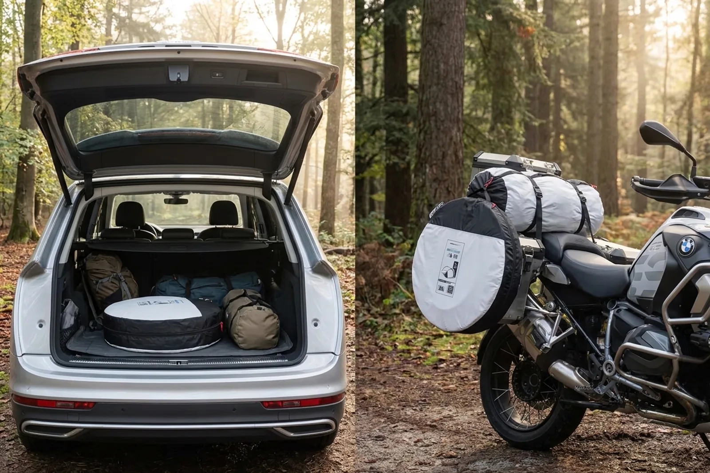
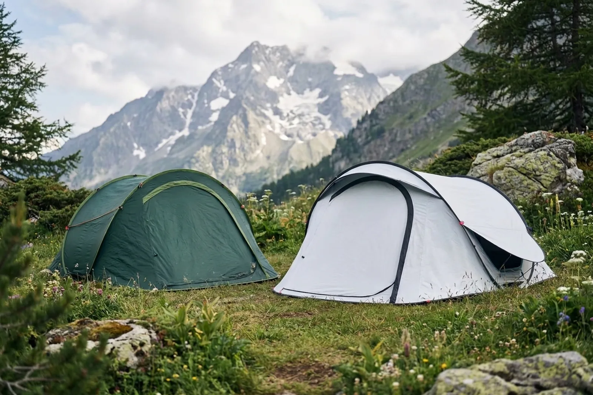
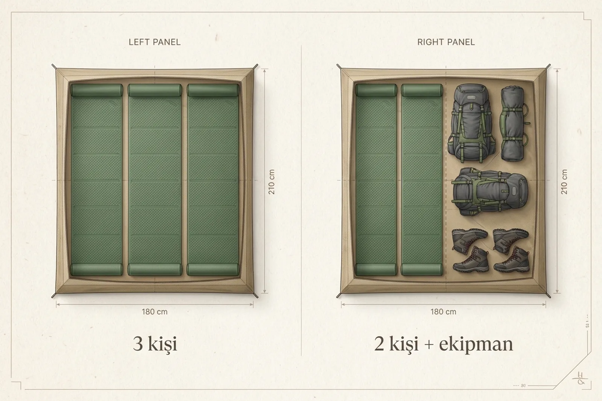
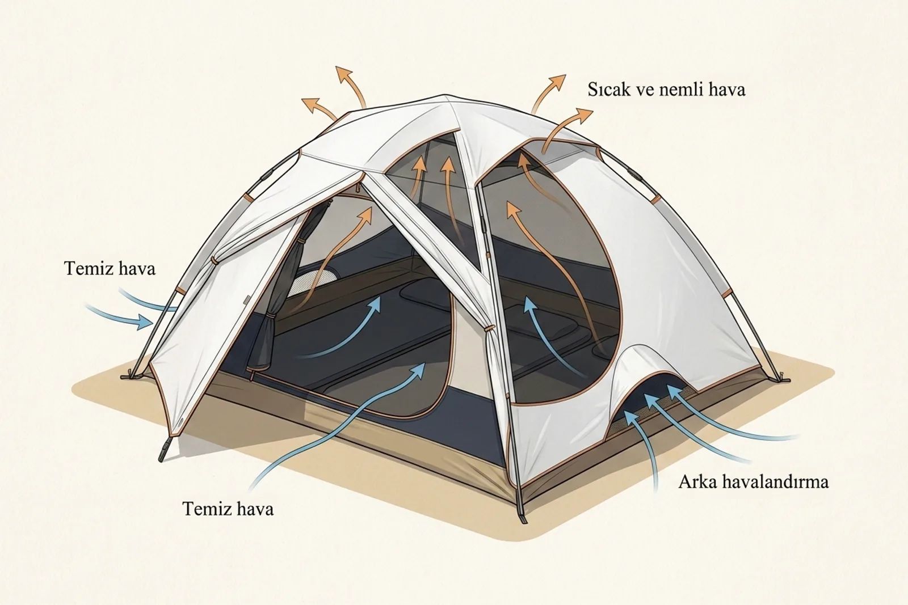
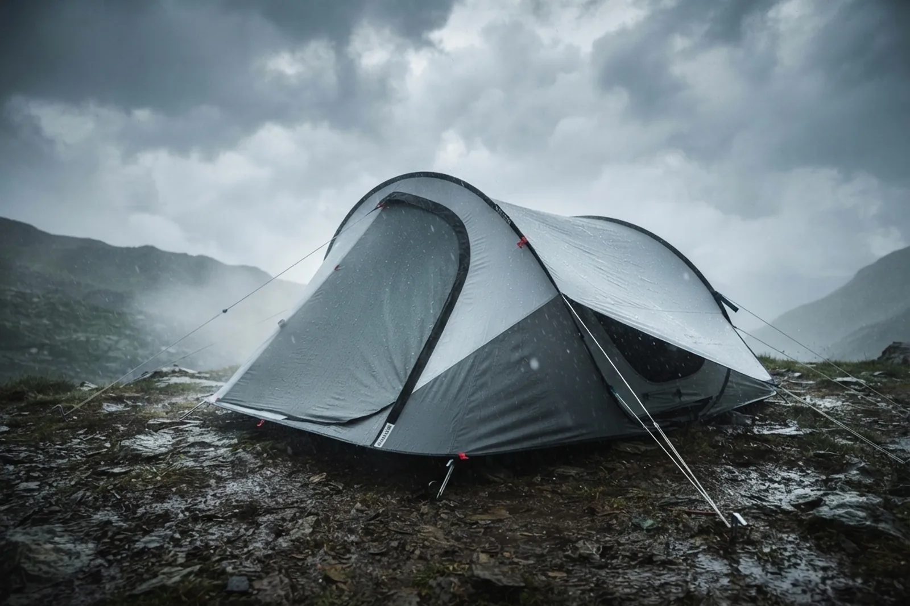

Quechua 2 Seconds Fresh&Black 3-person tent; offers fast setup, a dark interior, and a comfortable sleeping area for those who camp with their car. However, due to its weight of 4.9 kilograms and a circular package with a diameter of 86 centimeters, it’s still not particularly practical for motorcycling, cycling, and trekking.

That’s my verdict in a nutshell.

Years ago, when I evaluated the original 2 Seconds Easy 3 model from the series, my biggest criticism was the size of the package and ventilation. The new model has been significantly improved in terms of ventilation. However, instead of becoming lighter in terms of transport, it has become even heavier.

> A quickly erected tent is not the same as a tent that is easily transported.

## Who is the Quechua 2 Seconds Fresh&Black three-person tent for?

This tent can be used by people who primarily set up camp near their car, frequently moving their campsite during the day, or arriving at the campsite late at night.

Specifically, this is particularly advantageous in the following usage forms:

- Car-based weekend camping.
- Festival and camping accommodation
- New campers who don’t want to spend a long time setting up.
- People who don't want to wake up early with the morning sun
- Someone looking for a large, single-person sleeping area, or someone who prefers a comfortable sleeping space for two people.

If you are traveling by motorcycle, bicycle, or with a backpack, the size of the package presents a problem from the outset. The tent’s carrying bag measures 86 × 10 centimeters and has a total volume of 58 liters. Its weight is 4.9 kilograms.

Because I sometimes travel by motorcycle, I don’t want to carry something like this. If you were to attach it to a motorcycle, it would become a very wide, exposed disc – not a tent. If you try to attach it to a backpack, you would be traveling as if you were carrying a satellite antenna.

I explained in more detail in the guide “[Tips for choosing a tent](/cadir-alirken-nelere-dikkat-edilmeli/)” that it’s not enough to only consider the number of people when choosing a tent.

The round package design might be practical in a car, but it won’t provide the same level of convenience on a motorcycle or in a backpack.

## What’s new in the 2 Seconds Fresh&Black?

The sleeping area of the old dark green 2 Seconds Easy 3 is very similar to that of the new model. The main differences are seen in the fabric, ventilation, and packed dimensions.

| Feature | Old model | New model |
|---|---|---|
| Sleep area | 180 × 210 cm | 180 × 210 cm |
| Inner height | Approximately 104 cm | 102 cm |
| Weight | 3.9 kg | 4.9 kg |
| Package | Large, round disc | 86 × 10 cm, 58 litre |
| Dark interior | None | Fresh&Black |
| Ventilation | More limited | Two side openings and one rear opening. |
| Waterproofness | Varies by model | 2,000 mm and above |
| Wind test | — | 50 km/h when correctly pitched |

The new model has gained approximately one kilogram in weight while maintaining the same base area. This brings Fresh&Black fabric and improved ventilation comfort, but there’s a cost on the transport side.

As I progress with the new ventilation and darkness models, the weight and package volume have increased.

## Does the tent really set up in just two seconds?

When the cover is removed from the tent and the straps are loosened, the body really takes shape in just a few seconds. However, it’s important not to understand the phrase “two seconds” as meaning the tent is completely set up and ready for the night.

Getting the tent oriented correctly, hammering in the pegs, adjusting the guy lines, and opening the vents also takes time. A field test notes that once you're used to it, setting up the tent with all the pegs, lines, and vents takes about three minutes.

This is still quite fast.

The pitching side requires a bit of practice. One of the most frequently repeated points in online user reviews is that the tent is easy to erect, but it gives you a bit of a hard time in the first few folds. In fact, some users describe feeling as though the tent might snap while they’re bending the poles.

If I were, I would open and eat a few times at home or in the garden, without waiting for the first camp. It wouldn’t be very enjoyable to search for a usage video when the rain starts, when the weather gets dark, or when rushing to leave.

## Can three people comfortably stay in this tent?

The base measurement is 180 × 210 centimeters. This area is adequately covered by three 60-centimeter mats placed side by side, mathematically speaking.

The numbers may add up, but will you actually be comfortable? That’s where it gets complicated.

Three adults can sleep inside, but the space rapidly shrinks when the bags, boots, and other camping equipment are brought in. User evaluations frequently mention that the three-person model is more comfortable for two people and their equipment.

I would evaluate this tent like this:

- Quite extensive for a single person.
- Comfortable for two people and basic equipment.
- It’s suitable for three adults, but it’s quite cramped.
- Three people and insufficient space for large bags.

The manufacturer recommends using mats with a maximum width of 60 centimeters per person. While inflatable mats thicker than 6 centimeters can be used, they may reduce the usable height, bringing you closer to the inner layer and increasing the sensation of condensation.

Three mats are needed for the sleeping area; however, a space for two people and equipment allows for a more comfortable living area.

## Is Fresh&Black technology actually effective?

Fresh&Black fabric has two main purposes: to significantly block sunlight and to help keep the interior cooler when exposed to sunlight.

If you’re particularly bothered by the sunlight directly illuminating the inside of your tent in the early morning, this feature could provide significant comfort. Users at festivals have mentioned that they’ve been able to sleep later thanks to this. Some campers who use a traditional tent alongside the Fresh&Black model also report that the dark model offers considerably more comfort in the early mornings.

Don’t just think of it like a climate control system. The tent will still heat up when it’s directly exposed to the sun. The fabric delays the heat; it doesn’t turn the air into a refrigerator.

Moreover, because the interior is dark, it might seem gloomy to those who want to sit inside the tent during the day. For some, this feature is a wonderful sleeping room, while for others, it’s like a small cave for lunchtime.

## Is the ventilation of the new model sufficient?

In the previous model, one of the issues I raised was ventilation. The new Fresh&Black model features two side vents and one rear vent, which can be adjusted from the inside. The side vents consist of a fabric panel and a mesh made of insect screen; the rear section can also be adjusted internally.

This represents a significant improvement compared to the previous model.

Despite no ventilation system completely eliminates condensation, human breath, wet clothing, damp floors, and temperature differences can cause water buildup on interior surfaces throughout the night.

During a field test, it was noted that when using the unit alone at night with the ventilation open, no significant condensation was observed. However, other users reported experiencing some condensation in humid conditions. These two experiences do not necessarily contradict each other, as the number of people and the use of ventilation all contribute to the outcome.

*The use of side and rear clearances reduces the risk of condensation; however, it does not completely eliminate it.*

To reduce condensation:

- Keep the side and rear ventilation open as much as possible.
- Do not pile wet clothes in the sleeping area.
- Securely set up the tent using the ropes for stretching it.
- Do not allow the outer layer to adhere to the inner part.
- Before taking down the tent in the morning, be sure to ventilate it.

The tent might be perfectly waterproof. That steam room inside? You might have made it yourself.

## How does it perform in rain and wind?

[According to Decathlon’s product information](https://www.decathlon.com.tr/p/3-kisilik-otomatik-kamp-cadiri-freshandblack-2-seconds/_/R-p-346717), the flysheet has a waterproof rating above 2,000 mm and the floor is rated above 2,400 mm. The seams are taped. In a laboratory, the tent was exposed for 3 hours to simulated rainfall of 200 mm per hour.

Wind resistance is rated at 50 km/h when the tent is pitched correctly and all guy lines are used.

These are useful lab values for comparison. The field results depend on the tent's orientation, how well the pegs hold in the ground, the tension of the guy lines, and the condition of the gear.

Specifically, when the weather is windy, don’t hammer in the stakes just because the tent is standing on its own. During site inspections, it has been observed that the structure flexes and then returns to its original shape in strong winds. While this flexibility is normal, if the outer tent makes contact with the inner compartment, condensation or moisture from the surface can enter.

If you’re concerned that standard stakes may not be sufficient on hard, rocky ground, you can also take a look at [Ferrino steel tent stakes](/ferrino-cadir-kazigi/). Keep in mind that these steel stakes add extra weight for increased stability.

*Pitching the tent in the right direction and using the guy lines matter just as much as the lab rating.*

## What are people saying in online user reviews?

When reading the comments, it’s important to pay attention to the model names. The names “2 Seconds”, “2 Seconds Easy”, and “Fresh&Black” have been given to similar models in different years, so a comment may not refer directly to the new model with product code `8801561`.

Nevertheless, there are some recurring common points that occur across different model years:

- The setup is very quick, and assembly is straightforward. The tent opens in a few seconds, but you need to learn the eight-sided folding technique.
- Fresh&Black enhances morning comfort. The dark interior and fabric that reflects sunlight are particularly popular in summer camps.
- A capacity of three people is being found, but many user models are considered more suitable for two people and equipment.
- The largest disadvantage is the volume of the package. While it’s acceptable for car camping, it’s found to be difficult to transport when traveling by train, motorcycle, or on foot.
- Condensation levels vary depending on the weather conditions. Users who use open ventilation achieve better results; however, condensation can be observed when used in humid and enclosed environments.

## 2 Seconds Fresh&Black tent: What are the pros and cons?

### Pros/Advantages

- It sets up very quickly.
- It manages to stand on its own.
- Fresh&Black fabric significantly reduces morning light.
- It offers a comfortable sleeping area for two people.
- The side and rear ventilation are more practical compared to the previous model.
- The manufacturer gives lab test results for rain and wind.
- The parts can be replaced.
- It’s being sold with a five-year warranty.

### Eksileri

- 4.9 kilogram in weight
- The 86 centimeter round package takes up a lot of space.
- I wouldn’t take this tent on a motorbike, a bicycle or a trek.
- It’s quite tight for three adults and equipment.
- There is no large or enclosed vestibule.
- You need to learn how to fold it beforehand.
- The dark interior section may not be suitable for everyone when used during the day.

## Would I buy this tent?

If I were considering going on a weekend camping trip by car, setting up my tent quickly, and wanting to avoid the morning sun, I would certainly consider it. It’s spacious for one person, comfortable for two, and the setup is truly practical.

If I were traveling by motorcycle or with a backpack, I wouldn’t buy it. What I said about the older model applies to the new one: you need to think about where you’re going to put that huge, round package before considering weight.

For my use, a trekking tent that packs down smaller and allows the inner and outer tents to be managed separately would be more sensible. You can see an example of this type of usage in [Ferrino Lightent 2 review](/ferrino-lightent-2-kamp-cadiri/).

The new 2 Seconds Fresh&Black improves on the old model’s ventilation and keeps the tent cooler in the morning. I still see it as a handy tent to pitch beside the car. I wouldn’t want to carry it very far.

What kind of weather conditions and how many people did you use this tent in? If you could share your experiences with it – specifically regarding how easy it is to set up, the morning temperatures, rain performance, and condensation – in relation to the brand, model, and nighttime conditions, it would really provide a helpful comparison for those considering purchasing it.
