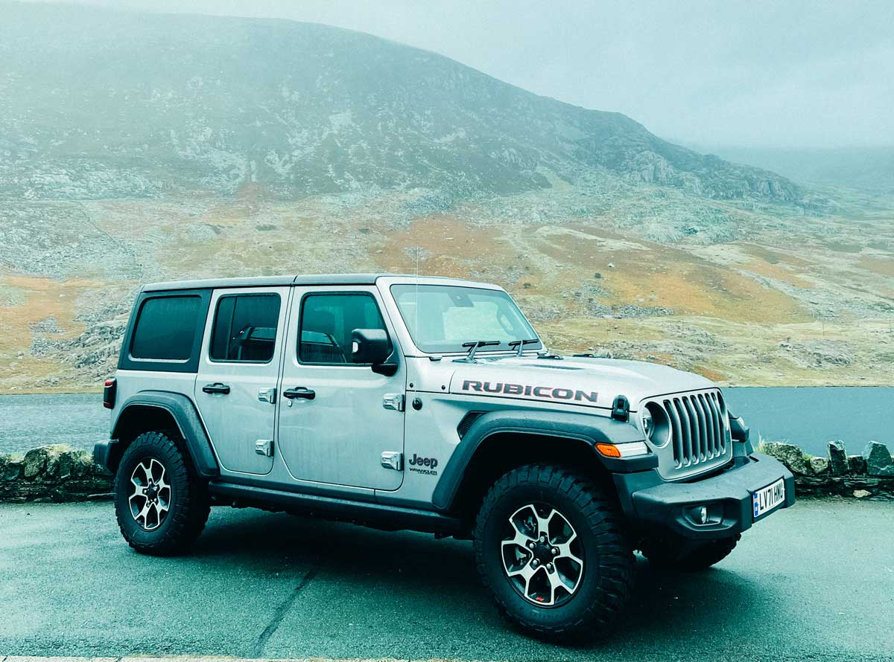
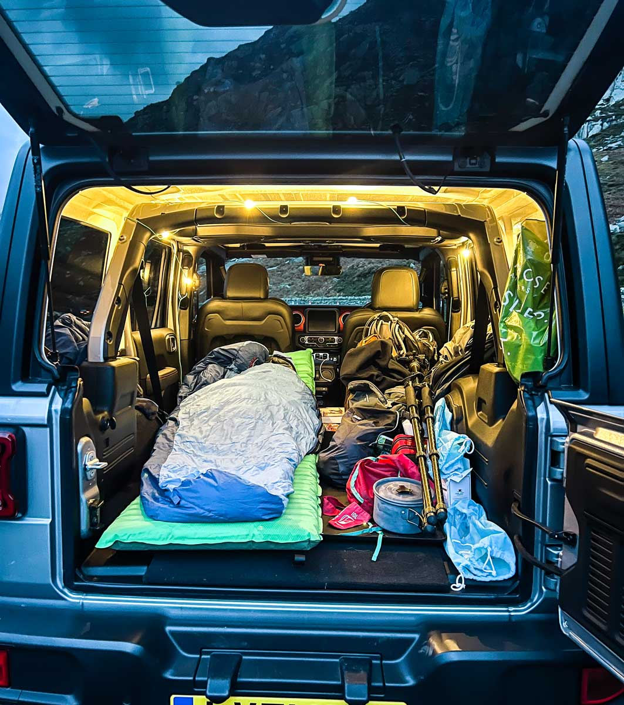

New comrade, Rubicon. It will be more than just a car or a van for me. It will be the companion of the biggest dream I have built so far.

One of my main reasons for wanting to move to England was to obtain an English passport and to be able to access opportunities in the world more easily. The prospect of being able to work remotely in England, or the chance to return here whenever I wanted, was like a delicious treat, making my mouth water. My biggest dream was to obtain this passport, to be able to access the world, sometimes to find a place in nature, sometimes to live in a different city for 3-5 months, to work remotely, and to have the opportunity to live in different countries. I would need a vehicle to accompany this lifestyle, constantly on the move. Of course, I never really considered how sustainable this dream would be. Perhaps I would end up clinging to this lifestyle for 1, 3, or even 5-10 years, and then search for ways to enjoy retirement – which, with this “totom” (where there are turtles), would be incredibly difficult. I don’t know. What was important was simply to start with that dream and to find the right companion.

I’d been in England for 4 years and had roughly 2 years left before I could get my passport. So the big dream was still 2–3 years away. As my time here passed the time I needed to stay, I began thinking more about the dream I’d had for years. I was getting restless and my mind wouldn’t stop. At every campsite I started watching how other people did it. “They came with a caravan, stayed 1 night and left. All that setting up just to go the next day? Isn’t that ridiculous?” While I was asking myself those questions, I’d notice the people who came with a four-wheel drive or, like me, a car or motorcycle. I thought and thought and couldn’t make up my mind.

Motorcycling is definitely my passion. It’s incredibly enjoyable to be on the road. We do take 3-5 month trips on the motorcycle, of course, but living trips of 3-5 years aren’t possible for me. That’s because being on the road, living while working remotely and earning money are the most important criteria for me. While it can be done with a motorcycle, there’s a significant loss of comfort. Because when I need to work from 9-6, it’s very important for me to be comfortable. I can’t carry a lot of belongings, and I also can’t live in a constantly urban environment away from nature. That’s why we decided against the motorcycle.

I’ve also decided to give up on living in a campervan because my mobility is limited. So, if you find a wonderful place in nature, it’s incredibly comfortable. Spend 2-3 months settling into a place like a 5+1 house. While a bicycle or a small motor looks fantastic in the back, you can’t park the campervan in town. Things don’t work like they do in Turkey here. You have to leave your campervan in caravan parks, go to the city, stay there, and then come back and get it, and so on. You’re always going to need a second vehicle, which would limit my mobility, and I don’t want that. Living in a campervan is a key element of this dream – being able to go anywhere freely. But living in a campervan makes you move more slowly and live in a more localized way, and I want to be more active and free. Therefore, I’ve decided to say goodbye to the idea of a campervan, perhaps not until 20 years from now.

Of course, there are also many people who come with their own cars to camping and nature trips. Gocuman sets up tents (family tents and gazebos), and lives there like in a cabin. While it seems amazing at first glance, it didn’t resonate with me – while a motorcycle appeals to my soul, a car never went beyond being just a vehicle. When I encountered it on a two-lane road, I would greet it, but – what would you do if you were traveling with two cars? Furthermore, I wanted a larger space. I had to sleep in the car, and I needed to carry all the gear I would need to spend weeks in nature. It had to be both a home and a means of transport, so a car just didn’t fit into my mind.

Finally, I turned, wandered around, and ended up with a off-roader. After [my motorcycle trip to Scotland](/tek-basina-iskoc-yaylalarinda-29-gunde-5500km/), the idea of a off-roader had taken root in my mind. It looked great with the roof tent and the large gazebo opening to the side. The truth of the matter is that I planned to switch to a BMW GS1250 Adventure this year, but the devil whispered in my ear, "Look at that off-roader, brother," and things got mixed up. I already had three off-roaders that, as a character, would match me: a Discovery 4, a Rubicon, and a Defender. I didn't like the Discovery models after 2016. They had been rolled over in the new models, becoming ugly and crude. With the new model of the 2016 chassis not coming, that one was eliminated. The new Defenders, however, are huge, beautiful, and expensive. In terms of price, one Defender equals 1.5 Rubicons. On top of that, they act like a city off-roader. Also, in recent years, Land Rover's production of off-roaders hasn't given much confidence. Constant problems, constant problems. The Defenders are better, I was told, but I don't know. They didn't suit me. Only the Rubicon remained. The devil whispered once more, "Go for a test drive, a test drive won't do any harm." I went, and do you know what happened? The devil whispered once more: "Listen, brother, 36 months with 0% interest (you could sell the world with zero interest to a Turk) and they're offering a 10% discount on top. If you don't buy one, they'll beat you." Oh, how right you are, boss, how well you've guided me, and despite this big dream taking 2.5 to 3 years to start, why wouldn't it happen, I said. During this time, I thought I would get used to the Rubicon and make it more comfortable, so I agreed with the devil and said, "Let's get a Rubicon, 'besmele' – let's get one!"

And so, the footsteps of this great dream began to appear. That’s why, Rubicon isn’t a means for me, nor an end; it’s simply a companion, :)

I hope that when I finally realize this huge dream and write the piece titled “Geliyorum Dünya Bekle Beni” in 3 years, it comes to fruition. Let’s see what happens; hopefully it works out. See you...

