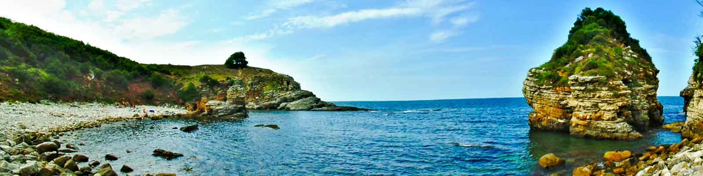
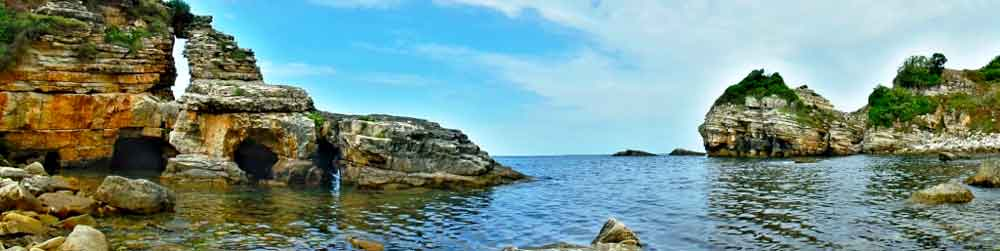
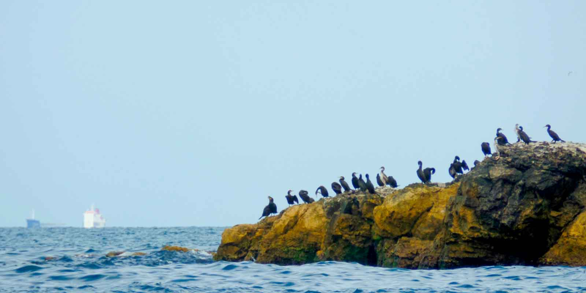
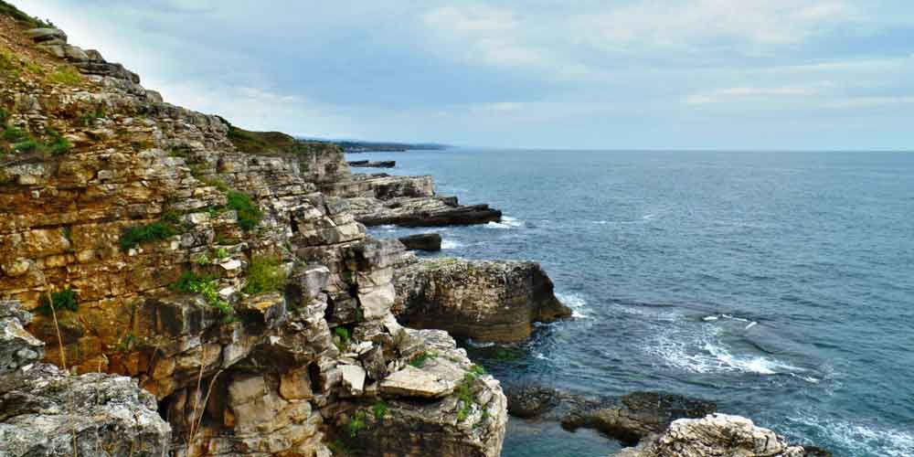

### Where is Saklı Koy, and how do you get there?

After reaching Kocaeli, follow the signs to Kandıra. Take the Çalköy road as far as the turn for Saklı Bay. You can leave the car at the junction marked on the map. If you have a 4×4, you can drive down to the shore. On foot it’s no more than 15 minutes to the shore. Follow the trail down to the bay.

### What is known about Saklı Koy

Saklı Bay is close to Sardala Bay. While you’re here you can visit [Sardala Bay](/sardala-koyu/) too. It’s an unspoilt bay where you can swim in the sea or jump in from the rocks. There’s seaweed in the water, so I’d wear water shoes or fins. You’ll probably have the bay to yourself or share it with very few people, so you can relax. The only snag is carrying all your gear for the 15-minute walk after parking by the road. It’s worth it for a place this beautiful.

<iframe
  class='mappingFrame'
  style={{ border: 0 }}
  src='https://www.google.com/maps/embed?pb=!1m25!1m12!1m3!1d6331.223629222578!2d30.07961287768872!3d41.13061652863423!2m3!1f0!2f0!3f0!3m2!1i1024!2i768!4f13.1!4m10!1i0!3e0!4m3!3m2!1d40.7850882!2d29.9714982!4m3!3m2!1d41.132140299999996!2d30.0828673!5e1!3m2!1str!2s!4v1408049327624'
  width='300'
  height='150'
></iframe>

 

### Saklı Koy camping area information

##### Available facilities

- Camp Site (You can set up a tent on the hillside area by the beach.)
- Rough/Raw place

##### Facilities that are unavailable

- Clean water
- Grocery store/Market
- Restaurant
- Café
- Guesthouse
- Toilets

Note: This information dates back to August 2014.

### Saklı Koy Wikiloc

<iframe
  frameBorder='0'
  scrolling='no'
  src='https://tr.wikiloc.com/wikiloc/spatialArtifacts.do?event=view&id=7462406&measures=on&title=on&near=off&images=on&maptype=H'
  width='100%'
  height='600'
  style={{ borderRadius: '10px 10px' }}
></iframe>

