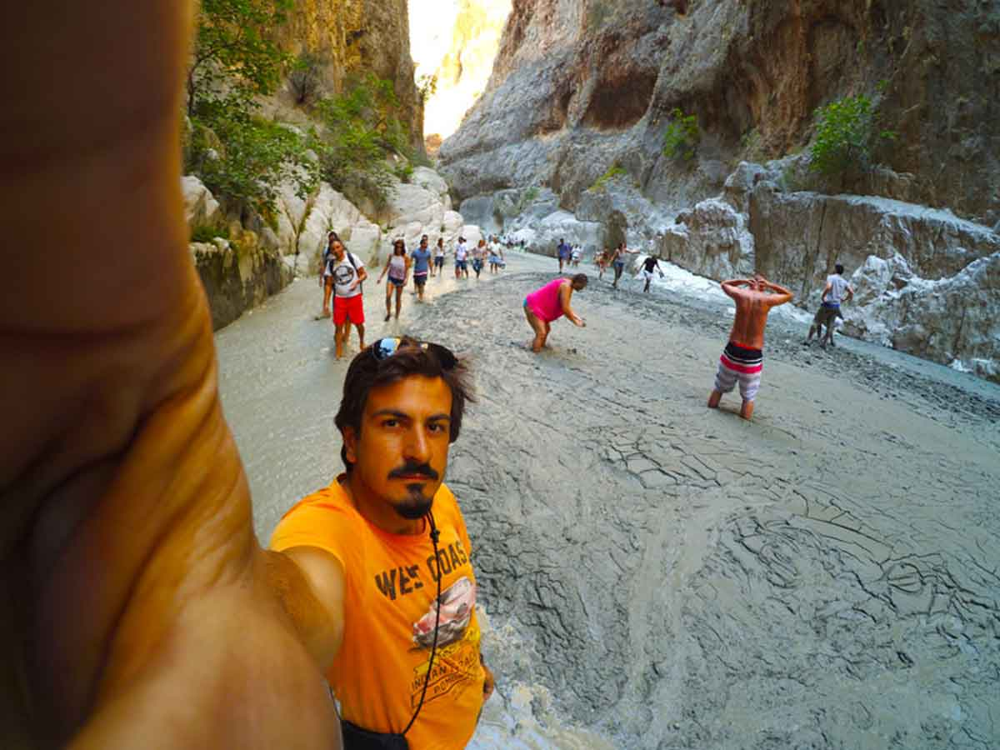
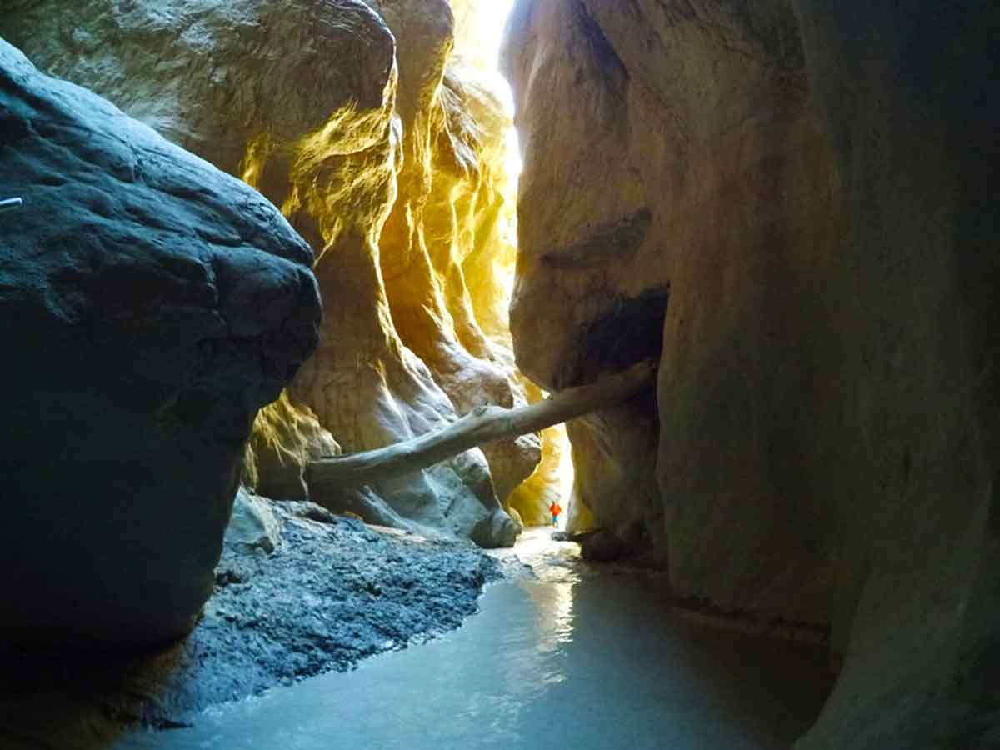

I think Saklıkent Canyon, on the Eşen River at the Antalya–Muğla border, is well worth seeing. The photos had given me the impression we’d be on a walkway the whole time. It turns out that’s only at the entrance. After that it’s a mud bath in the stream. It’s easy to get to from the Antalya and Muğla areas and is protected as a national park. The canyon is 18 km long and about 2 metres wide at its narrowest. You might struggle to see the sky. You can walk part of it and turn back without covering the whole thing.

Do not wear shoes. Because you will get very muddy, and there won’t be a comfortable walk in shoes. Sandals are good, but you’ll also get stones wedged between your feet, which will be uncomfortable. There are many shoe rental places at the canyon entrance. Do not wear someone else’s shoes; bring your own. This is the most logical and comfortable option. However, be careful, as your shoes can get lost in the mud when your feet are submerged and you pull them out. You should pay attention to this. After the hike, you can have tea and corn at the spots near the canyon entrance. If you find a difficult spot, you can return. Otherwise, the canyon will be a long, back-and-forth. [Patara Beach](/patara-plaji/).

### Where is Saklıkent Canyon and how do you get there?

While traveling on the route to Fethiye, after passing Kınık, you can reach Saklıkent Canyon by continuing from Kadıköy junction. There are multiple route options, but the most straightforward is to follow the signs on the Antalya – Fethiye road. You will already see the signs as you continue on the asphalt road to the canyon. Saklıkent Canyon is located 50 km from Antalya and 45 km from Fethiye. You can park your vehicle at the parking lot at the canyon entrance. I remember paying around 2 TL (2016) for a motorcycle.

<iframe class="mappingFrame" src="https://www.google.com/maps/embed?pb=!1m26!1m12!1m3!1d145189.2673656542!2d29.320249570478595!3d36.475439250549826!2m3!1f0!2f0!3f0!3m2!1i1024!2i768!4f13.1!4m11!3e0!4m3!3m2!1d36.532934!2d29.343132699999998!4m5!1s0x14c04aa8d2b88d5f%3A0x73cd5e161507819d!2sSakl%C4%B1kent+Milli+Park%C4%B1%2C+48850+Kayadibi%2FFethiye%2FMu%C4%9Fla!3m2!1d36.468839599999995!2d29.405540199999997!5e0!3m2!1str!2str!4v1487257820935" width="300" height="150" allowfullscreen="allowfullscreen"></iframe>

  

### Saklıkent Canyon Camping Area Information

##### Available facilities

* There are numerous businesses, as well as a parking lot, located in the area where the canyon entrance is.
* There are specialized businesses for camping areas. If you wish, you can also set up a tent in the meadows within the national park.
* It’s a very busy place, attracting many visitors.
* Because it’s a business, there are water and toilets available.

Note: This information dates back to September 2016.
