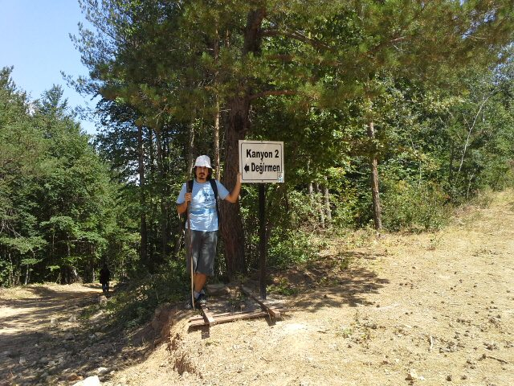
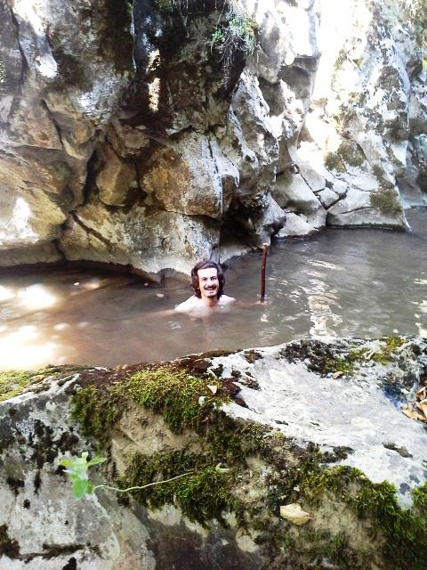
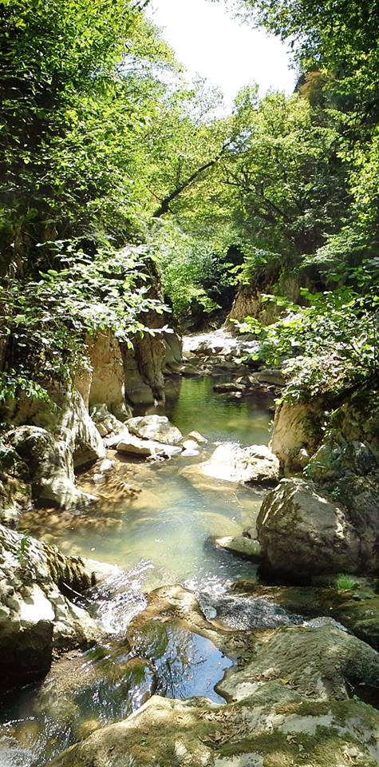
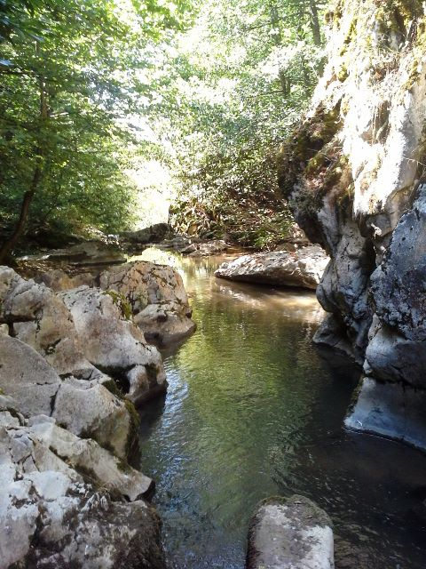

If you have an acquaintance in İznik, you’re fortunate. Because you can visit your acquaintance and enjoy a beautiful nature walk in Sansarak canyon on the weekend. Don’t be sad if you don’t have an acquaintance – there are various places where you can set up a tent. I was able to combine a visit to my relatives and a canyon walk, just as I always do, because my aunts live in İznik. Of course, I did my research as usual before going.

We were aiming to reach the village of Sansarak, approximately 20km from İznik. After passing the village, we would arrive at the canyon entrance (with signs) about 1km later. This was a family outing – my father, my brother, my aunt, and my uncle – and we were going to have a wonderful experience.

Canyons are cool.

We started our descent from the spot where the “Kanyon 2 Değirmen” sign was located, heading towards the stream. Shortly after, we reached the stream, and we planned to make our canyon walk easier by going from top to bottom. The canyon constantly surprised us. Just when we thought we were finished, we would suddenly come across places where the water was very scarce, and our spirits would drop, and then we would encounter either a waterfall or a small pool. Despite it being August, the water was very cold, and you could get cold when the water was low.

There’s a beautiful canyon, where at times you could walk along the riverbank, but in some places, crossing was quite difficult due to slippery rocks. We only managed to walk the initial section. It took about 4 hours, although our pace was a bit slow. The only problem we encountered was that we couldn’t figure out where we had come into the canyon. I actually climbed from a spot within the forest, but since it would be dangerous for the group to go further into it, we didn’t. Otherwise, we could have discovered a wonderful path. While looking left and right, we came across a group who suggested we could exit by following a path leading from a wooded area. Following the path, we realized we had reached the place where the sign “Kanyon 1” was on the path.

The taste of that exciting canyon, I really hope it comes back to me again someday.

