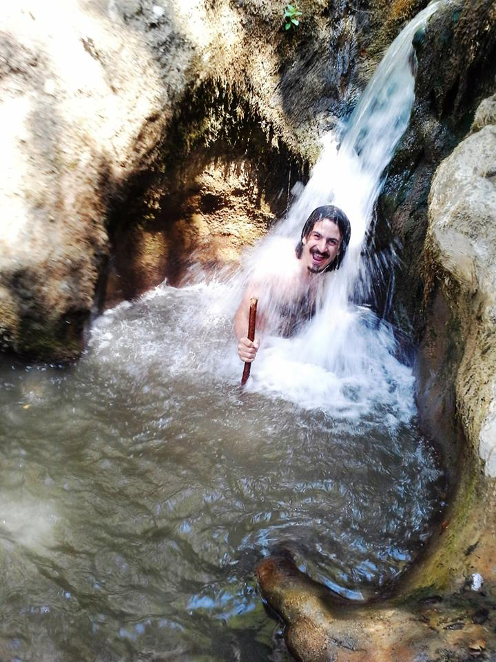
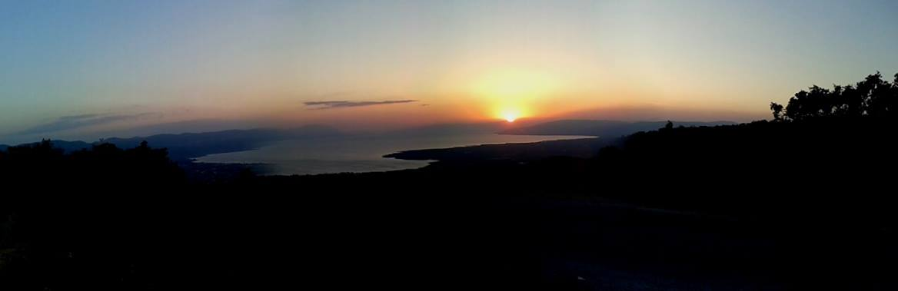

If you have a relative in İznik, you’re lucky. Because on the weekend you can visit your relative and enjoy a beautiful nature walk in Sansarak Canyon. Don’t be sad if you don’t have a relative – there are various places where you can pitch a tent. Since my aunts live in İznik, I was able to combine a visit to them with a canyon walk. Of course, as usual, I did some good research before going.

We were aiming to reach the village of Sansarak, some 20km from İznik. After passing the village, we would reach the canyon entrance (there are signs) about 1km further on and start our walk. This time, it was a family outing: my father, my brother, my aunt and my uncle. We had a wonderful experience together.

Canyons are cool.

We started our descent from the spot where the “Kanyon 2 Değirmen” sign was located, heading towards the stream. Shortly after, we reached the stream, and we decided to do the canyon walk from top to bottom to make it easier. The canyon constantly surprised us. Just when we thought it was over, or when we reached places where the water had dwindled and our spirits sank, we’d suddenly encounter either a waterfall or a small pool. Even though it was August, the water was quite cold. If you stay in the water for too long, you can get chilled.

There’s a beautiful canyon, where at times you could walk along the riverbank, but in some places, crossing was quite difficult due to slippery rocks. We only managed to walk the initial section. It took about 4 hours, although our pace was a bit slow. The only problem we encountered was that we couldn’t figure out where we had come into the canyon. I actually climbed from a spot within the forest, but since it would be dangerous for the group to go further into it, we didn’t. Otherwise, we could have discovered a wonderful path. While looking left and right, we came across a group who suggested we could exit by following a path leading from a wooded area. Following the path, we realized we had reached the place where the sign “Kanyon 1” was on the path.

That canyon left me wanting more. I’ll be back one day.

