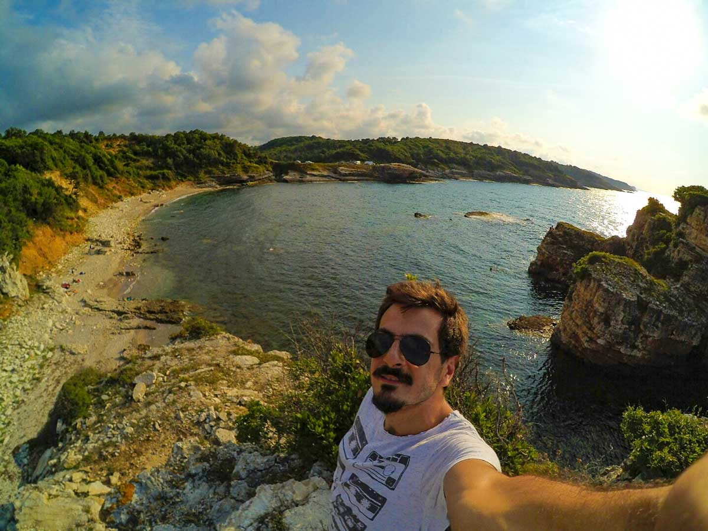
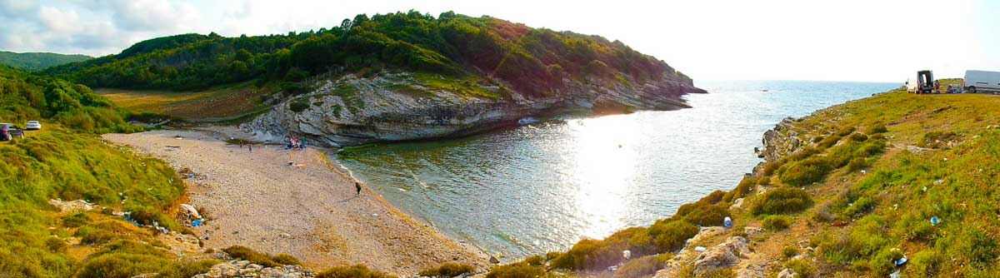
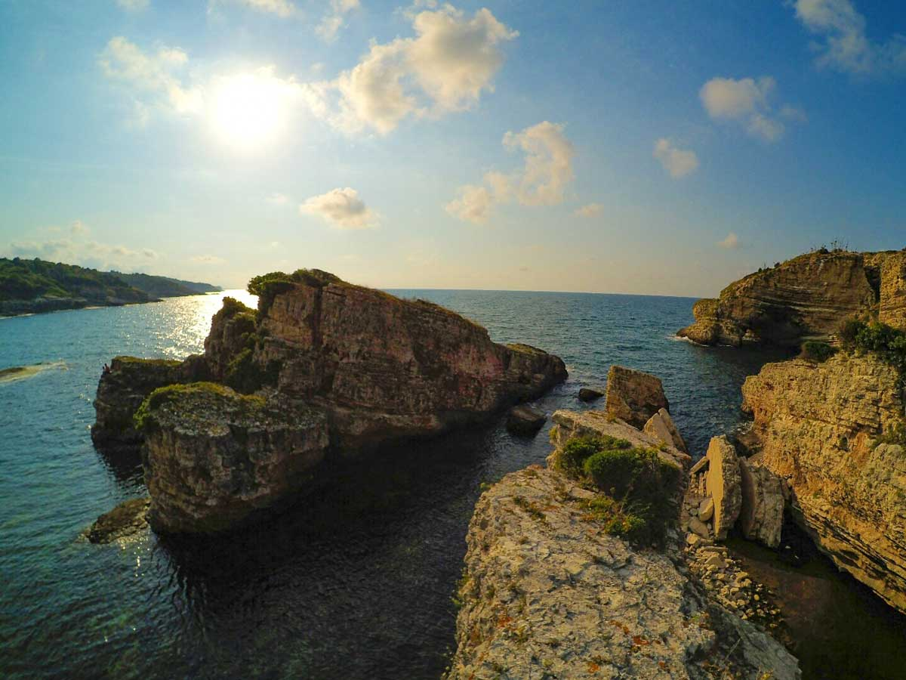
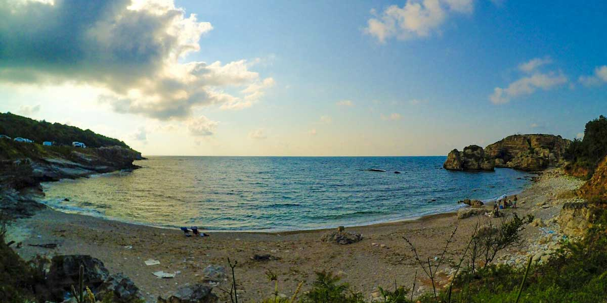

This year (July 2016), we went to Sardala bay again. Therefore, I updated the information and photos. The bay is quite beautiful, but I noticed that it’s becoming increasingly polluted with each passing day. Of course, thanks to humanity, it’s maintaining its unspoiled nature. Seriously, what is throwing your trash on the ground? I don’t understand how throwing it makes you rid of it. Please let’s take care of our trash so that these beautiful places can remain unspoiled. When returning, there are trash cans in every village. Let’s put them in, let’s be men, so these places stay beautiful. I couldn’t find a reasonable explanation for seeing Domestos on the beach in Sardala. If you keep it clean, you’ll find it clean.

### Where is Sardala Bay and how do you get there?

After reaching Ağva, you will first proceed towards Kerpe, passing through Bucaklı village, then Kadıköy and Pınarlı villages. After passing Pınarlı village, drive approximately 4 km (on a dirt road) where the road will turn left and enter the forest. Continuing down this somewhat rough road, you will reach Sardala bay in about 1 km. There are suitable places to leave your car when you reach Sardala bay.

### What to know about Sardala Bay

This name was given by a user on a forum site. We believe it’s a lovely name, and there’s no problem with using it. This secluded bay, which is very unspoiled, offers the opportunity to swim in the sea. You can jump into the water from the rocks. The coastline consists of a beach, and where you first enter the sea is rocky. The sea doesn’t suddenly become deep, and it’s sometimes covered in seaweed, so wearing sea shoes will make entering the sea much more comfortable. We recommend visiting during weekdays or on Saturday. Please remember to take your trash with you.

<iframe
  class='mappingFrame'
  style={{ border: 0 }}
  src='https://www.google.com/maps/embed?pb=!1m24!1m12!1m3!1d42388.56091156929!2d29.87394825236767!3d41.12595041367712!2m3!1f0!2f0!3f0!3m2!1i1024!2i768!4f13.1!4m9!3e0!4m3!3m2!1d41.1192233!2d29.8485186!4m3!3m2!1d41.1376148!2d29.960226!5e1!3m2!1str!2str!4v1469218197820'
  width='300'
  height='150'
></iframe>

 

### Sardala Bay campsite information

<iframe
  frameBorder='0'
  scrolling='no'
  src='https://tr.wikiloc.com/wikiloc/spatialArtifacts.do?event=view&id=14083003&measures=on&title=on&near=off&images=on&maptype=H'
  width='100%'
  height='600'
  style={{ borderRadius: '10px 10px' }}
></iframe>

##### Available facilities

- There isn’t a perfect spot for camping. However, once you reach the beach, you’ll see a large, flat area on the left side. You can set up your tent there.
- Rough/Raw place
- The market can get crowded on Sundays. It would be more enjoyable to come on Saturday or during the week.
- The rocks and scenery are exceptionally beautiful.

##### Facilities that are unavailable

- Clean water
- Grocery store/Market
- Restaurant
- Café
- Guesthouse
- Toilets

Note: This information dates back to July 2016.

