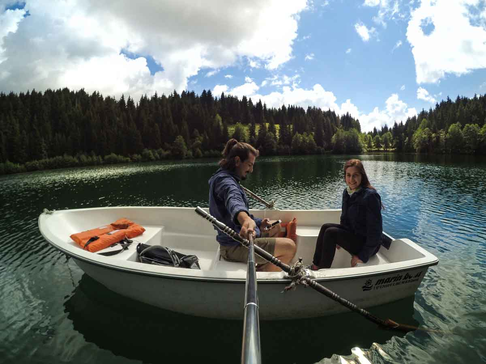
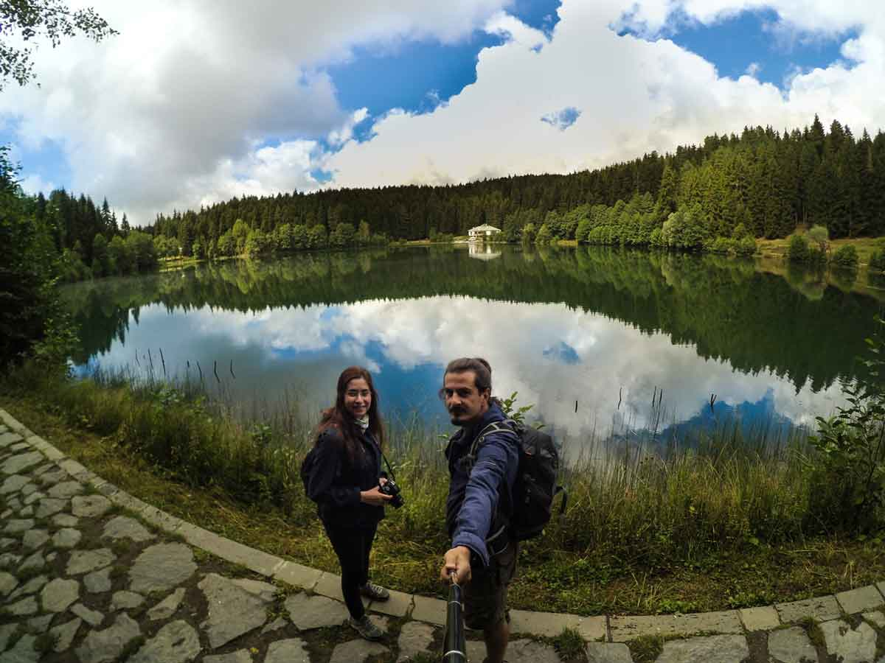

Şavşat Karagöl is located approximately 22 km from Şavşat, a district of Artvin. From Şavşat, you can reach the lake by asphalt road following the direction to Ciritdüzü and Veliköy; signs are available along the route. Karagöl is one of the most impressive lakes, which I would like to visit again, surrounded by forest.

> **Information Date:** The information is based on my experience in August 2015, including route, camping, fees, and facility details. Please verify the current information before you go, as park rules and fees may change.

## Where is Şavşat Karagöl, and how do you get there?

This beautiful lake is located approximately 22km from Şavşat, in a difficult-to-reach location and is protected to preserve its beauty. For someone living in Artvin or that region, reaching it is easy. However, for someone living in İstanbul, it requires traveling first to Artvin, then to Şavşat, and finally following the road from Ciritdüzü to Veliköy to reach Karagöl. If you manage to get there, you absolutely must go and see it. The road is paved, and there are directional signs. It’s just a slightly unfavorable location, though.

<iframe
  frameBorder='0'
  scrolling='no'
  src='https://tr.wikiloc.com/wikiloc/spatialArtifacts.do?event=view&id=17997193&measures=on&title=on&near=off&images=on&maptype=H'
  width='100%'
  height='600'
  style={{ borderRadius: '10px 10px' }}
></iframe>

Despite seeing multiple routes from Şavşat, you can reach Karagöl by following the Veliköy turnoff, traveling on asphalt for approximately 22km after entering Veliköy from Ciritdüzü. You can find the route on wikiloc above, and also via Google Maps. If you try a different route, let’s share it.

<iframe
  class='mappingFrame'
  src='https://www.google.com/maps/embed?pb=!1m24!1m12!1m3!1d48210.91497945503!2d42.373408848693764!3d41.279172677693445!2m3!1f0!2f0!3f0!3m2!1i1024!2i768!4f13.1!4m9!3e0!4m3!3m2!1d41.253766299999995!2d42.353563099999995!4m3!3m2!1d41.304381899999996!2d42.479111599999996!5e1!3m2!1str!2str!4v1496121811555'
  width='300'
  height='150'
  allowfullscreen='allowfullscreen'
></iframe>

 

## Şavşat Karagöl camping area information

### Available facilities

- Because the Şavşat Karagöl national park is under protection, you need to pay a fee to enter the area and set up camp.

  - According to data from 2015, the fares were as follows: 2.5 for a person, 5 for a motorcycle, 8 for a car, 25 for a small minibus, 40 for a large minibus, and 70 TL for a bus.

- You can also stay at the facility located right next to the lake. There is a guesthouse – but please don’t expect too much from it.
- Enjoy the tranquility in a place where you can savor nature, offering peaceful campsites alongside beautiful, flat areas, as well as toilets and clean water.
- Due to the lake being approximately 1600 meters in height, you may experience temperatures that are lower than your estimations, depending on the time of your visit. So, it could be a bit chilly.
- In this area, remember that you are dealing with a wild animal, specifically a bear. Keep this in mind at all times.

### Facilities that are unavailable

- There isn’t really a business like that, or anything like a market.
- You might be able to get a meal at the guesthouse, but the facilities are basic. Pick up everything you need while you’re still in Şavşat.

## Şavşat Karagöl hiking routes

### Şavşat Karagöl hike (1.1 km)

<iframe
  frameBorder='0'
  scrolling='no'
  src='https://tr.wikiloc.com/wikiloc/spatialArtifacts.do?event=view&id=17981509&measures=on&title=on&near=off&images=on&maptype=H'
  width='100%'
  height='600'
  style={{ borderRadius: '10px 10px' }}
></iframe>

- An easy route to walk along the lake. It’s already 1 km. How difficult could that possibly be?
- Please don’t have anyone who can’t walk use this route.
