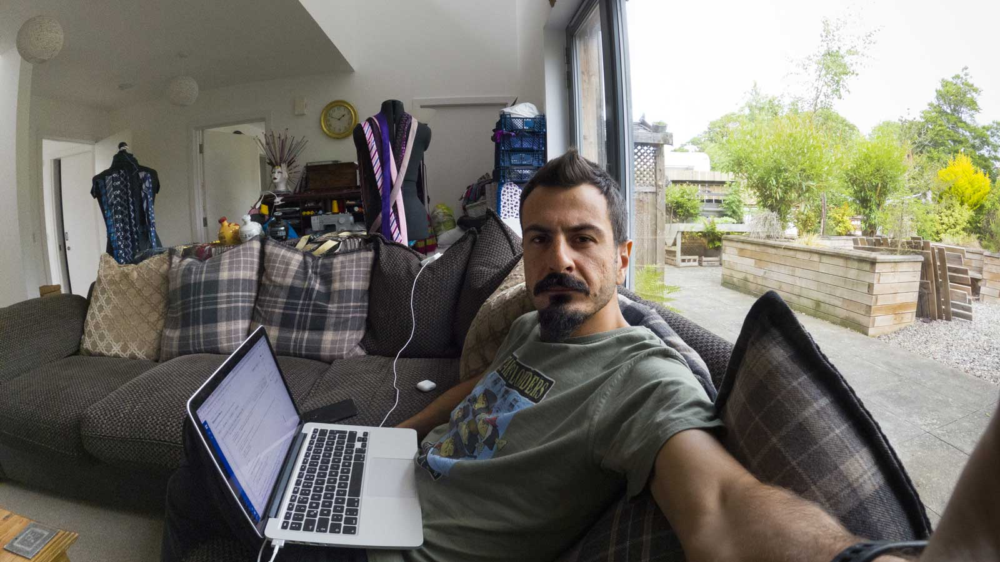
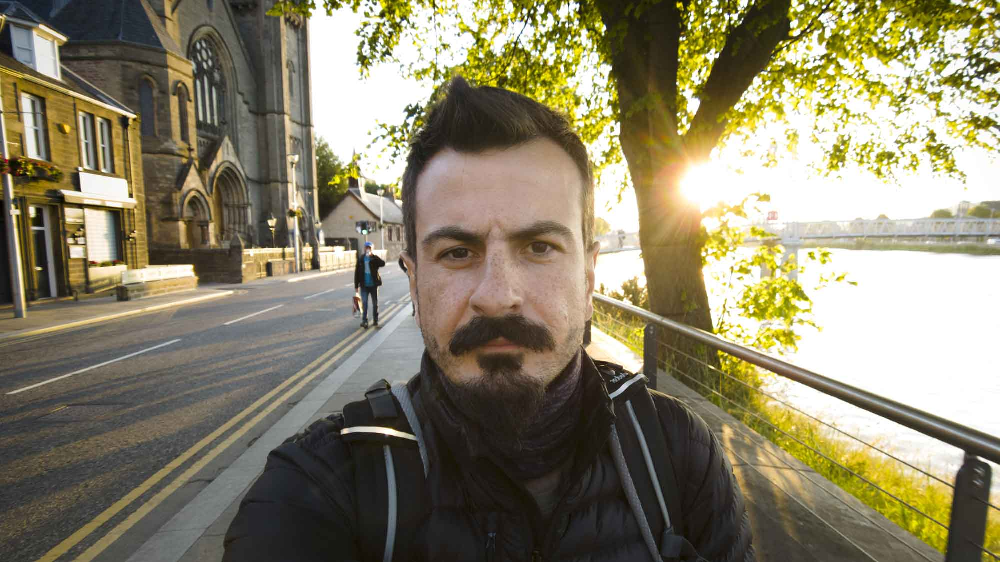
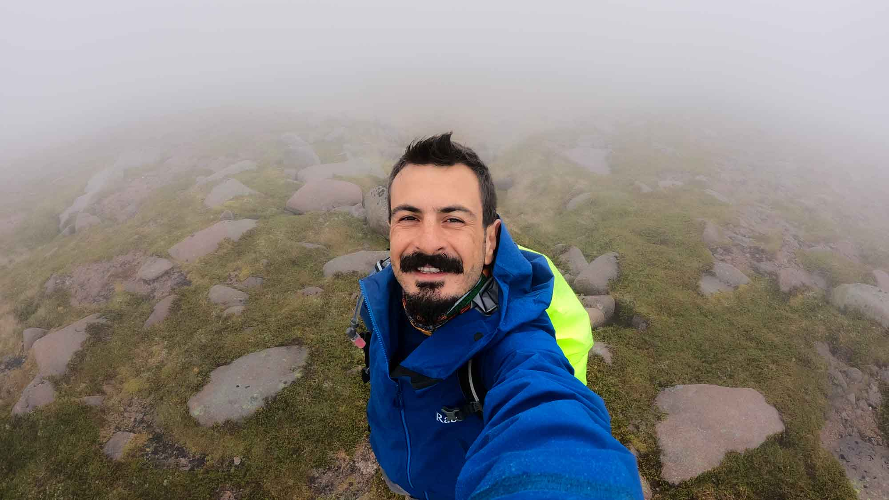

Today marks 1 week in Inverness, the largest city in the Scottish Highlands. I have no idea where that 1 week went. I thought my 4-week plan would feel like a long time. On my last day in Inverness I’m sitting alone in a chair in the living room, with its huge windows looking out onto the garden. I’m sipping Scotch whisky, deep in thought, watching the rain and writing my notes.

I’d dreamed of this trip for 3 years. I wrote about what it meant to me in [A Trip I’d Dreamed Of: The Isle of Skye](/bir-hayale-yolculuk-isle-of-skye/). So what happened on the first part of the trip?

I had planned to set off on Friday, June 18th, aiming to cover at least half of the 500km route. However, the weather in London was so rainy that it showed no signs of stopping. When this was combined with strong winds, I decided to set off on Saturday. Despite being prepared for the rain and wind, riding the motorcycle for at least 3 hours in those conditions would leave me exhausted.

I set off at 7:30 on Saturday morning, though hardly at the crack of dawn. The plan was to reach the house I’d be staying in at Inverness from London in a single day. Roughly 1,000 km on the motorcycle in a day. Easy to say. It was the longest trip I’d ever planned to do in one go. I knew I could stop somewhere overnight if I was too tired, and I’d told myself to take a break after no more than 100 miles, or 160 km. Somehow the road flew by. After 6 stops, 3 for myself and 3 for petrol, and 610 miles (about 1,000 km), I reached Inverness. The last 100 miles hurt, but arriving after 12 hours felt amazing. I’m using miles because that’s how distances and speeds are given here. No other reason. The English drive on the wrong side and their units are the wrong way round too :)

Carey, the owner of the house I arranged through Airbnb, greeted me. She's a very sweet older sister figure who moved here six months ago. She has a 250cc motorcycle and bought the caravan seen in the photo. She does everything herself, even the interior work and all the motorcycle maintenance. She found another caravan in better condition than the one she already had to get parts more cheaply, and she's combining the two. She said she took the engine out of one and fitted it to the other, you know? She's an interesting woman, and besides that, the house is basically a tie-making workshop. She's made a huge number of ties, both as a hobby and for individual clients. She's 49 and works as a nurse. She has a boyfriend, but they live in different houses. I'm sharing snippets of Carey's life because these highlight the differences between our societies. I wanted to share with you how different people live their lives differently. Otherwise, I'm not telling you any specific details about Carey's life. There's also one other person living in the house: Carey's friend, who came here for work. He leaves at 6 in the morning and returns at 6 in the evening. Honestly, we only met the guy four days later and just said hello. He was like a proper ghost; you couldn't tell if he was even there. And then there's Jake, a lazy, lethargic cat. In Carey's words, a devil. They've been together for 14 years. What a friendship, though. I couldn't live with my mum and dad for 14 years, honestly :).

My home life was generally like this – because I had to go to work during the week and then go on trips by riding my motorcycle in the evenings. We didn’t really have much time. What was also surprising about this place was that my aunt Carey didn’t even lock the door. There was no need to carry the key. It was great, really. We had two alarms and a whole bunch of cameras installed at home in London. Actually, one of my friends even installed a gas bomb. Seriously, it’s true. If someone entered the house while we weren’t there, they would remotely detonate it. It was really good, you know.

The weather has been very rainy for the last three days. Because of this, I haven't been able to go anywhere. I had planned to use the first week to recover from travel fatigue and take small trips after work, just as I had planned. And my motorcycle certainly tired me out. I’ve developed incredible muscle pain in my knees and shoulders. Thanks to a heating pad and Voltaren, I started feeling better in about 3-4 days.

Tomorrow morning I’m leaving here for Fort William. A 5-day adventure at a lovely campsite awaits. The plan for tomorrow, Saturday 26 June, is to reach the Ben Nevis campsite. On Sunday I’ll climb Ben Nevis for sunset and camp up there. On Monday morning I’ll watch the sunrise, then go back to the campsite to start work at 9. You’re probably asking if I’m broke or don’t have any leave. I did have leave and planned to take it, but I couldn’t use it because I was changing jobs. So I have to work. Whenever I make plans to go away, I get a new job offer and have to work. The good thing is that I get to try out the way of working and travelling I’ve been dreaming about. I can see if the idea is actually possible.

I know I’ll learn a lot on this trip, and what I learn will help me take the next step towards the other things I dream of doing.

Carey is setting off to attend her own birthday party. Since it’s not a weekend, we said goodbye, and I said we might see each other again. He asked, “Where will it be, in heaven?” I replied, “The world might be small, and so could heaven, why not?” I’ll leave a small gift and a note thanking him for only sharing one week of his life with me, and for not sharing his home with me.

My initial part of the journey went exactly as planned. Next up is the realization of this dream: to watch the sunset and be bathed in sunlight on Ben Nevis, in the United Kingdom. Following that, I’ll be chasing after the Hogwarts train, and then, I’ll be heading towards the heart of this dream – the Isle of Skye.

Thank you for reading this far; I send you big hugs and kisses.