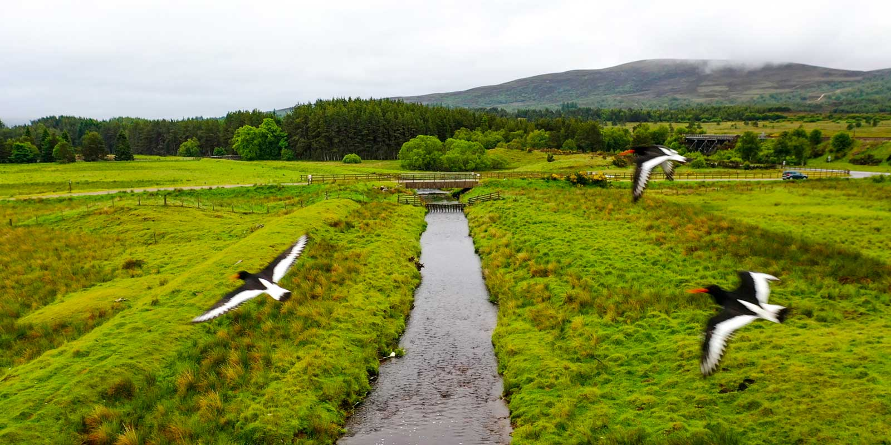
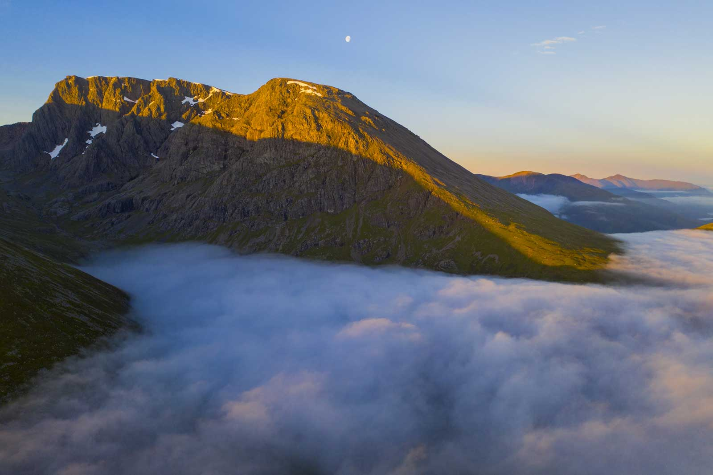
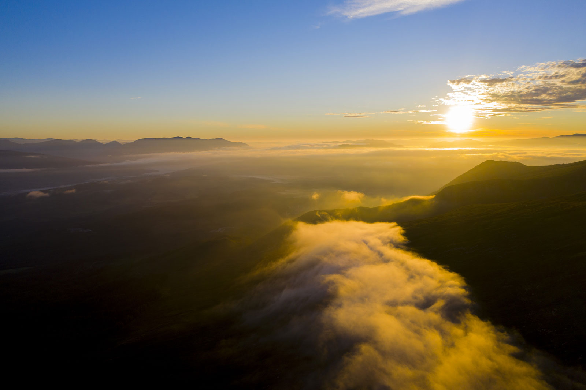

After [a week in Inverness](/iskoc-yaylalari-inverness-1.-bolum/), it was time to set off. Apart from 1–2 days of heavy rain, the Inverness part had gone exactly to plan. Now it was time to get out into nature.

On June 25th, Saturday, I set off at 7 am, even though the forecast predicted a cloudy day without rain. I had wanted to take drone footage of a train bridge for the past three days, but couldn’t due to the rain. I decided to start the day by heading to the bridge. When I was about 5km from the bridge, the rain started again, and I had to turn back. It wasn’t a particularly amazing bridge, but somehow, I just couldn’t seem to get lucky. While riding, I turned towards a lake I spotted. I took out my drone and began flying, following a stream that started in a meadow. Initially, I was caught in a flock of birds, and then, following the stream, I reached a forest with pine trees, about 30-40 meters high. While flying with the drone, I navigated through the forest, and the path became blocked, forcing me to ascend, eventually revealing a beautiful lake view. “Well, the bridge isn’t there, but there’s a lake,” I thought, and I had successfully completed my morning mission.

By then I’d covered about 1,500 km. I stopped at a motorcycle shop in Inverness to get my chain lubricated. I explained the problem and the man asked me something I didn’t understand. He was probably asking if I had a centre stand, which makes oiling the chain easy. I didn’t know the term in English and he didn’t say “middle leg” or anything like that. It would’ve sounded ridiculous if he had. He realised I wasn’t getting it and came over to look at the bike. Someone else came to help. They tipped it on the side stand to lift the wheel, lubricated the chain in 10 seconds and didn’t charge me even 5 kuruş. I left saying, “Tenk you, many many tenk you.” My next stop was the campsite in Fort William. Then I’d camp on Ben Nevis, the star of this dream, watch the sunset, watch the sunrise in the morning and come back.

The route between Inverness and Fort William is incredibly beautiful, with stunning lakes and a fantastic road winding through a valley, perfect for sailing. I was completely blown away by the scenery. If I get the chance, I want to fly a drone at sunset in these areas in the coming days. After arriving at the campsite in the evening, I was incredibly tired, so I decided to go on the Jacobite Steam Train ([The Jacobite Steam Train](https://westcoastrailways.co.uk/jacobite/steam-train-trip)) on Sunday morning. After setting up at the campsite, I realized I needed an electrical adapter. I had booked an electrical outlet, but I hadn’t bought an adapter myself. I figured my hairdryer would work, so I checked Google to see what I needed and ran to the reception. There, I bought a short adapter and told my sister that I must have forgotten the cable at home – would this be enough. She looked at me and asked if I had a long cable. I was surprised, and started acting like I didn’t know why I was looking for an electrical outlet. But, I was just trying to act like I didn’t know. She then told me that she thought I was poor, or a beggar. She went inside and got the long cable for the adapter. “Take it, son, you’ve come a long way, use it, and bring it back.” And she saved my life. That’s the way of the Turkish people, you know. No one in London does bad things :). But, if I hadn’t had electricity, I would have been really worried because I needed to turn on my PC on Monday to get to work. That was great, it really was. I don’t know how much of a “solo rider” image I created, driving with a motor, but I had electricity now :).

I woke up on Sunday morning and ran to the viaduct in Glenfinnan, the place where the train passes in the Harry Potter films. Two years ago, I rode that train from here and captured its image and sound with my camera. Now it was time to film with a drone. Back then, I had seen plenty of signs prohibiting drone use around here. When I reached the parking area and parked the motor, I didn’t see any drone prohibition signs. “Oh,” I thought, “the ban has been lifted. I can film without hiding.” I went to the bottom of the viaduct, sat down, and waited for the train. As the train approached, it honked from a distance. I immediately released my drone, which rose into the sky and began waiting for the train. When the train arrived, I started filming. Just as it was about to leave, it sped up, so I switched to sport mode and chased after it. We were racing side by side, and the thing was even spewing smoke. I tried to catch up with the locomotive, pressing the throttle hard, and we were about to collide head-on when I decided to cut in front. Suddenly, a car stopped beside me, and a man jumped out. “What’s happening?” I thought, “A fight is about to break out. They must have come to beat me.” I dropped the drone. The man gave me a thorough scolding, asking, “Didn’t you see the drone prohibition sign?” I was shocked. “Man, I’m really sorry,” I said, “I didn’t see it. I parked in the newly opened parking area, and there were no warnings.” “There were,” he replied. “Lower the drone immediately. Next time, I’ll shoot it down with my gun,” he said, then chased after the other two drone operators. You don’t call a guy from Erzurum like that. He was getting under my skin for no reason. I couldn’t say, “Come on, you’ll get beaten!” because I’m a dirty migrant. Ulan, I was completely messed up with that guy; my nerves were shot. If Itoğlu had arrived 10 seconds later, he would have cut in front of the train and won the race. They were going to give me the [Birincilik teli](https://www.google.com/search?q=birincilik+teli+f%C4%B1rat&oq=birincilik+teli&aqs=chrome.1.69i57j0i19j0i19i22i30l2.4083j0j7&sourceid=chrome&ie=UTF-8). While I was upset because I hadn’t managed to get a good shot, the fact that I had captured something really beautiful calmed me down. Then I returned to the campsite, charged the drone, and started gathering my gear to head up Ben Nevis for camping.

This mountain, with a summit 1,350 metres high, is the highest point in the United Kingdom. Those who reach the summit are said to be given the title "Sir". I thought, "I'll go and get it." I knew it would be a challenging ascent, rising by 800 metres over approximately 5 km. So, when I started, I packed only what was necessary: a tent, sleeping bag, mat, food for one night, and my electronic equipment, namely my cameras. Then the devil whispered from the left: "If you've managed to get up there, won't you be able to have a coffee at the top?" So I took a mug, camping stove, cartridge, kettle for boiling water, coffee, a grinder for the coffee, and a Delter Coffee Press to make it. I took 1 litre of water so I wouldn’t have to find out whether there was water higher up or how clean it was. Once the bag was packed, it weighed about 12 kg. I fitted 60 litres of gear into a 32-litre bag and climbed up to 800 metres, step by step. As I walked, I swore at myself and complained a lot. "Why bother looking at the view when you're up there? Shouldn't we be flying a drone and drinking our coffee?" I could at least have given up the drone or the coffee. On the rocky approach to the summit I worried about finding a patch of ground soft enough to pitch on. I passed close to 20 hikers coming down, and one of them told me to relax and look around, as there were spots like that here and there. When I reached 800 metres, I had a fantastic view and said to Ibrahim, "You're setting up camp here; there's no need to climb to 1,200 metres, and if you do go further, you could lose this view." I set up the tent, settled in, and everything was ready. There was 1.5 hours until sunset. "I'll make some coffee," I said. "Damn it, I haven't even brought matches!" I went mad with anger. I had everything except matches. I couldn't light the stove. I need just one spark, but I don't know where to get it. The coffee plan is out; I've also brought a whole lot more stuff.

While I was feeling frustrated and berating myself at the top of the mountain, a wonderful sunset began, and I started to feel a surge of happiness. I didn’t have matches, there wasn’t any coffee, I felt like I was carrying an extra heavy burden – none of that mattered. The clouds hadn’t settled on the mountainside, but it didn’t matter; I had watched a truly amazing sunset. Now that I wouldn’t see a beautiful sunrise, I was incredibly happy. Nature had given me a beautiful sight. As my clock showed 23:30, I slowly drifted off to sleep. The air was still bright. I hadn’t set an alarm to wake up for the sunrise at 4:15 in the morning. I simply left the sunrise to chance and went to sleep.

Around 03:30, I woke up shivering slightly. As soon as I woke, I pulled back the tent flap and looked straight out. It was dark, but not pitch-black like it is here. There were no clouds either; the air was crystal clear. Thinking there wouldn’t be a cloudy sunrise, I went back to sleep. This time, I left the flap slightly open so that if I woke up, I could see out from where I was. An hour later, I don’t know what happened or why I woke up, but the moment I opened my eyes, I saw all the clouds spread out before me, a sea of clouds, and the sun was just beginning to rise. A magnificent view was waiting for me. I immediately jumped out of the tent, watched that amazing scene for about five minutes, then grabbed the drone and started flying it to see more. That moment, the experience of it, and what I felt—I can only describe it as “I couldn’t breathe from happiness.” I can’t find another word to describe it.

Within half an hour, all the clouds disappeared. I gathered myself and set off for my return.

As I descended, I thought of the years of effort I had poured into reaching these dreams, and of the countless moments I had imagined this scene. How lucky I was—or whatever you call it, nature, fate, or God—who had done me the kindness of showing me a magnificent sunrise, one hundred times better than the beautiful sunset that had preceded it. What did I have in common with that 24-year-old girl who had climbed and disappeared from this mountain five or six days before me, and whose lifeless body was found two days later? I am sure she, like me, had planned everything and set out on her journey, and perhaps she too had watched that sunrise, walked the same paths. Why had nature been so generous with me, yet not with her? Her last post was a photo of the summit at 6:30 in the morning, and nothing after that. As I sent her my good wishes and prayers, I also thought, "Come on, what is 24? Isn't that too young?" The girl had only been an adult for three or five years in this life. Her accident was very sad, but I was glad for her, because she had ended her life while chasing the things she loved. One day we will all die, and if we could choose how our thoughts are taken, I would choose to die while pursuing the things I love, rather than in a traffic accident or something similar. Ah, life, how simple you are and how complex you are. As I continued my descent, listening to "[And The Waltz Goes On](https://open.spotify.com/track/6gvQHafvp7j7eanVD269Jj?si=e5f677b8ac814365)", with the crazy questions in my head and deep thoughts, I suddenly began to sob uncontrollably and collapsed where I was, continuing to cry through my sobs. I am writing these lines now with tears in my eyes. What was this? Why did it happen like that? Why did I feel this way, and why do I still feel it? I still don't know. What was Ibrahim compared to, given the vastness and magnificence of the world, even the universe, when such generosity was shown to him?

...

...

Today is June 29th, a Tuesday. If the weather clouds over a bit and loses its intense sun, I’ll go after the Harry Potter train again. There’s a really beautiful area with two lakes, and I’ll pass by that. I’m also planning to go there and enter a race. Afterwards, I’m planning to go to Glencoe Valley and ride a motor while observing nature, and then, in the early morning tomorrow, I’ll travel to Isle of Skye, which is the heart of this dream.
