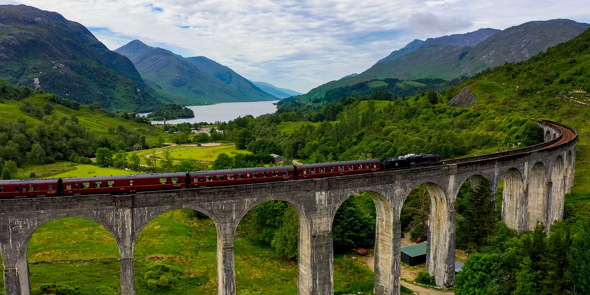
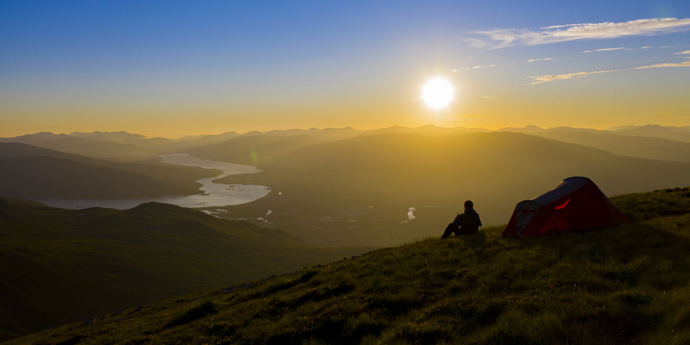

After [a week in Inverness](/iskoc-yaylalari-inverness-1.-bolum/), it was time to set off. Apart from 1–2 days of heavy rain, the Inverness part had gone exactly to plan. Now it was time to get out into nature.

On June 25th, Saturday, I set off at 7 am, even though the forecast predicted a cloudy day without rain. I had wanted to take drone footage of a train bridge for the past three days, but couldn’t due to the rain. I decided to start the day by heading to the bridge. When I was about 5km from the bridge, the rain started again, and I had to turn back. It wasn’t a particularly amazing bridge, but somehow, I just couldn’t seem to get lucky. While riding, I turned towards a lake I spotted. I took out my drone and began flying, following a stream that started in a meadow. Initially, I was caught in a flock of birds, and then, following the stream, I reached a forest with pine trees, about 30-40 meters high. While flying with the drone, I navigated through the forest, and the path became blocked, forcing me to ascend, eventually revealing a beautiful lake view. “Well, the bridge isn’t there, but there’s a lake,” I thought, and I had successfully completed my morning mission.

By then I’d covered about 1,500 km. I stopped at a motorcycle shop in Inverness to get my chain lubricated. I explained the problem and the man asked me something I didn’t understand. He was probably asking if I had a centre stand, which makes oiling the chain easy. I didn’t know the term in English and he didn’t say “middle leg” or anything like that. It would’ve sounded ridiculous if he had. He realised I wasn’t getting it and came over to look at the bike. Someone else came to help. They tipped it on the side stand to lift the wheel, lubricated the chain in 10 seconds and didn’t charge me even 5 kuruş. I left saying, “Tenk you, many many tenk you.” My next stop was the campsite in Fort William. Then I’d camp on Ben Nevis, the star of this dream, watch the sunset, watch the sunrise in the morning and come back.

The route between Inverness and Fort William is incredibly beautiful, with stunning lakes and a fantastic road winding through a valley, perfect for sailing. I was completely blown away by the scenery. If I get the chance, I want to fly a drone at sunset in these areas in the coming days. After arriving at the campsite in the evening, I was incredibly tired, so I decided to go on the Jacobite Steam Train ([The Jacobite Steam Train](https://westcoastrailways.co.uk/jacobite/steam-train-trip)) on Sunday morning. After setting up at the campsite, I realized I needed an electrical adapter. I had booked an electrical outlet, but I hadn’t bought an adapter myself. I figured my hairdryer would work, so I checked Google to see what I needed and ran to the reception. There, I bought a short adapter and told my sister that I must have forgotten the cable at home – would this be enough. She looked at me and asked if I had a long cable. I was surprised, and started acting like I didn’t know why I was looking for an electrical outlet. But, I was just trying to act like I didn’t know. She then told me that she thought I was poor, or a beggar. She went inside and got the long cable for the adapter. “Take it, son, you’ve come a long way, use it, and bring it back.” And she saved my life. That’s the way of the Turkish people, you know. No one in London does bad things :). But, if I hadn’t had electricity, I would have been really worried because I needed to turn on my PC on Monday to get to work. That was great, it really was. I don’t know how much of a “solo rider” image I created, driving with a motor, but I had electricity now :).

I woke up early in the morning and ran, and I went to the viaduct in Glenfinnan – the place where the train goes in the Harry Potter films. Two years ago, I rode on that train from here and took photos and sound recordings of its appearance with my camera. Now it was time to film with a drone. Back then, there were signs prohibiting the use of drones everywhere. When I reached the parking area and parked the motor, I didn’t see any drone prohibition signs. “Oh,” I said, “the ban has been lifted.” I could film without hiding. I went to the bottom of the viaduct and sat down, waiting for the train to approach. When the train came, I started filming, and as it was going, it started speeding up, so I activated my sport mode and chased after it. It was a race on the right and left, and there was also smoke. I tried to catch up with the locomotive, and suddenly, a car stopped beside me, and a man jumped over, and I said, “What’s happening?” I thought there would be a fight, and I thought they were going to beat me, so I dropped the drone. The man gave me a brush, scolded me, and asked me if I hadn’t seen the “drone prohibition” sign. I was shocked. “Man, I’m really sorry,” I said, “I didn’t see it.” I had parked in the newly opened parking area, and there were no warnings. “The drone must be lowered immediately,” he said, and then he went after the other two drone operators. You wouldn’t call a guy from Erzurum like that. My blood pressure goes up for no reason. I couldn’t say, “Come on, you’ll get beaten!” because I’m a migrant. It was a really bad situation. Itoğlu would have gotten in front of the train in 10 years and won the race. [Birincilik tel](https://www.google.com/search?q=birincilik+teli+f%C4%B1rat&oq=birincilik+teli&aqs=chrome.1.69i57j0i19j0i19i22i30l2.4083j0j7&sourceid=chrome&ie=UTF-8) were going to give it to me, but I was upset because I hadn’t managed to get a good shot. Then, I returned to the campsite, charged the drone, and started gathering my gear to go camping on Ben Nevis.

This mountain, with a summit 1,350 metres high, is the highest point in the United Kingdom. Those who reach the summit are said to be given the title "Sir". I thought, "I'll go and get it." I knew it would be a challenging ascent, rising by 800 metres over approximately 5 km. So, when I started, I packed only what was necessary: a tent, sleeping bag, mat, food for one night, and my electronic equipment, namely my cameras. Then the devil whispered from the left: "If you've managed to get up there, won't you be able to have a coffee at the top?" So I took a mug, camping stove, cartridge, kettle for boiling water, coffee, a grinder for the coffee, and a Delter Coffee Press to make it. I took 1 litre of water so I wouldn’t have to find out whether there was water higher up or how clean it was. Once the bag was packed, it weighed about 12 kg. I fitted 60 litres of gear into a 32-litre bag and climbed up to 800 metres, step by step. As I walked, I swore at myself and complained a lot. "Why bother looking at the view when you're up there? Shouldn't we be flying a drone and drinking our coffee?" I could at least have given up the drone or the coffee. On the rocky approach to the summit I worried about finding a patch of ground soft enough to pitch on. I passed close to 20 hikers coming down, and one of them told me to relax and look around, as there were spots like that here and there. When I reached 800 metres, I had a fantastic view and said to Ibrahim, "You're setting up camp here; there's no need to climb to 1,200 metres, and if you do go further, you could lose this view." I set up the tent, settled in, and everything was ready. There was 1.5 hours until sunset. "I'll make some coffee," I said. "Damn it, I haven't even brought matches!" I went mad with anger. I had everything except matches. I couldn't light the stove. I need just one spark, but I don't know where to get it. The coffee plan is out; I've also brought a whole lot more stuff.

While I was feeling frustrated and berating myself at the top of the mountain, a wonderful sunset began, and I started to feel a surge of happiness. I didn’t have matches, there wasn’t any coffee, I felt like I was carrying an extra heavy burden – none of that mattered. The clouds hadn’t settled on the mountainside, but it didn’t matter; I had watched a truly amazing sunset. Now that I wouldn’t see a beautiful sunrise, I was incredibly happy. Nature had given me a beautiful sight. As my clock showed 23:30, I slowly drifted off to sleep. The air was still bright. I hadn’t set an alarm to wake up for the sunrise at 4:15 in the morning. I simply left the sunrise to chance and went to sleep.

Around 03:30 in the morning, I woke up feeling slightly cold. When I woke up, I opened the tent flap and looked outside. It was dark, but not as pitch-black as it would be here. There were no clouds either. The environment was clean. I decided to go back to sleep, thinking there wouldn’t be a cloudy sunrise like we usually have. This time, I left the tent flap slightly open, so if I woke up, I could see outside from where I was. An hour later, I don’t know why I woke up, but the moment I opened my eyes, I saw all the clouds spread out in front of me, and the sun was starting to rise gradually. A magnificent scene was waiting for me. I immediately rushed out of the tent and watched that amazing scene for about 5 minutes, then I started taking a drone and flying to see more. I can only describe that moment, and the feelings I had, as “I couldn’t breathe from happiness.” I just can’t find another word to describe it.

Within half an hour, all the clouds disappeared. I gathered myself and set off for my return.

As I descended, I reflected on the years of effort I had devoted to reaching these dreams, and on countless moments when I had cherished this memory. How fortunate I was—or however you might phrase it, whether it be nature, fate, or God—who had bestowed such a beauty upon me. After a magnificent sunset, he had gifted me a sunrise 100 times more magnificent. What did I know of that 24-year-old girl, who had disappeared from the mountain five to six days before me and whose lifeless body was discovered two days later? Surely she, like me, had planned everything meticulously and set out on her journey, and perhaps she too had witnessed that breathtaking sunrise, having travelled the same paths. Why had nature been so generous with me, yet not with her? The last thing she shared was a photo of the summit at 6:30 in the morning, after which there was silence. As I sent her my best wishes and prayers, I also wondered, "What does 24 even mean? Isn't that too young?" She’d barely had three to five years to find her feet as an adult. Her accident was deeply tragic, yet I felt a strange sense of relief for her, because she had lost her life while pursuing the things she loved. One day we will all die; if we could choose how our thoughts are taken, I would choose to die while pursuing the things I love, rather than in a traffic accident. Ah, life/existence, how simple yet how complex it is. As I continued my descent, listening to "[And The Waltz Goes On](https://open.spotify.com/track/6gvQHafvp7j7eanVD269Jj?si=e5f677b8ac814365)", filled with frantic questions and deep thoughts, I began to weep uncontrollably, collapsing at the foot of Ben Nevis, weeping through my sobs. I am writing these words now, with tears in my eyes. What was this? Why had things turned out this way? Why did I feel this way, and why do I still feel it? I still do not know. What could Ibrahim be compared to, given the vastness and magnificence of the world/universe, when such generosity was shown to him?

...

...

Today is June 29th, a Tuesday. If the weather clouds over a bit and loses its intense sun, I’ll go after the Harry Potter train again. There’s a really beautiful area with two lakes, and I’ll pass by that. I’m also planning to go there and enter a race. Afterwards, I’m planning to go to Glencoe Valley and ride a motor while observing nature, and then, in the early morning tomorrow, I’ll travel to Isle of Skye, which is the heart of this dream.
