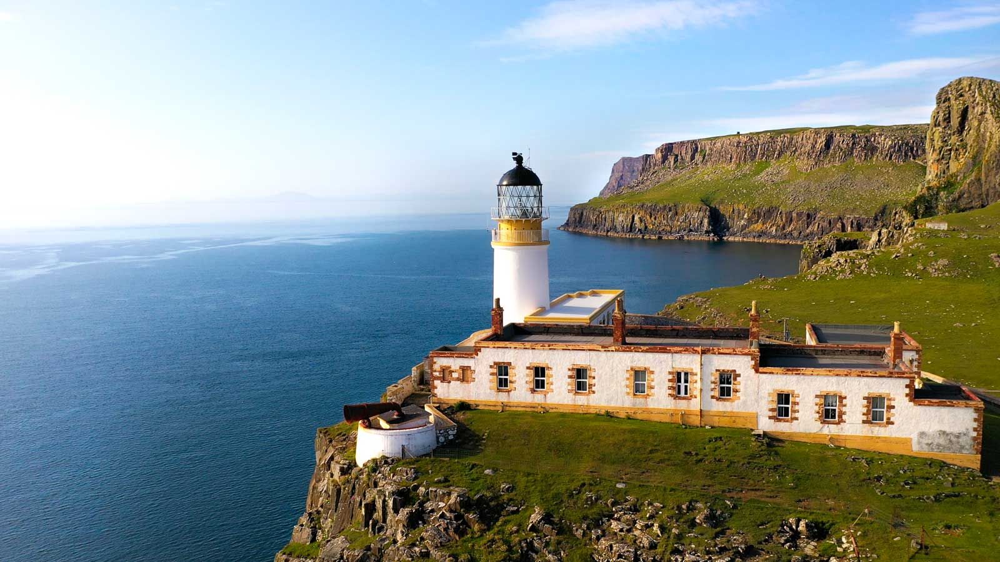
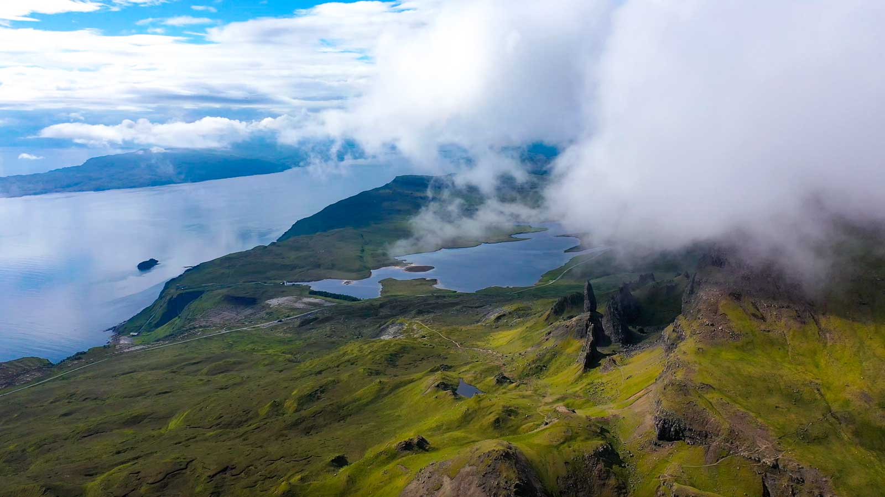
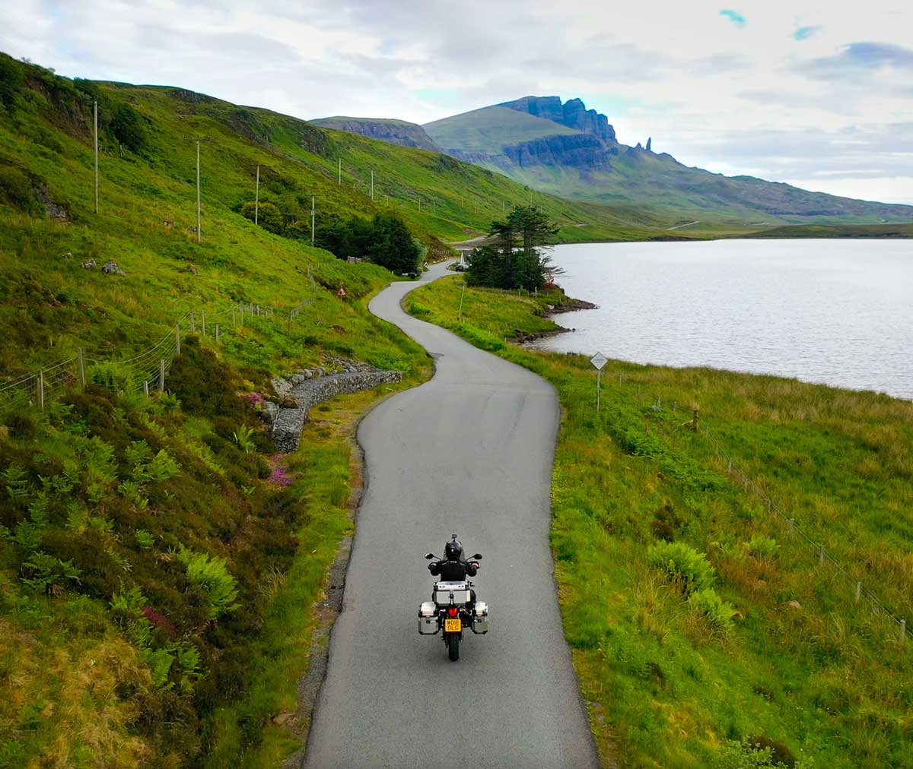
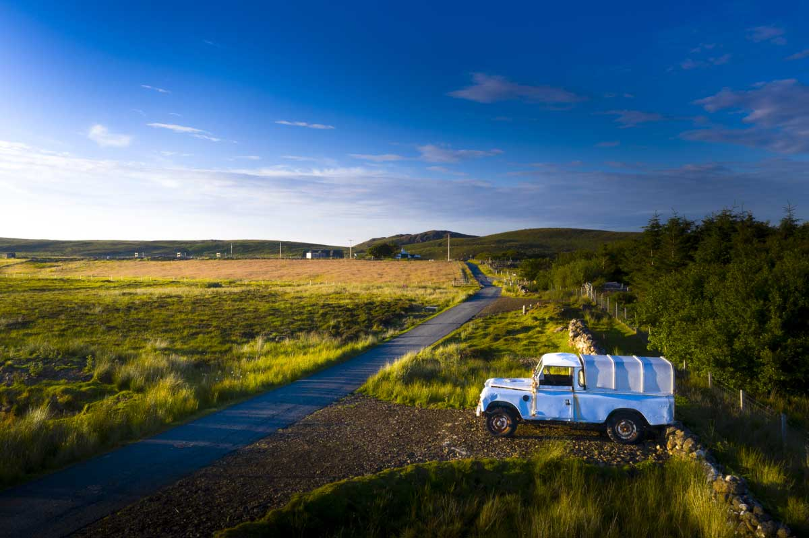
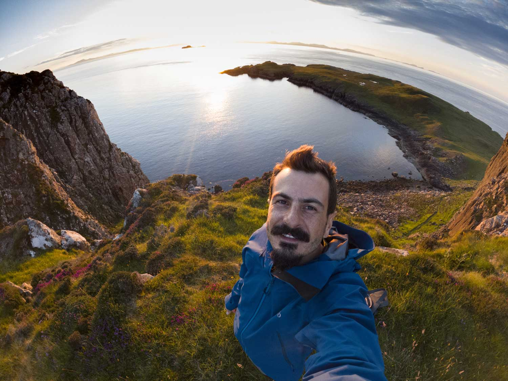

And here we are, in the section about the Isle of Skye, which in Turkish is known as Gökyüzü Adası. I’d heard of Skye’s fame, which is connected to Western Scotland with a 500-meter bridge, and I’d seen from the photos that it’s a truly beautiful place. I’m defining this as the heart of my dream – because I found a lovely house at the foot of the mountains, away from city life and a 20-minute drive by car, and I’ve arranged to stay here for 10 days.

I set aside 10 days so I wouldn’t have to rush. I was going to work from home and wanted to explore the island at my leisure in the evenings. It didn’t work out that way, of course. I rushed everywhere. When I reached the house, I was soaked from the rain and exhausted from riding so much. Just 1 or 2 days earlier I’d camped on Ben Nevis to watch the sun set and rise. So I spent my first 2 days at the house resting in my room.

Once I calmed down a bit, I jumped on the motorbike and started taking tours around the island.

I went straight to my first destination, the lighthouse above. It’s at the western tip of the island, with a wonderful view. The sun was out and so were the midges, those little flies that eat you alive. This time I was ready. I sprayed insect repellent all over myself and they left me alone. What was everyone telling me? Get sunscreen, make sure it’s factor 50 and has FPV or PVF or whatever it’s called. Couldn’t somebody have told me the sun only comes out for a day or two, and to bring insect repellent because those little monsters called midges will eat you? They’re everywhere in western Scotland. There are so many I can’t get my head around it. You’d have to set the whole west of Scotland on fire to get rid of them.

Well, I was just circling around the lighthouse, enjoying the view, and flying a drone when I suddenly started hearing sounds coming from the rocks at the very back of the photo. I looked, and there was a whole flock of birds flying there, making strange noises, and then, what do you know – I saw 2 to 3 whirlpools. I thought, 'There must be a whale there, or perhaps seals.' I pictured a whale coming in close to feed and the birds snapping up the little fish that escaped it. I immediately formulated the scenario in my head and launched the drone. 'Let's get two whale photos, and also a couple of seal videos,' I said. I used one battery, and besides the birds, I saw nothing else. The vortices were caused by the rocks remaining in the middle of the sea (actually, I should say ocean, since the location in the photo is the North Atlantic Ocean). The strange sounds were likely due to the calls of the birds and echoes off the rocks, which made them sound different. 'What a thrill, Ibrahim, I'll see a whale!' I thought, but the entire scenario turned out to be for nothing. However, I didn't lose hope – there is still a chance I might see a seal or a whale somewhere else.

While I was on the buoy, the weather was sunny, but the weather here changes so quickly. When I check the weather forecast, it says there’s no rain, but it’s actually raining. And of course, I’ve had days where I’m riding the motor while it’s raining – usually one or two days.

The following week, I went to The Old Man of Storr, which is the most popular spot on the island. Locals described it this way because it resembles an old man standing firmly in a rock. According to the legend, a giant who lived there said, “Enough, world, I’m going into eternal sleep,” and then lay down there. He was lying down, but his fingers were in the air, so they call those rocks the giant’s fingers. If that’s the case, it was his last action before entering his eternal sleep.

As I arrived, I had a constant feeling of questioning. “It’s a really nice place,” I kept asking myself, “but there are two standing stones, and something else seems to be going on here. Are people just exaggerating?” I was thinking this while looking at the photo I took on the motorbike. But then, when I started walking around, I was completely amazed by the scenery and nature. The clouds were going down and up, one side was the ocean, there were cows everywhere, and a huge rocky area. I had started thinking I would walk for 2-3km, but when I finished my walk, I had actually walked almost 10km.

I’ve also captured some fantastic videos to go with these beautiful photos. And I can say clearly that the videos I’ve taken represent, at most, only 5% of what I’ve seen.

I rode all over Skye Island, and I haven’t enjoyed riding a motor in my life as much as I did there. I was completely captivated, and I didn’t want to stop riding. When I arrived on the island, I had already covered 1500 miles – approximately 2000 kilometers. I don’t know how much more riding I’ll do on the island. I estimate that I’ve done around 500 miles more. I wish I had a record of exactly how many miles I rode each day. Actually, Google Maps has a timeline feature, and when I look at that, I can see exactly how many kilometers I drove each day, where I stopped, and how long I took breaks. When I’m planning the trip, I’ll use this feature.

Meanwhile, after running after Mr. Storr’s elderly man, I quickly went to The Fairy Glen, another evening.

There isn’t really anything happening here. There actually are small hills and little puddles of water, so it’s a really charming place. These small hills gave me the feeling that I had walked through a termite hill. When I saw the large area in the photos I saw online, I was surprised to see how small it actually is. And on the central stone, someone must have thrown a stone, made a wish, and put chocolate on it. Honestly, if I had collected them, they would have cost me a fortune in gasoline, and I would have eaten all the chocolate. Oh, my silly head – does it only work out later?

As I was running around like this in Isle of Skye, the days were passing by quickly. People might say, “You haven’t eaten anything, or drunk anything – you’re a child!” All my supplies, including food and gasoline, I was getting from Portree, a small, charming town, which was about 20 minutes away. To be honest, staying in this house in the mountains was practically a form of rehabilitation. I experienced the wonderful feeling of being alone with silence, peace, and clarity.

My final goal was to drive my motorcycle out another day. Yes, I went to the furthest point on the island, to the rocky area called Rubha Hunish, at sunset. Of course, I still had some hope, in case I saw a whale. And, as expected, that didn't happen.

I have absolutely no idea how those 10 days passed on Skye. I saw incredible scenery, and I had moments while riding my motorcycle on the roads where I felt like I was about to lose control from sheer enjoyment. My only regret is not being able to do as many nature walks as I wanted. But I’m managing to work, ride my motorcycle, and get to everywhere – that’s all I can manage. Now it’s time to say goodbye. My next destination is a 120-year-old Victorian-era house in Strathpeffer, just a bit west of Inverness, where I plan to spend a week, and explore the northern Highlands. Now it’s time to set off, time to go.

Finally, I want to share one more experience I recently gained.

We actually knew that the sun wasn't rising exactly from the east and west, but rather shifted according to the seasons and the Earth's movement – something I hadn't anticipated. The sun actually set from the northwest and rose from the northeast. That’s why nights in the north are so short. The simplest way to find direction when outdoors is to follow the sun. In Turkey, this system works, but directions in the north may become confused. Therefore, the most accurate direction-finding tool is a compass.

