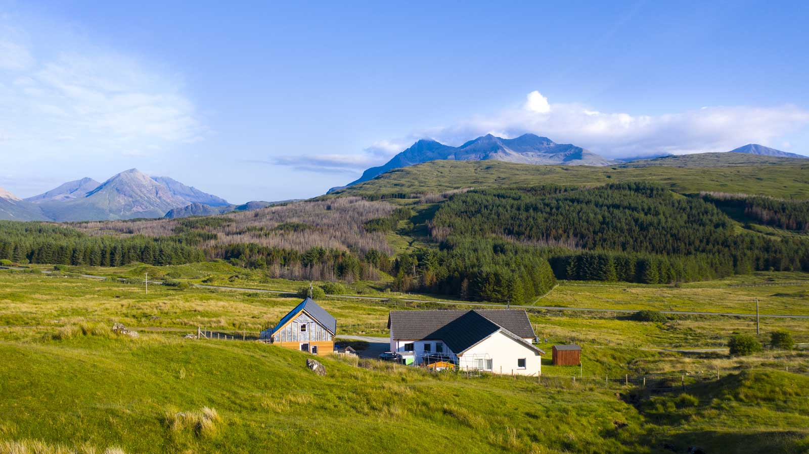
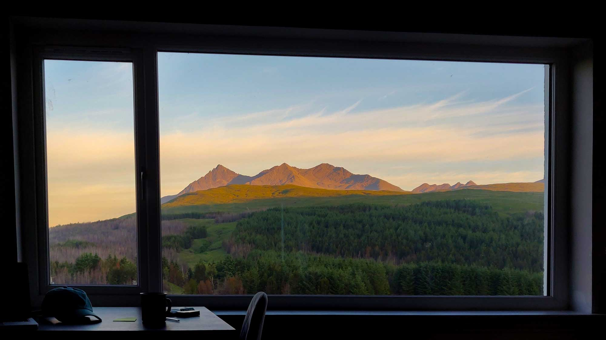
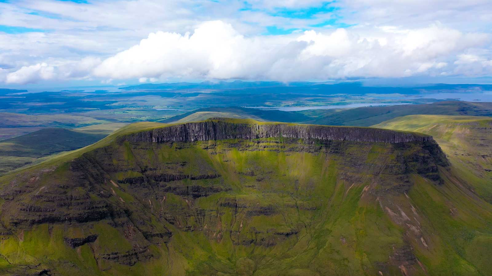
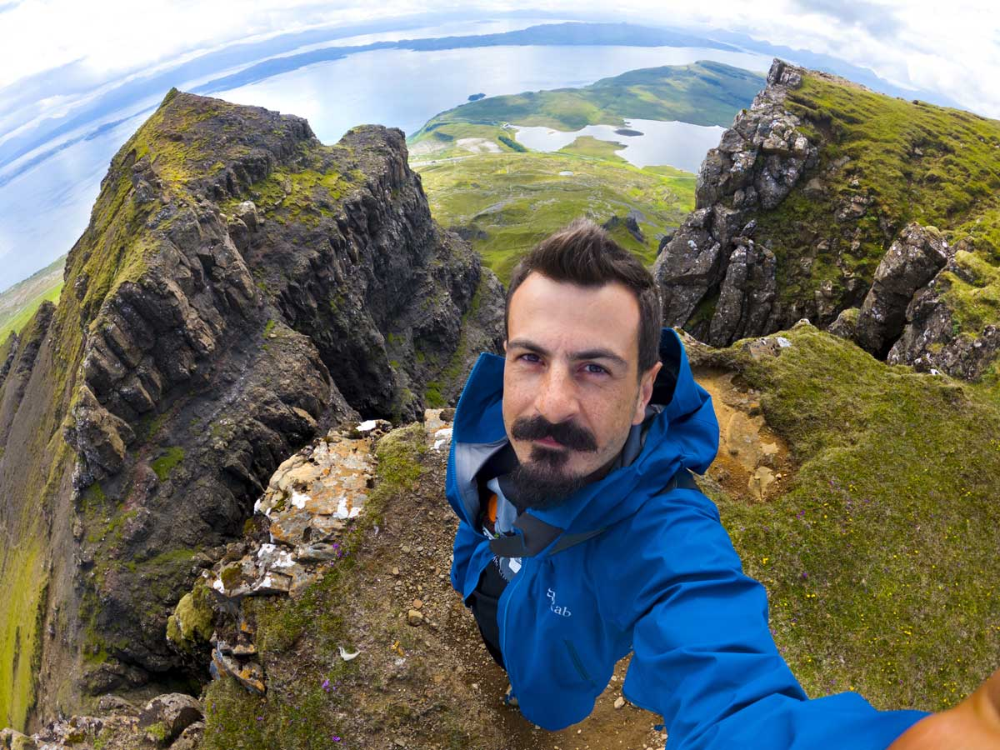
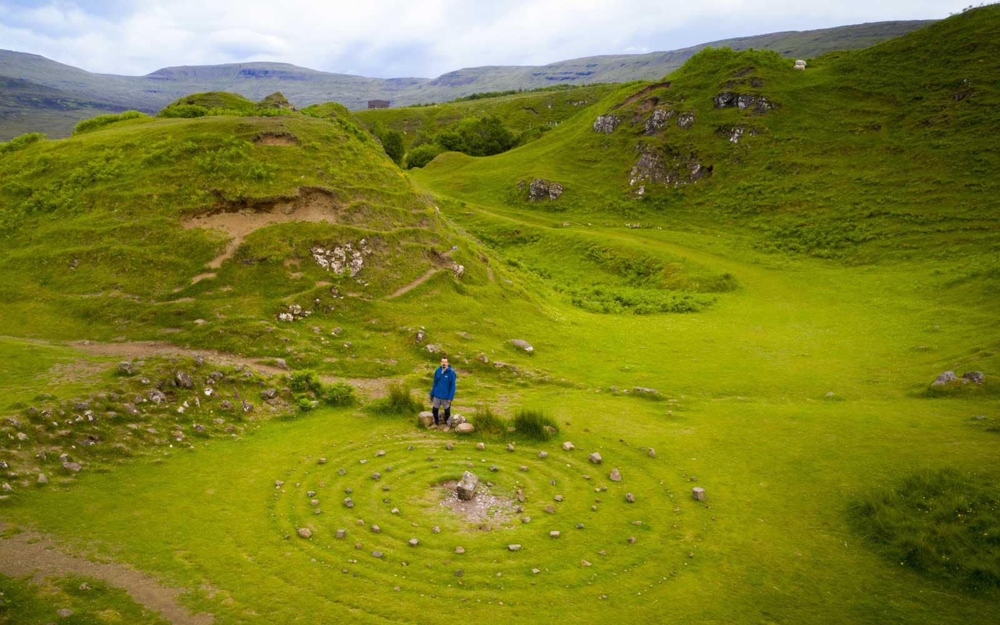
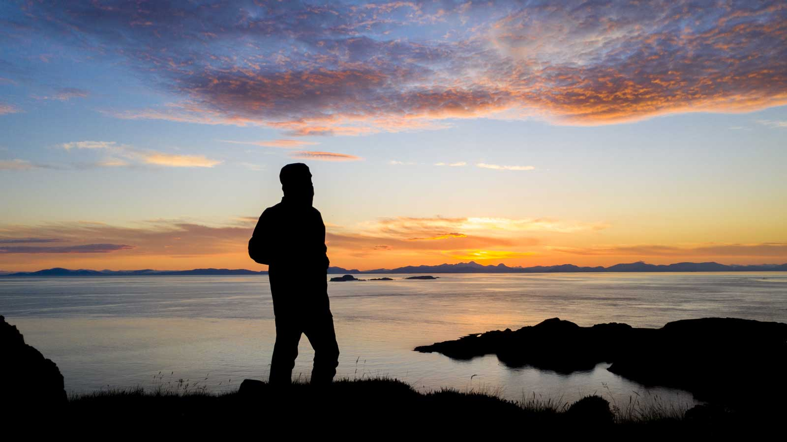
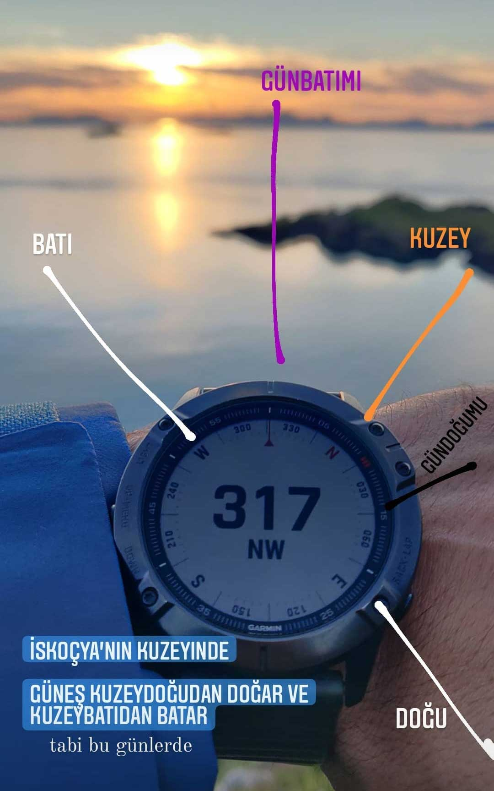

And here we are, in the section about the Isle of Skye, which in Turkish is known as Gökyüzü Adası. I’d heard of Skye’s fame, which is connected to Western Scotland with a 500-meter bridge, and I’d seen from the photos that it’s a truly beautiful place. I’m defining this as the heart of my dream – because I found a lovely house at the foot of the mountains, away from city life and a 20-minute drive by car, and I’ve arranged to stay here for 10 days.

I set aside 10 days so I wouldn’t have to rush. I was going to work from home and wanted to explore the island at my leisure in the evenings. It didn’t work out that way, of course. I rushed everywhere. When I reached the house, I was soaked from the rain and exhausted from riding so much. Just 1 or 2 days earlier I’d camped on Ben Nevis to watch the sun set and rise. So I spent my first 2 days at the house resting in my room.

Once I calmed down a bit, I jumped on the motorbike and started taking tours around the island.

I rushed straight to my first target: the lighthouse above. It’s at the westernmost tip of the island, offering a stunning view. The sun was out, and so were the midges—those tiny flies that eat you alive. Of course, this time I was prepared. I sprayed insect repellent all over my body, and none of them bothered me. What’s the deal, eh? They tell you to get sunscreen, make sure it’s factor 50, and have some FPV or PVF or whatever it’s called, and all that nonsense. Can’t someone just say, “The sun’s only out for a day or two, so forget it—take insect repellent instead”? There are those little monsters called midges there, and they’ll eat you. Friend, these cursed midges are everywhere across western Scotland. There are so many of them I can’t comprehend it. The only way to get rid of them would be to set the whole of western Scotland on fire.

Anyway, I was just hanging around the lighthouse, watching the view, and flying the drone when I suddenly started hearing sounds coming from the rocks at the very back of the photo. I took a look and there was a whole flock of birds flying there, making strange noises, and then, what do you know – there were 2 or 3 whirlpools. I thought, 'There must be a whale there, or maybe seals are basking over there.' I immediately wrote the scenario in my head and let the drone go. 'Run, Ibrahim,' I said, 'get two whale photos, and when you get there, film a couple of seals.' I used up one battery there and saw nothing besides the birds. The whirlpools are formed because of the rocks remaining in the middle of the sea (let's even call it an ocean, since the location in the photo is the North Atlantic Ocean). The strange sounds are just the calls of the silly birds, and they sound different because they echo off the rocks. 'What excitement, Ibrahim, you're going to see a whale!' and the whole scenario went to waste. But I didn't give up hope; even if there isn't one here, there's still a chance I might see a seal or a whale somewhere else.

While I was on the buoy, the weather was sunny, but the weather here changes so quickly. When I check the weather forecast, it says there’s no rain, but it’s actually raining. And of course, I’ve had days where I’m riding the motor while it’s raining – usually one or two days.

A few days later I went to the Old Man of Storr, the island’s most popular spot. You can see where the name comes from: that upright rock looks like an old man. The legend tells it differently. One day a giant who lived there said, “Enough, mate. Is it up to me to save the world? You lot can look after yourselves. I’m going to sleep for eternity.” And down he lay. His fingers stayed sticking up, though, which is why they call those rocks the giant’s fingers. If that’s true, the old boy got one last gesture in before his eternal sleep.

Of course, I had doubts when I came here. "Sure, it's a nice place," I kept asking myself, "but there are two standing stones, and what else is there to see? Are people exaggerating?" I thought that when I saw the photo I took on the motorbike. But then, when I started walking around, I was completely amazed by the scenery and the nature. The clouds went down and came up. On one side was the ocean, and around were cows and a huge rocky area. I had started thinking I'd walk 2-3km, but when I finished, I'd actually walked almost 10km.

I’ve also captured some fantastic videos to go with these beautiful photos. And I can say clearly that the videos I’ve taken represent, at most, only 5% of what I’ve seen.

I rode every road on Skye, in and out, and I’ve never enjoyed riding a motorbike as much as I did there. I was absolutely hooked and didn’t want to stop riding. By the time I arrived on the island, I’d already done 1500 miles, or over 2000 km. I don’t know how much more I rode on the island; I reckon I did another 500 miles or so. I wish I’d kept a day-by-day record of how far I’d gone. Actually, Google Maps has a timeline feature. If you check it, you can see how many kilometres I did each day, where I stopped, how long my breaks were, and so on. I’ll use that when writing up the trip.

After the Old Man of Storr, I went rushing off to the Fairy Glen. On a different evening, that is.

There’s not much to the place. Well, there is: little hills and pools of water that make it rather sweet and odd. Walking over those tiny hills felt like walking across anthills. As for the stones arranged in a circle, I’ve no grand explanation. Some nutter probably came along and put them there. It looked huge in the photos I’d seen online. I was surprised how small it was. People had left coins and chocolate on the stone in the middle and made wishes. Damn, if I’d picked them up I could’ve paid for my petrol and had a bit of chocolate. Why do my bright ideas always arrive too late?

As I was darting about like this, the days on the Isle of Skye were passing quickly. You might say, “What did you eat, what did you drink, you child?” All my supplies, food and petrol alike, I was getting from Portree, a small, charming town, about 20 minutes away. To be honest, staying in this house in the mountains was practically a form of rehabilitation. I experienced the wonderful feeling of being alone with silence, peace, and my own mind.

My final goal was to drive my motorcycle out another day. Yes, I went to the furthest point on the island, to the rocky area called Rubha Hunish, at sunset. Of course, I still had some hope, in case I saw a whale. And, as expected, that didn't happen.

I have absolutely no idea how those 10 days passed on Skye. I saw incredible scenery, and I had moments while riding my motorcycle on the roads where I felt like I was about to lose control from sheer enjoyment. My only regret is not being able to do as many nature walks as I wanted. But I’m managing to work, ride my motorcycle, and get to everywhere – that’s all I can manage. Now it’s time to say goodbye. My next destination is a 120-year-old Victorian-era house in Strathpeffer, just a bit west of Inverness, where I plan to spend a week, and explore the northern Highlands. Now it’s time to set off, time to go.

Finally, I want to share one more experience I recently gained.

We actually knew that the sun wasn't rising exactly from the east and west, but rather shifted according to the seasons and the Earth's movement – something I hadn't anticipated. The sun actually set from the northwest and rose from the northeast. That’s why nights in the north are so short. The simplest way to find direction when outdoors is to follow the sun. In Turkey, this system works, but directions in the north may become confused. Therefore, the most accurate direction-finding tool is a compass.

