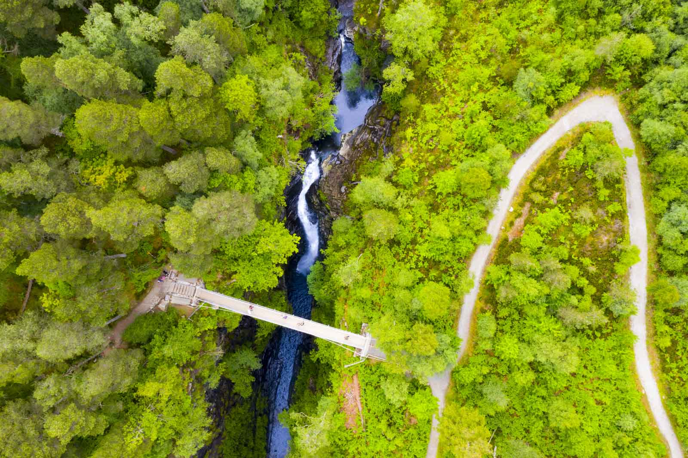
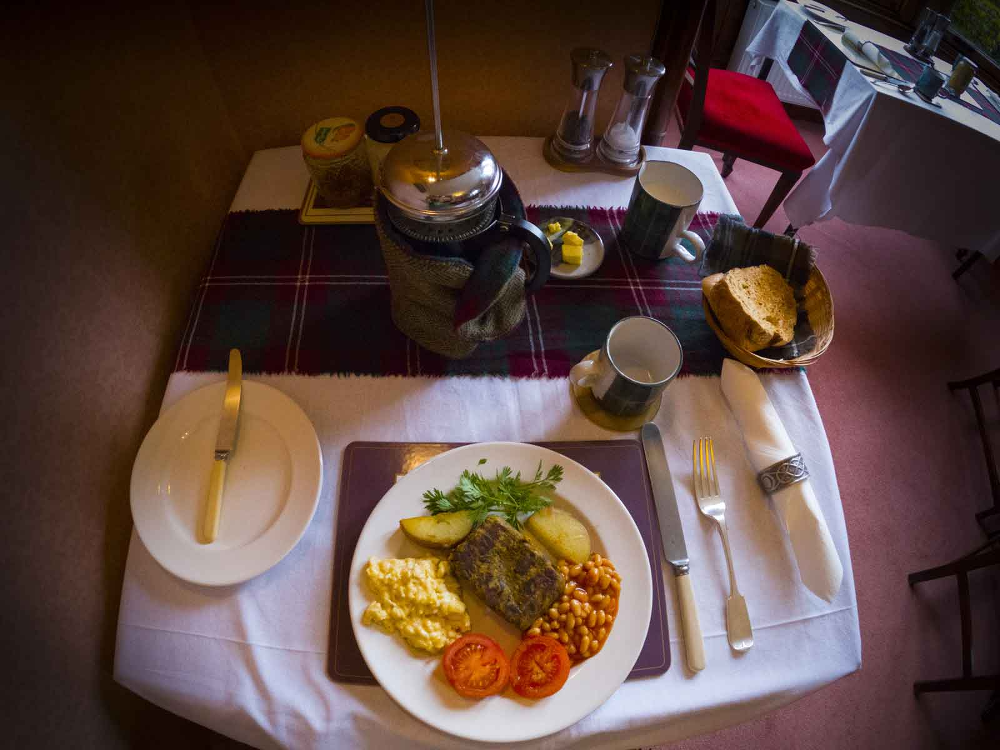
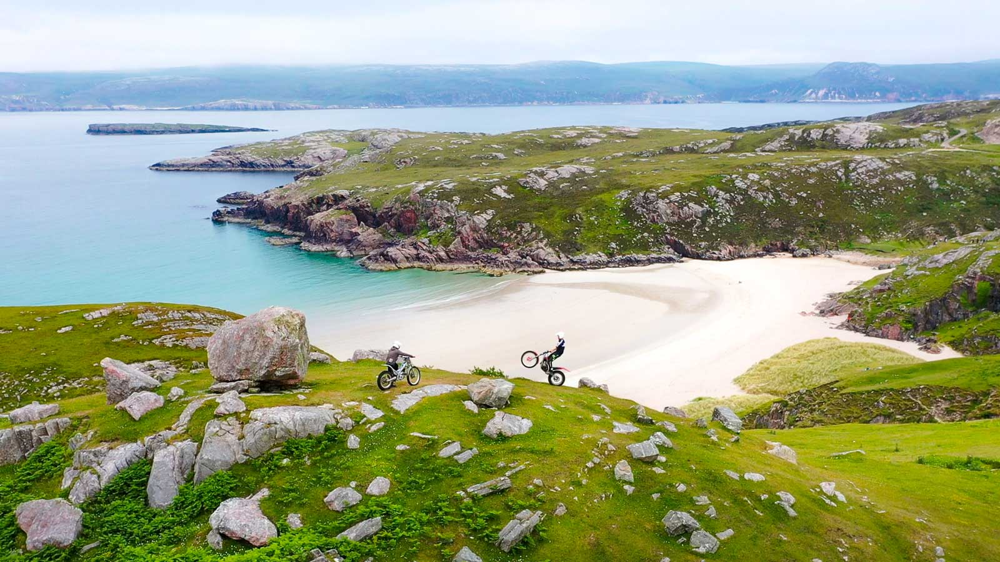
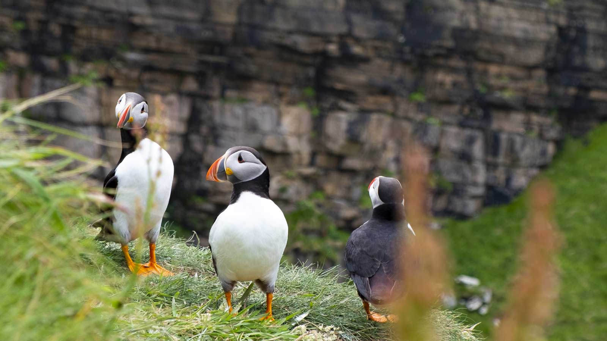
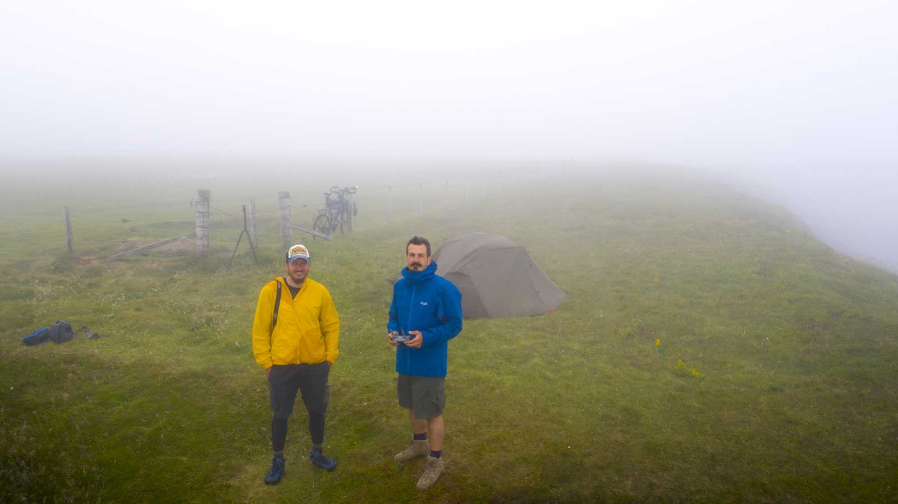
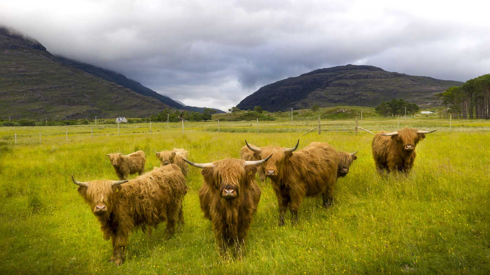
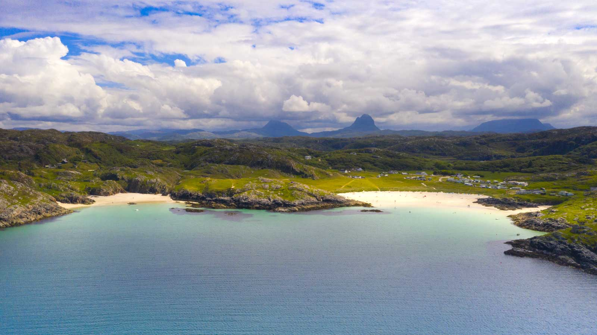
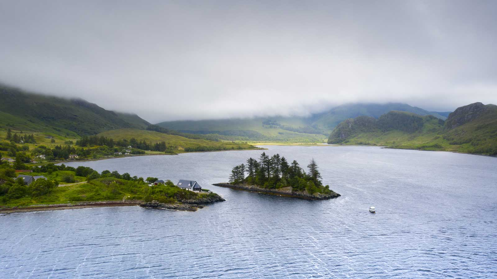

For this final 9-day stretch in the Scottish Highlands, I’d planned to ride along the west and north coasts and camp for a few nights in the Torridon mountains. A change of jobs put paid to my camping and walking plans, but I was determined to ride as much as I could. I left the Isle of Skye with a heavy heart. I’d ridden wonderful roads, seen amazing places and never enjoyed motorcycling so much. I hadn’t been able to take leave to go to the places I’d wanted to walk and camp, which made leaving bittersweet.

“The beginning is the end is the beginning”. I really love this saying. The beginning and the end are strange, mischievous friends in an endless cycle. While the Isle of Skye represents the end of a story, the North Coast 500 was the beginning of a new one.

After leaving the Isle of Skye, my goal was to fly a drone around Eilean Donan Castle, and then to head to a 120-year-old Victorian house, located a bit west of [Inverness](https://goo.gl/maps/HWdTLfES2QVmTvQ46), which would allow me to easily explore the northern part. I reached the house after driving for 3 hours along mountainous roads, through lakes and forests. What first caught my attention on the way was the NC500 signs. I wasn’t sure if this was a tourist spot or just a route, so I didn’t pay much attention. Fiona, my aunt, who is a very tall, beautiful, well-kept, and kind 75-year-old Scottish woman, greeted me at the house. While exploring the house, I also looked at Fiona, and I thought, “This is a house that someone has truly become attached to,” – considering she had lived in this house since her childhood. It’s amazing how a person can become so connected to a house. Both the woman and the house reflect 120 years. I felt like I had traveled through time and gone back to the past.

Fiona has been working in the tourism industry for many years. In 2013, she bought this house and began to live in it, while also running it as a guesthouse. She rents out 4-5 of her rooms, chats with guests who come and go, makes friends, offers advice, and prepares incredibly generous breakfasts. Fiona is such a warm and welcoming person that you feel like you’re at home in her house.

I was privileged to chat and catch up with guests staying in other rooms during the breakfast served in the dining room. It felt like a family atmosphere, with everyone sharing what they were doing, where they were going, and the places they had visited. Apart from me and Rob, the people staying in the house were constantly changing. Thus, a new conversation began every day. When I told them I had been travelling and that I was also working from home, each time the room seemed to be filled with a sense of melancholy. "Why are you working if you're on holiday?" and similar questions followed. On top of that, when I mentioned I am a computer engineer and do software development, no one seemed to understand what I was doing. It began to feel as though I were working at NASA. Indeed, when one of the house guests, an uncle, said, "You have dangerous work to do; don't tell anyone," I was surprised and asked why. After 2 seconds of confusion, wondering if I was doing something wrong or shameful, he joked that everyone might ask me for help with their computers. And indeed, that happened one morning when Fiona came and asked, "What does 'Your drive is full. There is no space' mean?" Just the day before, Fiona had tried to teach me the Scottish word "**Dreich**," which is said to describe misty, wet, gloomy, and closed-in weather. I wondered if she was referring to something similar again, or if it were an idiom or proverb, and asked what it meant and where one might encounter it. “I’m getting this error on my computer and I have no idea what to do,” she said. And just like that, his warning came true.

The other guests at the house usually stayed for 1–2 days before continuing on their routes, or preferred to remain for just one night because they had something to do. One person had gone on a bike tour, another had gone to a wedding, and Rob, who stayed for two days after me, planned to explore the area, learn about it, and then buy a house from a place he liked and settle there. In fact, during our first conversation, he asked me if I had gone to the wedding. When I said yes, he mentioned that everyone was gathering and going to one of the weddings. Rob is a real character – a man in his 50s, a British Airways employee, travelling with a car and a bike, and already having been through two marriages. He has decided to move from around Birmingham to this area and is planning to live here. Of course, since he has no children, he was able to carry out all his plans more easily. Rob was the person at the house I talked to the most, the one I shared my own stories with, and after me, the youngest person. Oh, and there is also Fiona's 20-year-old cat. Please do not forget him. In this country, as people live long, so do animals; I thought, "Wow, they live a long time too!" In Turkey, a grandfather who reaches 60 is said to be cutting the cord from life. Here, one must be over 80 to be considered "old." After moving to this country, the concept of "old" changed greatly for me. I am sure I will live to 100 here. Oh, it will be 2087. Uff, perhaps I will set up camp there using the minibuses that take people to Mars.

During the time I stayed here, I continued to work from home. In my free time, after work and on weekends, I rode my motorcycle relentlessly. I rode so much – for 10-12 hours at a time – that I didn’t want to stop. I really enjoyed riding on the winding, bumpy mountain roads. I first went west, then headed north from the coast to the coast. When I mentioned that I was setting off on Saturday morning to see the puffins, Fiona said, “It might be too late to leave at 10 am to see them,” which dampened my spirits, but I still wanted to go on the ride and try my luck. So, I rode west and reached the North Atlantic Ocean, then continued north from coast to coast, eventually arriving at [Puffin Cove](https://goo.gl/maps/CfPDcpnTRzPkuPD17) – which is where the puffins live. When I arrived at the rocky cove, I was completely stunned. I saw hundreds of puffins together. I sat close to them, about 2 meters away, and watched them for a while. They are a bit smaller than pigeons and look around in a confused and amazed way. Normally, they go to the open seas to hunt at that time, so the chances of seeing them were low. But because this was their home, I was incredibly lucky. The entire puffin community was there. Puffins are a type of bird, and definitely not penguins. They are sweet sea birds that live in the North Atlantic Ocean, and live in holes in rocks, on islands, and in the open seas, feeding by diving into the water.

I was off work on Saturday and Sunday, so I spent 2 days riding along the coast and clocking up distance, leaving the main roads now and then for mountain roads. In fact, in 2 days I rode 500 miles, about 800 km. I kept seeing NC500 signs and wondered what they meant. I found out when I crossed paths with [Mustafa Karaaslan](https://www.youtube.com/user/nistelX).

I met him through a friend, and it was through Mustafa that I learned about a man traveling across the United Kingdom by bicycle. He was creating amazing content on YouTube, exploring the Scottish highlands. It would be wonderful for me to meet a Turkish person who shares similar dreams to him. Our paths crossed in the Scottish highlands, specifically in [Dunscansby Stacks](https://goo.gl/maps/wob8akHoJqYeo633A), which is in the northernmost part of the region and is located on the ocean. He was there for about 3-4 days, and he was able to see the rocks. After that, our paths separated. The world isn’t that big, perhaps our paths will cross again one day.

While talking with Mustafa, he mentioned the NC500 route. He learned about it when he visited Scotland. I said, “Look, I’ve been seeing this sign everywhere.” Apparently, the “North Coast 500,” which is an 830km (516 miles) circular route, emerged in 2015. Many people are undertaking this beautiful route through the Highlands. Then, I looked at a map, and I realized I had already done a lot of it. In fact, because I’ve been driving on mountain roads, I’ve done even more. There’s only a small part that I haven’t done yet, and I decided to complete the final part of the trip by doing this section. So, because I completed the NC500 route in this section, we’re calling this part of the trip the “NC500,” esteemed audience. I really enjoy these kinds of spontaneous detours, as people call it, and yes, it’s often really wonderful. It’s full of surprises.

In the photo, they were looking rather cute, but they weren’t posing for me. They were aggressively facing the drone. And this was one of the poses that appeared at that moment. If I could get so close to them, I would tear them apart, you guys. So I told them, “Be nice, but don’t be so aggressive.” I hope they understood ;)

I rode through mountains, beautiful bays and mountain passes on this route. After leaving Fiona’s house, I headed farther west for 3 days. Before the bridge to the Isle of Skye, I went through [Dornie](https://goo.gl/maps/2MyyK7FLWSRag1WWA) to [Sallachy](https://goo.gl/maps/Zx7YjyUJVfS4FjMM8), where I spent 3 days in a house by the loch.

I’d have reached the place that evening after a 4–5-hour ride, having finished work at 5. On the way, I was looking for coffee in a small seaside town, [Gairloch](https://goo.gl/maps/TRtzurhZVv3VZTYMA), when I came across a company that ran boat trips to see whales and seals. It was closed, but there were posters everywhere saying how many seals, whales and puffins they’d seen that year. I looked it up online and, by sheer luck, got the last seat on Saturday’s trip. I was supposed to start my return journey that day, but who cared about going back? When you can see whales, London can wait 2 more days, I told myself. I was puffed up and delighted at how lucky my trip had been. The next night an email arrived saying the trip had been cancelled because of bad weather. So much for my luck. I’d used it all up.

On Saturday morning, I traveled for 14 hours with my friend Karaoğlan, covering 1000km, and finally returned home. My friend Karaoğlan was a fantastic companion; he took me everywhere and never complained. The trip was over. I had traveled 5500km in 29 days, including 85km of nature walks. “Wow,” I thought, “did I ever stop?” If I were to compare this to a trip from London to here, it would be 2000km, but without that, I had covered just 3500km in the Highland. “That’s amazing,” I thought. This was the longest journey I’ve ever taken. I really wanted to do more camping and nature walks. I even considered extending it by 1-2 weeks, but I was starting to get used to this way of life, which was a dangerous thing, because I didn’t want to change my lifestyle at the moment, and I didn’t want to experience serious adaptation problems when returning to London. “Son, my son,” I told him, “wake up and come home.” I had already started questioning myself from the moment I left the Highland soil – “Why are we here in England, why aren’t we living here?” But when returning, I always had the thought in my mind: “I’ll come back again in one month and do lots of camping and walking.” Because I really loved it.

Following the trip, I didn’t succumb to the depression that often arises after travel during my first week in London. I consciously fought against it, trying to distract myself with new plans. However, the sadness and longing for those lands grew with each passing day. Let’s just hope it all works out, you know? ;)