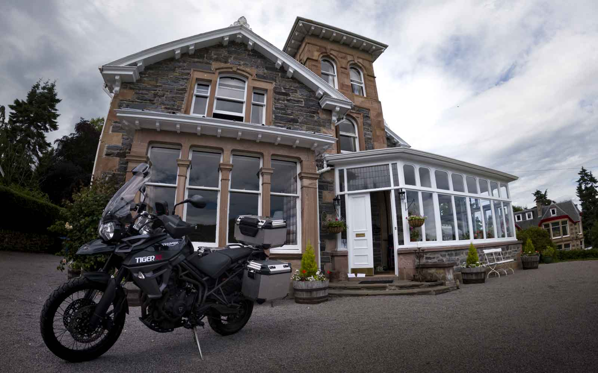
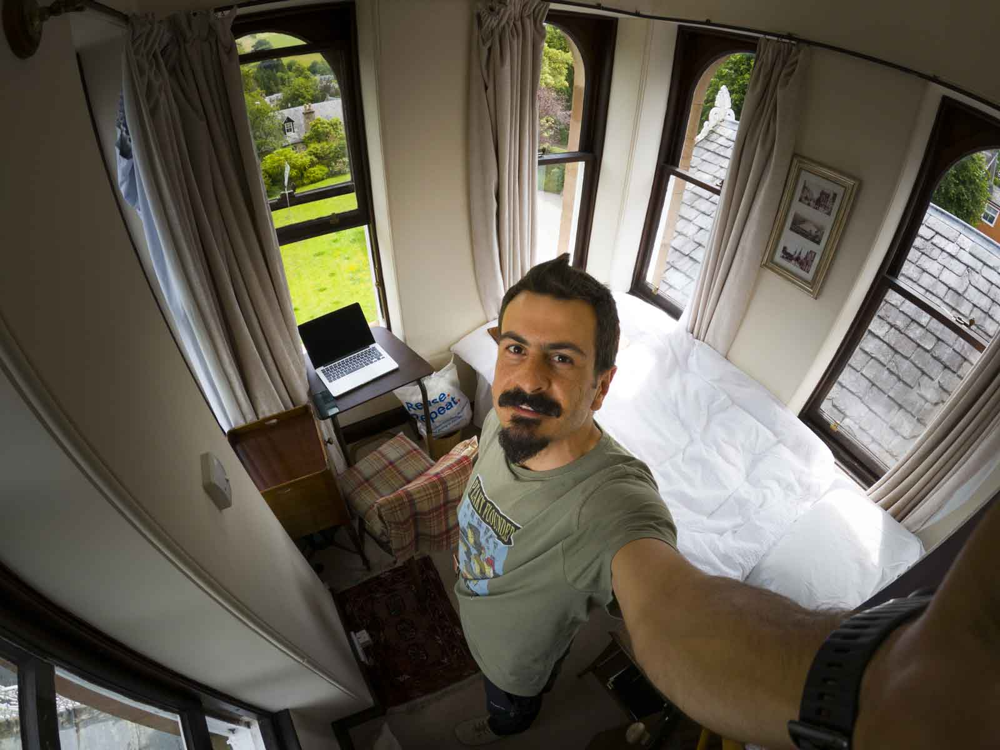
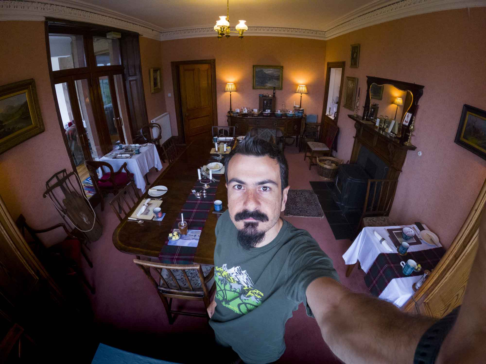
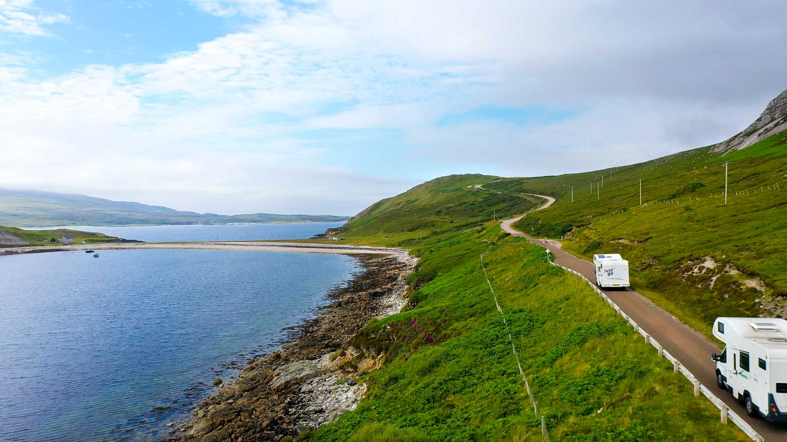
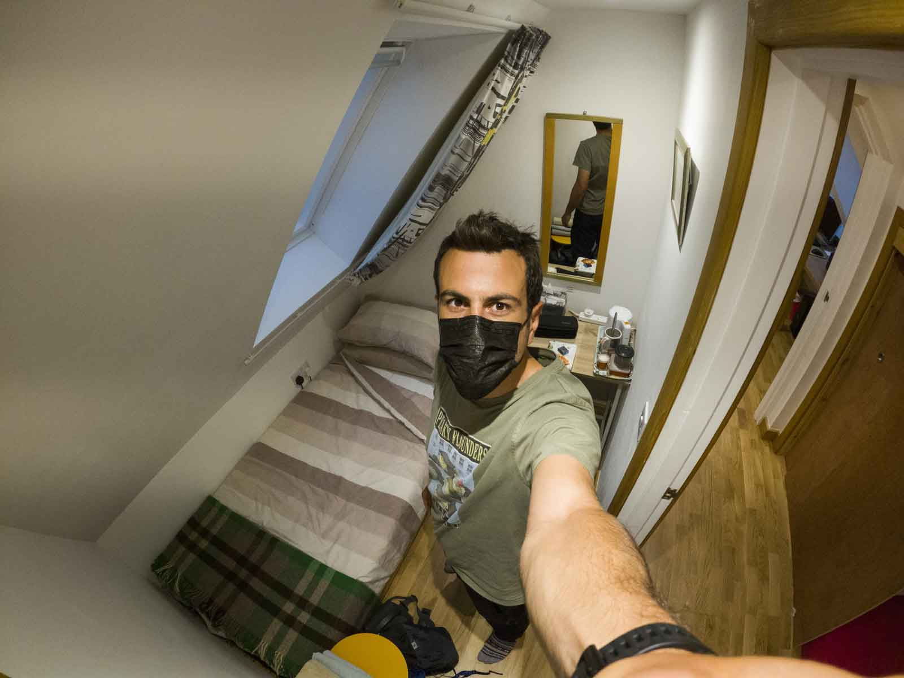
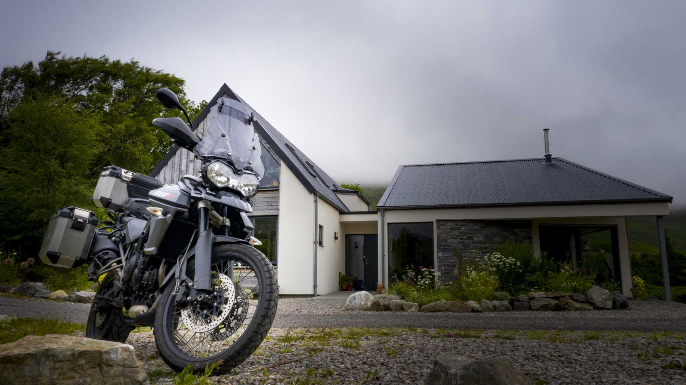
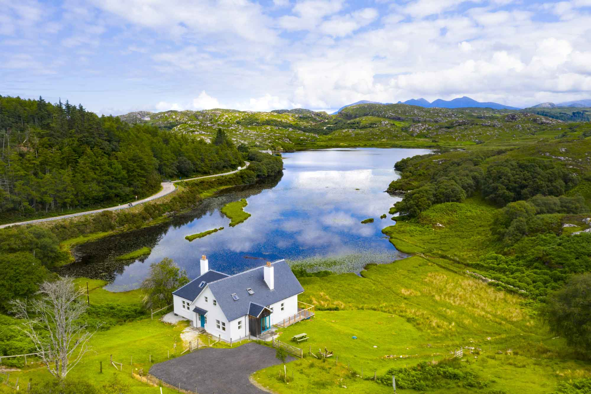

For this final 9-day stretch in the Scottish Highlands, I’d planned to ride along the west and north coasts and camp for a few nights in the Torridon mountains. A change of jobs put paid to my camping and walking plans, but I was determined to ride as much as I could. I left the Isle of Skye with a heavy heart. I’d ridden wonderful roads, seen amazing places and never enjoyed motorcycling so much. I hadn’t been able to take leave to go to the places I’d wanted to walk and camp, which made leaving bittersweet.

“The beginning is the end is the beginning”. I really love this saying. The beginning and the end are strange, mischievous friends in an endless cycle. While the Isle of Skye represents the end of a story, the North Coast 500 was the beginning of a new one.

After leaving the Isle of Skye, my goal was to fly a drone around Eilean Donan Castle, and then to head to a 120-year-old Victorian house, located a bit west of [Inverness](https://goo.gl/maps/HWdTLfES2QVmTvQ46), which would allow me to easily explore the northern part. I reached the house after driving for 3 hours along mountainous roads, through lakes and forests. What first caught my attention on the way was the NC500 signs. I wasn’t sure if this was a tourist spot or just a route, so I didn’t pay much attention. Fiona, my aunt, who is a very tall, beautiful, well-kept, and kind 75-year-old Scottish woman, greeted me at the house. While exploring the house, I also looked at Fiona, and I thought, “This is a house that someone has truly become attached to,” – considering she had lived in this house since her childhood. It’s amazing how a person can become so connected to a house. Both the woman and the house reflect 120 years. I felt like I had traveled through time and gone back to the past.

Fiona has been working in the tourism industry for many years. In 2013, she bought this house and began to live in it, while also running it as a guesthouse. She rents out 4-5 of her rooms, chats with guests who come and go, makes friends, offers advice, and prepares incredibly generous breakfasts. Fiona is such a warm and welcoming person that you feel like you’re at home in her house.

I was lucky enough to chat and catch up with guests staying in other rooms during breakfast in the dining room. It felt like a family atmosphere, with everyone sharing what they were doing, where they were going, and the places they had visited. Apart from me and Rob, the people staying in the house were constantly changing. That way, a new conversation started every day. When I told them I had been travelling and that I was also working from home, each time the room seemed to be filled with a sense of gloom. "Why are you working if you're on holiday?" and similar questions followed. On top of that, when I mentioned I am a computer engineer and do software development, no one seemed to understand what I was doing. It began to feel as though I were working at NASA. Indeed, when one of the house guests, an uncle, said, "You have a very dangerous job; don't tell anyone," I was surprised and asked why. After two seconds of mental confusion, wondering if I was doing something wrong or shameful, he joked that everyone might ask me for help with their computers. And indeed, that happened one morning when Fiona came and asked, "What does 'Your drive is full. There is no space' mean?" Just the day before, Fiona had tried to teach me the Scottish word "**Dreich**," which is said to describe misty, wet, gloomy, and overcast weather. I wondered if she was referring to something similar again, or if it were an idiom or proverb, and asked what it meant and where one might encounter it. "I'm getting this error on my computer and I have no idea what to do," she said. And just like that, his warning came true.

The other guests at the house usually stayed for 1–2 days before continuing on their routes, or preferred to remain for just one night because they had something to do. One person had gone on a bike tour, another had gone to a wedding, and Rob, who stayed for two days after me, planned to explore the area, learn about it, and then buy a house from a place he liked and settle there. In fact, during our first conversation, he asked me if I had gone to the wedding. When I said yes, he mentioned that everyone was gathering and going to one of the weddings. Rob is a real character – a man in his 50s, a British Airways employee, travelling with a car and a bike, and already having been through two marriages. He has decided to move from around Birmingham to this area and is planning to live here. Of course, since he has no children, he was able to carry out all his plans more easily. Rob was the person at the house I talked to the most, the one I shared my own stories with, and after me, the youngest person. Oh, and there is also Fiona's 20-year-old cat. Please do not forget him. In this country, as people live long, so do animals; I thought, "Wow, they live a long time too!" In Turkey, a grandfather who reaches 60 is said to be cutting the cord from life. Here, one must be over 80 to be considered "old." After moving to this country, the concept of "old" changed greatly for me. I am sure I will live to 100 here. Oh, it will be 2087. Uff, perhaps I will set up camp there using the minibuses that take people to Mars.

During the time I stayed here, I continued to work from home. After work and on weekends, I rode my motorcycle ruthlessly. I rode so much that even though I spent 10–12 hours on the bike, I didn’t want to stop. I had a fantastic time on the winding, bumpy mountain roads. First, I went west, then headed north from coast to coast. When I mentioned that I was setting off on Saturday morning to see the puffins, Fiona said it might be too late to see them at 10 am, which dampened my spirits, but I still wanted to ride and try my luck. So, I rode west, reached the North Atlantic Ocean, and then continued north from coast to coast, arriving at [Puffin Cove](https://goo.gl/maps/CfPDcpnTRzPkuPD17) – the home of the puffins. When I reached the rocky cove, I was absolutely stunned. I saw hundreds of puffins together. I sat about 2 metres away from them and watched them for a while. They’re a bit smaller than pigeons, looking around in a silly, bewildered way. Normally, they head out to the open seas to hunt at that time, so the chances of seeing them were low. But because this was their home, I was incredibly lucky. The entire puffin tribe was there. Puffins are a type of bird and definitely not penguins. People who see them for the first time often say, “A penguin?” Puffins are extremely cute seabirds that live in the North Atlantic Ocean, feeding by diving into the water, and inhabiting holes in rocks, on islands, and on land.

I was off work on Saturday and Sunday, so I spent 2 days riding along the coast and clocking up distance, leaving the main roads now and then for mountain roads. In fact, in 2 days I rode 500 miles, about 800 km. I kept seeing NC500 signs and wondered what they meant. I found out when I crossed paths with [Mustafa Karaaslan](https://www.youtube.com/user/nistelX).

I met him because Mustafa and a friend of mine mentioned him. He was cycling around Scotland, and indeed all the UK, and creating super content on YouTube. It was a great thing for me to chase the same dreams as a Turk in the Scottish highlands, and the fact that our paths crossed was valuable to me in that sense. Our paths crossed and we met at this place in the northernmost part of the Highlands, by the ocean, where the rocks called [Dunscansby Stacks](https://goo.gl/maps/wob8akHoJqYeo633A) are located. I couldn't see the rocks because of the fog, but after he had camped there for 3-4 days, he saw them. Then our paths parted. The world isn't that big, maybe one day our paths will cross again.

While talking with Mustafa, he mentioned the NC500 route. He learned about it when he visited Scotland. I said, “Look, I’ve been seeing this sign everywhere.” Apparently, the “North Coast 500,” which is an 830km (516 miles) circular route, emerged in 2015. Many people are undertaking this beautiful route through the Highlands. Then, I looked at a map, and I realized I had already done a lot of it. In fact, because I’ve been driving on mountain roads, I’ve done even more. There’s only a small part that I haven’t done yet, and I decided to complete the final part of the trip by doing this section. So, because I completed the NC500 route in this section, we’re calling this part of the trip the “NC500,” esteemed audience. I really enjoy these kinds of spontaneous detours, as people call it, and yes, it’s often really wonderful. It’s full of surprises.

They weren’t looking cute and posing for me in that photo. They were squaring up to the drone, and that’s one of the shots I got. If I got that close myself, the little maniacs would eat me alive. I kept telling them, “Less aggression, more charm.” Hope they got the message ;)

I rode through mountains, beautiful bays and mountain passes on this route. After leaving Fiona’s house, I headed farther west for 3 days. Before the bridge to the Isle of Skye, I went through [Dornie](https://goo.gl/maps/2MyyK7FLWSRag1WWA) to [Sallachy](https://goo.gl/maps/Zx7YjyUJVfS4FjMM8), where I spent 3 days in a house by the loch.

I was due to reach the place that evening after a 4–5-hour motorbike ride, having finished work at 5. On the way, I was looking for a place to have coffee in a small seaside town, [Gairloch](https://goo.gl/maps/TRtzurhZVv3VZTYMA), when I came across a place that ran boat trips to see whales and seals. It was closed, but there was a world-class poster, and they had written how many seals, whales and puffins they’d seen that year. I checked online straight away and, by sheer luck, got the last seat on Saturday’s tour. Normally, my return journey would have started that day, but who cares about going back? When you can see whales, we’ll return to London in 2 days, I told myself. I was puffing up my chest and flying high, thinking what a lucky trip I was having, when the next night an email arrived saying the tour had been cancelled due to bad weather. So there you have it: I’d used up all my luck.

On Saturday morning, my companion Karaoğlan and I spent 14 hours on the road, covering 1000km, and finally arrived home. My friend Karaoğlan was a super companion; he took me everywhere and never complained. The trip was over. In 29 days, I had covered 5500km, including 85km of nature walking. Wow, friend, did I never stop? If I subtract the 2000km round trip from London to here, I had only done 3500km in the Highlands. That’s very good. This was the longest journey I’ve ever spent alone. I would have liked to do more camping and nature walking. In fact, I even considered extending it by 1-2 weeks, but I was already getting used to living like this, which was a dangerous situation. Because I didn’t want to change my lifestyle for now, and I didn’t want to face serious adaptation problems when returning to London. So I told my son, “Ibrahim, pull your head together and go home.” In any case, the moment I left the Highland soil, I had already started questioning myself: “What are we doing in England? Why aren’t we living here?” But on the way back, I always had the thought in my mind: “I’ll come back again in a month with the car and do lots of camping and walking.” Because the taste had stayed on my tongue.

Following the trip, I didn’t succumb to the depression that often arises after travel during my first week in London. I consciously fought against it, trying to distract myself with new plans. However, the sadness and longing for those lands grew with each passing day. Let’s just hope it all works out, you know? ;)