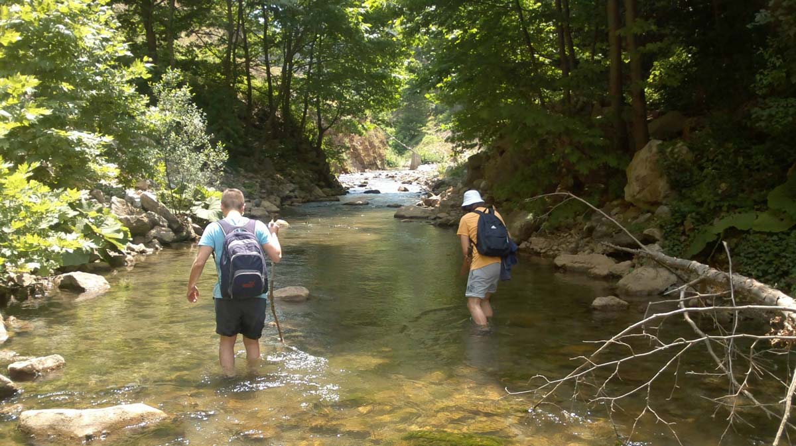
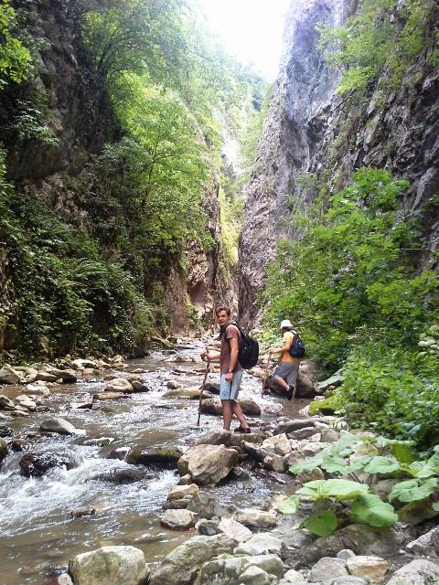
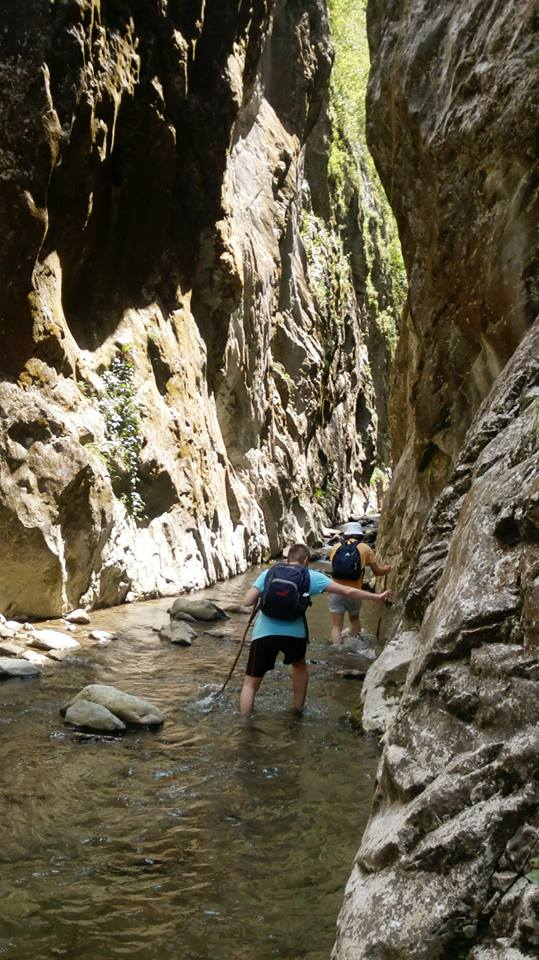
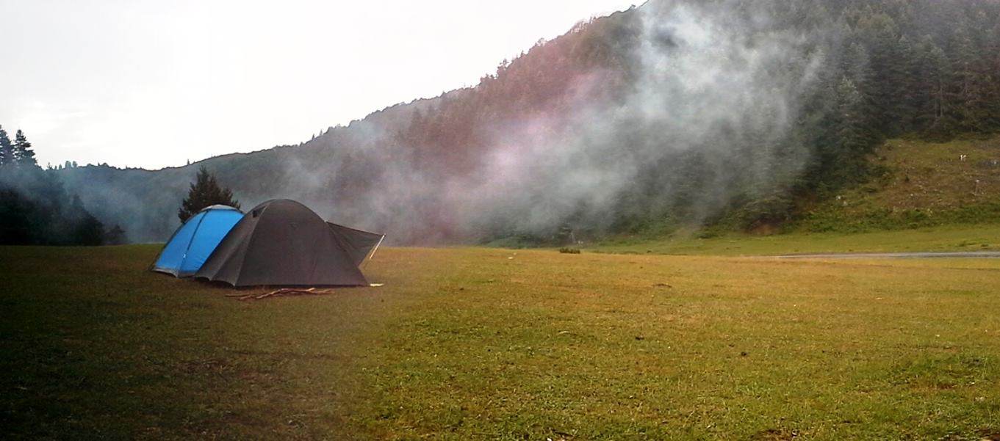
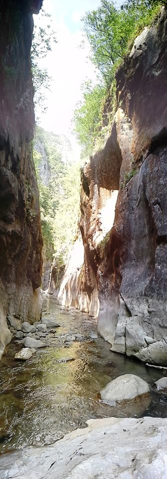
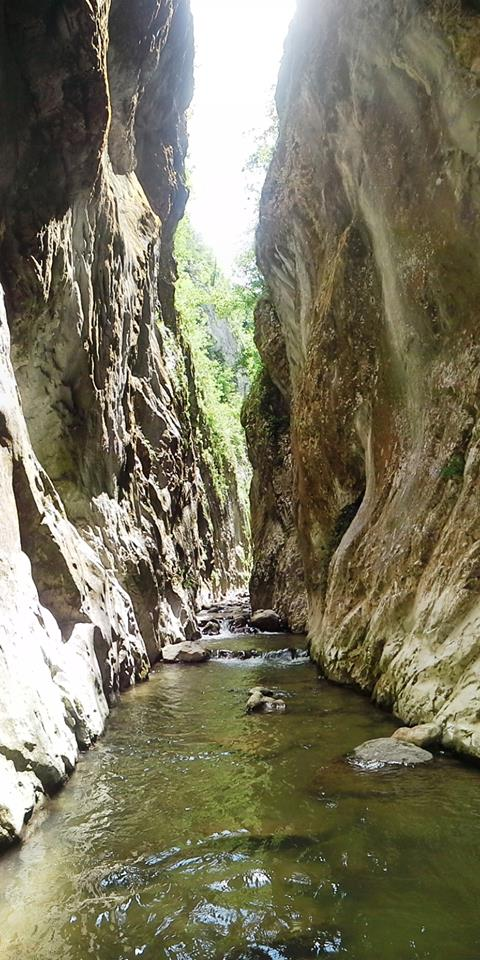

Should we go to the canyon?

We had been going camping in forests, by the sea, in mountains, and on hills. But what about a canyon? We decided to go to the Serindere canyon, which is within the borders of Kocaeli, a place we had heard about a lot. The plan was to set off on Saturday, have breakfast, then go for a hike in the canyon, and afterwards, move to İnönü Highland and camp there.

Starting Point

We began to enter the stream from its edge and proceed towards the canyon. We continued to proceed carefully on this course, which is of medium difficulty in Kocaeli, sometimes by entering the stream and sometimes by walking along its edge, paying close attention. We weren’t a large group; only three of us set out. We were proceeding carefully, trying not to lose our footing on the mossy rocks.

It looks like a canyon.

We pushed through the broad-leaved plants and reached the canyon entrance. The fact that we had arrived was immediately obvious: water flowed through the canyon up to our knees, and when we spread our arms, we bumped against the rocks rising towards the sky. It was exciting to make our way through this canyon, where at times we struggled to see the sky at all. After the canyon ended, we rested for a while, then turned back the same way. But because our perspective had changed, it didn’t feel like we were retracing the same path.

Night-Long Confrontation

We decided to spend the night in a comfortable place, that is, on İnönü Highland, and we made our way to the highland pasture before it got dark. When we arrived, we saw six or seven other groups. Because the yayla was large, there was plenty of space between us, so we felt relaxed. After gathering wood and lighting our fire, we ate our fill. We had just finished our tea and were gazing at the sky when the group to our right started firing their weapons. Hearing the sounds, the group opposite started firing back in response. Then, a group to our left began firing theirs. Many of the weapons were unloaded, and there were even those firing blanks with a pump. Because the group opposite was firing at us from an upward slope, the blanks were coming towards us. We warned them, and they changed their direction. Yes, all our fun was gone. While dreaming of spending a peaceful night, we were trying to chat accompanied by the sounds of gunfire, muttering various curses inside us. Even a Laz uncle passing by, as if firing weapons was such a normal thing, shouted: "Why aren't you making any noise, lads?" When we replied, "Uncle, we are campers, we came to camp," he went on his way, unable to understand.

Yes, the gunshots had shattered all the quiet beauty of the place. That meant nothing to those people, of course. They pulled the trigger to feed their egos. Each time they ran out of ammunition, they drove off to get more and came back to keep shooting. If they’d started before dark, we’d have moved. They started at 10 that night and apparently kept going until morning. I say apparently because I fell asleep at 1. In the morning Furkan and Cem said it had gone on all night. When I’m tired, I don’t hear a thing. That’s lucky for me. I slept soundly until morning while they tossed from right to left all night.

The rain is coming again.

Now, it seems like we don’t have completely dry camping trips anymore. We’re seeing even a little bit of rain. Cem’s tent didn’t have a rain cover, so the tent got wet, and we had to spend the night in the car. In the morning, we had breakfast while it was raining and then we saw a large group of people arriving at the valley by bus. It turns out that the Kocaeli municipality was organizing a festival. And some people were shooting their guns during the night. We decided to head back, but the gunshots were still continuing.

Our first canyon hike had been very enjoyable. We really wanted to return, especially since the water levels were higher. Although the night had been difficult, it had been a wonderful trip.

