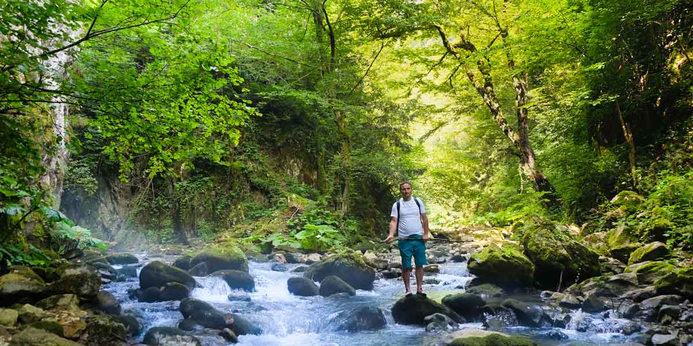
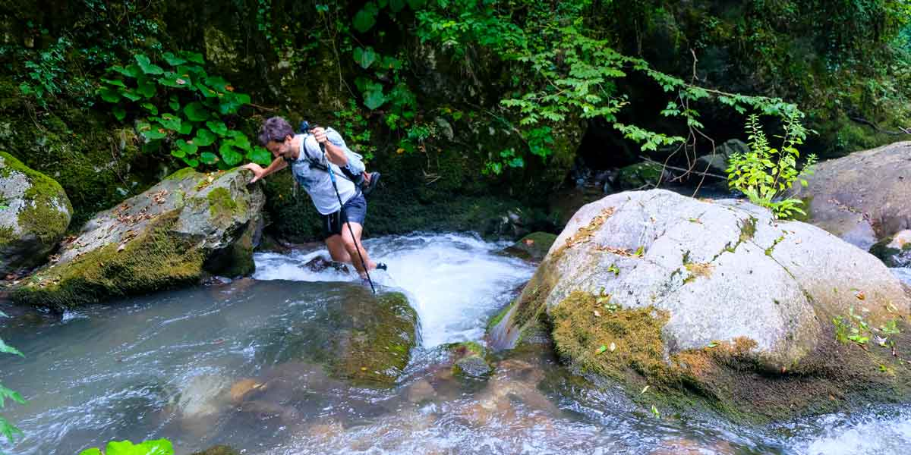
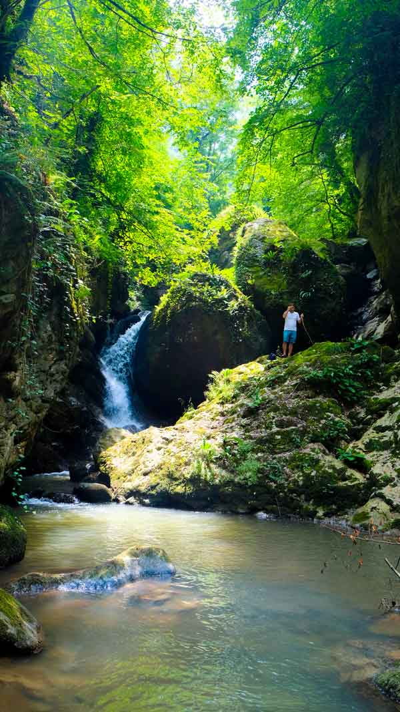

### Where is Sıcakdere Canyon and how do you get there?

After arriving in Kocaeli, you should continue from the Yuvacık fork towards the Yuvacık dam. You can begin your walk from either the location of the Karaaslan camping, which is at the top of the dam, or from a slightly further location at a trout facility.

<iframe
  src='https://www.google.com/maps/embed?pb=!1m28!1m12!1m3!1d128040.41649338766!2d29.906677006822584!3d40.7053159831374!2m3!1f0!2f0!3f0!3m2!1i1024!2i768!4f13.1!4m13!3e0!4m5!1s0x14cb4f66644bfb9d%3A0x82690ee7586b7eb9!2s%C4%B0zmit%2C%20Kocaeli%2C%20Turkey!3m2!1d40.7654408!2d29.9408089!4m5!1s0x14cb4257597a1d15%3A0x4fd1e6ce868f3a9c!2zU2VydmV0aXllIEthcsWfxLEsIEJhxZ9pc2tlbGUvS29jYWVsaSwgVMO8cmtpeWU!3m2!1d40.642702899999996!2d29.9220112!5e1!3m2!1str!2suk!4v1618304925819!5m2!1str!2suk'
  width='300'
  height='150'
  style={{ border: 0 }}
  allowfullscreen=''
  loading='lazy'
></iframe>

 

### Sıcakdere Canyon Camping Area Information

##### Available facilities

- You can pitch your tent and stay at Karaaslan Kamping free of charge.
- Clean Water (Karaaslan Kamping)
- Grocery shop (Karaaslan Kamping)
- Restaurant (Karaaslan Kamping)
- WC (Karaaslan Kamping)
- Prayer room (Karaaslan Kamping)
- Guesthouse (Karaaslan Kamping)

Note: This information dates back to 2017.

### Sıcakdere Canyon Hiking Routes

#### Sıcakdere canyon hike (8.5 km)

<iframe
  frameBorder='0'
  scrolling='no'
  src='https://tr.wikiloc.com/wikiloc/spatialArtifacts.do?event=view&id=1904554&measures=on&title=on&near=off&images=on&maptype=H'
  width='100%'
  height='600'
  style={{ borderRadius: '10px 10px' }}
></iframe>

- At Karaaslan Kamping, you should take your water and set off. There are no water sources within the canyon.
- Bring spare shoes for this route, which follows the stream bed.
- A helmet and trekking poles will help.
- Watch out for slippery rocks and stones covered in moss in the canyon.
- This is considered Kocaeli’s most challenging course.
- To cross the waterfalls, it is necessary to use ropes. For this, you need to have climbing experience.
- It’s a pleasant, challenging, but beautiful course.

