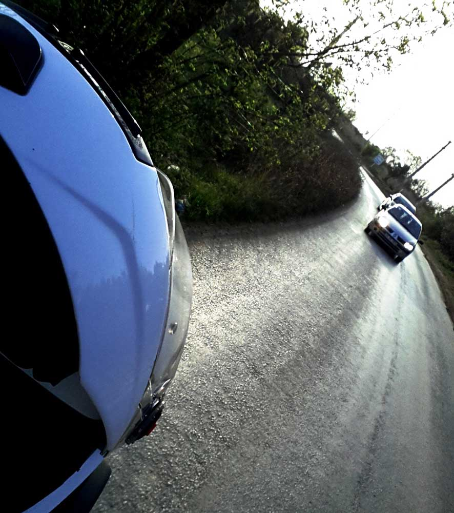
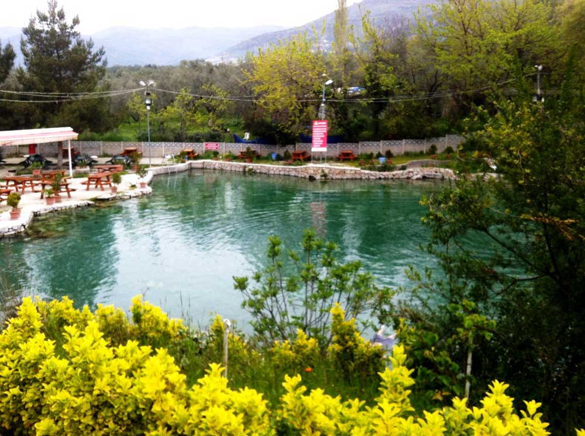
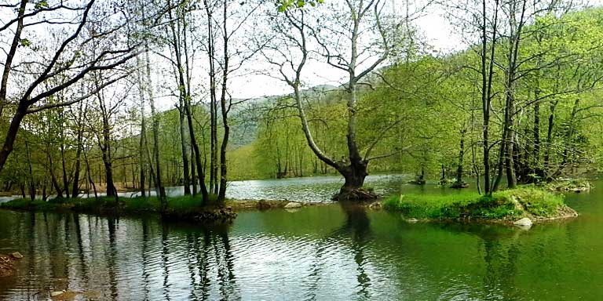
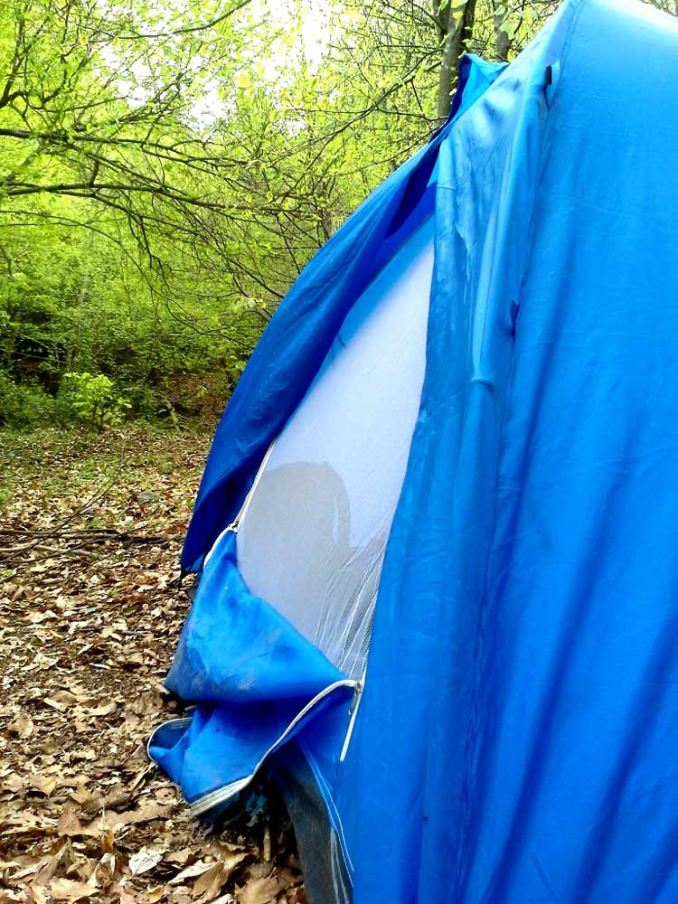
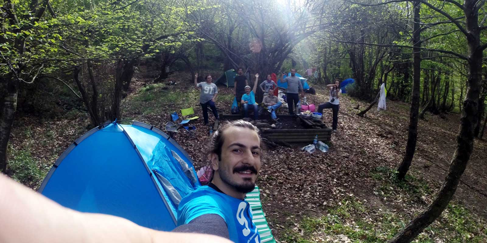
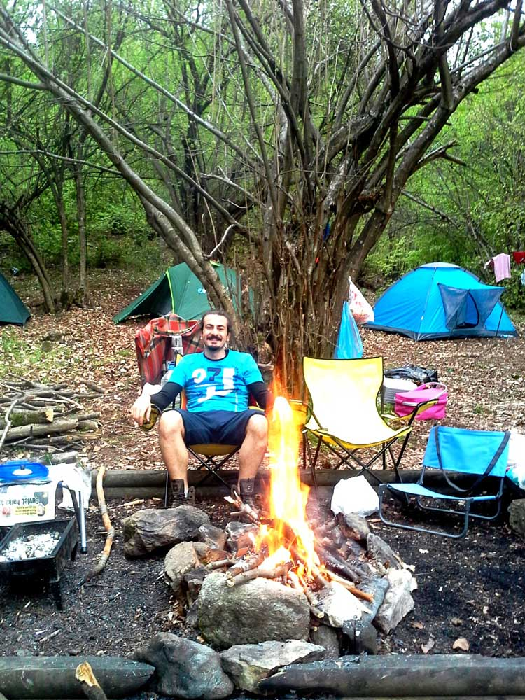
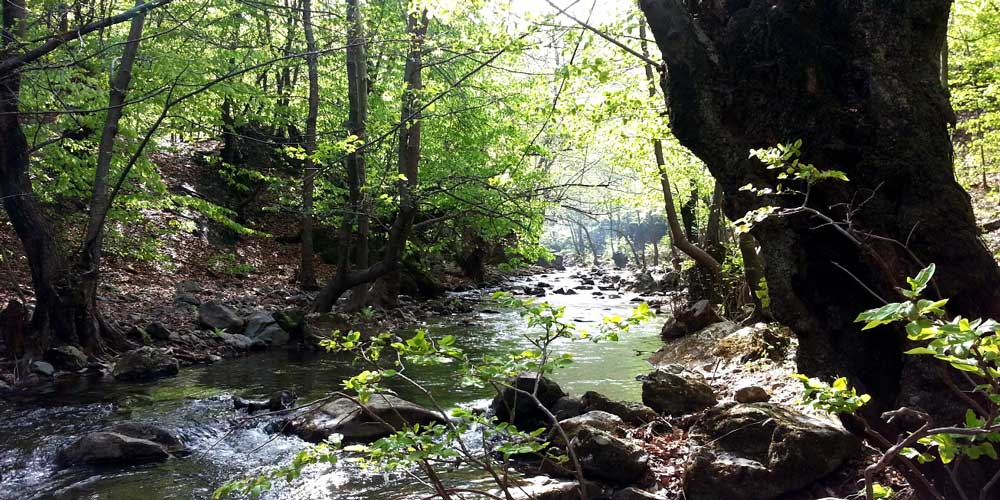

We wanted to go on our first camping trip of the year with friends at TEB. Because our friends were joining us, the trip quickly turned into a feast. We immediately started planning. We needed a place that was both secure and had a toilet/water source, considering our friends were coming. We decided to go to the Keramet village spa, located on the Orhangazi – İznik road. We planned to go in the open-air hot springs and then camp in the Delmece valley, located just past Erikli waterfall, which is accessible via Çınarcık. Delmece valley was a wonderful place for us. For hiking, we planned to explore the waterfall and the deep, bottomless lake.

### It should be best to leave early in the morning.

On Saturday morning, we gathered early and set off. It’s good to wake up and leave early, because you can get to your destination without wasting any time, and feel like you’ve made the most of the day. But I don’t really enjoy it. Why? Because it’s difficult to wake up early, you know :)

### Keramet Village Spas

We traveled from Eskihisar by boat to Topçular, and then followed the route of Topçular -> Orhangazi -> İznik to reach the Keramet village thermal springs. We were eager to take a dip in the large pool, located amidst greenery and outdoors. After paying 3 TL per person at the entrance, we bought a pot of tea and enjoyed our breakfast at the picnic tables, as using a heater is prohibited at this location. Afterwards, we became cold (as the weather is a bit chilly in April), we decided to head in the direction of Orhangazi -> Yalova -> Çınarcık to reach the Delmece valley.

### Spring hasn't arrived here.

You can see that spring has arrived everywhere up to Erikli meadow, but when we reached Delmece meadow afterwards, we could still see the effects of winter. There wasn’t much greenery, and naturally, the team didn’t want to stay at Erikli waterfall :)

### Camping is prohibited at Erikli Waterfall.

When we arrived at Erikli Waterfall, we set up our tents and settled down right above the children’s park.

We ended up chatting with a forestry employee who was out with his family. Camping had been banned because the waterfall area was protected. He warned us that the forestry staff could fine us if they came along. We didn’t pack up because we thought it would be fine in quiet April. Even the cafés hadn’t opened for the season, and few people were coming through. We were annoyed at first, but considering that 1,500–2,000 people visit each day in season, it makes sense as a way of protecting the area. For people who come to camp, there’s also a large camping area down the road that turns left from the waterfall entrance. There’s a fee, of course.

### **Want to go to the waterfall?**

The first day ended with a campfire and conversation. Today, we’re going to the waterfall first – I had mentioned that if I ever came back here, I wouldn’t go without visiting the waterfall. The place where the waterfall is located doesn’t get much sunlight, so it’s cool and quite cold. We couldn’t stand under the flow of more than 10 ‘sny’ (presumably ‘sn’) of water. After enjoying the warm waters of Keramet, we were quite chilled. Then, we immediately rushed back to the fire at the campsite. We’ll finish the day by exploring the area and swimming in the waterfall, and then we’ll set off for İstanbul.

Traffic begins before arriving in Yalova, and it reaches its peak at Topçular dock. We are waiting for a two-hour ferry queue. After having so much time alone in nature, it’s becoming difficult to reintegrate into society.

