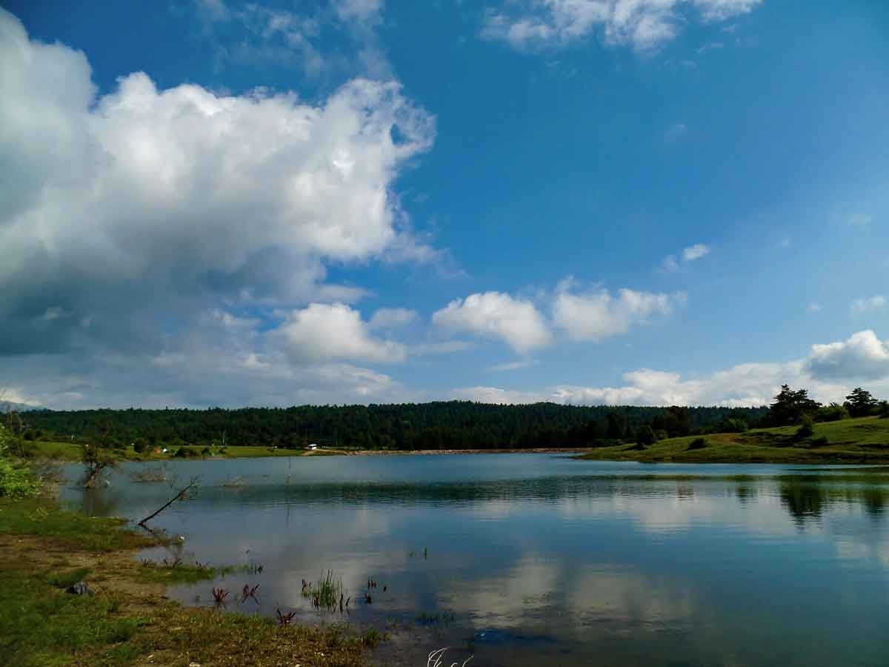
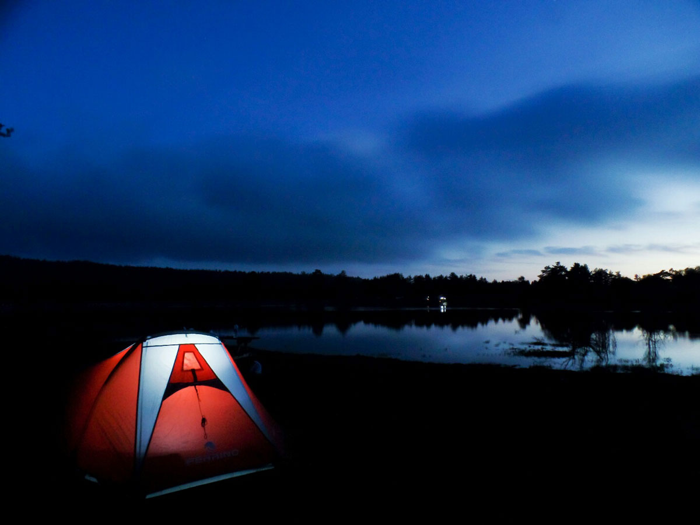

Karagöl meadow and lake, located in the Taraklı region of Sakarya, is a truly beautiful place with stunning natural scenery. The presence of numerous surrounding meadows has also led to the development of trekking trails.

### Where is Taraklı Karagöl Highland, and how do you get there?

While driving on the Tem Highway, exit at Adapazarı and continue towards Eskişehir. First, you will arrive in Gevye, and then continue towards Taraklı. After passing Taraklı, continue for 2-3 km to the left. At this crossroads, you can follow the signs for Mahdumlar and Karagöl Highland. Instead of leaving the asphalt road, continue upwards, and you will reach the lake. The asphalt road extends all the way to the lake’s edge. It’s very easy and beautiful to access, with wonderful views.

<iframe
  class='mappingFrame'
  src='https://www.google.com/maps/embed?pb=!1m24!1m12!1m3!1d243784.75428969305!2d30.44312133948704!3d40.55218692428643!2m3!1f0!2f0!3f0!3m2!1i1024!2i768!4f13.1!4m9!3e0!4m3!3m2!1d40.7164704!2d30.3966553!4m3!3m2!1d40.499716!2d30.583108499999998!5e1!3m2!1str!2str!4v1465189619392'
  width='300'
  height='150'
  allowfullscreen='allowfullscreen'
></iframe>

 

### Taraklı Karagöl Highland camping area information

##### Available facilities

- The lake has been surrounded with a wire fence and secured. You can set up your tent in open areas or in areas where there is a tendency to crowd, as indicated by the supervisor.
- The initial fee has begun to be collected at 10 TL. In the evenings, the tractor will be used to collect the waste.
- You can leave your car in the wide areas along the lake, or on the roadside.
- There isn't a specific, dedicated facility for camping.
- There’s a fountain and a toilet. Since it’s not a private business, don’t expect the toilet to be exceptionally clean.
- Because the road is paved, this is a very accessible place, and as a result, the number of visitors increases on market days.
- You can pick up any camping supplies you’re short of at the shops in Taraklı.
- There are a few picnic tables located in certain spots.

##### Facilities that are unavailable

- Grocery shop
- Restaurant
- Hotel, Guesthouse

Note: This information dates back to June 2016.

### Taraklı Karagöl Highland Hiking Routes

#### Seven highlands and five ponds (28 km)

<iframe
  frameBorder='0'
  scrolling='no'
  src='https://tr.wikiloc.com/wikiloc/spatialArtifacts.do?event=view&id=7242837&measures=on&title=on&near=off&images=on&maptype=H'
  width='100%'
  height='600'
  style={{ borderRadius: '10px 10px' }}
></iframe>

- A relatively easy and beautiful course, full of wonderful scenery.
- Because the parkur traversed the highlands, there was no water shortage.
- Walking 28 km in one day can be tiring. You could split it over two days and camp along the way.
- A section of the park route follows a portion of the roads, while another part continues through the forest.

#### From Karagöl Highland to Acelle Highland, and then a return trip (24 km).

<iframe
  frameBorder='0'
  scrolling='no'
  src='https://tr.wikiloc.com/wikiloc/spatialArtifacts.do?event=view&id=695734&measures=on&title=on&near=off&images=on&maptype=H'
  width='100%'
  height='600'
  style={{ borderRadius: '10px 10px' }}
></iframe>

- A relatively easy and beautiful course, full of wonderful scenery.
- Because the parkur traversed the highlands, there was no water shortage.
- You can camp along the way.
- A trail that can be walked in winter.
- A section of the park route follows a portion of the roads, while another part continues through the forest.

#### From Karagöl Highland to Çardacık Highland, followed by Acelle Highland (13 km).

<iframe
  frameBorder='0'
  scrolling='no'
  src='https://tr.wikiloc.com/wikiloc/spatialArtifacts.do?event=view&id=12569075&measures=on&title=on&near=off&images=on&maptype=H'
  width='100%'
  height='600'
  style={{ borderRadius: '10px 10px' }}
></iframe>

- A relatively easy and beautiful course, full of wonderful scenery.
- Because the parkur traversed the highlands, there was no water shortage.
- The pools that form on Karagöl Highland after winter or a spell of rain are quite a sight.
- A section of the park route follows a portion of the roads, while another part continues through the forest.
