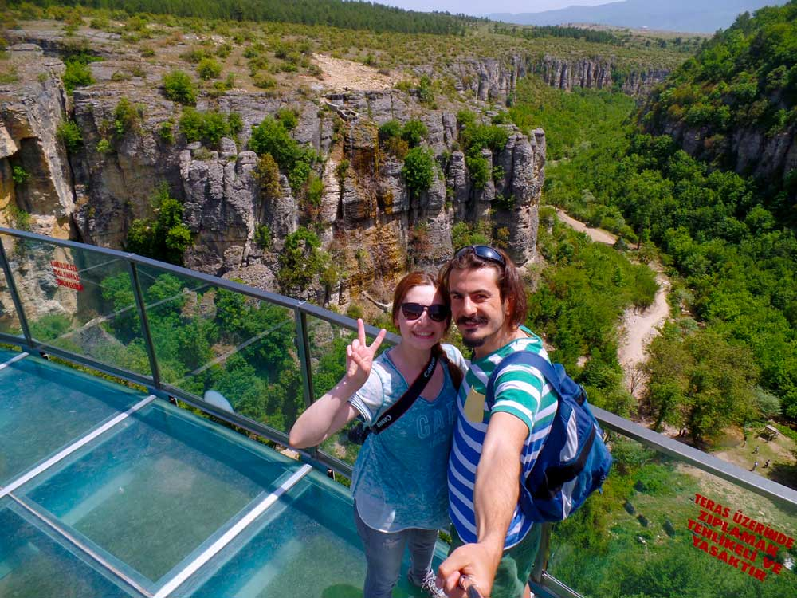

### Where is Safranbolu Tokatlı Canyon, and how do you get there?

After arriving in Safranbolu, it’s very easy to go to the canyon. Many signs will guide you to the canyon. If you have the opportunity, I recommend going on a weekday for a more peaceful experience.

<iframe
  class='mappingFrame'
  src='https://www.google.com/maps/embed?pb=!1m28!1m12!1m3!1d29832.82665601972!2d32.66038227242936!3d41.2674688837699!2m3!1f0!2f0!3f0!3m2!1i1024!2i768!4f13.1!4m13!3e6!4m5!1s0x409caa9d5ee9f88d%3A0xada7f397a3f8f371!2sTokatl%C4%B1+Kanyonu%2C+Safranbolu%2C+T%C3%BCrkiye!3m2!1d41.2813331!2d32.684698499999996!4m5!1s0x409caac51abbad83%3A0x6b7db3ac7a87e93d!2zU2FmcmFuYm9sdSwgS2FyYWLDvGssIFTDvHJraXll!3m2!1d41.249306!2d32.683127999999996!5e1!3m2!1str!2s!4v1437208700287'
  width='300'
  height='150'
></iframe>

 

### Safranbolu Tokatlı Canyon Camping Area Information

##### Available facilities

- There is no private campsite available.
- There are flat areas within the canyon. It seems like you could set up a tent. You will encounter people walking around and those coming to have picnics. If you disregard this, you can stay here.
- Clean Water (Drink your water before entering the canyon. There is no water inside the canyon.)
- Market (located at the Canyon entrance)
- Restaurant (located at Canyon entrance)
- Parking (available at the Canyon entrance)

Note: This information dates back to May 2015.

### Safranbolu Tokatlı Canyon hiking routes

#### Canyon walk (2.1 km)

<iframe
  frameBorder='0'
  scrolling='no'
  src='https://tr.wikiloc.com/wikiloc/spatialArtifacts.do?event=view&id=9721114&measures=on&title=on&near=off&images=on&maptype=H'
  width='100%'
  height='600'
  style={{ borderRadius: '10px 10px' }}
></iframe>

- After paying a 2 TL entrance fee, you descend the stairs and enter the canyon. Then, following the path, the walk ends at the bridge after approximately 2.1 km.
- The trail is short, and there’s no drinking water available along the route. It’s being followed along the stream bank.
- You should bring at least 1 liter of water with you before entering the canyon.
