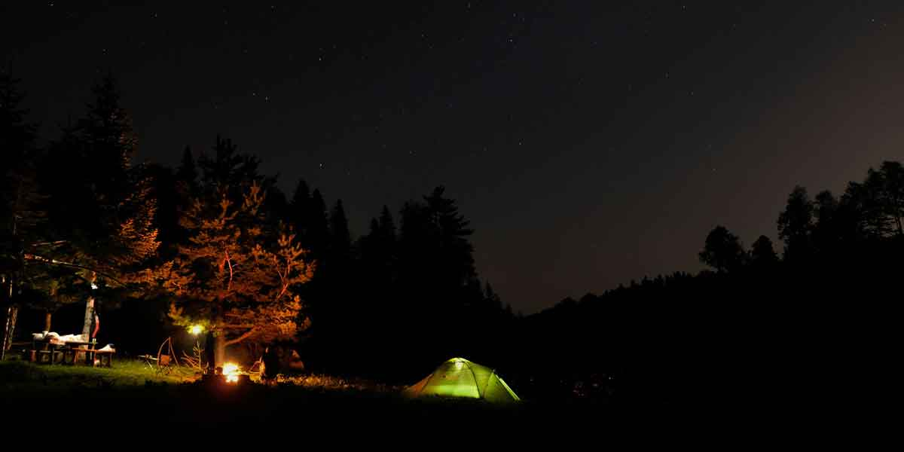
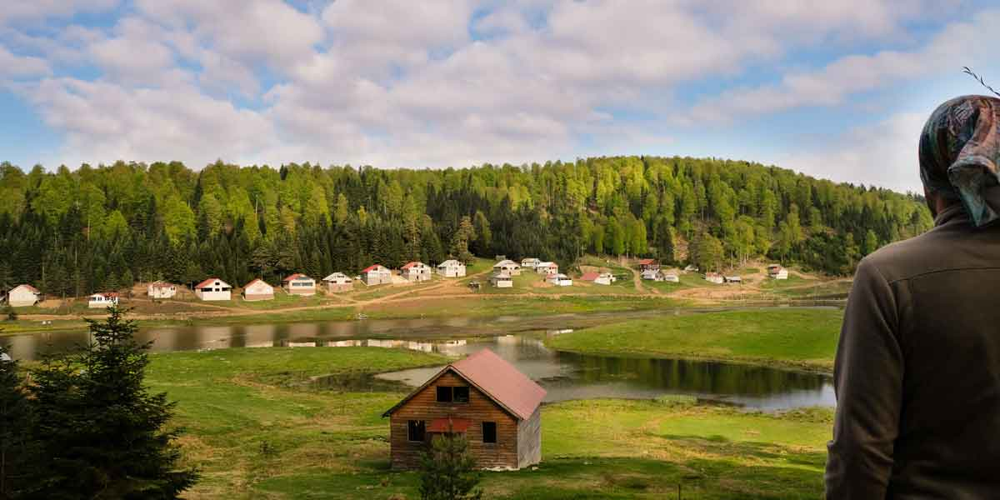

You can reach Turnalık Highland from Akyazı via Dokurcun, or from Hendek via Çiğdem Highland. This guide covers both approaches, the camping spots I saw and two walks of 2.8 km and 11.8 km.

## Quick summary

- **Region:** Sakarya, Akyazı–Dokurcun and the area surrounding Hendek–Çiğdem Highland
- **Camping:** There’s no campsite operator here. Look for level ground around the pond or behind the highland settlement.
- Routes: 2.8 km lake walk and 11.8 km plateau connection route
- Field observation: May 2017

> Update note: The road surface, vehicle crossings, fountains, camping permits, and fire restrictions may have changed since 2017. Before you go, check the weather, local announcements, and recent visitor information. Do not drink the water in the meadow without filtering it.

## Turnalık Highland: Where is it and how do you get there?

While traveling from İstanbul via the TEM highway, after passing Adapazarı, continue towards Akyazı. When proceeding towards Mengen, after leaving Dokurcun, you will continue onto the dirt road, turning left towards the plateau. You can use Sülüklü Göl junction as a reference point during this approach.

<iframe
  frameBorder='0'
  scrolling='no'
  src='https://tr.wikiloc.com/wikiloc/spatialArtifacts.do?event=view&id=17832443&measures=on&title=on&near=off&images=on&maptype=H'
  width='100%'
  height='600'
  style={{ borderRadius: '10px 10px' }}
></iframe>

Another option is to reach Çiğdem Highland via Hendek, following the connecting route. During my visit in May 2017, the road to Çiğdem Highland was smooth; however, the section between the two valleys was in poor condition. At that time, it was possible to travel by car carefully, but please verify the road and vehicle suitability before setting out.

<iframe
  class='mappingFrame'
  src='https://www.google.com/maps/embed?pb=!1m26!1m12!1m3!1d134609.45134831854!2d30.759703623632618!3d40.69942364192254!2m3!1f0!2f0!3f0!3m2!1i1024!2i768!4f13.1!4m11!3e0!4m5!1s0x409d8e1302209831%3A0xa364e1f493354341!2sHendek%2C+Sakarya!3m2!1d40.795052999999996!2d30.744705999999997!4m3!3m2!1d40.634106599999996!2d30.8327247!5e1!3m2!1str!2str!4v1495292972539'
  width='300'
  height='150'
  allowfullscreen='allowfullscreen'
></iframe>

 

## Turnalık Highland camping area information

### During my visit in May 2017

- There were level spots for tents around the pond and on the wide stretch of ground behind the highland settlement.
- Because the area around the lake was open, the wind and the sound of frogs were clearly audible.
- Most of the wooded sections were sloping; I found the flatter areas behind the ridge.
- There were fountains in the meadow, but I didn’t see a regular toilet nearby.
- The camping supplies needed to be purchased in either Akyazı or Hendek.
- During my visit, there were a lot of flies. Instead of lighting a fire, please follow current fire safety regulations and prepare safe measures like insect repellent.

### Facilities I didn’t find in May 2017

- A managed campsite
- Market and restaurant
- Hotel or guesthouse

Consider this list as a dated field record, not as current facility information.

## Turnalık Highland hiking routes

### Turnalık Highland pond walk (2.8 km)

<iframe
  frameBorder='0'
  scrolling='no'
  src='https://tr.wikiloc.com/wikiloc/spatialArtifacts.do?event=view&id=17726553&measures=on&title=on&near=off&images=on&maptype=H'
  width='100%'
  height='600'
  style={{ borderRadius: '10px 10px' }}
></iframe>

- A short and easy walking route around the lake in Turnalık Highland.
- You can enjoy the lake and the view. You can take beautiful photos.

### Kurtuluş Mahallesi–Çiğdem Highland–Turnalık Highland (11.8 km)

<iframe
  frameBorder='0'
  scrolling='no'
  src='https://tr.wikiloc.com/wikiloc/spatialArtifacts.do?event=view&id=2866888&measures=on&title=on&near=off&images=on&maptype=H'
  width='100%'
  height='600'
  style={{ borderRadius: '10px 10px' }}
></iframe>

- The route begins in Kurtuluş Mahallesi and ascends, eventually reaching Çiğdem Highland. After reaching Turnalık Highland, it returns to Kurtuluş.
- A relatively easy trail, following unpaved paths through the forest.
- During our hike in 2017, there were water points in the highlands. Don’t assume they are working – be sure to carry enough water and purify natural water.

## Nearby highlands and preparation guides

- Examine the guide for [Acelle Highland](/acelle-yaylasi/) for another Sakarya valley and camping route.
- For a shorter guide to Pürenli Highland, see the article [Pürenli Highland](/purenli-yaylasi/).
- If you’re looking for a versatile piece for wind, sun, and cool weather, refer to the guide: [What is a Buff and How to Use It](/buff-nedir-ne-ise-yarar/).

If you recently visited Turnalık Highland, please share the current condition of the road, the fountains, and camping conditions in the comments, and include the date so that future hikers can evaluate the information accurately.
